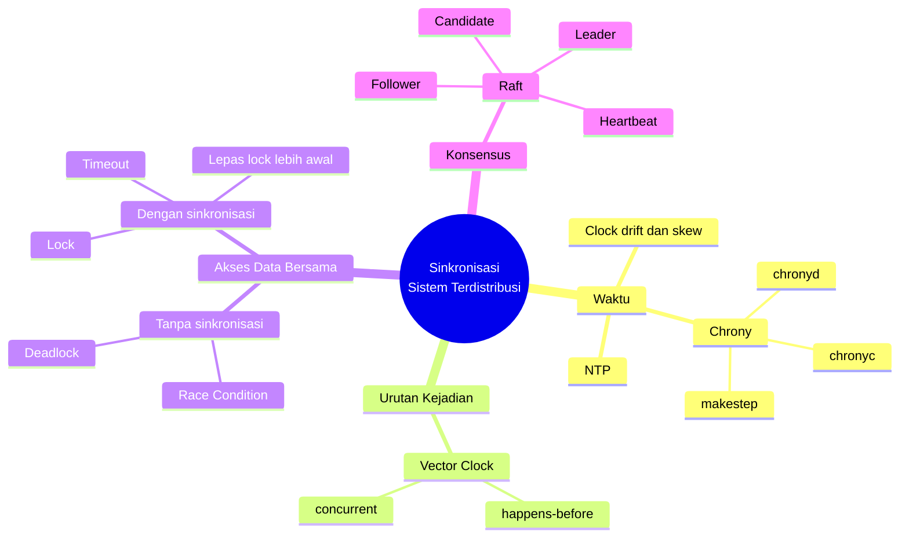
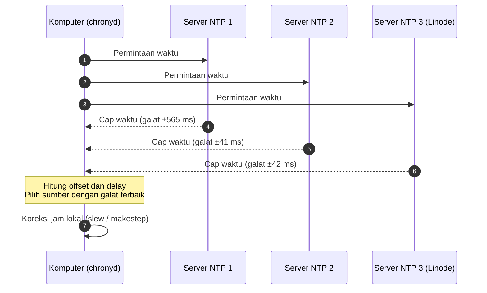
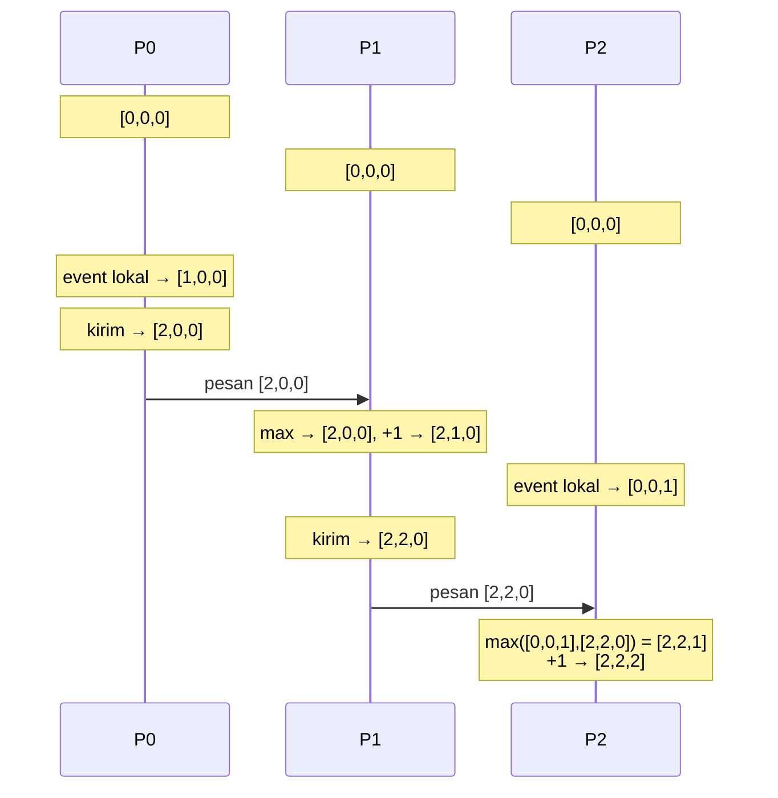
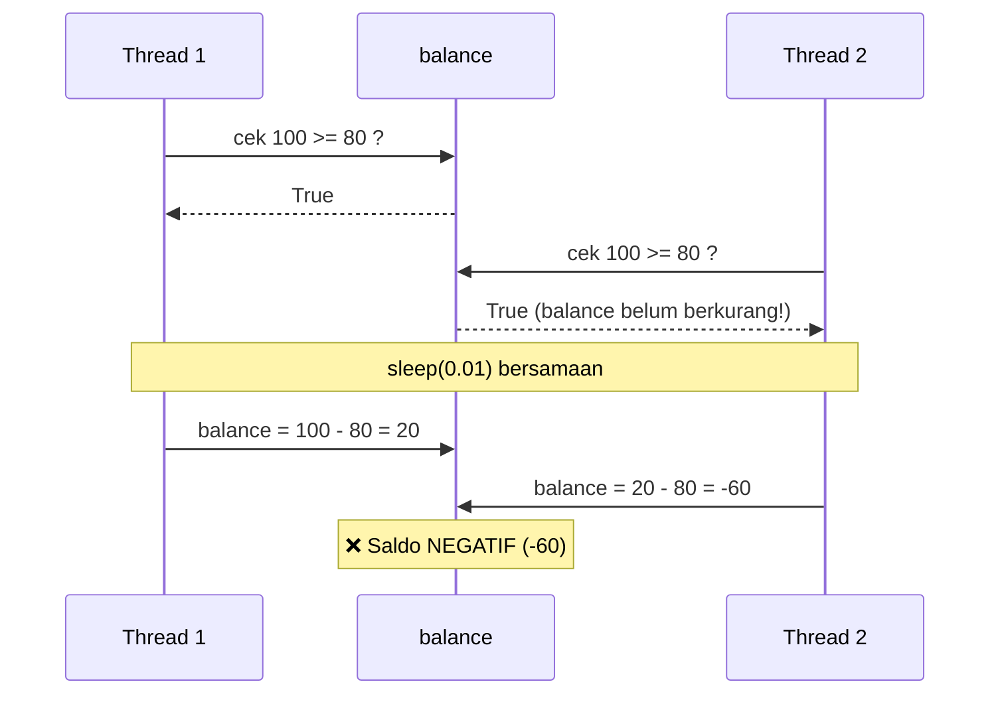
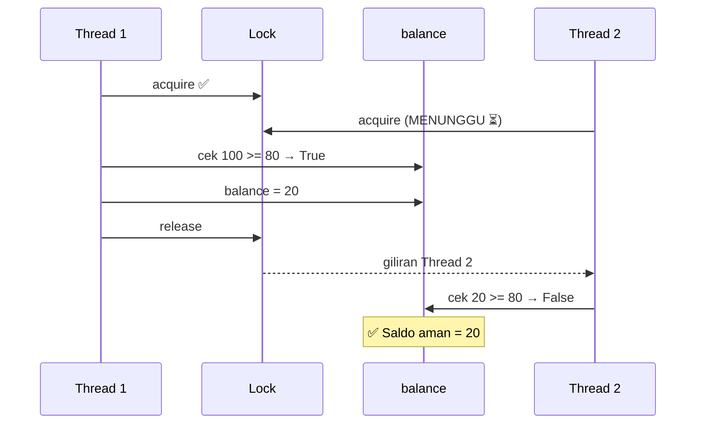
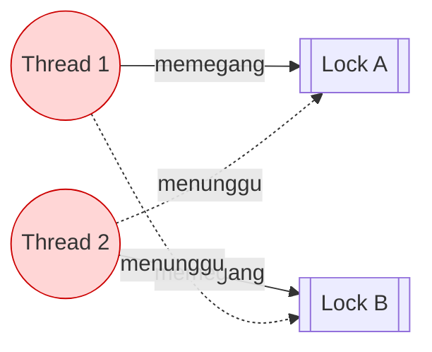
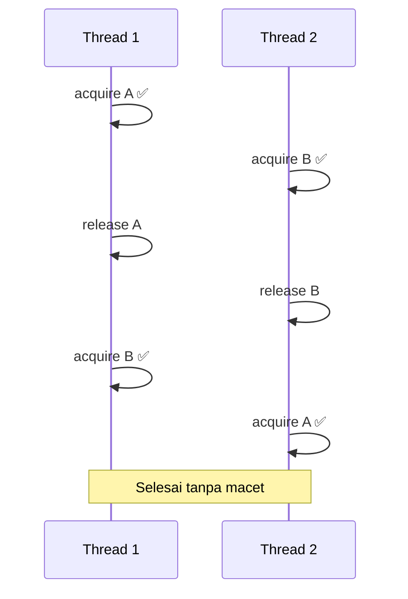
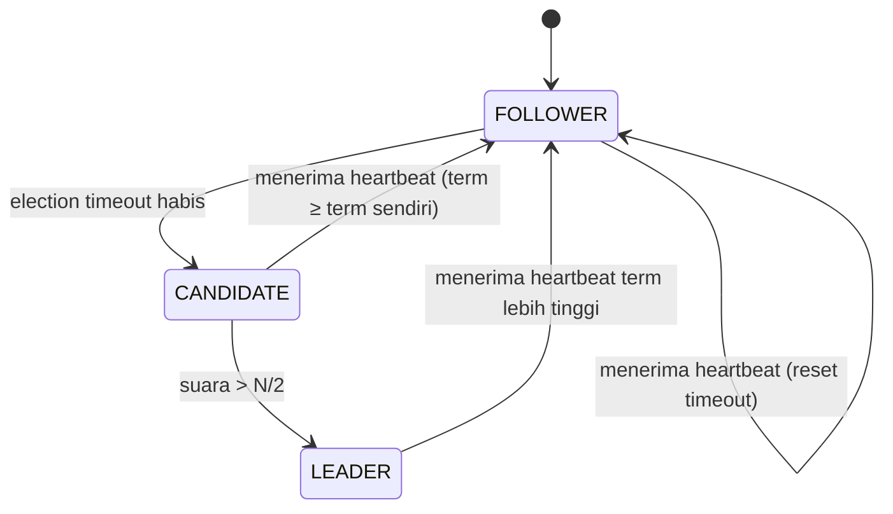
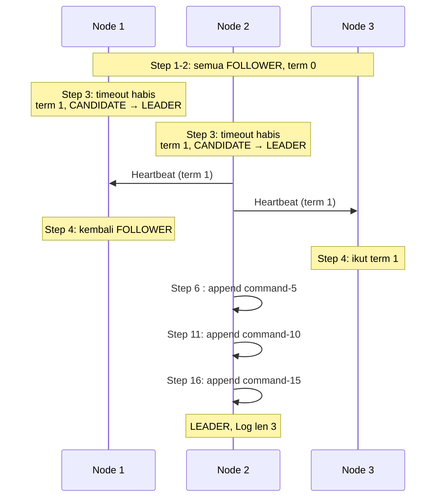

<div align="center">

# 🕒 Modul 03 — Sinkronisasi pada Sistem Terdistribusi

**Praktikum Sistem Terdistribusi dan Terdesentralisasi**
Informatika — Universitas Teknologi Digital Indonesia

| | |
|---|---|
| **Nama** | USAT JALUNG |
| **NIM** | 255410017 |
| **Kelas** | INFORMATIKA - 1 |


</div>

---

## 📑 Daftar Isi

1. [Gambaran Umum](#1-gambaran-umum)
2. [Struktur Folder](#2-struktur-folder)
3. [Prasyarat dan Cara Menjalankan](#3-prasyarat-dan-cara-menjalankan)
4. [Peta Konsep (Gambaran Besar)](#4-peta-konsep-gambaran-besar)
5. [Sinkronisasi Waktu — NTP / Chrony](#5-sinkronisasi-waktu--ntp--chrony)
6. [Vector Clock](#6-vector-clock)
7. [Multithread](#7-multithread)
8. [Race Condition](#8-race-condition)
9. [Deadlock](#9-deadlock)
10. [Algoritma Raft](#10-algoritma-raft)
11. [Rangkuman dan Kesimpulan](#11-rangkuman-dan-kesimpulan)
12. [Troubleshooting](#12-troubleshooting)
13. [Referensi](#13-referensi)

---

## 1. Gambaran Umum

Pada **sistem terdistribusi**, banyak komputer atau proses bekerja bersama tanpa satu jam dan satu memori yang sama. Hal ini menimbulkan tiga pertanyaan utama:

| Pertanyaan | Topik di modul ini |
|---|---|
| Bagaimana menyamakan waktu antar komputer? | NTP / Chrony |
| Bagaimana mengurutkan kejadian tanpa jam yang sama? | Vector Clock |
| Bagaimana mencegah kekacauan saat banyak proses mengakses data yang sama? | Lock (Race Condition dan Deadlock) |
| Bagaimana banyak node sepakat memilih satu koordinator? | Raft (Leader Election) |

Folder ini berisi dokumentasi praktikum, kode Python, dan bukti keluaran (screenshot) untuk semua topik di atas.

---

## 2. Struktur Folder

```text
03/
├── README.md                              ← file ini (dokumentasi gabungan)
│
├── Sinkronisasi Waktu/
│   ├── Linux-*BSD-Mac.md                  ← dokumentasi chrony (macOS)
│   └── kode instalasi                     ← log terminal lengkap instalasi
│
└── modul3_stt.py/
    ├── 01-vclocks.py                      ← Vector Clock
    ├── 02-multithreads-example.py         ← Multithread dasar
    ├── 03-race-conditions-01.py           ← Race condition TERJADI
    ├── 04-race-conditions-02.py           ← Race condition DICEGAH (Lock)
    ├── 05-deadlock-01.py                  ← Deadlock TERJADI
    ├── 06-deadlock-02.py                  ← Deadlock DICEGAH
    ├── 07-raft.py                         ← Simulasi Raft
    ├── README.md                          ← dokumentasi modul (versi ringkas)
    └── image/                             ← screenshot keluaran + gambar tangan
        ├── 01-vclocks.py.png
        ├── 02-multithreads-example.py.png
        ├── 03-race-conditions-01.py.png
        ├── 03-race-conditions-1.py.png
        ├── 04-race-conditions-02.py.png
        ├── 05-deadlock-01.py.png
        ├── 05-deadlock-1.py.png
        ├── 06-deadlock-02.py.png
        ├── 07-raft.py-01.png
        ├── 07-raft.py-02.png
        └── 07-raft.py-03.png
```

| No | File | Topik | Bukti keluaran |
|:-:|---|---|---|
| 01 | [`01-vclocks.py`](modul3_stt.py/01-vclocks.py) | Vector clock | `image/01-vclocks.py.png` |
| 02 | [`02-multithreads-example.py`](modul3_stt.py/02-multithreads-example.py) | Multithread | `image/02-multithreads-example.py.png` |
| 03 | [`03-race-conditions-01.py`](modul3_stt.py/03-race-conditions-01.py) | Race condition terjadi | `image/03-race-conditions-01.py.png` |
| 04 | [`04-race-conditions-02.py`](modul3_stt.py/04-race-conditions-02.py) | Race condition dicegah | `image/04-race-conditions-02.py.png` |
| 05 | [`05-deadlock-01.py`](modul3_stt.py/05-deadlock-01.py) | Deadlock terjadi | `image/05-deadlock-01.py.png` |
| 06 | [`06-deadlock-02.py`](modul3_stt.py/06-deadlock-02.py) | Deadlock dicegah | `image/06-deadlock-02.py.png` |
| 07 | [`07-raft.py`](modul3_stt.py/07-raft.py) | Simulasi Raft | `image/07-raft.py-01.png`, `-02`, `-03` |

---

## 3. Prasyarat dan Cara Menjalankan

### Prasyarat

| Kebutuhan | Keterangan |
|---|---|
| Python | Versi 3.8 atau lebih baru (`python3 --version`) |
| Library tambahan | **Tidak ada**, semua memakai library bawaan (`threading`, `time`, `random`, `enum`, `typing`) |
| Chrony (opsional) | Hanya untuk bagian 3.1; diuji di macOS 13 dengan Homebrew |

### Langkah menjalankan program Python

```bash
# 1. Salin repositori
git clone https://github.com/usatjalung25-stack/prak-dis-dec.git

# 2. Masuk ke folder modul
cd prak-dis-dec/03/modul3_stt.py

# 3. Jalankan program yang diinginkan
python3 01-vclocks.py
python3 02-multithreads-example.py
python3 03-race-conditions-01.py
python3 04-race-conditions-02.py
python3 05-deadlock-01.py      # akan MENGGANTUNG, hentikan dengan Ctrl+C
python3 06-deadlock-02.py
python3 07-raft.py
```

> ⚠️ **Penting:** `05-deadlock-01.py` memang dirancang untuk macet. Tekan `Ctrl + C` untuk menghentikannya.

### Ringkasan perilaku yang diharapkan

| Program | Selesai sendiri? | Hasil |
|---|:-:|---|
| 01-vclocks | ✅ | Vektor deterministik (selalu sama) |
| 02-multithreads | ✅ | Urutan selesai thread **bisa berbeda** tiap run |
| 03-race-conditions-01 | ✅ | Saldo bisa **negatif (-60)** |
| 04-race-conditions-02 | ✅ | Saldo aman (**20**) |
| 05-deadlock-01 | ❌ | **Menggantung** selamanya |
| 06-deadlock-02 | ✅ | Selesai, mencetak `Execution Finished` |
| 07-raft | ✅ | Hasil **acak**, leader bisa berbeda tiap run |

---

## 4. Peta Konsep (Gambaran Besar)



---

## 5. Sinkronisasi Waktu — NTP / Chrony

> 📄 Dokumentasi lengkap: [`Sinkronisasi Waktu/Linux-*BSD-Mac.md`](<Sinkronisasi Waktu/Linux-*BSD-Mac.md>)
> 🧾 Log terminal mentah: [`Sinkronisasi Waktu/kode instalasi`](<Sinkronisasi Waktu/kode instalasi>)

### 5.1 Mengapa waktu perlu disinkronkan?

Setiap komputer punya jam sendiri yang tidak pernah 100% akurat.

- **Clock drift**: jam berjalan sedikit lebih cepat atau lambat dari waktu sebenarnya.
- **Clock skew**: selisih waktu antar dua komputer.

Dampaknya: urutan log salah, autentikasi (token/sertifikat) gagal, konflik data pada basis data terdistribusi, dan error sulit dilacak.

### 5.2 Istilah penting

| Istilah | Arti |
|---|---|
| **NTP** | *Network Time Protocol*, protokol penyamaan waktu lewat jaringan |
| **Chrony** | Implementasi NTP: `chronyd` (daemon) dan `chronyc` (alat kontrol) |
| **Stratum** | Jarak dari sumber waktu asli. 0 = jam atom/GPS, makin besar makin jauh |
| **Offset** | Selisih jam kita terhadap server |
| **Delay** | Waktu tempuh paket bolak-balik |
| **Slew** | Koreksi pelan-pelan (jam dipercepat/diperlambat sedikit) |
| **Step** (`makestep`) | Koreksi langsung, jam dilompatkan |

### 5.3 Simulasi alur kerja



### 5.4 Cara mengaplikasikan (macOS + Homebrew)

```bash
# 1. Instal chrony
brew install chrony

# 2. Buat direktori runtime (WAJIB, dan diulang setelah reboot)
sudo mkdir -p /var/run/chrony /usr/local/var/run /usr/local/var/lib/chrony
sudo chmod 755 /var/run/chrony

# 3. Jalankan daemon
sudo /usr/local/sbin/chronyd -f /usr/local/etc/chrony.conf

# 4. Lihat daftar sumber waktu
sleep 10
chronyc sources -v

# 5. Lihat status sinkronisasi
chronyc tracking

# 6. Paksa koreksi langsung
sudo chronyc makestep
chronyc tracking
```

### 5.5 Hasil percobaan

**Lingkungan:** macOS 13 (Ventura) Intel, Homebrew, chrony 4.9 (Tier 3, semua paket dikompilasi dari sumber sehingga instalasi sekitar 1,5 jam).

**`chronyc sources -v`**

```text
MS Name/IP address         Stratum Poll Reach LastRx Last sample
===============================================================================
^- waktos2.unpak.ac.id           2   6    37    35    +27ms[  +27ms] +/-  565ms
^- time.citra.net.id             2   6    37    35    -12ms[  -12ms] +/-   41ms
^* 172-235-254-88.ip.linode>     2   6    37    36   -436us[  +20ms] +/-   42ms
^- jkt-tmd.caliph.dev            2   6    37    35   -779ms[ -779ms] +/-  859ms
```

| Server | Offset | Galat | Status |
|---|---|---|---|
| waktos2.unpak.ac.id | +27 ms | ±565 ms | Tidak dipakai, galat besar |
| time.citra.net.id | -12 ms | ±41 ms | Baik, tapi tidak dipilih |
| **172-235-254-88 (Linode)** | -436 µs | ±42 ms | ⭐ **Dipilih (`*`)** |
| jkt-tmd.caliph.dev | -779 ms | ±859 ms | Ditinggalkan |

**Membaca simbol:** `^` server, `*` sumber terbaik, `-` tidak digabung. `Reach 37` (oktal) berarti koneksi sehat. `Poll 6` berarti interval 2⁶ = 64 detik.

### 5.6 Efek `makestep` (gambaran sebelum dan sesudah)

```text
SEBELUM makestep                         SESUDAH makestep
────────────────────────────             ────────────────────────────
System time : 0.013657703 s FAST         System time : 0.000000000 s
                                          
 waktu NTP  ──────────●                   waktu NTP  ──────────●
 jam lokal  ───────────●  (+13,7 ms)      jam lokal  ──────────●  (sinkron)
```

| Kondisi | `System time` |
|---|---|
| Sebelum | 0,013657703 detik **lebih cepat** |
| Sesudah | **0,000000000** detik |

### 5.7 Masalah yang muncul dan solusi

| Pesan / Gejala | Serius? | Solusi |
|---|:-:|---|
| `grep: #: No such file or directory` | Tidak | Jangan tulis komentar `#` di baris perintah zsh |
| `zsh: no matches found: ...*.incomplete` | Tidak | Abaikan (tidak ada file sisa) |
| Warning macOS 13 / Tier 3 / Command Line Tools | Tidak | Abaikan |
| Warning tap `jostasik/tap` tidak dipercaya | Tidak | Abaikan atau `brew untap jostasik/tap` |
| `Could not open /var/run/chrony/chronyd.pid` | **Ya** | `sudo mkdir -p /var/run/chrony` lalu jalankan ulang |
| `506 Cannot talk to daemon` | **Ya** | Pastikan `chronyd` berjalan |
| `brew link step did not complete` | Tidak | Abaikan, **jangan** pakai `--overwrite` |
| `Another chronyd may already be running` | Tidak | Daemon sudah aktif, lanjut verifikasi |
| `Skew` dan `Frequency` besar | Tidak | Normal di awal, tunggu beberapa menit |

---

## 6. Vector Clock

Vector clock dipakai untuk **mengurutkan kejadian (event)** pada sistem terdistribusi tanpa jam fisik bersama. Setiap proses menyimpan sebuah vektor, satu slot per proses.

### 6.1 Aturan

| # | Kejadian | Aksi |
|:-:|---|---|
| 1 | Event lokal | Tambah 1 pada slot milik sendiri |
| 2 | Kirim pesan | Tambah 1, lalu sertakan seluruh vektor di pesan |
| 3 | Terima pesan | Ambil **maksimum per elemen**, lalu tambah 1 pada slot sendiri |

### 6.2 Kode — [`01-vclocks.py`](modul3_stt.py/01-vclocks.py)

Class `VectorClock` memiliki method: `increment()`, `send_message()`, `receive_message()`, `happens_before()`, dan `is_concurrent()`.

```python
vc0 = VectorClock(num_processes=3, process_id=0)
vc1 = VectorClock(num_processes=3, process_id=1)
vc2 = VectorClock(num_processes=3, process_id=2)

vc0.increment()                       # P0 event lokal
msg0 = vc0.send_message()             # P0 kirim ke P1
vc1.receive_message(msg0)             # P1 terima
vc2.increment()                       # P2 event lokal
msg1 = vc1.send_message()             # P1 kirim ke P2
vc2.receive_message(msg1)             # P2 terima
```

### 6.3 Simulasi alur pesan



### 6.4 Keluaran


```text
P0: [0, 0, 0]
P1: [0, 0, 0]
P2: [0, 0, 0]
P0: [1, 0, 0]
P0: [2, 0, 0]
P1: [2, 1, 0]
P2: [0, 0, 1]
P1: [2, 2, 0]
P2: [2, 2, 2]
VC0 happens before VC1: True
VC1 happens before VC0: False
VC0 is concurrent with VC2: False
```

### 6.5 Perbandingan dengan hitungan manual

| Langkah | Hitungan manual | Keluaran program | Cocok |
|---|---|---|:-:|
| Awal | Semua `[0,0,0]` | `[0,0,0]` | ✅ |
| P0 event lokal | `[1,0,0]` | `P0: [1, 0, 0]` | ✅ |
| P0 kirim ke P1 | P0 +1 → `[2,0,0]` | `P0: [2, 0, 0]` | ✅ |
| P1 terima | max → `[2,0,0]`, +1 → `[2,1,0]` | `P1: [2, 1, 0]` | ✅ |
| P2 event lokal | `[0,0,1]` | `P2: [0, 0, 1]` | ✅ |
| P1 kirim ke P2 | P1 +1 → `[2,2,0]` | `P1: [2, 2, 0]` | ✅ |
| P2 terima | max → `[2,2,1]`, +1 → `[2,2,2]` | `P2: [2, 2, 2]` | ✅ |

### 6.6 Pengecekan kausalitas

| Perbandingan | Hasil | Alasan |
|---|:-:|---|
| VC0 `[2,0,0]` → VC1 `[2,2,0]` | **True** | Semua elemen ≤ dan ada yang < |
| VC1 `[2,2,0]` → VC0 `[2,0,0]` | **False** | Elemen ke-2 bernilai 2 > 0 |
| VC0 *concurrent* VC2 `[2,2,2]` | **False** | VC0 mendahului VC2 lewat rantai P0 → P1 → P2 |

Dua event dikatakan **concurrent** jika tidak ada yang mendahului yang lain, contohnya `[1,0,0]` dan `[0,0,1]`.

```text
Happens-before                      Concurrent
[2,0,0] ──────▶ [2,2,0]             [1,0,0]      [0,0,1]
  (semua ≤, ada yang <)               (tidak ada yang ≤ semua elemen lawan)
```

---

## 7. Multithread

Pada program multithread, **urutan selesainya tiap thread tidak dapat diprediksi** karena ditentukan oleh *scheduler* sistem operasi.

### 7.1 Kode — [`02-multithreads-example.py`](modul3_stt.py/02-multithreads-example.py)

```python
import threading, time

def task(name, delay):
    print(f"Task {name} starting...")
    time.sleep(delay)
    print(f"Task {name} finished after {delay}s.")

# buat 5 thread (A–E), jalankan semuanya, lalu join()
```

### 7.2 Simulasi

```mermaid
gantt
    title 5 thread berjalan paralel (masing-masing tidur 5 detik)
    dateFormat  s
    axisFormat  %S s
    section Thread
    Task A :a, 0, 5s
    Task B :b, 0, 5s
    Task C :c, 0, 5s
    Task D :d, 0, 5s
    Task E :e, 0, 5s
```



### 7.3 Keluaran


```text
Task A starting...
Task B starting...
Task C starting...
Task D starting...
Task E starting...
Task A finished after 5s.
Task B finished after 5s.
Task C finished after 5s.
Task E finished after 5s.     ← E selesai SEBELUM D
Task D finished after 5s.
All tasks completed.
```

**Penjelasan:** kelima thread bangun hampir bersamaan, sehingga urutan pencetakan ditentukan scheduler dan bisa berubah tiap eksekusi. Hanya `All tasks completed.` yang pasti paling akhir karena semua thread di-`join()` lebih dulu.

---

## 8. Race Condition

**Race condition** terjadi ketika beberapa thread mengakses dan mengubah data bersama secara bersamaan, dan hasilnya bergantung pada urutan eksekusi yang tidak pasti.

### 8.1 Race condition TERJADI — [`03-race-conditions-01.py`](modul3_stt.py/03-race-conditions-01.py)

```python
balance = 100

def withdraw(amount):
    global balance
    if balance >= amount:          # 1. cek
        time.sleep(0.01)           # 2. jeda
        balance -= amount          # 3. kurangi
        print(f"Mengambil sejumlah Rp {amount}. Saldo: Rp {balance}")

t1 = Thread(target=withdraw, args=(80,))
t2 = Thread(target=withdraw, args=(80,))
```

**Simulasi (alur waktu):**



| Waktu | Thread 1 | Thread 2 | `balance` |
|:-:|---|---|:-:|
| 1 | cek `100 >= 80` → True | | 100 |
| 2 | | cek `100 >= 80` → True | 100 |
| 3 | `sleep(0.01)` | `sleep(0.01)` | 100 |
| 4 | `balance = 100 - 80` | | 20 |
| 5 | | `balance = 20 - 80` | **-60** |

**Keluaran:**


```text
Mengambil sejumlah Rp 80. Saldo: Rp 20
Mengambil sejumlah Rp 80. Saldo: Rp -60
```

**Gambar tangan:**


**Penyebab:** proses *check-then-act* tidak atomik. Kedua thread lolos pengecekan sebelum salah satunya sempat mengurangi saldo.

### 8.2 Race condition DICEGAH — [`04-race-conditions-02.py`](modul3_stt.py/04-race-conditions-02.py)

```python
counter_lock = threading.Lock()

def withdraw(amount):
    global balance
    with counter_lock:             # critical section
        if balance >= amount:
            time.sleep(0.01)
            balance -= amount
            print(f"Mengambil sejumlah Rp {amount}. Saldo: Rp {balance}")
```

**Simulasi:**



**Keluaran:**


```text
Mengambil sejumlah Rp 80. Saldo: Rp 20
```

**Penjelasan:** `with counter_lock` membuat blok cek → tidur → kurangi hanya bisa dimasuki satu thread pada satu waktu. Saat thread kedua masuk, saldo sudah 20 sehingga penarikan kedua tidak terjadi.

| | Tanpa Lock | Dengan Lock |
|---|:-:|:-:|
| Jumlah penarikan berhasil | 2 | 1 |
| Saldo akhir | **-60** ❌ | **20** ✅ |

---

## 9. Deadlock

**Deadlock** terjadi ketika dua thread atau lebih saling menunggu lock yang dipegang satu sama lain, sehingga tidak ada yang bisa maju.

### 9.1 Deadlock TERJADI — [`05-deadlock-01.py`](modul3_stt.py/05-deadlock-01.py)

```python
def thread_task1():
    with lock_a:                       # pegang A
        print("Thread 1: Locked A, waiting for B...")
        time.sleep(1)
        with lock_b:                   # minta B
            print("Thread 1: Locked both")

def thread_task2():
    with lock_b:                       # pegang B
        print("Thread 2: Locked B, waiting for A...")
        time.sleep(1)
        with lock_a:                   # minta A
            print("Thread 2: Locked both")
```

**Simulasi (graf tunggu):**



| Thread | Memegang | Menunggu |
|:-:|:-:|:-:|
| Thread 1 | Lock A | Lock B |
| Thread 2 | Lock B | Lock A |

Terbentuk **siklus tunggu** (T1 → B → T2 → A → T1).

**Keluaran** (program berhenti di sini dan menggantung):


```text
Thread 1: Locked A, waiting for B...
Thread 2: Locked B, waiting for A...
_                                      ← menggantung, hentikan dengan Ctrl+C
```

**Gambar tangan:**


**Empat syarat Coffman (semua terpenuhi):**

| Syarat | Terpenuhi karena |
|---|---|
| Mutual exclusion | Lock hanya bisa dipegang satu thread |
| Hold and wait | Memegang satu lock sambil meminta lock lain |
| No preemption | Lock tidak bisa dirampas paksa |
| Circular wait | T1 menunggu T2 dan T2 menunggu T1 |

### 9.2 Deadlock DICEGAH — [`06-deadlock-02.py`](modul3_stt.py/06-deadlock-02.py)

Dua perubahan kunci:

1. **Lepas lock pertama** (`finally: release()`) sebelum meminta lock kedua → *hold and wait* hilang.
2. **Pakai `acquire(timeout=5)`** → thread tidak menunggu selamanya.

```python
def thread1_task():
    if lock_a.acquire(timeout=5):
        try:
            print("Thread 1: Acquired Lock A")
            time.sleep(1)
            print("Thread 1: Waiting for Lock B...")
        finally:
            lock_a.release()                 # ← dilepas dulu
        if lock_b.acquire(timeout=5):        # ← baru minta B
            try:
                print("Thread 1: Acquired Lock B")
            finally:
                lock_b.release()
```

**Simulasi:**



**Keluaran:**


```text
Thread 1: Acquired Lock A
Thread 2: Acquired Lock B
Thread 2: Waiting for Lock A...
Thread 1: Waiting for Lock B...
Thread 1: Acquired Lock B
Thread 2: Acquired Lock A
Execution Finished
```

---

## 10. Algoritma Raft

**Raft** adalah algoritma **konsensus** untuk membuat banyak node sepakat, salah satunya dalam memilih koordinator (**LEADER**). Simulasi pada [`07-raft.py`](modul3_stt.py/07-raft.py) bersumber dari artikel C# Corner: *Simulate Distributed Consensus with the Raft Protocol (Simplified) using Python*.

### 10.1 Komponen

| Komponen | Fungsi |
|---|---|
| `State` | `FOLLOWER`, `CANDIDATE`, `LEADER` |
| `current_term` | Nomor "periode" pemilihan |
| `election_timeout` | Batas waktu acak 1–2 detik sebelum node mencalonkan diri |
| `on_heartbeat()` | Reset timeout; node kembali menjadi FOLLOWER |
| `start_election()` | term + 1, memilih diri sendiri, meminta suara |
| `append_entry()` | Leader menambah entri ke log |
| `tick()` | Siklus pengecekan waktu per node |

### 10.2 Diagram state



### 10.3 Simulasi pemilihan leader (3 node)



### 10.4 Keluaran


<details>
<summary><b>Klik untuk melihat cuplikan teks keluaran</b></summary>

```text
Simulating Raft Consensus for Drone Swarm Coordination

--- Step 2 ---
Node 1: FOLLOWER | Term 0 | Log len 0
Node 2: FOLLOWER | Term 0 | Log len 0
Node 3: FOLLOWER | Term 0 | Log len 0

--- Step 3 ---
Node 1 elected leader in term 1
Node 2 elected leader in term 1
Node 1: LEADER | Term 1 | Log len 0
Node 2: LEADER | Term 1 | Log len 0
Node 3: FOLLOWER | Term 0 | Log len 0

--- Step 4 ---
Node 1: FOLLOWER | Term 1 | Log len 0
Node 2: LEADER | Term 1 | Log len 0
Node 3: FOLLOWER | Term 1 | Log len 0

--- Step 6 ---
Leader 2 appended: command-5
Node 1: FOLLOWER | Term 1 | Log len 0
Node 2: LEADER | Term 1 | Log len 1
Node 3: FOLLOWER | Term 1 | Log len 0

--- Step 20 ---
Node 1: FOLLOWER | Term 1 | Log len 0
Node 2: LEADER | Term 1 | Log len 3
Node 3: FOLLOWER | Term 1 | Log len 0
```

</details>

> Keluaran Raft **acak** (timeout 1–2 detik), jadi leader terpilih dan waktu pemilihan berbeda tiap eksekusi.

### 10.5 Gambar tangan alur pemilihan leader


### 10.6 Penjelasan berdasarkan keluaran

| Tahap | State | Yang terjadi |
|:-:|:-:|---|
| 1 | FOLLOWER | Step 1–2: semua node `FOLLOWER`, `Term 0`, tiap node punya timeout acak |
| 2 | CANDIDATE | Step 3: timeout Node 1 dan 2 habis lebih dulu; term naik 0 → 1, memilih diri sendiri |
| 3 | LEADER | Suara > N/2 (3 node → minimal 2) sehingga menjadi leader |
| 4 | FOLLOWER | Step 4: heartbeat term 1 membuat Node 1 turun jadi follower |
| 5 | LEADER | Node 2 bertahan, menambah log: `command-5`, `command-10`, `command-15` |

**Ringkasnya:** FOLLOWER tanpa heartbeat sampai timeout → CANDIDATE (term + 1) → LEADER bila dapat suara mayoritas → leader mengirim heartbeat agar yang lain tetap FOLLOWER.

### 10.7 Catatan batasan simulasi

- Pada Step 3 dua node menjadi leader di term yang sama karena kode menganggap **semua node selalu memberi suara** (`votes += 1`). Pada Raft asli setiap node hanya memberi **satu suara per term**.
- Log Node 1 dan 3 tetap 0 karena **replikasi log ke follower tidak disimulasikan**.

---

## 11. Rangkuman dan Kesimpulan

| Topik | Masalah | Solusi | Hasil praktikum |
|---|---|---|---|
| Waktu | Jam tiap komputer berbeda | NTP / Chrony | Selisih 13,7 ms → 0 detik setelah `makestep` |
| Urutan event | Tidak ada jam bersama | Vector Clock | Hasil program = hitungan manual |
| Multithread | Urutan selesai tak terprediksi | Gunakan `join()` | Task E selesai sebelum D |
| Race condition | Check-then-act tidak atomik | `Lock` | Saldo -60 → 20 |
| Deadlock | Siklus tunggu antar lock | Lepas lock + `timeout` | Program macet → selesai |
| Konsensus | Banyak node, satu koordinator | Raft | Node 2 terpilih leader (term 1) |

---

## 12. Troubleshooting

| Masalah | Penyebab | Solusi |
|---|---|---|
| `python: command not found` | Python belum terpasang atau namanya `python3` | Gunakan `python3` |
| `05-deadlock-01.py` tidak berhenti | Memang deadlock (disengaja) | Tekan `Ctrl+C` |
| Hasil `02`, `03`, `07` berbeda dari screenshot | Sifatnya tidak deterministik | Wajar, jalankan ulang |
| Saldo di `03` tidak negatif | Scheduler kebetulan berurutan | Jalankan beberapa kali |
| `chronyc: 506 Cannot talk to daemon` | `chronyd` belum jalan | Lihat [bagian 5.4](#54-cara-mengaplikasikan-macos--homebrew) |
| Setelah reboot chrony gagal | macOS mengosongkan `/var/run` | Buat ulang direktori `/var/run/chrony` |

---

## 13. Referensi

- Materi kuliah Sistem Terdistribusi, E-Learning UTDI: <https://elearning.utdi.ac.id/mod/resource/view.php?id=78171>
- Dokumentasi chrony: <https://chrony-project.org/documentation.html>
- Tingkat dukungan Homebrew: <https://docs.brew.sh/Support-Tiers>
- Raft (C# Corner): *Simulate Distributed Consensus with the Raft Protocol (Simplified) using Python*
- Penulis modul: Dr. Bambang Purnomosidi D. P.

---

<div align="center">

**USAT JALUNG · 255410017 · INFORMATIKA - 1**

</div>
