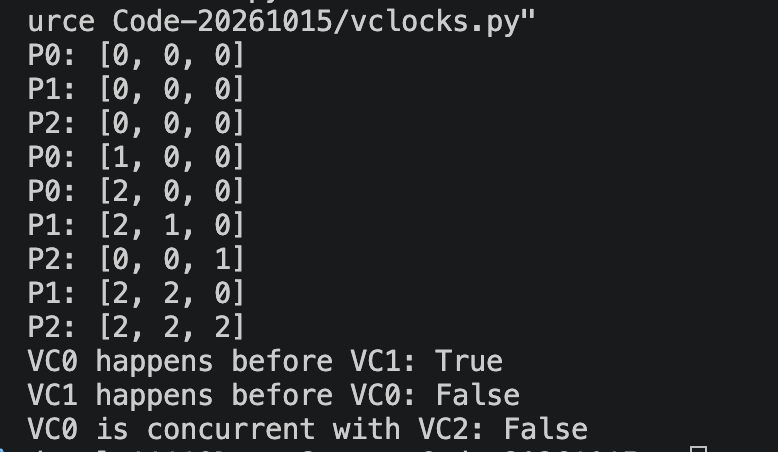
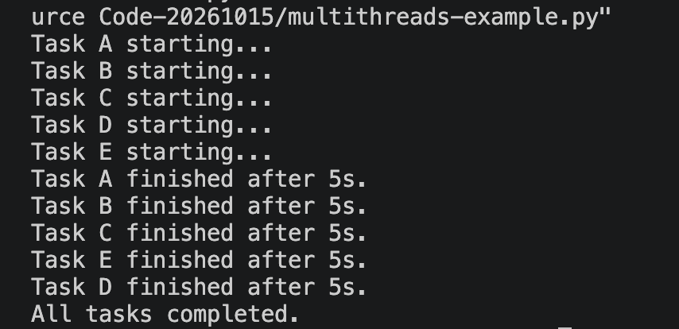
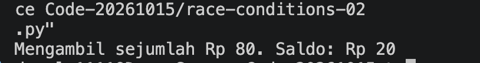
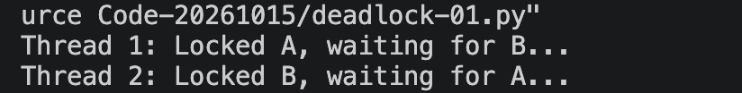
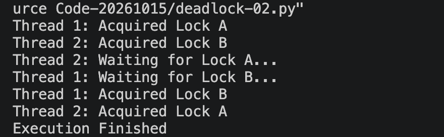
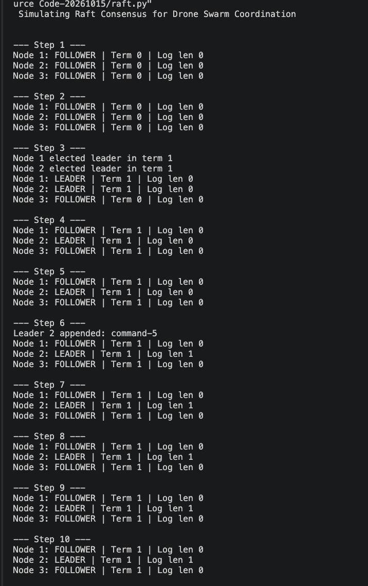
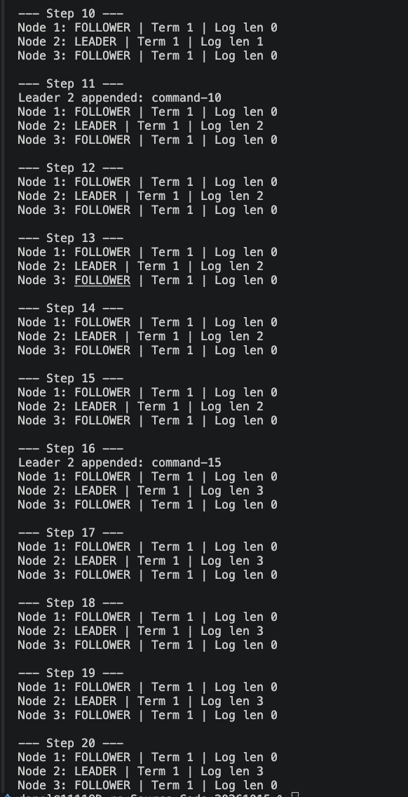

# Modul 3 — Sinkronisasi pada Sistem Terdistribusi

**Mata kuliah:** Praktikum Sistem Terdistribusi dan Terdesentralisasi
**Prodi:** Informatika — Universitas Teknologi Digital Indonesia

| | |
|---|---|
| **Nama** | _isi di sini_ |
| **NIM** | _isi di sini_ |
| **Kelas** | _isi di sini_ |

---

## Daftar Isi

1. [Struktur Repositori](#1-struktur-repositori)
2. [3.1 Sinkronisasi Waktu (NTP)](#2-31-sinkronisasi-waktu-ntp)
3. [3.2 Vector Clock](#3-32-vector-clock)
4. [3.3 Problem Tanpa Sinkronisasi](#4-33-problem-tanpa-sinkronisasi)
   - [3.3.0 Contoh Multithread](#330-contoh-multithread)
   - [3.3.1 Race Condition](#331-race-condition)
   - [3.3.2 Deadlock](#332-deadlock)
5. [3.4 Algoritma Raft](#5-34-algoritma-raft)
6. [Kesimpulan](#6-kesimpulan)

---

## 1. Struktur Repositori

| No | Program | Screenshot keluaran | Topik |
|:-:|---|---|---|
| 01 | [`01-vclocks.py`](01-vclocks.py) | `01-vclocks.py.png` | Vector clock |
| 02 | [`02-multithreads-example.py`](02-multithreads-example.py) | `02-multithreads-example.py.png` | Multithread |
| 03 | [`03-race-conditions-01.py`](03-race-conditions-01.py) | `03-race-conditions-01.py.png` | Race condition (tanpa Lock) |
| 04 | [`04-race-conditions-02.py`](04-race-conditions-02.py) | `04-race-conditions-02.py.png` | Race condition (dengan Lock) |
| 05 | [`05-deadlock-01.py`](05-deadlock-01.py) | `05-deadlock-01.py.png` | Deadlock terjadi |
| 06 | [`06-deadlock-02.py`](06-deadlock-02.py) | `06-deadlock-02.py.png` | Deadlock dicegah |
| 07 | [`07-raft.py`](07-raft.py) | `07-raft.py-01.png`, `07-raft.py-02.png` | Simulasi Raft |

Berkas lain: folder [`modul/`](modul/) (tugas modul Python), serta gambar tangan di folder `image/`: `gambar race-conditions-01.py.png`, `gambar deadlock-01.py.png`, dan `gambar Algoritma Raft.png`.

---

## 2. 3.1 Sinkronisasi Waktu (NTP)

### Tujuan
Menyinkronkan jam komputer ke server NTP menggunakan Chrony dan memahami prosesnya.

### Perintah
```bash
sudo apt install chrony
sudo chronyc add server pool.ntp.org iburst
sudo chronyc makestep
chronyc sources -v
chronyc tracking
```

### Screenshot


### Penjelasan proses
| Langkah | Proses |
|:-:|---|
| 1 | Klien mengirim request ke server NTP dan mencatat waktu kirim **T1** |
| 2 | Server mencatat waktu terima **T2** dan waktu kirim balasan **T3** |
| 3 | Klien menerima balasan pada **T4** |
| 4 | `delay = (T4 − T1) − (T3 − T2)` dan `offset = ((T2 − T1) + (T3 − T4)) / 2` |
| 5 | Chrony mengulang ke beberapa server, memilih sumber terbaik (tanda `*`), lalu mengoreksi jam |

### Pembahasan
Selisih besar dikoreksi langsung (`makestep`), selisih kecil dikoreksi bertahap (*slew*) agar waktu tidak mundur. Nilai `Last offset` dan `System time` pada `chronyc tracking` menunjukkan seberapa jauh jam lokal dari server; semakin kecil offset dan delay, semakin akurat sinkronisasinya.

---

## 3. 3.2 Vector Clock

### Tujuan
Mengurutkan event pada sistem terdistribusi tanpa jam fisik yang sama.

### Program
<details open>
<summary><b>Kode:</b> <code>01-vclocks.py</code></summary>

```python
"""Modul VectorClock untuk pengurutan event di sistem terdistribusi."""
class VectorClock:
    def __init__(self, num_processes, process_id):
        self.clocks = [0] * num_processes
        self.process_id = process_id

    def increment(self):
        self.clocks[self.process_id] += 1

    def send_message(self):
        self.increment()
        return list(self.clocks)

    def receive_message(self, received_clocks):
        for i in range(len(self.clocks)):
            self.clocks[i] = max(self.clocks[i], received_clocks[i])
        self.increment()

    def __str__(self):
        return f"P{self.process_id}: {self.clocks}"

    def happens_before(self, other):
        if self.clocks == other.clocks:
            return False
        any_lt = False
        for a, b in zip(self.clocks, other.clocks):
            if a > b:
                return False
            if a < b:
                any_lt = True
        return any_lt

    def is_concurrent(self, other):
        return not (self.happens_before(other) or other.happens_before(self))

# --- Simulasi ---
vc0, vc1, vc2 = (VectorClock(3, i) for i in range(3))
print(vc0); print(vc1); print(vc2)
vc0.increment(); print(vc0)
m0 = vc0.send_message(); vc1.receive_message(m0); print(vc0); print(vc1)
vc2.increment(); print(vc2)
m1 = vc1.send_message(); vc2.receive_message(m1); print(vc1); print(vc2)
print(f"VC0 happens before VC1: {vc0.happens_before(vc1)}")
print(f"VC1 happens before VC0: {vc1.happens_before(vc0)}")
print(f"VC0 is concurrent with VC2: {vc0.is_concurrent(vc2)}")
# Contoh event konkuren
a, b = VectorClock(3, 0), VectorClock(3, 2)
a.increment(); b.increment()
print(a, b, "-> concurrent:", a.is_concurrent(b))
```

</details>

### Screenshot keluaran


### Keluaran
```
P0: [0, 0, 0]
P1: [0, 0, 0]
P2: [0, 0, 0]
P0: [1, 0, 0]
P0: [2, 0, 0]
P1: [2, 1, 0]
P2: [0, 0, 1]
P1: [2, 2, 0]
P2: [2, 2, 2]
VC0 happens before VC1: True
VC1 happens before VC0: False
VC0 is concurrent with VC2: False
```

### Perbandingan dengan perhitungan manual
| Langkah | Aturan manual | Hasil program |
|---|---|---|
| Awal | Semua [0,0,0] | P0, P1, P2 = [0,0,0] |
| P0 event lokal | +1 pada slot sendiri | [1,0,0] |
| P0 kirim ke P1 | +1, vektor ikut dikirim | P0 = [2,0,0] |
| P1 terima | max per elemen, lalu +1 slot sendiri: max([0,0,0],[2,0,0]) = [2,0,0] → [2,1,0] | P1 = [2,1,0] |
| P2 event lokal | +1 slot sendiri | [0,0,1] |
| P1 kirim ke P2 | +1 | P1 = [2,2,0] |
| P2 terima | max([0,0,1],[2,2,0]) = [2,2,1] → +1 | P2 = [2,2,2] |

### Pembahasan
| Perbandingan | Hasil | Alasan |
|---|:-:|---|
| VC0 `[2,0,0]` happens-before VC1 `[2,2,0]` | **True** | Semua elemen ≤ dan ada yang < |
| VC1 `[2,2,0]` happens-before VC0 `[2,0,0]` | **False** | Elemen kedua 2 > 0 |
| VC0 `[2,0,0]` concurrent dengan VC2 `[2,2,2]` | **False** | VC0 mendahului VC2 (sebab-akibat P0 → P1 → P2) |

Hasil program identik dengan perhitungan manual. Event baru *concurrent* jika tidak ada yang mendahului, misalnya `[1,0,0]` dan `[0,0,1]` (contoh tambahan di modul menghasilkan `True`).

### Modul Python
Class `VectorClock` dipisah menjadi [`modul/vclock.py`](modul/vclock.py); contoh pemakaian di [`modul/contoh_vclock.py`](modul/contoh_vclock.py).
```python
from vclock import VectorClock

a, b = VectorClock(3, 0), VectorClock(3, 1)
b.receive_message(a.send_message())
print(a.happens_before(b))   # True
```

---

## 4. 3.3 Problem Tanpa Sinkronisasi

Tanpa sinkronisasi, program multithread dapat mengalami **race condition** dan **deadlock** karena urutan penyelesaian task tidak dapat diprediksi.

### 3.3.0 Contoh Multithread
<details open>
<summary><b>Kode:</b> <code>02-multithreads-example.py</code></summary>

```python
import threading, time
def task(name, delay):
    print(f"Task {name} starting...")
    time.sleep(delay)
    print(f"Task {name} finished after {delay}s.")
ts = [threading.Thread(target=task, args=(n, 5)) for n in "ABCDE"]
for t in ts: t.start()
for t in ts: t.join()
print("All tasks completed.")
```

</details>

**Screenshot keluaran**



**Keluaran**
```
Task A starting...
Task B starting...
Task C starting...
Task D starting...
Task E starting...
Task A finished after 5s.
...
All tasks completed.
```

**Pembahasan:** penjadwalan thread dilakukan OS/interpreter dan tidak deterministik, sehingga urutan "starting" dan "finished" bisa berbeda pada tiap eksekusi (jalankan berulang dan capture saat urutannya berbeda). Hanya "All tasks completed." yang pasti terakhir karena `join()`.

---

### 3.3.1 Race Condition

#### a. Tanpa Lock
<details open>
<summary><b>Kode:</b> <code>03-race-conditions-01.py</code></summary>

```python
import time
from threading import Thread
balance = 100
def withdraw(amount):
    global balance
    if balance >= amount:
        time.sleep(0.01)
        balance -= amount
        print(f"Mengambil sejumlah Rp {amount}. Saldo: Rp {balance}")
t1 = Thread(target=withdraw, args=(80,)); t2 = Thread(target=withdraw, args=(80,))
t1.start(); t2.start(); t1.join(); t2.join()
```

</details>

**Screenshot keluaran**


**Keluaran**
```
Mengambil sejumlah Rp 80. Saldo: Rp 20
Mengambil sejumlah Rp 80. Saldo: Rp -60
```

**Gambar tangan**


**Pembahasan**
| Waktu | Thread 1 | Thread 2 | `balance` |
|:-:|---|---|:-:|
| t1 | cek `100 >= 80` → True | | 100 |
| t2 | `sleep(0.01)` | cek `100 >= 80` → True | 100 |
| t3 | `balance -= 80` | `sleep(0.01)` | 20 |
| t4 | | `balance -= 80` | **−60** |

Kedua thread lolos pengecekan karena saldo belum dikurangi. Operasi *check-then-act* tidak atomik, sehingga hasil bergantung pada urutan eksekusi — inilah *race condition*.

#### b. Dengan Lock
<details open>
<summary><b>Kode:</b> <code>04-race-conditions-02.py</code></summary>

```python
import time, threading
from threading import Thread
counter_lock = threading.Lock()
balance = 100
def withdraw(amount):
    global balance
    with counter_lock:
        if balance >= amount:
            time.sleep(0.01)
            balance -= amount
            print(f"Mengambil sejumlah Rp {amount}. Saldo: Rp {balance}")
t1 = Thread(target=withdraw, args=(80,)); t2 = Thread(target=withdraw, args=(80,))
t1.start(); t2.start(); t1.join(); t2.join()
```

</details>

**Screenshot keluaran**



**Keluaran**
```
Mengambil sejumlah Rp 80. Saldo: Rp 20
```

**Pembahasan:** `with counter_lock` menjadikan blok cek-tidur-kurangi sebagai *critical section* yang eksklusif. Thread kedua menunggu sampai thread pertama selesai; saat masuk, saldo sudah 20 sehingga kondisi `if` False dan tidak ada penarikan kedua. Saldo tidak pernah negatif.

---

### 3.3.2 Deadlock

#### a. Deadlock terjadi
<details open>
<summary><b>Kode:</b> <code>05-deadlock-01.py</code></summary>

```python
import threading, time
lock_a = threading.Lock(); lock_b = threading.Lock()
def thread_task1():
    with lock_a:
        print("Thread 1: Locked A, waiting for B...", flush=True)
        time.sleep(1)
        with lock_b:
            print("Thread 1: Locked both")
def thread_task2():
    with lock_b:
        print("Thread 2: Locked B, waiting for A...", flush=True)
        time.sleep(1)
        with lock_a:
            print("Thread 2: Locked both")
t1 = threading.Thread(target=thread_task1); t2 = threading.Thread(target=thread_task2)
t1.start(); t2.start(); t1.join(); t2.join()
```

</details>

**Screenshot keluaran**



**Keluaran**
```
Thread 1: Locked A, waiting for B...
Thread 2: Locked B, waiting for A...
(program menggantung, dihentikan dengan Ctrl+C)
```

**Gambar tangan**


**Pembahasan**
| Thread | Memegang | Menunggu |
|:-:|:-:|:-:|
| Thread 1 | Lock A | Lock B |
| Thread 2 | Lock B | Lock A |

Terbentuk siklus tunggu sehingga tidak ada thread yang maju. Keempat syarat Coffman terpenuhi: *mutual exclusion*, *hold and wait*, *no preemption*, dan *circular wait*. `sleep(1)` memastikan kedua thread sudah mengunci lock pertamanya sebelum meminta lock kedua.

#### b. Deadlock dicegah
<details open>
<summary><b>Kode:</b> <code>06-deadlock-02.py</code></summary>

```python
import threading, time
lock_a = threading.Lock(); lock_b = threading.Lock()
def thread1_task():
    if lock_a.acquire(timeout=5):
        try:
            print("Thread 1: Acquired Lock A"); time.sleep(1)
            print("Thread 1: Waiting for Lock B...")
        finally:
            lock_a.release()
        if lock_b.acquire(timeout=5):
            try: print("Thread 1: Acquired Lock B")
            finally: lock_b.release()
def thread2_task():
    if lock_b.acquire(timeout=5):
        try:
            print("Thread 2: Acquired Lock B"); time.sleep(1)
            print("Thread 2: Waiting for Lock A...")
        finally:
            lock_b.release()
        if lock_a.acquire(timeout=5):
            try: print("Thread 2: Acquired Lock A")
            finally: lock_a.release()
t1 = threading.Thread(target=thread1_task); t2 = threading.Thread(target=thread2_task)
t1.start(); t2.start(); t1.join(); t2.join()
print("Execution Finished")
```

</details>

**Screenshot keluaran**



**Keluaran**
```
Thread 1: Acquired Lock A
Thread 2: Acquired Lock B
Thread 2: Waiting for Lock A...
Thread 1: Waiting for Lock B...
Thread 1: Acquired Lock B
Thread 2: Acquired Lock A
Execution Finished
```

**Pembahasan:** deadlock tidak terjadi karena (1) setiap `acquire` memakai `timeout=5` sehingga thread tidak menunggu selamanya, dan (2) lock pertama dilepas (`finally: release()`) *sebelum* meminta lock kedua sehingga kondisi *hold and wait* hilang. Alternatif umum: mengunci dengan urutan yang sama (A lalu B) di semua thread.

---

## 5. 3.4 Algoritma Raft

### Tujuan
Memahami pemilihan koordinator (**LEADER**) pada algoritma konsensus Raft.

### Program
<details open>
<summary><b>Kode:</b> <code>07-raft.py</code></summary>

```python
"""Modul simulasi Raft (disederhanakan)."""
import random, time
from enum import Enum
from typing import List, Optional

class State(Enum):
    FOLLOWER = 1
    CANDIDATE = 2
    LEADER = 3

class RaftNode:
    def __init__(self, node_id: int, all_nodes: List[int]):
        self.id = node_id
        self.nodes = all_nodes
        self.state = State.FOLLOWER
        self.current_term = 0
        self.voted_for: Optional[int] = None
        self.log: List[str] = []
        self.commit_index = 0
        self.last_heartbeat = time.time()
        self.election_timeout = self._random_timeout()

    def _random_timeout(self) -> float:
        return time.time() + random.uniform(1.0, 2.0)

    def on_heartbeat(self, term: int):
        if term >= self.current_term:
            self.current_term = term
            self.state = State.FOLLOWER
            self.voted_for = None
            self.last_heartbeat = time.time()
            self.election_timeout = self._random_timeout()

    def start_election(self):
        self.current_term += 1
        self.state = State.CANDIDATE
        self.voted_for = self.id
        votes = 1
        for node_id in self.nodes:
            if node_id == self.id:
                continue
            votes += 1  # disederhanakan: semua node memberi suara
        if votes > len(self.nodes) // 2:
            self.state = State.LEADER
            print(f"Node {self.id} elected leader in term {self.current_term}")

    def append_entry(self, entry: str):
        if self.state == State.LEADER:
            self.log.append(entry)
            print(f"Leader {self.id} appended: {entry}")
            self.commit_index = len(self.log) - 1

    def tick(self):
        now = time.time()
        if self.state == State.LEADER:
            pass
        elif now > self.election_timeout:
            self.start_election()
        elif self.state == State.FOLLOWER and now - self.last_heartbeat > 2.0:
            self.election_timeout = self._random_timeout()
            self.start_election()

def simulate_raft(n_nodes=3, steps=20, delay=0.5):
    ids = list(range(1, n_nodes + 1))
    nodes = [RaftNode(i, ids) for i in ids]
    for step in range(steps):
        time.sleep(delay)
        print(f"\n--- Step {step + 1} ---")
        leaders = [n for n in nodes if n.state == State.LEADER]
        if leaders:
            leader = random.choice(leaders)
            for node in nodes:
                if node.id != leader.id:
                    node.on_heartbeat(leader.current_term)
            if step % 5 == 0:
                leader.append_entry(f"command-{step}")
        for node in nodes:
            node.tick()
        for node in nodes:
            print(f"Node {node.id}: {node.state.name} | Term {node.current_term} | Log len {len(node.log)}")
    return nodes

if __name__ == "__main__":
    print("Simulating Raft Consensus for Drone Swarm Coordination\n")
    simulate_raft()
```

</details>

### Screenshot keluaran



### Contoh keluaran (acak, berbeda tiap eksekusi)
```
--- Step 3 ---
Node 1 elected leader in term 1
Node 3 elected leader in term 1
Node 1: LEADER | Term 1 | Log len 0
Node 2: FOLLOWER | Term 0 | Log len 0
Node 3: LEADER | Term 1 | Log len 0
--- Step 4 ---
Node 1: FOLLOWER | Term 1 | Log len 0
Node 2: FOLLOWER | Term 1 | Log len 0
Node 3: LEADER | Term 1 | Log len 0
--- Step 6 ---
Leader 3 appended: command-5
--- Step 20 ---
Node 3: LEADER | Term 1 | Log len 3
```

### Gambar tangan alur pemilihan Leader


### Penjelasan algoritma
| Tahap | State | Yang terjadi |
|:-:|:-:|---|
| 1 | FOLLOWER | Semua node mulai di term 0 dengan *election timeout* acak 1–2 detik |
| 2 | CANDIDATE | Node yang timeout lebih dulu menaikkan term (0→1), memilih dirinya sendiri, dan meminta suara |
| 3 | LEADER | Jika suara > N/2 (3 node → minimal 2), node menjadi leader |
| 4 | LEADER | Leader mengirim heartbeat; follower menyamakan term dan mereset timeout |
| 5 | LEADER | Tiap 5 langkah leader menambah log (`command-5`, `-10`, `-15` → Log len 3) |
| 6 | FOLLOWER → CANDIDATE | Jika leader mati, heartbeat berhenti dan pemilihan baru dengan term lebih tinggi dimulai |

### Pembahasan
- Pada **Step 3** dua node (1 dan 3) menjadi leader di term yang sama karena simulasi menganggap semua node selalu memberi suara. Pada Raft asli setiap node hanya memberi satu suara per term, sehingga hal ini tidak terjadi.
- Pada **Step 4** simulasi memilih satu leader acak (Node 3) untuk mengirim heartbeat, sehingga Node 1 kembali menjadi follower.
- Log follower tetap 0 karena replikasi log tidak disimulasikan.

### Modul Python
Kode dipisah menjadi [`modul/raft_module.py`](modul/raft_module.py); contoh simulasi di [`modul/simulasi_raft.py`](modul/simulasi_raft.py).
```python
from raft_module import simulate_raft

simulate_raft(n_nodes=3, steps=20)
```

---

## 6. Kesimpulan

| Topik | Kesimpulan |
|---|---|
| NTP | Sinkronisasi waktu dilakukan dengan menghitung offset dan delay terhadap server NTP |
| Vector clock | Menentukan urutan kausal antar event tanpa jam fisik yang sama |
| Race condition | Diatasi dengan *mutual exclusion* (Lock) pada critical section |
| Deadlock | Dicegah dengan timeout, melepas lock sebelum meminta lock lain, atau urutan penguncian konsisten |
| Raft | Konsensus dicapai lewat pemilihan leader berbasis term, timeout acak, dan suara mayoritas |
