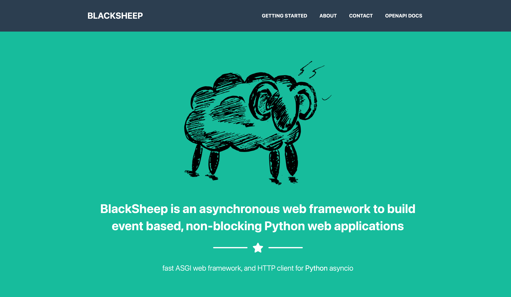

<div align="center">

# Modul 5 — Fault Tolerance

**Praktikum Sistem Terdistribusi dan Terdesentralisasi**
Load Balancing · Failure Detection · Retry · Circuit Breaker


| Nama | NIM | Program Studi |
|:----:|:---:|:-------------:|
| Usat Jalung | 255410017 | Informatika |

</div>

---

## Daftar Isi

| # | Bagian | Isi singkat |
|---|--------|-------------|
| 0 | [Gambaran umum](#0-gambaran-umum) | Apa itu fault tolerance, arsitektur, istilah |
| 1 | [Isi folder ini](#1-isi-folder-ini) | Semua file dan fungsinya |
| **4.1** | **[Load Balancing Aplikasi](#41-load-balancing-aplikasi)** | |
| | [1. Persiapan](#1-persiapan) | Install Docker, Python env, BlackSheep |
| | [2. Pembuatan aplikasi web](#2-pembuatan-aplikasi-web) | `blacksheep create`, jalankan, penjelasan semua kode aplikasi |
| | [3. Dockerfile dan docker-compose.yml](#3-siapkan-dockerfile-dan-docker-composeyml) | Dockerfile, nginx, compose, alias |
| | [4. Jalankan Docker Compose](#4-jalankan-docker-compose) | Build, uji load balancing, uji failover |
| **4.2** | **[Failure Detection](#42-failure-detection)** | |
| | [Heartbeat](#heartbeat) | `check-server.py` |
| | [Retry](#retry-dengan-tenacity) | `check-retry.py` |
| | [Circuit Breaker](#circuit-breaker) | `check-circuit-breaker.py` |
| | [Retry + penanganan error](#versi-dengan-penanganan-error-check-retry-handlingpy) | `check-retry-handling.py` (kode tambahan) |
| **4.3** | **[Pembahasan](#43-pembahasan)** | Analisis hasil, jawaban tugas modul, kesimpulan |
| 5 | [Solusi error](#5-solusi-error-troubleshooting) | Error yang benar-benar muncul + cara memperbaiki |
| 6 | [Ringkasan perintah](#6-ringkasan-perintah) | Alur lengkap dari nol |
| 7 | [Perbedaan dengan modul](#7-perbedaan-dengan-modul-dan-catatan-repo) | Dan catatan kebersihan repo |
| 8 | [Kode lengkap yang dipakai](#8-kode-lengkap-yang-dipakai) | Satu script pembuat semua file, siap salin |

> [!NOTE]
> **Penanda sumber output.** Semua blok output di README ini berasal dari file di repo ini:
> 📁 **Log 01 / Log 02** = file `01-sister-modul5-fault-tolerance` dan `02-sister-modul5-fault-tolerance` (praktikum 1 November 2026).
> 🕘 **Percobaan pertama** = log awal yang sudah tidak ada di folder ini tetapi masih ada di riwayat commit `e11ebfe` (langkah instalasi, wizard `blacksheep create`, dan error yang saya perbaiki kemudian).
> 📘 **Modul** = contoh dari modul PDF (hanya dipakai untuk perbandingan).

---

## 0. Gambaran Umum

**Fault tolerance** artinya sistem **tetap bekerja walaupun ada bagian yang rusak**. Bayangkan sebuah toko dengan dua kasir: kalau satu kasir sakit, pelanggan masih bisa dilayani kasir yang lain.

Modul ini mempraktikkan tiga hal:

| Topik | Perumpamaan sehari-hari | Alat |
|-------|--------------------------|------|
| **Load balancing** | Petugas antrean yang mengarahkan pelanggan ke kasir 1 atau kasir 2 | Nginx + Docker Compose |
| **Heartbeat** (deteksi gagal) | Mengetuk pintu: "Ada orang di dalam?" | `socket` TCP |
| **Retry** | Menelepon ulang beberapa kali kalau tidak diangkat | `tenacity` |
| **Circuit breaker** | Sekring listrik: kalau korslet berkali-kali, aliran diputus dulu supaya tidak makin rusak | `pybreaker` |

### Arsitektur

```text
                           ┌──────────────────────────┐
                      ┌───►│  bs_app-1  (BlackSheep)  │
 Browser ──► Nginx ───┤    └──────────────────────────┘
 (port 80)   (proxy)  │    ┌──────────────────────────┐
                      └───►│  bs_app-2  (BlackSheep)  │
                           └──────────────────────────┘
          Satu service "bs_app" digandakan menjadi 2 instance (--scale bs_app=2)
```

Nginx adalah satu-satunya pintu masuk (port 80). Ia meneruskan setiap request ke salah satu instance `bs_app`. Jika satu instance mati, instance lain tetap melayani.

### Istilah penting

| Istilah | Arti sederhana |
|---------|----------------|
| **Instance** | Salinan yang berjalan dari sebuah aplikasi |
| **Scale** | Menambah jumlah instance supaya beban terbagi |
| **Load balancer** | Pembagi request ke beberapa instance |
| **Container** | "Kotak" terisolasi berisi aplikasi beserta semua kebutuhannya |
| **Image** | Cetakan untuk membuat container |
| **Upstream** | Daftar server tujuan yang dipakai nginx |
| **High availability** | Sistem tetap tersedia walau ada komponen gagal |

---

## 1. Isi Folder Ini

```text
05/
├── README.md                                   ← dokumen ini
├── 01-sister-modul5-fault-tolerance            ← 📁 Log 01: Docker, load balancing, failover, uji kondisi server mati
├── 02-sister-modul5-fault-tolerance            ← 📁 Log 02: uji kondisi server aktif
├── BlackSheep MVC Project  http-::localhost.pdf            ← halaman web via nginx (port 80), 5 halaman
├── BlackSheep MVC Project  http-::localhost-44777:.pdf     ← halaman web via dev.py (port 44777), 5 halaman
├── image/
│   ├── 01-localhost.png                        ← tangkapan layar halaman BlackSheep
│   ├── 02-localhost:44777.png                  ← tangkapan layar halaman BlackSheep
│   └── k                                       ← file kosong (1 byte), tidak dipakai
└── modul5/
    ├── docker-compose.yml                      ← menjalankan app + nginx, men-scale app
    ├── env.sh                                  ← alias perintah (dcu, dcd, dps, dcln)
    ├── blacksheep_lb/                          ← aplikasi BlackSheep (yang di-scale)
    │   ├── Dockerfile                          ← image aplikasi
    │   ├── dev.py                              ← menjalankan server development (port 44777)
    │   ├── requirements.txt                    ← daftar dependensi
    │   ├── pyproject.toml · settings.toml · settings.dev.toml
    │   ├── README.md                           ← README bawaan template BlackSheep
    │   ├── app/                                ← kode aplikasi (lihat bagian 2)
    │   │   ├── main.py · settings.py · services.py · templating.py
    │   │   ├── auth.py · errors.py · binders.py
    │   │   ├── controllers/  (home.py, examples.py)
    │   │   ├── docs/         (__init__.py, binders.py)   ← dokumentasi OpenAPI
    │   │   ├── views/        (layout.jinja, home/index.jinja, home/example.jinja, partial/footer.jinja)
    │   │   └── static/       (CSS, JS, gambar, bootstrap, jquery, fontawesome)
    │   ├── domain/common.py                    ← model data umum (paginasi, urutan)
    │   └── tests/                              ← folder kosong untuk pengujian
    ├── nginx/
    │   ├── Dockerfile                          ← image nginx
    │   └── nginx.conf                          ← konfigurasi load balancer
    ├── heartbeat/check-server.py               ← 4.2 Heartbeat
    └── failure-detection/
        ├── check-retry.py                      ← 4.2 Retry
        └── check-circuit-breaker.py            ← 4.2 Circuit breaker
```

> [!NOTE]
> **File tambahan yang belum ada di repo** (dibuat pada bagian [Retry + penanganan error](#versi-dengan-penanganan-error-check-retry-handlingpy)), taruh di `modul5/failure-detection/`:
> `check-retry-handling.py` (retry dengan penanganan error) dan `fake-server-500.py` (server palsu untuk uji status 500).

---

# 4.1 Load Balancing Aplikasi

Tujuan bagian ini: menjalankan **2 instance** aplikasi BlackSheep dan membagi request di antaranya memakai **nginx**, sehingga aplikasi tetap hidup walau satu instance mati (*high availability*).

## 1. Persiapan

Aplikasinya adalah aplikasi ASGI Python yang dibuat dengan framework [BlackSheep](https://www.neoteroi.dev/blacksheep/). Aplikasinya hanya template bawaan, dipakai sekadar untuk memahami load balancing.

### 1.1 Install Docker

<details open>
<summary><b>macOS (dipakai pada praktikum ini)</b></summary>

Docker Desktop **tidak bisa dipasang** di macOS yang lebih lama dari Sonoma. Praktikum ini memakai macOS 13 (Intel), sehingga solusinya **Colima**, yaitu mesin Docker ringan tanpa Docker Desktop.

🕘 **Percobaan pertama**, error saat memasang Docker Desktop:

```text
Error: docker-desktop: docker-desktop: This cask does not run on macOS versions older than Sonoma.
```

Perintah yang berhasil:

```bash
# Install Colima, Docker CLI, dan Docker Compose
brew install colima docker docker-compose

# Jalankan mesin Docker (2 CPU, 4 GB RAM)
colima start --cpu 2 --memory 4

# Pastikan Docker aktif
docker info
docker run --rm hello-world
```

🕘 **Percobaan pertama**, hasil `colima start`:

```text
danel@1111QD-rs ~ % colima start --cpu 2 --memory 4
INFO[0001] starting colima
INFO[0001] runtime: docker
INFO[0002] starting ...                                  context=vm
INFO[0037] provisioning ...                              context=docker
INFO[0041] starting ...                                  context=docker
INFO[0045] done
```

🕘 Hasil `hello-world`:

```text
danel@1111QD-rs ~ % docker run --rm hello-world

Hello from Docker!
This message shows that your installation appears to be working correctly.
```

Cek versi alat:

```text
danel@1111QD-rs ~ % python3 --version
Python 3.13.9
danel@1111QD-rs ~ % docker --version
Docker version 29.9.2, build a82e528901
danel@1111QD-rs ~ % docker compose version
Docker Compose version 5.6.1
```

Perintah Colima yang berguna:

| Perintah | Fungsi |
|----------|--------|
| `colima start` | Menyalakan mesin Docker |
| `colima status` | Melihat apakah sedang berjalan |
| `colima stop` | Mematikan mesin Docker |

> [!IMPORTANT]
> Colima **harus dinyalakan setiap kali** komputer dihidupkan ulang. Lihat [error 5.1](#51-colima-is-not-running).
</details>

<details>
<summary><b>Linux (Arch / Artix, seperti di modul)</b></summary>

```bash
sudo pacman -S docker docker-compose
```

Sebelum dipakai, nyalakan service `dockerd`:

```bash
# Sistem dengan dinit (Artix, dipakai di modul)
sudo dinitctl start dockerd

# Linux lain dengan systemd
sudo systemctl start dockerd     # modul: "sudo systemctl start dockerd"
```

> Pada distro systemd umumnya nama service-nya `docker`, yaitu `sudo systemctl start docker`. Jika perintah pertama gagal, coba yang ini.
</details>

<details>
<summary><b>Linux (Ubuntu / Debian)</b></summary>

```bash
sudo apt update
sudo apt install docker.io docker-compose-v2
sudo systemctl enable --now docker
```
</details>

<details>
<summary><b>Windows</b></summary>

Install **Docker Desktop**: <https://docs.docker.com/desktop/setup/install/windows-install/>
Buka Docker Desktop dan tunggu sampai statusnya *running*.
</details>

### 1.2 Siapkan Python environment

Karena aplikasinya memakai Python, modul menyarankan *env manager* supaya paket modul ini terpisah dari paket lain. Silakan dipelajari dan buat *env* khusus untuk modul ini:

| Env manager | Panduan |
|-------------|---------|
| **uv** (dipakai di modul) | <https://docs.astral.sh/uv/> · panduan khusus modul: <https://github.com/NEO-X-School/notes/blob/main/uv/00.md> |
| Micromamba | <https://mamba.readthedocs.io/en/latest/installation/micromamba-installation.html> |
| Miniconda | <https://www.anaconda.com/docs/getting-started/miniconda/install> |
| `venv` bawaan Python (dipakai di repo ini) | cara A di bawah |

**Cara A, `venv` (dipakai di repo ini):**

```bash
mkdir -p ~/modul5 && cd ~/modul5
python3 -m venv .venv
source .venv/bin/activate          # Windows: .venv\Scripts\activate
pip install --upgrade pip
```

🕘 **Percobaan pertama:**

```text
danel@1111QD-rs ~ % mkdir -p ~/modul5 && cd ~/modul5
danel@1111QD-rs modul5 % python3 -m venv .venv
danel@1111QD-rs modul5 % source .venv/bin/activate
(.venv) danel@1111QD-rs modul5 % pip install --upgrade pip
Requirement already satisfied: pip in ./.venv/lib/python3.13/site-packages (25.2)
Collecting pip
  Downloading pip-26.2.2-py3-none-any.whl.metadata (4.6 kB)
Downloading pip-26.2.2-py3-none-any.whl (1.8 MB)
   ━━━━━━━━━━━━━━━━━━━━━━━━━━━━━━━━━━━━━━━━ 1.8/1.8 MB 9.3 MB/s  0:00:00
Installing collected packages: pip
  Attempting uninstall: pip
    Found existing installation: pip 25.2
    Uninstalling pip-25.2:
      Successfully uninstalled pip-25.2
Successfully installed pip-26.2.2
```

**Cara B, `uv` (dipakai di modul):**

```bash
mkdir workspace-05
cd workspace-05/
uv python list                     # daftar versi Python
uv python pin /home/<user>/.local/bin/python3.14
uv venv
source .venv/bin/activate
```

Prompt akan berubah menjadi `(.venv)` atau `(workspace-05)` jika environment aktif.

### 1.3 Install BlackSheep dan paket pendukung

```bash
pip install blacksheep blacksheep-cli requests tenacity pybreaker
```

(Dengan `uv`: `uv pip install blacksheep` lalu `uv pip install blacksheep-cli`.)

| Paket | Fungsi |
|-------|--------|
| `blacksheep` | Framework web ASGI asynchronous |
| `blacksheep-cli` | Perintah `blacksheep create` untuk membuat proyek dari template |
| `requests` | HTTP client untuk script uji di bagian 4.2 |
| `tenacity` | Library **retry** |
| `pybreaker` | Library **circuit breaker** |

🕘 **Percobaan pertama** (awal dan akhir proses):

```text
(.venv) danel@1111QD-rs modul5 % pip install blacksheep blacksheep-cli requests tenacity pybreaker
Collecting blacksheep
...
Successfully installed Jinja2-3.1.6 arrow-1.4.0 binaryornot-0.6.0 blacksheep-2.6.4 blacksheep-cli-0.0.5 certifi-2026.10.23 charset_normalizer-3.5.2 cl …
```

---

## 2. Pembuatan Aplikasi Web

### 2.1 Buat proyek dengan CLI

```bash
blacksheep create
```

| Pertanyaan wizard | Jawaban |
|-------------------|---------|
| Project name | `blacksheep_lb` |
| Project template | `mvc` |
| Use OpenAPI Documentation? | `Yes` |
| Library to read settings | `essentials-configuration` |
| App settings format | `TOML` |

🕘 **Percobaan pertama:**

```text
(.venv) danel@1111QD-rs modul5 % blacksheep create
✨ Project name: blacksheep_lb
🚀 Project template: mvc
📜 Use OpenAPI Documentation? Yes
🔧 Library to read settings essentials-configuration
🔩 App settings format TOML
────────────────────────────────────────────────────────────────────────────────
🏗️  Project created in blacksheep_lb
────────────────────────────────────────────────────────────────────────────────
-- What's next:
        cd blacksheep_lb
        pip install -r requirements.txt
        python dev.py
```

### 2.2 Install dependensi proyek

```bash
cd blacksheep_lb
pip install -r requirements.txt
```

Isi `requirements.txt`:

```text
blacksheep[full]>=2.3.0
Jinja2~=3.1.6
uvicorn~=0.34.0
uvloop; platform_system != "Windows"
essentials-configuration[full]
MarkupSafe==3.0.2
pydantic
```

> [!NOTE]
> Di output akan terlihat `MarkupSafe` **diturunkan** dari 3.0.4 ke 3.0.2. Itu **bukan error**: `requirements.txt` mengunci `MarkupSafe==3.0.2`. Hal yang sama terjadi di modul (`- markupsafe==3.0.3`, `+ markupsafe==3.0.2`).

🕘 **Percobaan pertama:**

```text
  Attempting uninstall: MarkupSafe
    Found existing installation: MarkupSafe 3.0.4
    Uninstalling MarkupSafe-3.0.4:
      Successfully uninstalled MarkupSafe-3.0.4
Successfully installed MarkupSafe-3.0.2 PyJWT-2.15.1 annotated-types-0.8.0 cffi-2.1.1 cryptography-46.0.7 defusedxml-0.7.1 pycparser-3.12 pydantic-2.1 …
```

### 2.3 Jalankan dan uji aplikasi

```bash
python dev.py
```

📁 **Log 01:** output di terminal:

```text
(.venv) danel@1111QD-rs blacksheep_lb % python dev.py
Running for local development ──────────────────────────────────────────────────
Visit http://localhost:44777/
```

Lalu buka <http://localhost:44777> di browser. **Output di browser** (`image/02-localhost:44777.png`):


<details>
<summary>Lihat log terminal lengkap (percobaan pertama: server dijalankan, halaman dibuka, lalu dihentikan dengan <code>Ctrl+C</code>)</summary>

🕘

```text
(.venv) danel@1111QD-rs blacksheep_lb % python dev.py
Running for local development ──────────────────────────────────────────────────
Visit http://localhost:44777/

INFO:     Started server process [13335]
INFO:     Waiting for application startup.
INFO:     Application startup complete.
INFO:     Uvicorn running on http://localhost:44777 (Press CTRL+C to quit)
INFO:     ::1:49624 - "GET / HTTP/1.1" 200 OK
INFO:     ::1:49624 - "GET /styles/public.css HTTP/1.1" 200 OK
INFO:     ::1:49625 - "GET /vendor/jquery-easing/jquery.easing.js HTTP/1.1" 200 OK
INFO:     ::1:49624 - "GET /vendor/bootstrap/js/bootstrap.bundle.min.js HTTP/1.1" 200 OK
INFO:     ::1:49626 - "GET /vendor/jquery/jquery.min.js HTTP/1.1" 200 OK
INFO:     ::1:49627 - "GET /scripts/freelancer.js HTTP/1.1" 200 OK
INFO:     ::1:49628 - "GET /vendor/fontawesome-free/css/all.min.css HTTP/1.1" 200 OK
INFO:     ::1:49629 - "GET /images/blacksheep.png HTTP/1.1" 200 OK
INFO:     ::1:49624 - "GET /vendor/fontawesome-free/webfonts/fa-solid-900.woff2 HTTP/1.1" 200 OK
INFO:     ::1:49624 - "GET /vendor/fontawesome-free/webfonts/fa-brands-400.woff2 HTTP/1.1" 200 OK
INFO:     ::1:49624 - "GET /vendor/fontawesome-free/webfonts/fa-regular-400.woff2 HTTP/1.1" 200 OK
^CINFO:     Shutting down
INFO:     Waiting for application shutdown.
INFO:     Application shutdown complete.
INFO:     Finished server process [13335]
```

</details>

Halaman yang sama juga disimpan sebagai PDF (5 halaman: *Getting started*, contoh kode controller, *About*, *Contact*, *Copyright*):

| Dibuka lewat | Berkas |
|--------------|--------|
| Nginx, port 80 (`http://localhost/`) | [BlackSheep MVC Project  http-::localhost.pdf](BlackSheep%20MVC%20Project%20%20http-%3A%3Alocalhost.pdf) |
| `dev.py`, port 44777 (`http://localhost:44777/`) | [BlackSheep MVC Project  http-::localhost-44777:.pdf](BlackSheep%20MVC%20Project%20%20http-%3A%3Alocalhost-44777%3A.pdf) |

Isi kedua PDF sama persis; yang berbeda hanya alamat di footer (`http://localhost/` dan `http://localhost:44777/`) dan jam cetak.

> [!TIP]
> Perhatikan: aplikasi pada `dev.py` memakai **port 44777**, sedangkan di Docker memakai **port 80**. Modul menekankan ini karena nanti akses lewat nginx tidak memakai nomor port (`http://localhost`).

### 2.4 Penjelasan kode aplikasi

Aplikasi memakai pola **MVC** (*Model-View-Controller*): *controller* menerima request, *view* (template Jinja) menampilkan halaman, dan *domain* menyimpan model data. Berikut peran setiap file.

| File | Fungsi dalam bahasa sederhana |
|------|-------------------------------|
| `dev.py` | Tombol "nyalakan" untuk development: set mode dev, lalu jalankan Uvicorn di `localhost:44777` |
| `app/main.py` | **Perakit utama**: membuat aplikasi dan menyambungkan semua bagian |
| `app/settings.py` | Membaca pengaturan dari file `.toml` dan environment variable |
| `app/services.py` | Mendaftarkan "layanan" yang otomatis disuntikkan ke handler (*dependency injection*) |
| `app/templating.py` | Menyiapkan Jinja2 dan fungsi bantu template (`bgcolor`, `copy`, `absurl`) |
| `app/controllers/home.py` | Mengatur alamat `/` dan `/example` |
| `app/controllers/examples.py` | Contoh API `GET/POST /api/examples` |
| `app/errors.py` | Menentukan balasan untuk jenis error tertentu (404, 401, 403, dst.) |
| `app/auth.py` | Tempat kosong untuk autentikasi (belum dipakai) |
| `app/binders.py` | Mengubah query `?page=&limit=` menjadi objek `PageOptions` |
| `app/docs/` | Membuat dokumentasi OpenAPI otomatis di `/docs` |
| `domain/common.py` | Model data umum: paginasi, urutan, penanda waktu |
| `app/views/*.jinja` | Template HTML halaman |
| `app/static/` | File statis: CSS, JavaScript, gambar, Bootstrap, jQuery, FontAwesome |

**Alur satu request** saat Anda membuka `http://localhost:44777/`:

```text
Browser ─► Uvicorn ─► app/main.py ─► controllers/home.py (index) ─► views/home/index.jinja ─► HTML ke browser
                                                                       └─ memakai layout.jinja + file di static/
```

#### `dev.py`

```python
"""
Runs the application for local development. This file should not be used to start the
application for production.

Refer to https://www.uvicorn.org/deployment/ for production deployments.
"""

import os

import uvicorn
from blacksheep.server.env import get_global_route_prefix
from rich.console import Console

try:
    import uvloop
except ModuleNotFoundError:
    pass
else:
    uvloop.install()

if __name__ == "__main__":
    os.environ["APP_ENV"] = "dev"
    os.environ["APP_SHOW_ERROR_DETAILS"] = "1"
    port = int(os.environ.get("APP_PORT", 44777))

    prefix = get_global_route_prefix()
    if prefix:
        prefix = prefix.strip("/") + "/"
    console = Console()
    console.rule("[bold yellow]Running for local development", align="left")
    console.print(f"[bold yellow]Visit http://localhost:{port}/{prefix}\n")

    root_path = os.environ.get("APP_ROOT_PATH", "")
    uvicorn.run(
        "app.main:app",
        host="localhost",
        port=port,
        lifespan="on",
        log_level="info",
        reload=False,
        root_path=root_path,
    )
```

| Bagian | Penjelasan |
|--------|------------|
| `os.environ["APP_ENV"] = "dev"` | Mode development, sehingga `settings.dev.toml` ikut dibaca |
| `APP_SHOW_ERROR_DETAILS = "1"` | Tampilkan detail error saat ada masalah |
| `APP_PORT`, default `44777` | Port dapat diganti lewat environment variable |
| `uvicorn.run("app.main:app", ...)` | Menjalankan objek `app` dari `app/main.py` |
| `uvloop.install()` | Mempercepat event loop bila `uvloop` terpasang |

> File ini **hanya untuk development**. Di Docker, aplikasi dijalankan langsung oleh `uvicorn` di port 80.

#### `app/main.py`

```python
"""
This module configures the BlackSheep application before it starts.
"""
from blacksheep import Application
from blacksheep.server.diagnostics import get_diagnostic_app
from blacksheep.server.redirects import get_trailing_slash_middleware
from rodi import Container

from app.auth import configure_authentication
from app.docs import configure_docs
from app.errors import configure_error_handlers
from app.services import configure_services
from app.settings import Settings
from app.templating import configure_templating


def configure_application(
    services: Container,
    settings: Settings,
) -> Application:
    app = Application(services=services)

    app.middlewares.append(get_trailing_slash_middleware())

    app.serve_files("app/static")
    configure_error_handlers(app)
    configure_authentication(app, settings)
    configure_docs(app, settings)
    configure_templating(app, settings)
    return app


def get_app():
    try:
        return configure_application(*configure_services())
    except Exception as exc:
        return get_diagnostic_app(exc)


app = get_app()
```

Urutan di `configure_application`: buat aplikasi → pasang middleware (merapikan tanda `/` di akhir URL) → sajikan file statis dari `app/static` → pasang penanganan error → autentikasi → dokumentasi OpenAPI → templating. Jika terjadi error saat memulai, `get_diagnostic_app` menampilkan halaman diagnosa, bukan crash diam-diam.

#### `app/controllers/home.py`

```python
from blacksheep.server.controllers import Controller, get


class Home(Controller):
    @get()
    def index(self):
        # Since the @get() decorator is used without arguments, the URL path
        # is by default "/"

        # Since the view function is called without parameters, the name is
        # obtained from the calling request handler: 'index',
        # -> /views/home/index.jinja
        return self.view()

    @get(None)
    def example(self):
        # Since the @get() decorator is used explicitly with None, the URL path
        # is obtained from the method name: "/example"

        # Since the view function is called without parameters, the name is
        # obtained from the calling request handler: 'example',
        # -> /views/home/example.jinja
        return self.view()
```

`@get()` tanpa argumen berarti alamat `/`. `self.view()` otomatis memilih template sesuai nama method (`index` → `views/home/index.jinja`). `@get(None)` mengambil alamat dari nama method (`/example`).

<details>
<summary><b>Kode lainnya di folder <code>app/</code> dan <code>domain/</code></b> (klik untuk membuka)</summary>

#### `app/settings.py`: membaca konfigurasi

```python
"""
Application settings handled using essentials-configuration and Pydantic.

- essentials-configuration is used to read settings from various sources and build the
  configuration root
- Pydantic is used to validate application settings

https://github.com/Neoteroi/essentials-configuration

https://docs.pydantic.dev/latest/usage/settings/
"""
from blacksheep.server.env import get_env, is_development
from config.common import Configuration, ConfigurationBuilder
from config.env import EnvVars
from config.user import UserSettings
from config.toml import TOMLFile
from pydantic import BaseModel


class APIInfo(BaseModel):
    title: str
    version: str


class App(BaseModel):
    show_error_details: bool


class Site(BaseModel):
    copyright: str


class Settings(BaseModel):
    app: App
    info: APIInfo
    site: Site


def default_configuration_builder() -> ConfigurationBuilder:
    app_env = get_env()
    builder = ConfigurationBuilder(
        TOMLFile(f"settings.toml"),
        TOMLFile(f"settings.{app_env.lower()}.toml", optional=True),
        EnvVars("APP_"),
    )

    if is_development():
        # for development environment, settings stored in the user folder
        builder.add_source(UserSettings())

    return builder


def default_configuration() -> Configuration:
    builder = default_configuration_builder()

    return builder.build()


def load_settings() -> Settings:
    config_root = default_configuration()
    return config_root.bind(Settings)
```

Sumber dibaca berurutan, yang belakangan menimpa yang awal: `settings.toml` → `settings.<env>.toml` → environment variable berawalan `APP_`.

`settings.toml`:

```toml
[info]
title = "blacksheep_lb API"
version = "0.0.1"

[app]
show_error_details = false

[site]
copyright = "Example"
```

`settings.dev.toml`:

```toml
[app]
show_error_details = true
```

`pyproject.toml`:

```toml
[project]
name = "blacksheep_lb"
```

#### `app/services.py`: dependency injection

```python
"""
Use this module to register required services.
Services registered inside a `rodi.Container` are automatically injected into request
handlers.

For more information and documentation, see `rodi` Wiki and examples:
    https://github.com/Neoteroi/rodi/wiki
    https://github.com/Neoteroi/rodi/tree/main/examples
"""

from typing import Tuple

from rodi import Container

from app.settings import Settings, load_settings


def configure_services() -> Tuple[Container, Settings]:
    container = Container()
    settings = load_settings()

    container.add_instance(settings)
    return container, settings
```

#### `app/templating.py`: fungsi bantu template

```python
import os
from datetime import datetime

from blacksheep.server import Application
from blacksheep.server.rendering.jinja2 import JinjaRenderer
from blacksheep.settings.html import html_settings
from blacksheep.utils import join_fragments

from app.settings import Settings


def configure_templating(app: Application, settings: Settings) -> None:
    """
    Configures server side rendering for HTML views.
    """
    renderer = html_settings.renderer
    assert isinstance(renderer, JinjaRenderer)

    def get_copy():
        now = datetime.now()
        return "{} {}".format(now.year, settings.site.copyright)

    def get_bg_color():
        return os.environ.get("BG_COLOR", "#1abc9c")

    def abs_url(value: str = ""):
        prefix = app.router.prefix
        if not value and prefix and not prefix.endswith("/"):
            return prefix + "/"
        return join_fragments(prefix, value)

    helpers = {"bgcolor": get_bg_color, "copy": get_copy, "absurl": abs_url}

    renderer.env.globals.update(helpers)
```

| Fungsi | Dipakai untuk |
|--------|---------------|
| `bgcolor()` | Warna latar bagian atas. Diambil dari env `BG_COLOR`, default `#1abc9c` (hijau di tangkapan layar) |
| `copy()` | Teks *Copyright* di footer, misalnya `© 2026 Example` |
| `absurl()` | Membentuk URL dengan awalan rute (`APP_ROUTE_PREFIX`) |

#### `app/controllers/examples.py`: contoh API

```python
"""
Example API implemented using a controller.
"""

from typing import List, Optional

from blacksheep.server.controllers import Controller, get, post


class ExamplesController(Controller):
    @classmethod
    def route(cls) -> Optional[str]:
        return "/api/examples"

    @classmethod
    def class_name(cls) -> str:
        return "Examples"

    examples: List[str] = list(f"example {i}" for i in range(3))

    @get()
    async def get_examples(self) -> List[str]:
        """
        Gets a list of examples.
        """
        return self.examples

    @post()
    async def add_example(self, example: str):
        """
        Adds an example.
        """
        self.examples.append(example)
        return example
```

#### `app/errors.py`: penanganan error

```python
from typing import Any

from blacksheep import Request, Response
from blacksheep.server import Application
from blacksheep.server.responses import text
from essentials.exceptions import (
    AcceptedException,
    ForbiddenException,
    NotImplementedException,
    ObjectNotFound,
    UnauthorizedException,
)


def configure_error_handlers(app: Application) -> None:
    async def not_found_handler(
        app: Application, request: Request, exception: Exception
    ) -> Response:
        return text(str(exception) or "Not found", 404)

    async def not_implemented(*args: Any) -> Response:
        return text("Not implemented", status=500)

    async def unauthorized(*args: Any) -> Response:
        return text("Unauthorized", status=401)

    async def forbidden(*args: Any) -> Response:
        return text("Forbidden", status=403)

    async def accepted(*args: Any) -> Response:
        return text("Accepted", status=202)

    app.exceptions_handlers.update(
        {
            ObjectNotFound: not_found_handler,
            NotImplementedException: not_implemented,
            UnauthorizedException: unauthorized,
            ForbiddenException: forbidden,
            AcceptedException: accepted,
        }
    )
```

#### `app/auth.py`: autentikasi (masih kosong)

```python
from blacksheep import Application

from app.settings import Settings


def configure_authentication(app: Application, settings: Settings):
    """
    Configure authentication as desired. For reference:
    https://www.neoteroi.dev/blacksheep/authentication/
    """
```

#### `app/binders.py`: paginasi dari query string

```python
"""
This module contains definitions of custom binders, used to bind request input
parameters into instances of objects, injected to request handlers.
"""
from blacksheep import FromHeader, Request
from blacksheep.server.bindings import Binder

from domain.common import PageOptions


class IfNoneMatchHeader(FromHeader[str | None]):
    name = "If-None-Match"


class PageOptionsBinder(Binder):
    """
    Binds common pagination options for all endpoints implementing pagination of
    results. Collects and validates optional the following query parameters:

    - page, for page number
    - limit, for results per page
    - continuation_id, the last numeric ID that was read
    """

    handle = PageOptions

    async def get_value(self, request: Request) -> PageOptions:
        page = request.query.get("page")
        limit = request.query.get("limit")
        continuation_id = request.query.get("continuation_id")
        if page is None:
            page = 1
        else:
            page = page[0]
        if limit is None:
            limit = 100
        else:
            limit = limit[0]
        if continuation_id is not None:
            continuation_id = int(continuation_id[0])
        return PageOptions(page=page, limit=limit, continuation_id=continuation_id)
```

#### `app/docs/__init__.py` dan `app/docs/binders.py`: dokumentasi OpenAPI

```python
"""
This module contains OpenAPI Documentation definition for the API.

It exposes a docs object that can be used to decorate request handlers with additional
information, used to generate OpenAPI documentation.
"""

from blacksheep import Application
from blacksheep.server.openapi.v3 import OpenAPIHandler
from openapidocs.v3 import Info

from app.docs.binders import set_binders_docs
from app.settings import Settings


def configure_docs(app: Application, settings: Settings):
    docs = OpenAPIHandler(
        info=Info(title=settings.info.title, version=settings.info.version),
        anonymous_access=True,
    )

    # include only endpoints whose path starts with "/api/"
    docs.include = lambda path, _: "/api/" in path

    set_binders_docs(docs)

    docs.bind_app(app)
```

```python
"""
This module configures OpenAPI Documentation for custom binders.
"""
from blacksheep.server.openapi.v3 import OpenAPIHandler
from openapidocs.v3 import Parameter, ParameterLocation, Schema, ValueFormat, ValueType

from app.binders import PageOptionsBinder


def set_binders_docs(docs: OpenAPIHandler):
    """
    This function configures OpenAPI Documentation for custom application binders.
    """
    docs.set_binder_docs(
        PageOptionsBinder,
        [
            Parameter(
                "page",
                ParameterLocation.QUERY,
                description="Page number.",
                schema=Schema(minimum=0, format=ValueFormat.INT64, default=1),
            ),
            Parameter(
                "limit",
                ParameterLocation.QUERY,
                description="Number of results per page.",
                schema=Schema(
                    minimum=0, maximum=1000, format=ValueFormat.INT32, default=100
                ),
            ),
            Parameter(
                "continuation_id",
                ParameterLocation.QUERY,
                description=(
                    "Optional, ID of the last item that was retrieved. "
                    "If provided, enables faster pagination."
                ),
                schema=Schema(format=ValueFormat.INT64, default=None),
            ),
            Parameter(
                "order",
                ParameterLocation.QUERY,
                description=("Optional sort order (asc / desc) - default asc."),
                schema=Schema(ValueType.STRING, default=None),
            ),
        ],
    )
```

#### `domain/common.py`: model data umum

```python
"""
Common domain models reused across several API endpoints.
"""
from dataclasses import dataclass, field
from datetime import datetime
from enum import Enum
from typing import Generic, TypeVar

from pydantic import BaseModel, Field, conint

T = TypeVar("T")


@dataclass(slots=True)
class PaginatedSet(Generic[T]):
    items: list[T]
    total: int

    def __iter__(self):
        yield from self.items

    def __len__(self) -> int:
        return len(self.items)


@dataclass(slots=True)
class SetterAction(Generic[T]):
    """
    Describes an action that requires adding and removing objects from a collection.
    """

    add: list[T] = field(default_factory=list)
    remove: list[T] = field(default_factory=list)


class SortOrder(Enum):
    ASC = "ASC"
    DESC = "DESC"


class PageOptions(BaseModel):
    """
    Common pagination options for all endpoints implementing pagination of
    results.

    - page, for page number
    - limit, for results per page
    - continuation_id, the last numeric ID that was read
    """

    page: conint(gt=0) = Field(1, description="Page number.")  # type: ignore
    limit: conint(gt=0, le=1000) = Field(  # type: ignore
        100, description="Maximum number of results per page."
    )
    continuation_id: int | None = Field(
        None, description="If provided, the ID of the last object that was retrieved."
    )
    sort_order: SortOrder = SortOrder.ASC


class TimedMixin(BaseModel):
    created_at: datetime
    updated_at: datetime
    etag: str
```

#### `app/views/layout.jinja`: kerangka halaman

```html
<!DOCTYPE html>
<html lang="en">

<head>
    <meta charset="utf-8">
    <!-- Force latest IE rendering engine or ChromeFrame if installed -->
    <!--[if IE]><meta http-equiv="X-UA-Compatible" content="IE=edge,chrome=1"><![endif]-->
    <meta name="viewport" content="width=device-width, initial-scale=1, shrink-to-fit=no">
    <title></title>
    <meta http-equiv="Content-Type" content="text/html; charset=utf-8" />
    <meta name="description" content="" />
    <meta name="copyright" content="{{copy()}}" />
    <link rel="icon" href="{{absurl()}}blacksheep-favicon-white.png" type="image/x-icon" />
    <link href="{{absurl()}}vendor/fontawesome-free/css/all.min.css" rel="stylesheet" type="text/css">
    <link rel="stylesheet" href="//cdnjs.cloudflare.com/ajax/libs/highlight.js/9.15.10/styles/default.min.css">
    <script src="//cdnjs.cloudflare.com/ajax/libs/highlight.js/9.15.10/highlight.min.js"></script>
    
</head>

<body id="page-top">
    <script>hljs.initHighlightingOnLoad()</script>
    <!-- Navigation -->
    <nav class="navbar navbar-expand-lg bg-secondary text-uppercase fixed-top" id="mainNav">
        <div class="container">
            <a class="navbar-brand js-scroll-trigger" href="#page-top">BlackSheep</a>
            <button
                class="navbar-toggler navbar-toggler-right text-uppercase font-weight-bold bg-primary text-white rounded"
                type="button" data-toggle="collapse" data-target="#navbarResponsive" aria-controls="navbarResponsive"
                aria-expanded="false" aria-label="Toggle navigation">
                Menu
                <i class="fas fa-bars"></i>
            </button>
            <div class="collapse navbar-collapse" id="navbarResponsive">
                <ul class="navbar-nav ml-auto">
                    <li class="nav-item mx-0 mx-lg-1">
                        <a class="nav-link py-3 px-0 px-lg-3 rounded js-scroll-trigger" href="#getting-started">Getting
                            started</a>
                    </li>
                    <li class="nav-item mx-0 mx-lg-1">
                        <a class="nav-link py-3 px-0 px-lg-3 rounded js-scroll-trigger" href="#about">About</a>
                    </li>
                    <li class="nav-item mx-0 mx-lg-1">
                        <a class="nav-link py-3 px-0 px-lg-3 rounded js-scroll-trigger" href="#contact">Contact</a>
                    </li>
                    <li class="nav-item mx-0 mx-lg-1">
                        <a class="nav-link py-3 px-0 px-lg-3 rounded js-scroll-trigger" href="{{absurl()}}docs">OpenAPI
                            Docs</a>
                    </li>
                </ul>
            </div>
        </div>
    </nav>

    <div id="content">
        
    </div>

    <script src="{{absurl()}}vendor/jquery/jquery.min.js"></script>
    <script src="{{absurl()}}vendor/jquery-easing/jquery.easing.js"></script>
    <script src="{{absurl()}}vendor/bootstrap/js/bootstrap.bundle.min.js"></script>

    
    
</body>

</html>
```

#### `app/views/home/example.jinja` dan `partial/footer.jinja`

```html


BlackSheep MVC Project Template


Project template to create web applications with MVC architecture using BlackSheep web framework.


<link rel="stylesheet" href="{{absurl()}}styles/public.css" />


<section id="example">
    <h1>Example...</h1>
</section>




```

```html
<!--
Example
-->
```

#### `app/views/home/index.jinja` (halaman utama)

File ini (±9 KB) berisi isi halaman beranda: bagian atas (*masthead*) dengan gambar domba dan judul, bagian **Getting started**, **About**, **Contact**, dan footer. Warna latar atas diambil dari `bgcolor()`. Lihat langsung: [`app/views/home/index.jinja`](modul5/blacksheep_lb/app/views/home/index.jinja).

#### `app/static/`: file statis

| Lokasi | Isi |
|--------|-----|
| `styles/public.css` | Gaya tampilan (tema *Freelancer* dari Start Bootstrap, MIT) |
| `scripts/freelancer.js` | Efek gulir halus, tombol kembali ke atas, navbar mengecil saat digulir |
| `vendor/bootstrap`, `vendor/jquery`, `vendor/jquery-easing`, `vendor/fontawesome-free` | Pustaka pihak ketiga |
| `images/blacksheep.png`, `img/portfolio/*.png`, `favicon.ico`, `blacksheep-favicon-white.png` | Gambar dan ikon |

`README.md` bawaan template ada di [`modul5/blacksheep_lb/README.md`](modul5/blacksheep_lb/README.md) (cara menjalankan di Linux/Mac/Windows, variabel `BG_COLOR` dan `APP_ROUTE_PREFIX`, serta contoh `docker run`).

</details>

---

## 3. Siapkan Dockerfile dan docker-compose.yml

Ada dua komponen utama:

1. **Aplikasi BlackSheep** yang akan di-*scale* menjadi 2 instance.
2. **Nginx** sebagai proxy *load balancer*.

| Komponen | File | Tugas |
|----------|------|-------|
| Aplikasi | `blacksheep_lb/Dockerfile` | Membuat image aplikasi |
| Load balancer | `nginx/Dockerfile` + `nginx/nginx.conf` | Membuat image nginx dengan konfigurasi sendiri |
| Pengelola | `docker-compose.yml` | Menjalankan app dan nginx bersama, men-scale app |
| Alias (opsional) | `env.sh` | Singkatan perintah (Linux/macOS, Bash/Zsh) |

### 3.1 `blacksheep_lb/Dockerfile`

```dockerfile
FROM python:3.12-slim
WORKDIR /home
COPY . /home
RUN python -m venv venv \
    && . venv/bin/activate \
    && pip install --upgrade pip \
    && pip install -r requirements.txt
ENV APP_ENV=prod BG_COLOR="#1abc9c" APP_ROUTE_PREFIX=""
EXPOSE 80
CMD ["sh", "-c", ". venv/bin/activate && uvicorn \"app.main:app\" --host 0.0.0.0 --port 80 --log-level info"]
```

| Baris | Penjelasan |
|-------|------------|
| `FROM python:3.12-slim` | Mulai dari image Python versi ringan |
| `WORKDIR /home` | Folder kerja di dalam container |
| `COPY . /home` | Salin seluruh proyek ke container |
| `RUN python -m venv venv && ... pip install -r requirements.txt` | Buat virtual env, lalu pasang dependensi |
| `ENV APP_ENV=prod BG_COLOR="#1abc9c" APP_ROUTE_PREFIX=""` | Mode produksi, warna latar hijau, tanpa awalan rute |
| `EXPOSE 80` | Aplikasi memakai port **80** (bukan 44777) |
| `CMD [...]` | Aktifkan venv, lalu jalankan `uvicorn` di `0.0.0.0:80` |

> [!IMPORTANT]
> `--host 0.0.0.0` wajib. Jika memakai `localhost`, container lain (nginx) **tidak bisa** menjangkau aplikasi.

<details>
<summary><b>📘 Dockerfile versi modul (multi-stage), untuk perbandingan</b></summary>

Dockerfile di `blacksheep_lb` adalah **bawaan BlackSheep**. Modul mengingatkan: boleh diedit, tetapi pastikan paham cara kerja Docker dan sistem operasi dasar container. Perubahan di modul hanya pada versi Python, yaitu `3.14.4-slim`.

```dockerfile
# Build the Server
FROM python:3.14.4-slim AS server_builder
WORKDIR /home
RUN echo "APT::Get::Assume-Yes \"true\";" > /etc/apt/apt.conf.d/90assumeyes
RUN apt-get update && apt-get install make \
   apt-utils \
   lsb-release \
   software-properties-common \
   apt-transport-https \
   ca-certificates \
   gnupg \
   sqlite3 \
   build-essential \
   libssl-dev \
   zlib1g-dev \
   libbz2-dev \
   libsqlite3-dev \
   unixodbc-dev \
   libncurses5-dev \
   libgdbm-dev \
   libnss3-dev \
   libreadline-dev \
   libffi-dev \
   libjpeg-dev \
   zlib1g-dev \
   wget
COPY . /home
RUN python -m venv venv && . venv/bin/activate && pip install --upgrade pip && pip install -r requirements.txt

EXPOSE 80

FROM python:3.14.4-slim
WORKDIR /home
COPY --from=server_builder /home/ /home/

ENV APP_ENV=prod BG_COLOR="#1abc9c" APP_ROUTE_PREFIX=""
RUN echo "APT::Get::Assume-Yes \"true\";" > /etc/apt/apt.conf.d/90assumeyes
RUN apt-get update && apt-get install \
   ca-certificates \
   sqlite3 \
   libsqlite3-dev \
   libjpeg-dev \
   zlib1g-dev
CMD ["sh", "-c", ". venv/bin/activate && uvicorn \"app.main:app\" --host 0.0.0.0 --port 80 --log-level info"]
```

| Perbedaan | Modul | Repo ini |
|-----------|-------|----------|
| Tahap build | **Dua tahap**: `server_builder` (banyak paket build seperti `build-essential`, `libssl-dev`) lalu image akhir yang bersih | **Satu tahap**, lebih ringkas |
| Versi Python | `3.14.4-slim` | `3.12-slim` |
| Ukuran image | Lebih kecil (hanya hasil build yang disalin) | Lebih besar tetapi build lebih cepat dan sederhana |
| Hasil | Aplikasi di port 80 dengan `uvicorn` | Sama: aplikasi di port 80 dengan `uvicorn` |

Keduanya menghasilkan aplikasi yang sama. Modul juga menekankan: `Dockerfile` ini membuka **port 80**, bukan 44777, dan itu penting diperhatikan karena akses port diperlukan saat memakai Docker Compose.
</details>

### 3.2 `nginx/Dockerfile`

```dockerfile
FROM nginx

# Override the default nginx configuration file
RUN rm /etc/nginx/conf.d/default.conf
COPY nginx.conf /etc/nginx/nginx.conf
```

Pakai image nginx resmi, hapus konfigurasi bawaannya, lalu ganti dengan `nginx.conf` buatan sendiri.

### 3.3 `nginx/nginx.conf`

```nginx
events {
  worker_connections 4096;
}

http {
  # Definisi grup, lihat di docker-compose.yml
  upstream backend {
    server bs_app:80;
  }
  server {
    listen 80;
    location / {
      # sesuaikan dengan nama upstream di atas
      proxy_pass http://backend;
    }
  }
}
```

| Bagian | Penjelasan |
|--------|------------|
| `worker_connections 4096` | Maksimal koneksi simultan per worker |
| `upstream backend { server bs_app:80; }` | Daftar server tujuan. `bs_app` adalah **nama service** di `docker-compose.yml`. DNS internal Docker mengubahnya menjadi alamat **semua** instance |
| `listen 80` | Nginx mendengarkan di port 80 |
| `proxy_pass http://backend` | Teruskan request ke grup `backend` (nama harus sama dengan `upstream`) |

Karena `bs_app` ada 2 instance, nginx membagi request secara **bergantian** (*round robin*).

### 3.4 `docker-compose.yml`

```yaml
services:
  # aplikasi yang akan di-scale
  # ada pada direktori blacksheep_lb
  bs_app:
    build: ./blacksheep_lb

  # aktifkan nginx dengan menggunakan nginx/Dockerfile
  nginx:
    container_name: nginx
    build: ./nginx
    ports:
      - 80:80
    depends_on:
      - bs_app
```

| Bagian | Penjelasan |
|--------|------------|
| `bs_app.build: ./blacksheep_lb` | Bangun image dari Dockerfile aplikasi. **Tidak ada** `container_name` dan `ports` agar bisa digandakan |
| `nginx.container_name: nginx` | Nama container dibuat tetap `nginx` |
| `nginx.ports: 80:80` | Port 80 komputer → port 80 container. **Satu-satunya pintu masuk dari luar** |
| `depends_on: bs_app` | Nginx dijalankan setelah `bs_app` |

> [!TIP]
> Kenapa `bs_app` tidak punya `ports`? Dua instance tidak boleh memakai port komputer yang sama. Jadi hanya nginx yang membuka port; akses ke `bs_app` lewat jaringan internal Docker.

### 3.5 `env.sh` (opsional)

```bash
alias dcu="docker compose up --build -d --scale bs_app=2"
alias dcd="docker compose down"
alias dps="docker ps --format '{{.Image}} {{.Names}}'"
alias dcln="docker logs nginx"
```

| Alias | Perintah asli | Fungsi |
|-------|---------------|--------|
| `dcu` | `docker compose up --build -d --scale bs_app=2` | Build, jalankan di latar belakang, buat **2 instance** `bs_app` |
| `dcd` | `docker compose down` | Matikan dan hapus semua container |
| `dps` | `docker ps --format '{{.Image}} {{.Names}}'` | Tampilkan image dan nama container yang berjalan |
| `dcln` | `docker logs nginx` | Lihat log nginx |

Aktifkan alias di terminal yang sedang dipakai:

```bash
source env.sh
```

> Di modul (Linux) alias memakai `sudo docker-compose ...`. Di macOS dengan Colima tidak perlu `sudo`, dan perintahnya `docker compose` (tanpa tanda hubung).

---

## 4. Jalankan Docker Compose

### 4.1 Pastikan Docker aktif

```bash
colima status                     # macOS dengan Colima
docker info > /dev/null 2>&1 && echo "Docker AKTIF" || echo "Docker MATI"
```

📁 **Log 01:** Colima sedang mati, lalu dinyalakan:

```text
(.venv) danel@1111QD-rs modul5 % colima status
FATA[0001] colima is not running
(.venv) danel@1111QD-rs modul5 %   colima start
INFO[0001] starting colima
INFO[0001] runtime: docker
INFO[0001] starting ...                                  context=vm
INFO[0035] provisioning ...                              context=docker
INFO[0043] starting ...                                  context=docker
INFO[0046] done
(.venv) danel@1111QD-rs modul5 % colima status
INFO[0001] colima is running using macOS Virtualization.Framework
INFO[0001] arch: x86_64
INFO[0001] runtime: docker
INFO[0001] mountType: virtiofs
INFO[0001] docker socket: unix:///Users/danel/.colima/default/docker.sock
INFO[0001] containerd socket: unix:///Users/danel/.colima/default/containerd.sock
(.venv) danel@1111QD-rs modul5 % docker info | head -5
```

Membersihkan container `nginx` lama (jika ada) sebelum memulai:

```text
(.venv) danel@1111QD-rs modul5 % docker ps -a --filter name=nginx
CONTAINER ID   IMAGE     COMMAND   CREATED   STATUS    PORTS     NAMES
(.venv) danel@1111QD-rs modul5 % docker rm -f nginx
(.venv) danel@1111QD-rs modul5 % docker compose down 2>/dev/null
```

```bash
docker ps -a --filter name=nginx   # cari container "nginx" lama
docker rm -f nginx                 # hapus jika ada
docker compose down                # bersihkan sisa compose
```

### 4.2 Build dan jalankan

Dari folder `modul5/` (yang berisi `docker-compose.yml`):

```bash
source env.sh
dcu
```

📁 **Log 01:** (ringkas; `...` = bagian yang dilewati)

```text
(.venv) danel@1111QD-rs modul5 % dcu
WARN[0000] buildx Docker CLI plugin not found: falling back to the classic builder. BuildKit-only build features (multi-arch, secrets, ssh, additional …
Sending build context to Docker daemon  1.756MB
Step 1/8 : FROM python:3.12-slim
...
Successfully installed Jinja2-3.1.6 MarkupSafe-3.0.2 PyJWT-2.15.1 annotated-types-0.8.0 blacksheep-2.6.4 certifi-2026.10.23 cffi-2.1.1 click-8.5.0 cry …
...
Step 7/8 : CMD ["sh", "-c", ". venv/bin/activate && uvicorn \"app.main:app\" --host 0.0.0.0 --port 80 --log-level info"]
 ---> Running in 86461abfe62b
 ---> Removed intermediate container 86461abfe62b
 ---> 359aa5eb4422
Step 8/8 : LABEL com.docker.compose.image.builder=classic
 ---> Running in 6f3741d2f7ca
 ---> Removed intermediate container 6f3741d2f7ca
 ---> 7a5e2c157103
Successfully built 7a5e2c157103
Successfully tagged modul5-bs_app:latest
[+] up 1/1
 ✔ Image modul5-bs_app Built                                               69.3s
Sending build context to Docker daemon     386B
Step 1/4 : FROM nginx
 ---> 7be37bf763b4
Step 2/4 : RUN rm /etc/nginx/conf.d/default.conf
 ---> Using cache
 ---> 95b1881d2809
Step 3/4 : COPY nginx.conf /etc/nginx/nginx.conf
 ---> Using cache
 ---> 3613b0ca2eef
Step 4/4 : LABEL com.docker.compose.image.builder=classic
 ---> Using cache
 ---> 99a541f86cef
Successfully built 99a541f86cef
Successfully tagged modul5-nginx:latest
[+] up 6/6
 ✔ Image modul5-bs_app       Built                                         69.3s
 ✔ Image modul5-nginx        Built                                          0.2s
 ✔ Network modul5_default    Created                                        0.2s
 ✔ Container modul5-bs_app-1 Started                                        0.8s
 ✔ Container modul5-bs_app-2 Started                                        1.5s
 ✔ Container nginx           Started                                        2.1s
```

Hasilnya **3 container berjalan**: `modul5-bs_app-1`, `modul5-bs_app-2`, dan `nginx`. Waktu build pertama ±70 detik karena mengunduh image dan paket.

### 4.3 Periksa container

```bash
dps
```

📁 **Log 01:**

```text
(.venv) danel@1111QD-rs modul5 % dps
modul5-nginx nginx
modul5-bs_app modul5-bs_app-1
modul5-bs_app modul5-bs_app-2
```

> Awalan `modul5-` berasal dari **nama folder**. Di modul folder-nya `load-balancing`, sehingga namanya `load-balancing-bs_app-1` dan `load-balancing-bs_app-2`.

### 4.4 Buka di browser

```bash
open http://localhost          # Linux: xdg-open http://localhost
```

📁 **Log 01:** perintah di terminal:

```text
(.venv) danel@1111QD-rs modul5 % open http://localhost
```

**Output di browser** (`image/01-localhost.png`):



Perhatikan: alamatnya `http://localhost` **tanpa nomor port**, artinya port **80** (nginx), bukan 44777 lagi. Tampilannya sama dengan versi `dev.py` karena yang melayani tetap aplikasi BlackSheep yang sama. Hasil cetaknya juga tersimpan: [BlackSheep MVC Project  http-::localhost.pdf](BlackSheep%20MVC%20Project%20%20http-%3A%3Alocalhost.pdf).

### 4.5 Buktikan load balancing berjalan

Kirim 6 request, lalu lihat log tiap instance:

```bash
for i in 1 2 3 4 5 6; do curl -s -o /dev/null -w "%{http_code}\n" http://localhost/; done
docker logs modul5-bs_app-1
docker logs modul5-bs_app-2
dcln
```

📁 **Log 01:** semua request berhasil (`200`):

```text
(.venv) danel@1111QD-rs modul5 % for i in 1 2 3 4 5 6; do curl -s -o /dev/null -w "%{http_code}\n" http://localhost/; done
200
200
200
200
200
200
```

📁 **Log 01:** log kedua instance. Request `GET /` **terbagi ke dua instance** (3 dan 4 kali):

```text
(.venv) danel@1111QD-rs modul5 % docker logs modul5-bs_app-1 | grep "GET / "
INFO:     Started server process [7]
INFO:     Waiting for application startup.
INFO:     Application startup complete.
INFO:     Uvicorn running on http://0.0.0.0:80 (Press CTRL+C to quit)
INFO:     172.18.0.4:33638 - "GET / HTTP/1.1" 200 OK
INFO:     172.18.0.4:33638 - "GET / HTTP/1.1" 200 OK
INFO:     172.18.0.4:33638 - "GET / HTTP/1.1" 200 OK
(.venv) danel@1111QD-rs modul5 % echo "-----"
-----
(.venv) danel@1111QD-rs modul5 % docker logs modul5-bs_app-2 | grep "GET / "
INFO:     Started server process [8]
INFO:     Waiting for application startup.
INFO:     Application startup complete.
INFO:     Uvicorn running on http://0.0.0.0:80 (Press CTRL+C to quit)
INFO:     172.18.0.4:43628 - "GET / HTTP/1.1" 200 OK
INFO:     172.18.0.4:39720 - "GET / HTTP/1.1" 200 OK
INFO:     172.18.0.4:39720 - "GET / HTTP/1.1" 200 OK
INFO:     172.18.0.4:39720 - "GET / HTTP/1.1" 200 OK
```

📁 **Log 01:** log nginx, yaitu 1 request dari browser dan 6 dari `curl`, semuanya `200`:

```text
(.venv) danel@1111QD-rs modul5 % dcln
/docker-entrypoint.sh: /docker-entrypoint.d/ is not empty, will attempt to perform configuration
/docker-entrypoint.sh: Looking for shell scripts in /docker-entrypoint.d/
/docker-entrypoint.sh: Launching /docker-entrypoint.d/10-listen-on-ipv6-by-default.sh
10-listen-on-ipv6-by-default.sh: info: /etc/nginx/conf.d/default.conf is not a file or does not exist
/docker-entrypoint.sh: Sourcing /docker-entrypoint.d/15-local-resolvers.envsh
/docker-entrypoint.sh: Launching /docker-entrypoint.d/20-envsubst-on-templates.sh
/docker-entrypoint.sh: Launching /docker-entrypoint.d/30-tune-worker-processes.sh
/docker-entrypoint.sh: Configuration complete; ready for start up
...
172.18.0.1 - - [01/Nov/2026:02:18:55 +0000] "GET / HTTP/1.1" 200 12061 "-" "curl/8.7.1"
172.18.0.1 - - [01/Nov/2026:02:18:55 +0000] "GET / HTTP/1.1" 200 12061 "-" "curl/8.7.1"
172.18.0.1 - - [01/Nov/2026:02:18:55 +0000] "GET / HTTP/1.1" 200 12061 "-" "curl/8.7.1"
172.18.0.1 - - [01/Nov/2026:02:18:55 +0000] "GET / HTTP/1.1" 200 12061 "-" "curl/8.7.1"
172.18.0.1 - - [01/Nov/2026:02:18:55 +0000] "GET / HTTP/1.1" 200 12061 "-" "curl/8.7.1"
172.18.0.1 - - [01/Nov/2026:02:18:56 +0000] "GET / HTTP/1.1" 200 12061 "-" "curl/8.7.1"
```

> [!TIP]
> **Cara membaca hasilnya.** Total `GET /` yang diterima kedua instance = 7 (1 dari browser + 6 dari `curl`), sama dengan jumlah di log nginx. Artinya tidak ada request yang hilang, dan pembagiannya 3 : 4, bukan semuanya ke satu instance. Itulah *load balancing*.
> Bandingkan dengan contoh modul: `bs_app-1` menerima 2 request `GET /` dan `bs_app-2` menerima 1.

### 4.6 Uji ketahanan (fault tolerance)

Matikan satu instance, lalu pastikan aplikasi **tetap bisa diakses**:

```bash
docker stop modul5-bs_app-1
for i in 1 2 3 4; do curl -s -o /dev/null -w "%{http_code}\n" http://localhost/; done
docker start modul5-bs_app-1
```

📁 **Log 01:**

```text
(.venv) danel@1111QD-rs modul5 % docker stop modul5-bs_app-1
modul5-bs_app-1
(.venv) danel@1111QD-rs modul5 % for i in 1 2 3 4; do curl -s -o /dev/null -w "%{http_code}\n" http://localhost/; done
200
200
200
200
(.venv) danel@1111QD-rs modul5 % docker start modul5-bs_app-1
modul5-bs_app-1
```

Walau `bs_app-1` mati, **4 dari 4 request tetap `200`** karena `bs_app-2` mengambil alih. Inilah inti *high availability*.

### 4.7 Matikan semua container

```bash
dcd
```

📁 **Log 01:**

```text
(.venv) danel@1111QD-rs modul5 % dcd
[+] down 4/4
 ✔ Container nginx           Removed                                        0.3s
 ✔ Container modul5-bs_app-2 Removed                                       10.2s
 ✔ Container modul5-bs_app-1 Removed                                       10.2s
 ✔ Network modul5_default    Removed                                        0.1s
```

---

# 4.2 Failure Detection

*Failure detection* adalah proses menentukan apakah suatu komponen sudah **gagal**. Tiga teknik berikut dipraktikkan, dari yang paling sederhana ke yang paling lengkap.

| Teknik | Pertanyaan yang dijawab | File |
|--------|-------------------------|------|
| Heartbeat | "Apakah server masih hidup?" | `heartbeat/check-server.py` |
| Retry | "Kalau gagal, coba lagi berapa kali?" | `failure-detection/check-retry.py` |
| Circuit breaker | "Kalau gagal terus, kapan berhenti mencoba?" | `failure-detection/check-circuit-breaker.py` |

### Dua kondisi uji

Sesuai modul, setiap script dijalankan pada **dua kondisi**, lalu perbedaannya dijelaskan.

| Kondisi | Cara membuatnya | Log |
|---------|-----------------|-----|
| **A. Server mati** | Tidak ada aplikasi di port 44777 (container sudah dimatikan dengan `dcd`) | 📁 Log 01 |
| **B. Server aktif** | Jalankan `cd blacksheep_lb && python dev.py` di terminal lain | 📁 Log 02 |

### Terminal 1 dan Terminal 2 (kondisi B: server aktif)

Untuk kondisi B dibutuhkan **dua terminal** yang berjalan bersamaan:

| Terminal | Tugas | Perintah | Sumber |
|----------|-------|----------|--------|
| **Terminal 1** | Menyalakan server BlackSheep dan **tetap dibiarkan berjalan** | `cd blacksheep_lb && python dev.py` | 📁 Log 01 |
| **Terminal 2** | Menjalankan ketiga script pengujian terhadap server tadi | `python heartbeat/check-server.py localhost 44777` dst. | 📁 Log 02 |

> [!TIP]
> Server di Terminal 1 tidak boleh dihentikan (`Ctrl+C`) selama Terminal 2 masih menguji. Kalau dihentikan, hasilnya kembali menjadi kondisi A (server mati).

**Terminal 1:** menyalakan server, diakses dari browser, lalu dihentikan setelah pengujian selesai.

📁 **Log 01:**

```text
(.venv) danel@1111QD-rs blacksheep_lb % python dev.py
Running for local development ──────────────────────────────────────────────────
Visit http://localhost:44777/

INFO:     Started server process [3792]
INFO:     Waiting for application startup.
INFO:     Application startup complete.
INFO:     Uvicorn running on http://localhost:44777 (Press CTRL+C to quit)
INFO:     ::1:49554 - "GET / HTTP/1.1" 200 OK
INFO:     ::1:49554 - "GET /images/blacksheep.png HTTP/1.1" 200 OK
INFO:     ::1:49554 - "GET /scripts/freelancer.js HTTP/1.1" 200 OK
INFO:     ::1:49555 - "GET /vendor/fontawesome-free/css/all.min.css HTTP/1.1" 200 OK
INFO:     ::1:49556 - "GET /vendor/jquery/jquery.min.js HTTP/1.1" 200 OK
INFO:     ::1:49557 - "GET /styles/public.css HTTP/1.1" 200 OK
INFO:     ::1:49558 - "GET /vendor/bootstrap/js/bootstrap.bundle.min.js HTTP/1.1" 200 OK
INFO:     ::1:49559 - "GET /vendor/jquery-easing/jquery.easing.js HTTP/1.1" 200 OK
INFO:     ::1:49554 - "GET /vendor/fontawesome-free/webfonts/fa-brands-400.woff2 HTTP/1.1" 200 OK
INFO:     ::1:49555 - "GET /vendor/fontawesome-free/webfonts/fa-solid-900.woff2 HTTP/1.1" 200 OK
INFO:     ::1:49554 - "GET /vendor/fontawesome-free/webfonts/fa-regular-400.woff2 HTTP/1.1" 200 OK
INFO:     ::1:49565 - "GET / HTTP/1.1" 200 OK
INFO:     ::1:49567 - "GET / HTTP/1.1" 200 OK
^CINFO:     Shutting down
INFO:     Waiting for application shutdown.
INFO:     Application shutdown complete.
INFO:     Finished server process [3792]
```

**Terminal 2:** membuka terminal baru, masuk ke folder `modul5`, mengaktifkan virtual environment, lalu menjalankan ketiga script.

```bash
cd ~/modul5
source .venv/bin/activate
python heartbeat/check-server.py localhost 44777
python failure-detection/check-retry.py
python failure-detection/check-circuit-breaker.py
```

📁 **Log 02:** output di terminal:

```text
danel@1111QD-rs ~ % cd ~/modul5
danel@1111QD-rs modul5 % source .venv/bin/activate
(.venv) danel@1111QD-rs modul5 % python heartbeat/check-server.py localhost 44777
Server up
(.venv) danel@1111QD-rs modul5 % python failure-detection/check-retry.py
Attempting to access http://localhost:44777...
Successfully accessed http://localhost:44777
(.venv) danel@1111QD-rs modul5 % python failure-detection/check-circuit-breaker.py
Attempting to access http://localhost:44777...
Successfully accessed http://localhost:44777
Status circuit breaker sekarang: closed
```

**Output di browser.** Server yang diuji sama-sama menampilkan halaman BlackSheep (`image/01-localhost.png`):


Ketiga hasilnya (`Server up`, `Successfully accessed`, status `closed`) menunjukkan server aktif dan menjawab. Penjelasan tiap script ada di bagian berikut.

---

## Heartbeat

**Konsep.** Protokol *heartbeat* memantau aktivitas suatu komponen. Jika pemantau tidak menerima tanda hidup dalam jangka waktu tertentu, komponen dianggap **gagal dan tidak responsif**. Seperti mengetuk pintu: terdengar jawaban → ada orang; sunyi → kosong.

### `heartbeat/check-server.py`

```python
import socket
import sys


def check_server(host: str, port: int, timeout: float = 3.0) -> bool:
    """Heartbeat sederhana: coba koneksi TCP ke host:port."""
    try:
        with socket.create_connection((host, port), timeout=timeout):
            return True
    except (OSError, socket.timeout):
        return False


if __name__ == "__main__":
    if len(sys.argv) != 3:
        print("Pemakaian: python check-server.py <host> <port>")
        sys.exit(2)

    host, port = sys.argv[1], int(sys.argv[2])
    if check_server(host, port):
        print("Server up")
    else:
        print("Server down")
        sys.exit(1)
```

| Bagian | Penjelasan |
|--------|------------|
| `socket.create_connection((host, port), timeout=3.0)` | Coba membuka koneksi TCP ke server, tunggu maksimal 3 detik |
| `return True` | Koneksi berhasil → server **hidup** |
| `except (OSError, socket.timeout)` | Ditolak atau kehabisan waktu → server **mati** |
| `sys.argv` | Host dan port diberikan dari baris perintah |
| `sys.exit(0 / 1 / 2)` | `0` = up (otomatis), `1` = down, `2` = salah pemakaian |

Cara menjalankan:

```bash
python heartbeat/check-server.py localhost 44777
```

Script ini hanya memeriksa **satu kali**. Untuk heartbeat berkelanjutan, ulangi dalam *loop*:

```bash
while true; do python heartbeat/check-server.py localhost 44777; sleep 5; done
```

### Hasil dua kondisi

| Kondisi | Output | Kode keluar | Arti |
|---------|--------|:-----------:|------|
| **A. Server mati** | `Server down` | `1` | Tidak ada yang mendengarkan di port 44777, koneksi ditolak |
| **B. Server aktif** | `Server up` | `0` | Koneksi TCP berhasil dibuat |

📁 **Log 01**, kondisi A (server mati):

```text
(.venv) danel@1111QD-rs modul5 % python heartbeat/check-server.py localhost 44777
Server down
```

📁 **Log 02**, kondisi B (server aktif):

```text
(.venv) danel@1111QD-rs modul5 % python heartbeat/check-server.py localhost 44777
Server up
```

**Penjelasan perbedaan.** Script mengetuk port 44777. Saat server mati, sistem operasi langsung menolak koneksi → `Server down`. Saat server hidup, koneksi diterima → `Server up`.

> 📘 Modul juga mencoba port lain: `python check-server.py localhost 80` menghasilkan `Server down` karena tidak ada layanan di port 80 saat itu.

---

## Retry dengan `tenacity`

**Konsep.** Selalu ada kemungkinan gagal saat terhubung ke komponen di luar aplikasi (jaringan putus, server sibuk, dll.). Banyak kegagalan hanya **sementara**, sehingga **mencoba ulang** sering menyelesaikannya. Library [`tenacity`](https://github.com/jd/tenacity) mengurus pengulangan ini.

### `failure-detection/check-retry.py`

```python
import requests
from tenacity import (
    retry,
    stop_after_attempt,
    wait_fixed,
    retry_if_exception_type,
    RetryError,
)

URL = "http://localhost:44777"


@retry(
    stop=stop_after_attempt(5),                 # maksimal 5 percobaan
    wait=wait_fixed(2),                         # jeda 2 detik antar percobaan
    retry=retry_if_exception_type(requests.exceptions.RequestException),
)
def access_url(url: str) -> requests.Response:
    print(f"Attempting to access {url}...")
    response = requests.get(url, timeout=3)
    response.raise_for_status()
    return response


if __name__ == "__main__":
    try:
        access_url(URL)
        print(f"Successfully accessed {URL}")
    except RetryError as e:
        print(f"Failed to access URL after multiple retries: {e}")
```

| Bagian | Penjelasan |
|--------|------------|
| `@retry(...)` | *Decorator*: jika fungsi gagal, otomatis dipanggil ulang |
| `stop_after_attempt(5)` | Berhenti setelah **5 percobaan** |
| `wait_fixed(2)` | Jeda **2 detik** antar percobaan |
| `retry_if_exception_type(RequestException)` | Hanya ulangi untuk error koneksi/HTTP. Error lain (bug kode) langsung berhenti |
| `requests.get(url, timeout=3)` | Request dibatasi 3 detik supaya tidak menggantung |
| `raise_for_status()` | Status `4xx`/`5xx` dianggap error agar ikut diulang |
| `except RetryError` | Setelah 5 kali gagal, `tenacity` melempar `RetryError` yang ditangkap di sini |

```text
percobaan 1 ─gagal─► tunggu 2 dtk ─► percobaan 2 ─gagal─► ... ─► percobaan 5 ─gagal─► RetryError
        └─────────── sukses di percobaan mana pun ──► "Successfully accessed"
```

### Hasil dua kondisi

| Kondisi | Perilaku | Output akhir |
|---------|----------|--------------|
| **A. Server mati** | 5 kali mencoba, jeda 2 detik (total ±8 detik), semuanya gagal | `Failed to access URL after multiple retries` |
| **B. Server aktif** | Berhasil pada percobaan pertama, tanpa jeda | `Successfully accessed http://localhost:44777` |

📁 **Log 01**, kondisi A (terlihat 5 kali `Attempting`):

```text
(.venv) danel@1111QD-rs modul5 % python failure-detection/check-retry.py
Attempting to access http://localhost:44777...
Attempting to access http://localhost:44777...
Attempting to access http://localhost:44777...
Attempting to access http://localhost:44777...
Attempting to access http://localhost:44777...
Failed to access URL after multiple retries: RetryError[<Future at 0x10d83d480 state=finished raised ConnectionError>]
```

📁 **Log 02**, kondisi B:

```text
(.venv) danel@1111QD-rs modul5 % python failure-detection/check-retry.py
Attempting to access http://localhost:44777...
Successfully accessed http://localhost:44777
```

**Penjelasan perbedaan.** Saat server mati, tiap percobaan gagal dengan `ConnectionError`, diulang sampai batas 5 kali, lalu menyerah. Saat server hidup, percobaan pertama langsung sukses sehingga tidak ada pengulangan.


### Versi dengan penanganan error: `check-retry-handling.py`

**Masalah pada `check-retry.py`.** Script aslinya sudah benar untuk demonstrasi, tetapi saat server mati ia hanya mencetak `RetryError[<Future ... raised ConnectionError>]`. Dari pesan itu sulit mengetahui **apa penyebab sebenarnya**. Versi berikut memperbaiki kekurangannya:

| Kekurangan `check-retry.py` | Akibatnya | Perbaikan di versi baru |
|-----------------------------|-----------|-------------------------|
| Kegagalan tiap percobaan tidak dicatat | Tidak tahu apa yang terjadi selama ±8 detik menunggu | `before_sleep_log` mencatat setiap kegagalan beserta waktunya |
| Error dibungkus `RetryError` | Penyebab asli (mati, lambat, atau status 500) tersembunyi | `reraise=True` melempar **error aslinya** |
| Semua kegagalan diberi pesan sama | Server mati, lambat, dan menjawab 500 tampak sama | `except` terpisah: `ConnectionError`, `Timeout`, `HTTPError` |
| Bug di luar jaringan ikut tersamar | Sulit dilacak | `except Exception` + `log.exception` menampilkan jejak lengkap |
| Kode keluar selalu `0`, walau gagal | Tidak bisa dipakai di shell script atau otomasi | `sys.exit(main())` mengembalikan `0` / `1` / `2` |

```python
import logging
import sys

import requests
from tenacity import (
    before_sleep_log,
    retry,
    retry_if_exception_type,
    stop_after_attempt,
    wait_fixed,
)

URL = "http://localhost:44777"

# Format log: waktu, tingkat (INFO/WARNING/ERROR), pesan
logging.basicConfig(
    level=logging.INFO,
    format="%(asctime)s [%(levelname)s] %(message)s",
    datefmt="%H:%M:%S",
)
log = logging.getLogger("retry")


@retry(
    stop=stop_after_attempt(5),                      # maksimal 5 percobaan
    wait=wait_fixed(2),                              # jeda 2 detik antar percobaan
    retry=retry_if_exception_type(requests.exceptions.RequestException),
    before_sleep=before_sleep_log(log, logging.WARNING),  # catat tiap kegagalan
    reraise=True,                                    # lempar error ASLI, bukan RetryError
)
def access_url(url: str) -> requests.Response:
    log.info("Attempting to access %s ...", url)
    response = requests.get(url, timeout=3)
    response.raise_for_status()                      # 4xx/5xx dianggap error
    return response


def main() -> int:
    """Kembalikan kode keluar: 0 = sukses, 1 = gagal setelah retry, 2 = error tak terduga."""
    try:
        access_url(URL)
    except requests.exceptions.ConnectionError:
        log.error("Server tidak dapat dihubungi (mati atau port salah).")
        log.error("Nyalakan dulu server: cd blacksheep_lb && python dev.py")
        return 1
    except requests.exceptions.Timeout:
        log.error("Server tidak menjawab dalam batas waktu 3 detik.")
        return 1
    except requests.exceptions.HTTPError as exc:
        status = exc.response.status_code if exc.response is not None else "?"
        log.error("Server menjawab tetapi dengan status error: %s", status)
        return 1
    except Exception:
        # Bukan masalah jaringan (misalnya bug di kode): jangan di-retry, tampilkan detailnya
        log.exception("Error tak terduga")
        return 2

    log.info("Successfully accessed %s", URL)
    return 0


if __name__ == "__main__":
    sys.exit(main())
```

| Bagian | Penjelasan |
|--------|------------|
| `logging.basicConfig(...)` | Mengatur format log: waktu, tingkat (`INFO`, `WARNING`, `ERROR`), dan pesan |
| `before_sleep_log(log, logging.WARNING)` | Sebelum `tenacity` menunggu untuk percobaan berikutnya, kegagalan sebelumnya dicatat sebagai `WARNING` |
| `reraise=True` | Setelah percobaan ke-5 gagal, yang dilempar adalah error **asli** (bukan `RetryError`) sehingga bisa ditangkap sesuai jenisnya |
| `except ConnectionError` | Server mati atau port salah (`Connection refused`) |
| `except Timeout` | Server ada tetapi tidak menjawab dalam 3 detik |
| `except HTTPError` | Server menjawab, tetapi dengan status `4xx` atau `5xx` |
| `except Exception` | Penangkap terakhir untuk error tak terduga; `log.exception` mencetak jejak lengkapnya |
| `sys.exit(main())` | Kode keluar dibaca oleh shell (`echo $?`) |

> [!NOTE]
> Urutan `except` penting. `ConnectTimeout` adalah turunan **sekaligus** `ConnectionError` dan `Timeout`, jadi akan tertangkap oleh `except ConnectionError` yang ditulis lebih dulu.

| Kode keluar | Arti |
|:-----------:|------|
| `0` | Berhasil |
| `1` | Gagal setelah 5 kali mencoba (server mati, lambat, atau menjawab error) |
| `2` | Error tak terduga di luar masalah jaringan |

**Cara menjalankan**

```bash
python failure-detection/check-retry-handling.py
echo $?                  # lihat kode keluar
```

Kondisi A dan B dibuat seperti biasa (server mati / `python dev.py`). Untuk **kondisi C** (server hidup tetapi menjawab error), gunakan server palsu berikut di terminal lain:

```python
"""Server palsu untuk uji: selalu menjawab status 500 di port 44777.

Dipakai untuk melihat bagaimana check-retry-handling.py bereaksi saat server
HIDUP tetapi menjawab dengan error (bukan mati).
"""
from http.server import BaseHTTPRequestHandler, HTTPServer


class Handler(BaseHTTPRequestHandler):
    def do_GET(self):
        self.send_response(500)
        self.end_headers()
        self.wfile.write(b"Internal Server Error")

    def log_message(self, *args):  # matikan log bawaan agar terminal bersih
        pass


if __name__ == "__main__":
    print("Server palsu (selalu 500) berjalan di http://localhost:44777  (Ctrl+C untuk berhenti)")
    HTTPServer(("localhost", 44777), Handler).serve_forever()
```

```bash
python failure-detection/fake-server-500.py          # Terminal 1 (biarkan berjalan)
python failure-detection/check-retry-handling.py     # Terminal 2
```

> [!IMPORTANT]
> 🧪 **Hasil di bawah ini berasal dari uji tambahan di lingkungan terpisah (Linux), bukan dari log praktikum di komputer Anda.** Script ini belum dijalankan di Mac. Jalankan sendiri, lalu ganti hasil di bawah dengan hasil dari komputer sendiri. Baris yang sangat panjang dipotong dengan tanda `…`.

**Kondisi A: server mati** (5 percobaan, jeda 2 detik, total ±8 detik, kode keluar `1`):

```text
$ python failure-detection/check-retry-handling.py   # kondisi A: server mati
20:42:03 [INFO] Attempting to access http://localhost:44777 ...
20:42:03 [WARNING] Retrying __main__.access_url in 2 seconds as it raised ConnectionError: HTTPConnectionPool(host='localhost', port=44777): Max retri …
20:42:05 [INFO] Attempting to access http://localhost:44777 ...
20:42:05 [WARNING] Retrying __main__.access_url in 2 seconds as it raised ConnectionError: HTTPConnectionPool(host='localhost', port=44777): Max retri …
20:42:07 [INFO] Attempting to access http://localhost:44777 ...
20:42:07 [WARNING] Retrying __main__.access_url in 2 seconds as it raised ConnectionError: HTTPConnectionPool(host='localhost', port=44777): Max retri …
20:42:09 [INFO] Attempting to access http://localhost:44777 ...
20:42:09 [WARNING] Retrying __main__.access_url in 2 seconds as it raised ConnectionError: HTTPConnectionPool(host='localhost', port=44777): Max retri …
20:42:11 [INFO] Attempting to access http://localhost:44777 ...
20:42:11 [ERROR] Server tidak dapat dihubungi (mati atau port salah).
20:42:11 [ERROR] Nyalakan dulu server: cd blacksheep_lb && python dev.py
(kode keluar: 1, lama: 8 detik)
```

**Kondisi B: server aktif** (berhasil di percobaan pertama, kode keluar `0`):

```text
$ python failure-detection/check-retry-handling.py   # kondisi B: server aktif
20:42:13 [INFO] Attempting to access http://localhost:44777 ...
20:42:13 [INFO] Successfully accessed http://localhost:44777
(kode keluar: 0, lama: 1 detik)
```

**Kondisi C: server menjawab `500`** (server hidup, tetapi tiap percobaan gagal):

```text
$ python failure-detection/check-retry-handling.py   # kondisi C: server menjawab 500
20:42:15 [INFO] Attempting to access http://localhost:44777 ...
20:42:15 [WARNING] Retrying __main__.access_url in 2 seconds as it raised HTTPError: 500 Server Error: Internal Server Error for url: http://localhost …
20:42:17 [INFO] Attempting to access http://localhost:44777 ...
20:42:17 [WARNING] Retrying __main__.access_url in 2 seconds as it raised HTTPError: 500 Server Error: Internal Server Error for url: http://localhost …
20:42:19 [INFO] Attempting to access http://localhost:44777 ...
20:42:19 [WARNING] Retrying __main__.access_url in 2 seconds as it raised HTTPError: 500 Server Error: Internal Server Error for url: http://localhost …
20:42:21 [INFO] Attempting to access http://localhost:44777 ...
20:42:21 [WARNING] Retrying __main__.access_url in 2 seconds as it raised HTTPError: 500 Server Error: Internal Server Error for url: http://localhost …
20:42:23 [INFO] Attempting to access http://localhost:44777 ...
20:42:23 [ERROR] Server menjawab tetapi dengan status error: 500
(kode keluar: 1, lama: 8 detik)
```

**Penjelasan perbedaan.** Versi asli menjawab "gagal" untuk semua penyebab. Versi baru membedakannya: kondisi A dan kondisi C sama-sama gagal setelah 5 percobaan, tetapi pesannya berbeda (*server tidak dapat dihubungi* vs *status error 500*). Itu menentukan tindakan perbaikan: pada A nyalakan server, pada C periksa log aplikasinya.

---

## Circuit Breaker

**Konsep.** Pola desain di *microservices* untuk mencegah **kegagalan berantai** dengan **memblokir sementara** panggilan ke layanan yang gagal. Seperti sekring listrik: bila korslet berkali-kali, aliran diputus dulu. Circuit breaker bertindak sebagai mesin status dengan tiga status:

```text
                  gagal ≥ ambang batas
       ┌────────┐ ─────────────────────► ┌────────┐
       │ CLOSED │                        │  OPEN  │   permintaan langsung ditolak
       └────────┘ ◄───────────────────── └────────┘
            ▲         uji berhasil            │
            │                                 │ setelah reset_timeout
            │          ┌───────────┐          ▼
            └───────── │ HALF-OPEN │ ◄────────┘
           uji berhasil└───────────┘
                             │ uji gagal
                             └────────► kembali ke OPEN
```

| Status | Perilaku |
|--------|----------|
| **Closed** | Normal. Permintaan diizinkan dan kegagalan dihitung |
| **Open** | Ambang batas terpenuhi. Permintaan **langsung ditolak** tanpa menghubungi server, memberi layanan waktu untuk pulih |
| **Half-open** | Setelah batas waktu, beberapa permintaan uji diizinkan. Berhasil → **closed**; gagal → kembali **open** |

### `failure-detection/check-circuit-breaker.py`

```python
import requests
import pybreaker
from tenacity import retry, stop_after_attempt, wait_fixed, retry_if_exception_type

URL = "http://localhost:44777"

# Closed -> Open setelah 3 kegagalan berturut-turut.
# Open selama 10 detik, lalu Half-Open untuk menguji pemulihan.
breaker = pybreaker.CircuitBreaker(fail_max=3, reset_timeout=10)


@retry(
    stop=stop_after_attempt(5),
    wait=wait_fixed(1),
    retry=retry_if_exception_type(requests.exceptions.RequestException),
    reraise=True,
)
@breaker
def access_url(url: str) -> requests.Response:
    print(f"Attempting to access {url}...")
    response = requests.get(url, timeout=3)
    response.raise_for_status()
    return response


if __name__ == "__main__":
    try:
        access_url(URL)
        print(f"Successfully accessed {URL}")
    except pybreaker.CircuitBreakerError:
        print("Circuit breaker OPEN: permintaan ditolak sementara, layanan diberi waktu pulih.")
    except requests.exceptions.RequestException as e:
        print(f"Failed to access {URL}: {e}")
    print(f"Status circuit breaker sekarang: {breaker.current_state}")
```

| Bagian | Penjelasan |
|--------|------------|
| `CircuitBreaker(fail_max=3, reset_timeout=10)` | Sirkuit **terbuka setelah 3 kegagalan berturut-turut** dan tetap terbuka **10 detik** sebelum masuk half-open |
| `@breaker` | Membungkus fungsi: setiap panggilan dipantau dan status sirkuit diperbarui |
| `@retry(...)` | Dipasang **di luar** `@breaker`, sehingga setiap percobaan ulang melewati breaker lebih dulu |
| `reraise=True` | Error asli dilempar ulang (bukan dibungkus `RetryError`) supaya bisa ditangkap sesuai jenisnya |
| `except pybreaker.CircuitBreakerError` | Dilempar saat sirkuit **open**. Bukan turunan `RequestException`, jadi `retry` **berhenti** dan tidak mengulang lagi |
| `breaker.current_state` | Mencetak status akhir: `closed`, `open`, atau `half-open` |

**Alur saat server mati:**

1. Percobaan 1 gagal (kegagalan ke-1)
2. Percobaan 2 gagal (kegagalan ke-2)
3. Percobaan 3 gagal (kegagalan ke-3) → ambang batas tercapai → sirkuit **OPEN** → `CircuitBreakerError`
4. `retry` tidak mengulang → program berhenti dengan pesan *Circuit breaker OPEN*

### Hasil dua kondisi

| Kondisi | Perilaku | Status akhir |
|---------|----------|:------------:|
| **A. Server mati** | 3 kali mencoba, sirkuit terbuka, permintaan ditolak | `open` |
| **B. Server aktif** | Berhasil langsung, tidak ada kegagalan yang dihitung | `closed` |

📁 **Log 01**, kondisi A (hanya 3 kali `Attempting`, bukan 5):

```text
(.venv) danel@1111QD-rs modul5 % python failure-detection/check-circuit-breaker.py
Attempting to access http://localhost:44777...
Attempting to access http://localhost:44777...
Attempting to access http://localhost:44777...
Circuit breaker OPEN: permintaan ditolak sementara, layanan diberi waktu pulih.
Status circuit breaker sekarang: open
```

📁 **Log 02**, kondisi B:

```text
(.venv) danel@1111QD-rs modul5 % python failure-detection/check-circuit-breaker.py
Attempting to access http://localhost:44777...
Successfully accessed http://localhost:44777
Status circuit breaker sekarang: closed
```

**Penjelasan perbedaan.** Saat server mati, retry biasa tetap mencoba 5 kali, sedangkan circuit breaker berhenti di percobaan **ke-3** lalu menolak panggilan berikutnya selama 10 detik, sehingga tidak membuang waktu dan tidak membebani layanan yang sedang rusak. Saat server hidup, tidak ada kegagalan, sirkuit tetap `closed`.

### Perbandingan ketiga teknik

| | Heartbeat | Retry | Circuit Breaker |
|---|-----------|-------|-----------------|
| Tugas | Mendeteksi hidup/mati | Mengulang saat gagal | Berhenti mencoba saat gagal terus |
| Percobaan saat server mati | 1 | 5 | 3 |
| Melindungi server yang rusak dari beban? | Tidak | Tidak | **Ya** |
| Output saat server mati | `Server down` | `Failed ... after multiple retries` | `Circuit breaker OPEN` |
| Output saat server aktif | `Server up` | `Successfully accessed` | `Successfully accessed` + status `closed` |

---

# 4.3 Pembahasan

Bagian ini menyimpulkan apa yang terjadi pada praktikum, mengapa hasilnya demikian, dan menjawab tugas-tugas yang diminta modul.

## a. Load balancing dan high availability

**Bukti dari 📁 Log 01:**

| Uji | Perintah | Hasil | Artinya |
|-----|----------|-------|---------|
| Instance berjalan | `dps` | `nginx`, `bs_app-1`, `bs_app-2` | `--scale bs_app=2` berhasil |
| Akses lewat nginx | 6 × `curl` | 6 × `200` | Nginx berhasil meneruskan request ke aplikasi |
| Pembagian beban | `docker logs bs_app-1` / `bs_app-2` | `GET /` diterima **3** dan **4** kali | Request tersebar ke dua instance |
| Konsistensi | `dcln` (log nginx) | 1 dari browser + 6 dari `curl` = **7** | Sama dengan 3 + 4, tidak ada request hilang |
| Ketahanan | `docker stop bs_app-1`, lalu 4 × `curl` | 4 × `200` | Instance lain mengambil alih |

**Mengapa bisa begitu.** Nama `bs_app` di `nginx.conf` diselesaikan oleh DNS internal Docker menjadi alamat **semua** instance. Nginx lalu membagi request secara bergantian (*round robin*). Pembagiannya 3 : 4, bukan 3 : 3, karena request dari browser ikut dihitung dan koneksi dapat dipakai ulang (di log terlihat port klien yang sama muncul berulang, misalnya `33638`).

**Mengapa aplikasi tetap hidup saat satu instance mati.** Nginx hanya perlu satu instance yang sehat. Selama `bs_app-2` hidup, semua request tetap dijawab. Inilah *high availability* yang dimaksud modul: aplikasi tetap tersedia walau sebagian komponennya gagal.

**Pelajaran dari percobaan pertama.** Compose gagal karena nama container `nginx` sudah dipakai (lihat [5.4](#54-container-name-nginx-sudah-dipakai)), akibatnya nginx tidak berjalan dan semua `curl` mengembalikan `000`. Uji failover pada percobaan itu juga `000`, tetapi **bukan** bukti sistem tidak tahan gagal; itu hanya karena nginx belum hidup. Setelah dibersihkan, percobaan berikutnya berhasil.

**Keterbatasan yang perlu disadari:**

| Keterbatasan | Penjelasan |
|--------------|------------|
| Nginx satu-satunya pintu masuk | Jika nginx mati, semua akses putus. Nginx sendiri menjadi *single point of failure* |
| Deteksi kegagalan nginx bersifat pasif | Nginx versi open source baru tahu sebuah instance gagal saat ada request yang gagal. Pemeriksaan aktif secara berkala adalah ide **heartbeat** di 4.2 |
| Aplikasi sebaiknya *stateless* | Request berikutnya bisa jatuh ke instance lain, sehingga data yang hanya disimpan di memori satu instance tidak terlihat oleh instance lain |
| Alamat instance dibaca saat nginx dimulai | Jika container dibuat ulang dengan alamat baru, nginx mungkin perlu di-restart (`docker restart nginx`) |

## b. Failure detection: perbandingan dua kondisi

Modul meminta setiap script dijalankan pada dua kondisi, lalu perbedaannya dicatat dan dijelaskan.

| Script | Kondisi A: server **mati** (📁 Log 01) | Kondisi B: server **aktif** (📁 Log 02) | Inti perbedaan |
|--------|-----------------------------------------|------------------------------------------|----------------|
| `check-server.py` (heartbeat) | `Server down`, kode keluar `1` | `Server up`, kode keluar `0` | Koneksi TCP ke port 44777 **ditolak** vs **diterima** |
| `check-retry.py` (retry) | 5 × `Attempting`, lalu `Failed ... after multiple retries`, ±8 detik | 1 × `Attempting`, lalu `Successfully accessed`, langsung tanpa jeda | Gagal terus sampai batas 5 kali vs sukses di percobaan pertama |
| `check-circuit-breaker.py` | 3 × `Attempting`, lalu `Circuit breaker OPEN`, status `open`, ±2 detik | 1 × `Attempting`, lalu `Successfully accessed`, status `closed` | Sirkuit **terbuka** setelah 3 kegagalan vs tetap **tertutup** |

> Waktu ±8 detik (retry) dan ±2 detik (circuit breaker) adalah perhitungan dari 4 jeda × 2 detik dan 2 jeda × 1 detik; diukur ulang di lingkungan uji terpisah (Linux) dan hasilnya 8,2 dan 2,2 detik. Log praktikum tidak mencatat waktu.

**Pola yang terlihat:** pada kondisi B ketiga script berperilaku sama (semuanya "baik-baik saja"), sedangkan pada kondisi A **cara masing-masing menanggapi kegagalan** berbeda. Heartbeat hanya melaporkan, retry berusaha sekuat tenaga, circuit breaker berhenti lebih awal agar tidak membuang waktu dan beban.

## c. Cara kerja `check-circuit-breaker.py`

Modul meminta penjelasan cara kerjanya. Pengaturannya: `fail_max=3` (buka setelah 3 kegagalan berturut-turut) dan `reset_timeout=10` (tetap terbuka 10 detik). Untuk kondisi server mati, kejadiannya berurutan seperti ini:

| Langkah | Waktu | Kejadian | Status sirkuit |
|:-------:|:-----:|----------|:--------------:|
| 1 | 0 detik | Percobaan 1 gagal (kegagalan ke-1 dari 3) | `closed` |
| 2 | 1 detik | Jeda 1 detik (`wait_fixed(1)`), percobaan 2 gagal (ke-2 dari 3) | `closed` |
| 3 | 2 detik | Percobaan 3 gagal (ke-3 dari 3), ambang batas tercapai | `closed` → `open` |
| 4 | 2 detik | `CircuitBreakerError` dilempar. Karena bukan `RequestException`, `retry` **tidak mengulang** | `open` |
| 5 | 2 detik | Program mencetak pesan *Circuit breaker OPEN* dan status akhir | `open` |

**Jika program tetap berjalan**, setelah 10 detik sirkuit masuk **half-open**: satu permintaan uji diizinkan. Jika berhasil, sirkuit kembali **closed**; jika gagal, kembali **open** untuk 10 detik berikutnya.

**Mengapa setiap dijalankan hasilnya sama?** Objek `breaker` dibuat di dalam program. Saat program selesai, statusnya hilang; dijalankan lagi, ia mulai dari `closed`. Itu sebabnya di 🕘 percobaan pertama script ini dijalankan dua kali dan hasilnya sama (3 percobaan, lalu `open`), dan mengapa status `half-open` **tidak pernah terlihat** pada script ini. Untuk melihatnya, program harus terus berjalan lebih dari 10 detik (misalnya dalam *loop*), seperti pada layanan sungguhan.

**Dua dekorator saling bekerja sama.** `@retry` berada di luar `@breaker`. Selama sirkuit tertutup, `retry` mengulang kegagalan jaringan. Begitu sirkuit terbuka, `CircuitBreakerError` keluar dari `breaker`, dan `retry` berhenti karena error itu bukan jenis yang diulang. Jadi circuit breaker **menghentikan** retry yang sia-sia.

## d. Retry atau circuit breaker?

| | Retry | Circuit breaker |
|---|-------|-----------------|
| Asumsi | Kegagalan bersifat **sementara** | Kegagalan bisa **berlangsung lama** |
| Tindakan | Coba lagi beberapa kali | Berhenti mencoba setelah ambang batas |
| Risiko jika dipakai sendirian | Membanjiri layanan yang sedang rusak dengan percobaan ulang | Menolak permintaan yang sebenarnya bisa berhasil bila sirkuit terlalu cepat terbuka |
| Cocok untuk | Gangguan jaringan singkat | Melindungi layanan yang bergantung pada layanan lain, mencegah kegagalan berantai |
| Dipakai bersama? | **Ya**: retry untuk gangguan singkat, circuit breaker sebagai pengaman bila gangguan berlanjut | |

## e. Jawaban tugas dan cakupan modul

| Bagian modul | Yang diminta | Di README ini |
|--------------|--------------|---------------|
| 4.1 / 1 Persiapan | Docker, env manager | [1.1](#11-install-docker), [1.2](#12-siapkan-python-environment), [1.3](#13-install-blacksheep-dan-paket-pendukung) |
| 4.1 / 2 Pembuatan aplikasi | `blacksheep create`, `requirements.txt`, `dev.py`, buka di browser | [2.1](#21-buat-proyek-dengan-cli) sampai [2.4](#24-penjelasan-kode-aplikasi) |
| Catatan modul | `Dockerfile` memakai **port 80**, bukan 44777 | [2.3](#23-jalankan-dan-uji-aplikasi), [3.1](#31-blacksheep_lbdockerfile) |
| 4.1 / 3 Dockerfile dan compose | Aplikasi, nginx, `docker-compose.yml`, `env.sh` | [3.1](#31-blacksheep_lbdockerfile) sampai [3.5](#35-envsh-opsional) |
| 4.1 / 4 Jalankan Compose | `dcu`, `dps`, browser, log tiap instance, `dcd` | [4.1](#41-pastikan-docker-aktif) sampai [4.7](#47-matikan-semua-container) |
| 4.2 Heartbeat | Uji 2 kondisi, **catat dan jelaskan perbedaan** | [Heartbeat](#heartbeat), [b](#b-failure-detection-perbandingan-dua-kondisi) |
| 4.2 Retry (`tenacity`) | Uji 2 kondisi, **jelaskan** | [Retry](#retry-dengan-tenacity), [b](#b-failure-detection-perbandingan-dua-kondisi) |
| 4.2 Circuit breaker | Uji 2 kondisi, **jelaskan cara kerja** `check-circuit-breaker.py` | [Circuit Breaker](#circuit-breaker), [c](#c-cara-kerja-check-circuit-breakerpy) |
| Tambahan | Penanganan error pada kode kedua (retry) | [Retry + penanganan error](#versi-dengan-penanganan-error-check-retry-handlingpy) |

## f. Kesimpulan

1. **Load balancing** dengan nginx membagi request ke dua instance (3 : 4 pada pengujian) dan membuat aplikasi **tetap dapat diakses walau satu instance dimatikan** (4 dari 4 request `200`).
2. **Heartbeat** adalah cara paling sederhana mengetahui sebuah server hidup atau mati, tetapi hanya melaporkan dan tidak bertindak.
3. **Retry** mengatasi kegagalan sementara dengan mencoba ulang (5 kali, jeda 2 detik). Tanpa penanganan error, penyebab kegagalan sulit diketahui; versi `check-retry-handling.py` membedakan server mati, lambat, dan menjawab error.
4. **Circuit breaker** menghentikan percobaan setelah 3 kegagalan berturut-turut sehingga lebih cepat (±2 detik dibanding ±8 detik) dan tidak membebani layanan yang sedang rusak.
5. Ketiganya saling melengkapi. Sistem yang tahan gagal membutuhkan **pembagian beban** (agar ada cadangan), **deteksi kegagalan** (agar tahu ada yang rusak), dan **penanganan kegagalan** (agar bereaksi dengan tepat).

---

## 5. Solusi Error (Troubleshooting)

Error di bawah muncul **benar-benar** pada log praktikum, kecuali yang bertanda *(umum)*.

### 5.1 `colima is not running`

📁 **Log 01:**

```text
(.venv) danel@1111QD-rs modul5 % colima status
FATA[0001] colima is not running
```

**Penyebab.** Mesin Docker (Colima) mati setelah komputer dihidupkan ulang.
**Solusi:**

```bash
colima start
colima status        # harus: "colima is running"
```

### 5.2 Docker Desktop tidak bisa dipasang di macOS lama

🕘

```text
Error: docker-desktop: docker-desktop: This cask does not run on macOS versions older than Sonoma.
```

**Penyebab.** Docker Desktop mensyaratkan macOS Sonoma (14) atau lebih baru; di sini macOS 13.
**Solusi:** pakai Colima.

```bash
brew install colima docker docker-compose
colima start --cpu 2 --memory 4
```

### 5.3 `Unable to find application named 'Docker'`

🕘

```text
danel@1111QD-rs ~ % open -a Docker
Unable to find application named 'Docker'
```

**Penyebab.** Aplikasi Docker Desktop memang tidak terpasang (lihat 5.2). `open -a Docker` tidak berlaku untuk Colima.
**Solusi:** nyalakan lewat Colima dan cek statusnya.

```bash
colima start
docker info > /dev/null 2>&1 && echo "Docker AKTIF" || echo "Docker MATI"
```

### 5.4 Container name `/nginx` sudah dipakai

🕘 **Percobaan pertama:**

```text
 ⠋ Container nginx           Creating                                       0.1s
 ✘ service:nginx:1           Error response from daemon: Conflict. The...   0.0s
Error response from daemon: Conflict. The container name "/nginx" is already in use by container "0d3c692faf1573084218785116a341b2b15d3ea28b9e4851c40e …
```

**Penyebab.** Ada container lama bernama `nginx` (kemungkinan sisa percobaan sebelumnya), sedangkan `docker-compose.yml` memaksa `container_name: nginx`, sehingga Docker menolak membuat yang baru.

**Dampaknya** (terlihat di log yang sama): compose berhenti di tengah jalan, container `bs_app-1` dan `bs_app-2` hanya berstatus *Created* (tidak pernah *Started*), nginx tidak berjalan, dan `curl` mengembalikan kode `000` (tidak ada yang menjawab):

```text
(.venv) danel@1111QD-rs modul5 % for i in 1 2 3 4 5 6; do curl -s -o /dev/null -w "%{http_code}\n" http://localhost/; done
000
000
000
000
000
000
```

**Solusi:**

```bash
docker ps -a --filter name=nginx     # cari container nginx lama
docker rm -f nginx                   # hapus
docker compose down --remove-orphans
dcu                                  # jalankan ulang
```

Setelah dibersihkan, percobaan berikutnya berhasil (lihat [4.2](#42-build-dan-jalankan) dan [4.5](#45-buktikan-load-balancing-berjalan)).

### 5.5 `curl` mengembalikan `000`

**Penyebab.** Tidak ada server yang menjawab di port 80 (nginx belum berjalan, lihat 5.4, atau Colima mati, lihat 5.1).
**Solusi:**

```bash
dps                  # harus muncul nginx dan 2 bs_app
docker logs nginx    # cek pesan error nginx
```

### 5.6 `docker logs ... | grep "GET / "` tidak menyaring apa pun

Pada 📁 **Log 01**, hasil `grep` menampilkan juga baris `Started server process`, `Waiting for application startup`, dst., padahal baris itu tidak mengandung `GET / `.

**Penyebab (kemungkinan besar).** Uvicorn menulis log ke *stderr*, dan `docker logs` meneruskannya ke stderr; tanda `|` hanya menyalurkan *stdout*, sehingga `grep` tidak ikut menyaring.
**Solusi:** gabungkan stderr ke stdout dengan `2>&1`.

```bash
docker logs modul5-bs_app-1 2>&1 | grep "GET / "
docker logs modul5-bs_app-2 2>&1 | grep "GET / "
```

### 5.7 `Server down` / `ConnectionError` pada script uji

```text
Server down
Failed to access URL after multiple retries: RetryError[<Future ... raised ConnectionError>]
```

**Penyebab.** Aplikasi tidak berjalan di port 44777. Ini **perilaku yang diharapkan** untuk kondisi A, bukan bug.
**Solusi** (jika ingin kondisi B): jalankan aplikasi di terminal lain.

```bash
cd blacksheep_lb
python dev.py
```

### 5.8 `MarkupSafe` diturunkan versinya

```text
Uninstalling MarkupSafe-3.0.4: Successfully uninstalled MarkupSafe-3.0.4
Successfully installed MarkupSafe-3.0.2
```

**Bukan error.** `requirements.txt` mengunci `MarkupSafe==3.0.2`. Modul menunjukkan hal yang sama.

### 5.9 `zsh: no such file or directory: /opt/homebrew/bin/brew`

```text
/Users/danel/.zshrc:27: no such file or directory: /opt/homebrew/bin/brew
```

**Penyebab.** `~/.zshrc` memanggil Homebrew versi Apple Silicon (`/opt/homebrew`), sedangkan komputer ini Intel (Homebrew di `/usr/local`).
**Solusi.** Perbaiki atau hapus baris 27–29 di `~/.zshrc` (untuk Intel: `/usr/local/bin/brew`). Hanya peringatan, tidak menghalangi praktikum.

### 5.10 Peringatan `buildx Docker CLI plugin not found`

```text
WARN[0000] buildx Docker CLI plugin not found: falling back to the classic builder.
```

**Bukan error.** Docker memakai *classic builder* dan build tetap berhasil. Untuk menghilangkannya: `brew install docker-buildx`.

### 5.11 Error umum lain *(umum, belum terjadi di log)*

| Gejala | Penyebab | Solusi |
|--------|----------|--------|
| `Bind for 0.0.0.0:80 failed: port is already allocated` | Port 80 dipakai program lain | `sudo lsof -i :80`, atau ubah compose menjadi `- 8080:80` lalu buka `http://localhost:8080` |
| `Cannot connect to the Docker daemon ...` | Docker belum dinyalakan | macOS: `colima start` · Linux systemd: `sudo systemctl start docker` · dinit: `sudo dinitctl start dockerd` · Windows: buka Docker Desktop |
| `ModuleNotFoundError: No module named 'tenacity'` (atau `pybreaker`, `requests`) | Virtual env belum aktif atau paket belum dipasang | `source .venv/bin/activate` lalu `pip install requests tenacity pybreaker` |
| `externally-managed-environment` saat `pip install` | `pip` dijalankan di luar virtual env | Aktifkan venv dulu. Hindari `--break-system-packages` di komputer pribadi |
| Nginx masih mengarah ke container lama setelah dibuat ulang | Nginx menyimpan hasil DNS `bs_app` saat dijalankan | `docker restart nginx` |

---

## 6. Ringkasan Perintah

### Alur lengkap dari nol

```bash
# 1. Siapkan Docker (macOS lama)
brew install colima docker docker-compose
colima start --cpu 2 --memory 4

# 2. Siapkan Python
mkdir -p ~/modul5 && cd ~/modul5
python3 -m venv .venv
source .venv/bin/activate
pip install --upgrade pip
pip install blacksheep blacksheep-cli requests tenacity pybreaker

# 3. Buat dan uji aplikasi
blacksheep create               # blacksheep_lb / mvc / Yes / essentials-configuration / TOML
cd blacksheep_lb
pip install -r requirements.txt
python dev.py                   # buka http://localhost:44777, hentikan dengan Ctrl+C
cd ..

# 4. Buat blacksheep_lb/Dockerfile, nginx/Dockerfile, nginx/nginx.conf,
#    docker-compose.yml, env.sh (isinya ada di bagian 3)

# 5. Load balancing
source env.sh
dcu                             # build + 2 instance + nginx
dps                             # cek container
open http://localhost           # Linux: xdg-open http://localhost
docker stop modul5-bs_app-1     # uji failover, lalu curl http://localhost/ tetap 200
docker start modul5-bs_app-1
dcd                             # matikan semua

# 6. Failure detection (kondisi A: server mati)
python heartbeat/check-server.py localhost 44777
python failure-detection/check-retry.py
python failure-detection/check-circuit-breaker.py

# 7. Failure detection (kondisi B: server aktif). Terminal 1:
cd blacksheep_lb && python dev.py
#    Terminal 2:
python heartbeat/check-server.py localhost 44777
python failure-detection/check-retry.py
python failure-detection/check-circuit-breaker.py

# 8. Selesai
colima stop
```

### Perintah Docker yang sering dipakai

| Perintah | Fungsi |
|----------|--------|
| `docker ps` / `docker ps -a` | Container berjalan / semua container |
| `docker logs <nama>` | Lihat log container |
| `docker stop <nama>` / `docker start <nama>` | Hentikan / jalankan container |
| `docker rm -f <nama>` | Hapus paksa container |
| `docker compose up --build -d --scale bs_app=2` | Build, jalankan, buat 2 instance |
| `docker compose down` | Matikan dan hapus semua |

---

## 7. Perbedaan dengan Modul dan Catatan Repo

### Perbedaan lingkungan

| Hal | 📘 Modul (Linux) | Repo ini (macOS) |
|-----|------------------|------------------|
| Sistem operasi | Artix Linux | macOS 13 (Intel) |
| Runtime Docker | `dockerd` (dinit/systemd) | Colima |
| Python | 3.14.4 | 3.13.9 di komputer, 3.12-slim di container |
| Env manager | `uv` (`uv pip install`) | `venv` (`pip install`) |
| BlackSheep | 2.6.2 | 2.6.4 |
| `blacksheep_lb/Dockerfile` | *Multi-stage* (`server_builder`) dengan banyak paket build, `python:3.14.4-slim` | Satu tahap, lebih ringkas, `python:3.12-slim` |
| Perintah compose | `sudo docker-compose` | `docker compose` (tanpa `sudo`) |
| Nama container | `load-balancing-bs_app-1` | `modul5-bs_app-1` |
| Script `check-*.py` | Hanya hasilnya yang ditampilkan di modul (kodenya tidak ada) | Ditulis sendiri; hasilnya sama untuk kondisi server aktif |
| Output circuit breaker saat server mati | Pesan mentah `HTTPConnectionPool ... Connection refused` | Pesan `Circuit breaker OPEN` dan status `open` (script menangkap `CircuitBreakerError`) |
| File tersembunyi proyek (`.dockerignore`, `.flake8`, `.gitignore`) | Ada di modul (`ls -la`) | Tidak ada di repo |

### Catatan kebersihan repo (saran)

| Temuan | Saran |
|--------|-------|
| 15 file `__pycache__/*.pyc` ikut ter-commit di `modul5/blacksheep_lb/` | Hapus dari repo dan tambahkan `__pycache__/` ke `.gitignore` |
| `image/k` hanya 1 byte | Hapus jika tidak dipakai |
| Nama file memuat tanda `:` dan spasi ganda (`02-localhost:44777.png`, kedua PDF) | Ganti nama dengan huruf, angka, dan `-` agar aman di Windows (tanda `:` tidak diizinkan di nama file Windows) |
| Tidak ada `.gitignore` dan `.dockerignore` | Salin dari hasil `blacksheep create` |

---

## 8. Kode Lengkap yang Dipakai

Semua file buatan sendiri (di luar yang dibuat otomatis oleh `blacksheep create`) dikumpulkan di sini supaya bisa disalin dan dijalankan dari nol. Cara pembuatannya sama seperti di log praktikum, yaitu `cat > file <<'EOF'`.

### 8.1 Langkah 1: siapkan lingkungan dan proyek

```bash
# Docker (macOS lama): pakai Colima
brew install colima docker docker-compose
colima start --cpu 2 --memory 4

# Python environment
mkdir -p ~/modul5 && cd ~/modul5
python3 -m venv .venv
source .venv/bin/activate
pip install --upgrade pip
pip install blacksheep blacksheep-cli requests tenacity pybreaker

# Buat proyek (jawab: blacksheep_lb / mvc / Yes / essentials-configuration / TOML)
blacksheep create
cd blacksheep_lb
pip install -r requirements.txt
python dev.py            # uji di http://localhost:44777, hentikan dengan Ctrl+C
cd ..
```

### 8.2 Langkah 2: script pembuat semua file

Simpan sebagai `setup-modul5.sh`. Script ini membuat **10 file**: Dockerfile aplikasi, 2 file nginx, `docker-compose.yml`, `env.sh`, 3 script failure detection, serta 2 file tambahan (retry dengan penanganan error dan server palsu).

```bash
#!/usr/bin/env bash
# setup-modul5.sh: membuat semua file buatan sendiri untuk Modul 5.
# Jalankan SETELAH `blacksheep create` (folder ~/modul5/blacksheep_lb sudah ada).
set -euo pipefail
cd ~/modul5
mkdir -p nginx heartbeat failure-detection

# ---- 1. Dockerfile aplikasi
cat > blacksheep_lb/Dockerfile <<'EOF'
FROM python:3.12-slim
WORKDIR /home
COPY . /home
RUN python -m venv venv \
    && . venv/bin/activate \
    && pip install --upgrade pip \
    && pip install -r requirements.txt
ENV APP_ENV=prod BG_COLOR="#1abc9c" APP_ROUTE_PREFIX=""
EXPOSE 80
CMD ["sh", "-c", ". venv/bin/activate && uvicorn \"app.main:app\" --host 0.0.0.0 --port 80 --log-level info"]
EOF

# ---- 2. Nginx (load balancer)
cat > nginx/Dockerfile <<'EOF'
FROM nginx

# Override the default nginx configuration file
RUN rm /etc/nginx/conf.d/default.conf
COPY nginx.conf /etc/nginx/nginx.conf
EOF

cat > nginx/nginx.conf <<'EOF'
events {
  worker_connections 4096;
}

http {
  # Definisi grup, lihat di docker-compose.yml
  upstream backend {
    server bs_app:80;
  }
  server {
    listen 80;
    location / {
      # sesuaikan dengan nama upstream di atas
      proxy_pass http://backend;
    }
  }
}
EOF

# ---- 3. Docker Compose dan alias
cat > docker-compose.yml <<'EOF'
services:
  # aplikasi yang akan di-scale
  # ada pada direktori blacksheep_lb
  bs_app:
    build: ./blacksheep_lb

  # aktifkan nginx dengan menggunakan nginx/Dockerfile
  nginx:
    container_name: nginx
    build: ./nginx
    ports:
      - 80:80
    depends_on:
      - bs_app
EOF

cat > env.sh <<'EOF'
alias dcu="docker compose up --build -d --scale bs_app=2"
alias dcd="docker compose down"
alias dps="docker ps --format '{{.Image}} {{.Names}}'"
alias dcln="docker logs nginx"
EOF

# ---- 4. Heartbeat
cat > heartbeat/check-server.py <<'EOF'
import socket
import sys


def check_server(host: str, port: int, timeout: float = 3.0) -> bool:
    """Heartbeat sederhana: coba koneksi TCP ke host:port."""
    try:
        with socket.create_connection((host, port), timeout=timeout):
            return True
    except (OSError, socket.timeout):
        return False


if __name__ == "__main__":
    if len(sys.argv) != 3:
        print("Pemakaian: python check-server.py <host> <port>")
        sys.exit(2)

    host, port = sys.argv[1], int(sys.argv[2])
    if check_server(host, port):
        print("Server up")
    else:
        print("Server down")
        sys.exit(1)
EOF

# ---- 5. Retry
cat > failure-detection/check-retry.py <<'EOF'
import requests
from tenacity import (
    retry,
    stop_after_attempt,
    wait_fixed,
    retry_if_exception_type,
    RetryError,
)

URL = "http://localhost:44777"


@retry(
    stop=stop_after_attempt(5),                 # maksimal 5 percobaan
    wait=wait_fixed(2),                         # jeda 2 detik antar percobaan
    retry=retry_if_exception_type(requests.exceptions.RequestException),
)
def access_url(url: str) -> requests.Response:
    print(f"Attempting to access {url}...")
    response = requests.get(url, timeout=3)
    response.raise_for_status()
    return response


if __name__ == "__main__":
    try:
        access_url(URL)
        print(f"Successfully accessed {URL}")
    except RetryError as e:
        print(f"Failed to access URL after multiple retries: {e}")
EOF

# ---- 6. Circuit breaker
cat > failure-detection/check-circuit-breaker.py <<'EOF'
import requests
import pybreaker
from tenacity import retry, stop_after_attempt, wait_fixed, retry_if_exception_type

URL = "http://localhost:44777"

# Closed -> Open setelah 3 kegagalan berturut-turut.
# Open selama 10 detik, lalu Half-Open untuk menguji pemulihan.
breaker = pybreaker.CircuitBreaker(fail_max=3, reset_timeout=10)


@retry(
    stop=stop_after_attempt(5),
    wait=wait_fixed(1),
    retry=retry_if_exception_type(requests.exceptions.RequestException),
    reraise=True,
)
@breaker
def access_url(url: str) -> requests.Response:
    print(f"Attempting to access {url}...")
    response = requests.get(url, timeout=3)
    response.raise_for_status()
    return response


if __name__ == "__main__":
    try:
        access_url(URL)
        print(f"Successfully accessed {URL}")
    except pybreaker.CircuitBreakerError:
        print("Circuit breaker OPEN: permintaan ditolak sementara, layanan diberi waktu pulih.")
    except requests.exceptions.RequestException as e:
        print(f"Failed to access {URL}: {e}")
    print(f"Status circuit breaker sekarang: {breaker.current_state}")
EOF

# ---- 7. Tambahan: retry dengan penanganan error + server palsu (status 500)
cat > failure-detection/check-retry-handling.py <<'EOF'
import logging
import sys

import requests
from tenacity import (
    before_sleep_log,
    retry,
    retry_if_exception_type,
    stop_after_attempt,
    wait_fixed,
)

URL = "http://localhost:44777"

# Format log: waktu, tingkat (INFO/WARNING/ERROR), pesan
logging.basicConfig(
    level=logging.INFO,
    format="%(asctime)s [%(levelname)s] %(message)s",
    datefmt="%H:%M:%S",
)
log = logging.getLogger("retry")


@retry(
    stop=stop_after_attempt(5),                      # maksimal 5 percobaan
    wait=wait_fixed(2),                              # jeda 2 detik antar percobaan
    retry=retry_if_exception_type(requests.exceptions.RequestException),
    before_sleep=before_sleep_log(log, logging.WARNING),  # catat tiap kegagalan
    reraise=True,                                    # lempar error ASLI, bukan RetryError
)
def access_url(url: str) -> requests.Response:
    log.info("Attempting to access %s ...", url)
    response = requests.get(url, timeout=3)
    response.raise_for_status()                      # 4xx/5xx dianggap error
    return response


def main() -> int:
    """Kembalikan kode keluar: 0 = sukses, 1 = gagal setelah retry, 2 = error tak terduga."""
    try:
        access_url(URL)
    except requests.exceptions.ConnectionError:
        log.error("Server tidak dapat dihubungi (mati atau port salah).")
        log.error("Nyalakan dulu server: cd blacksheep_lb && python dev.py")
        return 1
    except requests.exceptions.Timeout:
        log.error("Server tidak menjawab dalam batas waktu 3 detik.")
        return 1
    except requests.exceptions.HTTPError as exc:
        status = exc.response.status_code if exc.response is not None else "?"
        log.error("Server menjawab tetapi dengan status error: %s", status)
        return 1
    except Exception:
        # Bukan masalah jaringan (misalnya bug di kode): jangan di-retry, tampilkan detailnya
        log.exception("Error tak terduga")
        return 2

    log.info("Successfully accessed %s", URL)
    return 0


if __name__ == "__main__":
    sys.exit(main())
EOF

cat > failure-detection/fake-server-500.py <<'EOF'
"""Server palsu untuk uji: selalu menjawab status 500 di port 44777.

Dipakai untuk melihat bagaimana check-retry-handling.py bereaksi saat server
HIDUP tetapi menjawab dengan error (bukan mati).
"""
from http.server import BaseHTTPRequestHandler, HTTPServer


class Handler(BaseHTTPRequestHandler):
    def do_GET(self):
        self.send_response(500)
        self.end_headers()
        self.wfile.write(b"Internal Server Error")

    def log_message(self, *args):  # matikan log bawaan agar terminal bersih
        pass


if __name__ == "__main__":
    print("Server palsu (selalu 500) berjalan di http://localhost:44777  (Ctrl+C untuk berhenti)")
    HTTPServer(("localhost", 44777), Handler).serve_forever()
EOF

echo "Selesai. 10 file dibuat di ~/modul5"
```

### 8.3 Langkah 3: jalankan

```bash
bash setup-modul5.sh          # buat semua file
source env.sh                 # aktifkan alias dcu, dcd, dps, dcln

# Load balancing
dcu                           # build + 2 instance + nginx
dps                           # cek container
open http://localhost         # Linux: xdg-open http://localhost
dcd                           # matikan

# Failure detection, kondisi A (server mati)
python heartbeat/check-server.py localhost 44777
python failure-detection/check-retry.py
python failure-detection/check-circuit-breaker.py
python failure-detection/check-retry-handling.py

# Kondisi B (server aktif): Terminal 1
cd blacksheep_lb && python dev.py
# Terminal 2 (folder ~/modul5, venv aktif): ulangi empat perintah python di atas
```

### 8.4 File yang dihasilkan

| File | Asal | Dibahas di |
|------|------|------------|
| `blacksheep_lb/Dockerfile` | Bawaan BlackSheep, disederhanakan | [3.1](#31-blacksheep_lbdockerfile) |
| `nginx/Dockerfile`, `nginx/nginx.conf` | Modul | [3.2](#32-nginxdockerfile), [3.3](#33-nginxnginxconf) |
| `docker-compose.yml`, `env.sh` | Modul | [3.4](#34-docker-composeyml), [3.5](#35-envsh-opsional) |
| `heartbeat/check-server.py` | Hasil uji ada di modul, kodenya ditulis sendiri | [Heartbeat](#heartbeat) |
| `failure-detection/check-retry.py` | Sama | [Retry](#retry-dengan-tenacity) |
| `failure-detection/check-circuit-breaker.py` | Sama | [Circuit Breaker](#circuit-breaker) |
| `failure-detection/check-retry-handling.py` | **Tambahan** (penanganan error) | [Retry + penanganan error](#versi-dengan-penanganan-error-check-retry-handlingpy) |
| `failure-detection/fake-server-500.py` | **Tambahan** (uji status 500) | sama |

---

<div align="center">

**Usat Jalung · 255410017 · Informatika**
Praktikum Sistem Terdistribusi dan Terdesentralisasi · Universitas Teknologi Digital Indonesia

</div>
