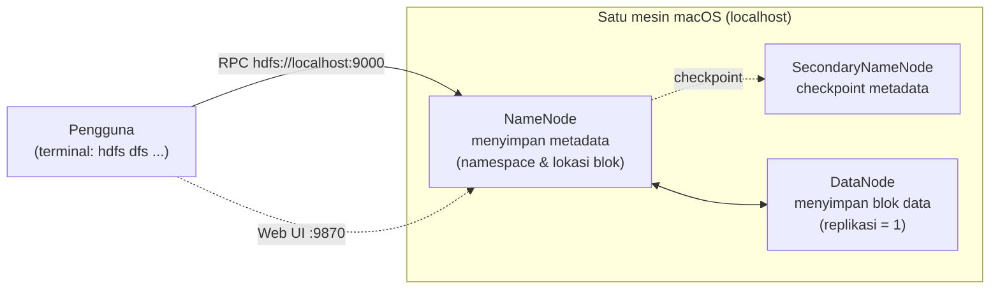
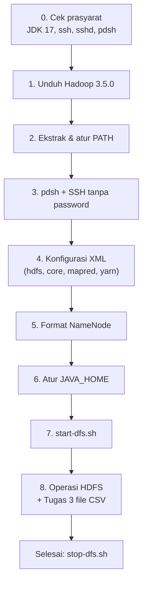
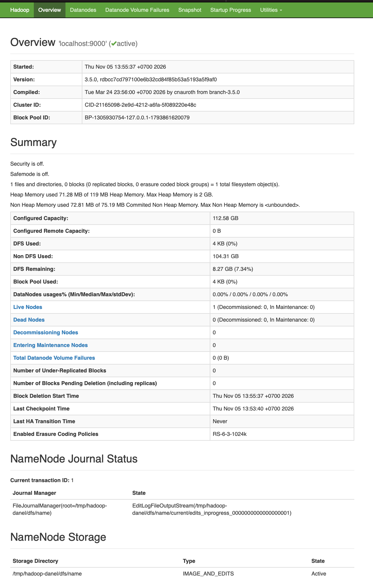
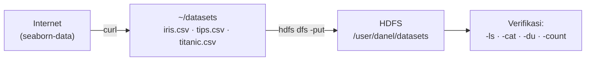

<div align="center">

# Modul 6 — Distributed File System (HDFS)

### Praktikum Sistem Terdistribusi dan Terdesentralisasi

**Instalasi Apache Hadoop 3.5.0 & HDFS Mode Single Node di macOS**


-orange?logo=openjdk&logoColor=white)

-green)

</div>
| Nama | NIM | Program Studi |
|:----:|:---:|:-------------:|
| Usat Jalung | 255410017 | Informatika |

---

## Daftar Isi

1. [Identitas](#identitas)
2. [Tujuan Praktikum](#tujuan-praktikum)
3. [Gambaran Umum Arsitektur](#gambaran-umum-arsitektur)
4. [Isi Folder `06`](#isi-folder-06)
5. [Langkah 0 — Persyaratan Software](#langkah-0--persyaratan-software)
6. [Langkah 1 — Unduh Apache Hadoop](#langkah-1--unduh-apache-hadoop)
7. [Langkah 2 — Instalasi Apache Hadoop](#langkah-2--instalasi-apache-hadoop)
8. [Langkah 3 — Instalasi pdsh & Konfigurasi SSH](#langkah-3--instalasi-pdsh--konfigurasi-ssh)
9. [Langkah 4 — Konfigurasi Apache Hadoop](#langkah-4--konfigurasi-apache-hadoop)
10. [Langkah 5 — Format NameNode](#langkah-5--format-namenode)
11. [Langkah 6 — Atur Konfigurasi JAVA_HOME](#langkah-6--atur-konfigurasi-java_home)
12. [Langkah 7 — Jalankan Daemon HDFS](#langkah-7--jalankan-daemon-hdfs)
13. [Langkah 8 — Contoh Operasi File pada HDFS](#langkah-8--contoh-operasi-file-pada-hdfs)
14. [Menghentikan HDFS](#menghentikan-hdfs)
15. [Tugas Modul 6](#tugas-modul-6)
16. [Catatan & Kendala](#catatan--kendala)
17. [Kesimpulan](#kesimpulan)

---

## Identitas

| Keterangan | Isi |
|---|---|
| **Mata Kuliah** | Praktikum Sistem Terdistribusi dan Terdesentralisasi |
| **Modul** | Modul 6 — Distributed File System (HDFS) |
| **Nama** | Usat Jalung |
| **NIM** | _(isi NIM)_ |
| **Kelas** | IF-1 (Informatika) — Ganjil 2026 |
| **Dosen / Penulis Modul** | Dr. Bambang Purnomosidi D. P. |
| **Institusi** | Universitas Teknologi Digital Indonesia — Prodi Informatika |
| **Pengguna terminal** | `danel` (`danel@1111QD-rs`) |
| **Sistem operasi** | macOS (shell `zsh`) |

---

## Tujuan Praktikum

1. Memasang Apache Hadoop 3.5.0 beserta seluruh prasyaratnya (JDK 17, `pdsh`, `ssh`/`sshd`).
2. Mengonfigurasi Hadoop agar berjalan sebagai **single node (pseudo-distributed)**.
3. Memformat **NameNode** dan menjalankan daemon HDFS (`NameNode`, `DataNode`, `SecondaryNameNode`).
4. Memantau HDFS melalui antarmuka web dan memahami operasi dasar `hdfs dfs`.
5. Menyelesaikan tugas: membuat direktori `/user/<nama-user>/datasets` di HDFS dan menyalin **3 file `.csv`** ke dalamnya.

---

## Gambaran Umum Arsitektur

Pada praktikum ini seluruh komponen HDFS berjalan di **satu mesin** (`localhost`). Meskipun hanya satu node, peran-peran HDFS tetap terpisah sebagai proses Java yang berbeda.



Alur kerja seluruh praktikum:



---

## Isi Folder `06`

| No | File | Jenis | Keterangan |
|---|---|---|---|
| 1 | `setup-hadoop-3.5.0-macos-single-node.log` | Log terminal | Rekaman seluruh perintah dan output instalasi Hadoop di macOS |
| 2 | `README.md` | Dokumentasi | Dokumen ini |
| 3 | `image/01-Unduh Apache Hadoop.png` | Gambar | Halaman unduh Apache Hadoop (Langkah 1) |
| 4 | `image/02-HDFS.png` | Gambar | Web UI HDFS, halaman Overview (Langkah 7) |
| 5 | `image/03-Browsing HDFS.png` | Gambar | Browse Directory HDFS, tiga file CSV (Tugas) |

---

## Langkah 0 — Persyaratan Software

Sebelum memulai, perangkat lunak berikut harus tersedia:

| Software | Ketentuan | Fungsi |
|---|---|---|
| **JDK** | Versi 17 dan/atau 21 (server memakai 17) | Hadoop ditulis dengan Java |
| **Apache Hadoop** | Versi 3.5.0 (rilis 2 April 2026) | Framework HDFS/YARN/MapReduce |
| **pdsh** | Parallel Distributed Shell | Menjalankan perintah ke banyak node lewat SSH |
| **ssh** | OpenSSH client | Koneksi antar node |
| **sshd** | Harus berjalan | Server SSH yang dipakai skrip `start-dfs.sh` |

Pada modul asli, `sshd` dijalankan dengan `sudo dinitctl start sshd` (Artix Linux + dinit) atau `sudo systemctl start ssh` (systemd). Pada **macOS**, SSH server diaktifkan melalui fitur **Remote Login**.

### Kode (di macOS)

```bash
sudo systemsetup -setremotelogin on
nc -z localhost 22 && echo "SSHD AKTIF"
```

### Output

```text
setremotelogin: remote login is already On.
Connection to localhost port 22 [tcp/ssh] succeeded!
SSHD AKTIF
```

### Penjelasan Kode

| Perintah | Penjelasan |
|---|---|
| `sudo systemsetup -setremotelogin on` | Mengaktifkan **Remote Login** (SSH server) di macOS. Setara dengan menjalankan `sshd` pada Linux. |
| `nc -z localhost 22` | `nc` (netcat) dengan opsi `-z` hanya **memindai** apakah port 22 terbuka tanpa mengirim data. |
| `&& echo "SSHD AKTIF"` | Operator `&&` menjalankan `echo` **hanya jika** perintah sebelumnya sukses (exit code 0). |

### Penjelasan Output

- `remote login is already On` → Remote Login **sudah aktif sebelumnya**, jadi tidak ada perubahan.
- `Connection to localhost port 22 [tcp/ssh] succeeded!` → port 22 (SSH) menerima koneksi, berarti `sshd` hidup.
- `SSHD AKTIF` → pesan dari `echo`, menandakan prasyarat `sshd` **terpenuhi**.

---

## Langkah 1 — Unduh Apache Hadoop

Distribusi Hadoop diambil dari <https://hadoop.apache.org/releases.html>. Pada halaman tersebut tersedia versi **3.5.0 (rilis 2026 Apr 2)**, dengan pilihan *binary* (x86_64) dan *binary-aarch64* (ARM).


### Kode

```bash
rm -f ~/master/data-engineering/apache-hadoop/hadoop-3.5.0*.tar.gz
mkdir -p ~/master/data-engineering/apache-hadoop
cd ~/master/data-engineering/apache-hadoop

if [ "$(uname -m)" = "arm64" ]; then FILE=hadoop-3.5.0-aarch64.tar.gz; else FILE=hadoop-3.5.0.tar.gz; fi
curl -fL -O "https://dlcdn.apache.org/hadoop/common/hadoop-3.5.0/$FILE" \
|| curl -fL -O "https://archive.apache.org/dist/hadoop/common/hadoop-3.5.0/$FILE"

ls -lh
gzip -t hadoop-3.5.0*.tar.gz && echo "FILE VALID"
```

### Output

```text
  % Total    % Received % Xferd  Average Speed   Time     Time     Time  Current
100  554M  100  554M    0     0  1968k      0  0:04:48  0:04:48 --:--:-- 3380k

total 1135320
-rw-r--r--  1 danel  staff   554M Nov  5 13:30 hadoop-3.5.0.tar.gz

FILE VALID
```

### Penjelasan Kode

| Perintah | Penjelasan |
|---|---|
| `rm -f ...hadoop-3.5.0*.tar.gz` | Menghapus unduhan lama (jika ada) agar tidak bentrok; `-f` mencegah error bila file tidak ada. |
| `mkdir -p ...` | Membuat folder tujuan unduhan beserta folder induknya. |
| `uname -m` + `if ... fi` | Mendeteksi **arsitektur CPU**. Jika `arm64` (Apple Silicon) maka unduh varian `aarch64`; selain itu unduh varian x86_64. |
| `curl -fL -O URL` | `-f` gagal bila server memberi error HTTP, `-L` mengikuti redirect, `-O` menyimpan dengan nama file asli. |
| `\|\| curl ... archive.apache.org` | **Cadangan**: bila mirror utama gagal, unduh dari arsip resmi Apache. |
| `ls -lh` | Menampilkan ukuran file dalam format mudah dibaca. |
| `gzip -t` | **Menguji integritas** arsip tanpa mengekstraknya. |

### Penjelasan Output

- Ukuran file **554 MB**, selesai dalam **4 menit 48 detik** (kecepatan rata-rata ±1,9 MB/s).
- Nama file yang tersimpan adalah `hadoop-3.5.0.tar.gz` (bukan `-aarch64`), artinya cabang `else` yang terpilih: mesin ini bukan `arm64` (Mac berbasis Intel/x86_64).
- `FILE VALID` → arsip **tidak rusak** dan aman diekstrak.

---

## Langkah 2 — Instalasi Apache Hadoop

Arsip diekstrak ke `~/software/storage/`, dibuat *symbolic link* `hadoop` → `hadoop-3.5.0`, lalu dibuat file environment agar perintah `hadoop`, `hdfs`, `start-dfs.sh`, dll. bisa dipanggil dari mana saja.

> Lokasi instalasi disebut **`$HADOOP_HOME`** = `$HOME/software/storage/hadoop`.

### Kode

```bash
mkdir -p ~/software/storage
cd ~/software/storage
rm -f hadoop
tar -xzf ~/master/data-engineering/apache-hadoop/hadoop-3.5.0*.tar.gz
ln -s hadoop-3.5.0 hadoop

mkdir -p ~/env/bash/storage
cat > ~/env/bash/storage/hadoop.sh << 'EOF'
export JAVA_HOME=$(/usr/libexec/java_home -v 17)
export HADOOP_HOME="$HOME/software/storage/hadoop"
export PATH="$HADOOP_HOME/bin:$HADOOP_HOME/sbin:$PATH"
export PDSH_RCMD_TYPE=ssh
EOF

grep -qxF 'source ~/env/bash/storage/hadoop.sh' ~/.zshrc || echo 'source ~/env/bash/storage/hadoop.sh' >> ~/.zshrc
source ~/env/bash/storage/hadoop.sh
hadoop version
```

### Output

```text
Hadoop 3.5.0
Source code repository https://github.com/apache/hadoop.git -r dbcc7cd797100e6b32cd84f85b53a5193a5f9af0
Compiled by cnauroth on 2026-03-24T16:56Z
Compiled on platform linux-x86_64
Compiled with protoc 3.25.5
From source with checksum 64582ed0a62a169c39a19c734a8f33b5
This command was run using /Users/danel/software/storage/hadoop-3.5.0/share/hadoop/common/hadoop-common-3.5.0.jar
```

### Penjelasan Kode

| Perintah | Penjelasan |
|---|---|
| `tar -xzf` | Mengekstrak (`x`) arsip gzip (`z`) dari file (`f`). |
| `ln -s hadoop-3.5.0 hadoop` | Membuat **symlink** `hadoop`. Keuntungannya, saat upgrade versi cukup mengganti tautan; konfigurasi tetap memakai path `.../hadoop`. |
| `cat > hadoop.sh << 'EOF'` | Menulis file environment (*here-document*). Tanda kutip pada `'EOF'` mencegah variabel diperluas saat penulisan. |
| `JAVA_HOME=$(/usr/libexec/java_home -v 17)` | Utilitas macOS yang mencari lokasi **JDK 17** secara otomatis. |
| `HADOOP_HOME` | Menunjuk ke direktori instalasi Hadoop. |
| `PATH=...bin:...sbin` | `bin` berisi `hadoop`/`hdfs`; `sbin` berisi skrip admin seperti `start-dfs.sh`. |
| `PDSH_RCMD_TYPE=ssh` | Memaksa `pdsh` memakai SSH sebagai mekanisme perintah jarak jauh. |
| `grep -qxF ... \|\| echo ... >> ~/.zshrc` | Menambahkan `source` ke `~/.zshrc` **hanya jika belum ada**, sehingga tidak terduplikasi. (Modul memakai bash; macOS memakai `zsh`.) |
| `source ...` | Memuat variabel ke shell yang sedang berjalan. |
| `hadoop version` | Menampilkan versi untuk memastikan instalasi berhasil. |

### Penjelasan Output

- `Hadoop 3.5.0` → versi sesuai yang dipersyaratkan modul.
- `Compiled by cnauroth on 2026-03-24` → tanggal build rilis resmi (cocok dengan *Compiled* pada Web UI di Langkah 7).
- `-r dbcc7cd797...` → *commit hash* Git sumber kode; juga muncul di Web UI sebagai identitas versi.
- Baris terakhir menunjukkan JAR yang dieksekusi berada di `$HOME/software/storage/hadoop-3.5.0/...` → **PATH sudah benar**.

> Pada modul asli (Linux), sebelum `source` perintah `hadoop` menghasilkan `bash: hadoop: command not found`. Itu menunjukkan bahwa `PATH` memang **belum** mengenali Hadoop sampai file environment di-*source*.

---

## Langkah 3 — Instalasi pdsh & Konfigurasi SSH

`pdsh` dipakai skrip Hadoop (`start-dfs.sh`) untuk menjalankan daemon di banyak node. Pada modul, `pdsh` di Artix Linux dikompilasi dari AUR menggunakan `trizen`; di macOS `pdsh` sudah tersedia pada `/usr/local/bin/pdsh`.

### 3.1 Verifikasi `pdsh`

```bash
pdsh -q -w localhost
```

```text
-- DSH-specific options --
Separate stderr/stdout Yes
Path prepended to cmd  none
Appended to cmd        none
Command:               none
Full program pathname  /usr/local/bin/pdsh
Remote program path    /usr/local/bin/pdsh

-- Generic options --
Local username         danel
Local uid              501
Remote username        danel
Rcmd type              ssh
one ^C will kill pdsh  No
Connect timeout (secs) 10
Command timeout (secs) 0
Fanout                 32
Display hostname labels Yes
Debugging              No

-- Target nodes --
localhost
```

| Opsi | Arti |
|---|---|
| `-q` | *Query*: hanya menampilkan konfigurasi, **tanpa** menjalankan perintah. |
| `-w localhost` | Menetapkan node target = `localhost`. |

**Penjelasan output:** `Rcmd type = ssh` (sudah sesuai, jadi tidak perlu `export PDSH_RCMD_TYPE=ssh` manual karena sudah ada di `hadoop.sh`). `Fanout 32` berarti maksimal 32 koneksi paralel. `Target nodes: localhost` membuktikan `pdsh` mengenali target.

### 3.2 SSH tanpa Password ke `localhost`

Hadoop memakai SSH untuk menyalakan daemon, sehingga login ke `localhost` **tidak boleh meminta password**.

Perintah menurut modul (membuat kunci baru jika belum ada):

```bash
ssh-keygen -t rsa -P '' -f ~/.ssh/id_rsa
cat ~/.ssh/id_rsa.pub >> ~/.ssh/authorized_keys
chmod 0600 ~/.ssh/authorized_keys
```

Perintah yang tercatat pada log (versi aman & idempoten):

```bash
mkdir -p ~/.ssh && touch ~/.ssh/authorized_keys
grep -qF "$(cat ~/.ssh/id_rsa.pub)" ~/.ssh/authorized_keys || cat ~/.ssh/id_rsa.pub >> ~/.ssh/authorized_keys
chmod 700 ~/.ssh
chmod 600 ~/.ssh/authorized_keys

for h in localhost 0.0.0.0 $(hostname); do
  ssh -o StrictHostKeyChecking=accept-new -o BatchMode=yes $h 'echo SSH OK'
done
```

```text
SSH OK
Warning: Permanently added '0.0.0.0' (ED25519) to the list of known hosts.
SSH OK
SSH OK
```

### Penjelasan Kode

| Perintah | Penjelasan |
|---|---|
| `ssh-keygen -t rsa -P '' -f ~/.ssh/id_rsa` | Membuat pasangan kunci **RSA** dengan *passphrase kosong* (`-P ''`) di `~/.ssh/id_rsa`. |
| `cat id_rsa.pub >> authorized_keys` | Mendaftarkan **kunci publik** sebagai kunci yang diizinkan login ke akun ini sendiri. |
| `grep -qF "$(cat ...)" \|\| cat ... >>` | Menambahkan kunci **hanya bila belum terdaftar** (mencegah duplikat). |
| `chmod 700 ~/.ssh` & `chmod 600 authorized_keys` | `sshd` menolak kunci jika izin file terlalu longgar. Hanya pemilik yang boleh membaca/menulis. |
| `for h in localhost 0.0.0.0 $(hostname)` | Menguji tiga alamat yang mungkin dipakai Hadoop. |
| `-o StrictHostKeyChecking=accept-new` | Otomatis menerima *host key* baru (tanpa prompt `yes/no`) tetapi tetap menolak jika kunci berubah. |
| `-o BatchMode=yes` | Melarang prompt password; **gagal langsung** jika autentikasi kunci tidak berhasil. |
| `'echo SSH OK'` | Perintah uji yang dijalankan di sisi remote. |

### Penjelasan Output

- Tiga kali `SSH OK` → SSH ke `localhost`, `0.0.0.0`, dan *hostname* mesin berhasil **tanpa password**.
- `Warning: Permanently added '0.0.0.0'` → hanya peringatan informasi bahwa alamat `0.0.0.0` baru dicatat di `known_hosts`; **bukan error**.
- Pada modul, uji pertama `ssh localhost` meminta konfirmasi `yes` (fingerprint ED25519 belum dikenal); sesudah itu login berikutnya langsung masuk tanpa prompt.

---

## Langkah 4 — Konfigurasi Apache Hadoop

Empat file konfigurasi XML di `$HADOOP_HOME/etc/hadoop/` diatur untuk mode single node.

### 4.1 `hdfs-site.xml`

```xml
<configuration>
    <property>
        <name>dfs.replication</name>
        <value>1</value>
    </property>
</configuration>
```

`dfs.replication = 1` → setiap blok hanya disimpan **1 salinan**. Pada cluster sungguhan default-nya 3, tetapi karena hanya ada 1 DataNode, nilai lebih besar dari 1 tidak akan terpenuhi.

### 4.2 `core-site.xml`

```xml
<configuration>
    <property>
        <name>fs.defaultFS</name>
        <value>hdfs://localhost:9000</value>
    </property>
    <property>
        <name>hadoop.proxyuser.danel.groups</name>
        <value>*</value>
    </property>
    <property>
        <name>hadoop.proxyuser.danel.hosts</name>
        <value>*</value>
    </property>
</configuration>
```

- `fs.defaultFS` → alamat NameNode; semua perintah `hdfs dfs` yang tidak menyebut host akan diarahkan ke `hdfs://localhost:9000`.
- `hadoop.proxyuser.<user>.groups/hosts` → mengizinkan pengguna tersebut bertindak sebagai *proxy user* (impersonasi) dari grup/host mana pun (`*`). Pada modul tertulis `yourusername`; diganti dengan nama pengguna sendiri (`danel`).

### 4.3 `mapred-site.xml`

```xml
<configuration>
    <property>
        <name>mapreduce.framework.name</name>
        <value>yarn</value>
    </property>
    <property>
        <name>mapreduce.application.classpath</name>
        <value>$HADOOP_CLASSPATH:$HADOOP_HOME/share/hadoop/mapreduce/*:$HADOOP_MAPRED_HOME/share/hadoop/mapreduce/lib/*</value>
    </property>
</configuration>
```

- `mapreduce.framework.name = yarn` → job MapReduce dijalankan di atas **YARN**.
- `mapreduce.application.classpath` → daftar JAR yang dibutuhkan job MapReduce.

### 4.4 `yarn-site.xml`

```xml
<configuration>
    <!-- Site specific YARN configuration properties -->
    <property>
        <name>yarn.nodemanager.aux-services</name>
        <value>mapreduce_shuffle</value>
    </property>
    <property>
        <name>yarn.nodemanager.env-whitelist</name>
        <value>JAVA_HOME,HADOOP_COMMON_HOME,HADOOP_HDFS_HOME,HADOOP_CONF_DIR,CLASSPATH_PREPEND_DISTCACHE,HADOOP_YARN_HOME,HADOOP_HOME,PATH,LANG,TZ,HADOOP_MAPRED_HOME</value>
    </property>
    <property>
        <name>yarn.nodemanager.resource.memory-mb</name>
        <value>4096</value>
    </property>
    <property>
        <name>yarn.scheduler.minimum-allocation-mb</name>
        <value>2048</value>
    </property>
    <property>
        <name>yarn.nodemanager.vmem-pmem-ratio</name>
        <value>2.1</value>
    </property>
</configuration>
```

| Properti | Fungsi |
|---|---|
| `yarn.nodemanager.aux-services = mapreduce_shuffle` | Mengaktifkan layanan *shuffle* untuk tahap MapReduce. |
| `yarn.nodemanager.env-whitelist` | Variabel lingkungan yang boleh diwariskan ke container. |
| `yarn.nodemanager.resource.memory-mb = 4096` | Total memori (4 GB) yang boleh dipakai NodeManager. |
| `yarn.scheduler.minimum-allocation-mb = 2048` | Alokasi memori minimum per container (2 GB). |
| `yarn.nodemanager.vmem-pmem-ratio = 2.1` | Rasio memori virtual terhadap fisik yang diizinkan. |

### 4.5 Validasi Konfigurasi

```bash
hadoop conftest
```

```text
/Users/danel/software/storage/hadoop/etc/hadoop/yarn-site.xml: valid
/Users/danel/software/storage/hadoop/etc/hadoop/hdfs-site.xml: valid
/Users/danel/software/storage/hadoop/etc/hadoop/hadoop-policy.xml: valid
/Users/danel/software/storage/hadoop/etc/hadoop/kms-site.xml: valid
/Users/danel/software/storage/hadoop/etc/hadoop/core-site.xml: valid
/Users/danel/software/storage/hadoop/etc/hadoop/hdfs-rbf-site.xml: valid
/Users/danel/software/storage/hadoop/etc/hadoop/kms-acls.xml: valid
/Users/danel/software/storage/hadoop/etc/hadoop/capacity-scheduler.xml: valid
/Users/danel/software/storage/hadoop/etc/hadoop/mapred-site.xml: valid
/Users/danel/software/storage/hadoop/etc/hadoop/httpfs-site.xml: valid
OK
```

**Penjelasan:** `hadoop conftest` memeriksa sintaks seluruh file XML konfigurasi. Semua berstatus `valid` dan diakhiri `OK` → tidak ada kesalahan penulisan tag/struktur XML.

> Pada file log, isi awal *here-document* (`hdfs-site.xml`, `core-site.xml`, `mapred-site.xml`, dan bagian awal `yarn-site.xml`) terpotong di terminal; isi yang ditampilkan di atas mengikuti petunjuk Modul 6.

---

## Langkah 5 — Format NameNode

> Proses ini **hanya dilakukan sekali**. Jika diulang, seluruh data yang sudah ada di HDFS akan **terhapus**.

### Kode

```bash
java -version
hdfs namenode -format
```

### Output (ringkasan dari log)

```text
openjdk version "17.0.21" 2026-10-20
OpenJDK Runtime Environment Temurin-17.0.21+9 (build 17.0.21+9)
OpenJDK 64-Bit Server VM Temurin-17.0.21+9 (build 17.0.21+9, mixed mode)

2026-11-05 13:53:37,413 INFO namenode.NameNode: STARTUP_MSG:
/************************************************************
STARTUP_MSG: Starting NameNode
STARTUP_MSG:   host = 1111QD-rs.local/127.0.0.1
STARTUP_MSG:   args = [-format]
STARTUP_MSG:   version = 3.5.0
...
STARTUP_MSG:   java = 17.0.21
************************************************************/
2026-11-05 13:53:38,497 WARN util.NativeCodeLoader: Unable to load native-hadoop library for your platform... using builtin-java classes where applicable
2026-11-05 13:53:39,074 INFO namenode.NameNode: Formatting using clusterid: CID-21165098-2e9d-4212-a6fa-5f089220e48c
2026-11-05 13:53:39,368 INFO namenode.FSNamesystem: fsOwner = danel (auth:SIMPLE)
2026-11-05 13:53:39,369 INFO namenode.FSNamesystem: supergroup = supergroup
2026-11-05 13:53:39,369 INFO namenode.FSNamesystem: isPermissionEnabled = true
2026-11-05 13:53:39,825 INFO blockmanagement.BlockManager: defaultReplication = 1
2026-11-05 13:53:40,093 INFO namenode.FSImage: Allocated new BlockPoolId: BP-1305930754-127.0.0.1-1793861620079
2026-11-05 13:53:40,145 INFO common.Storage: Storage directory /tmp/hadoop-danel/dfs/name has been successfully formatted.
2026-11-05 13:53:40,398 INFO namenode.FSImageFormatProtobuf: Image file /tmp/hadoop-danel/dfs/name/current/fsimage.ckpt_0000000000000000000 of size 400 bytes saved in 0 seconds .
2026-11-05 13:53:40,491 INFO namenode.FSImage: FSImageSaver clean checkpoint: txid=0 when meet shutdown.
SHUTDOWN_MSG: Shutting down NameNode at 1111QD-rs.local/127.0.0.1
```

### Penjelasan Kode

| Perintah | Penjelasan |
|---|---|
| `java -version` | Memastikan Java yang aktif adalah **JDK 17** (Temurin) sebelum memformat. |
| `hdfs namenode -format` | **Menginisialisasi** sistem berkas HDFS baru: membuat direktori metadata, `fsimage` awal, *Cluster ID*, dan *Block Pool ID*. |

### Penjelasan Output

| Baris output | Arti |
|---|---|
| `STARTUP_MSG: ... version = 3.5.0` / `java = 17.0.21` | NameNode sementara dijalankan dengan Hadoop 3.5.0 dan Java 17.0.21. |
| `WARN NativeCodeLoader: Unable to load native-hadoop library` | **Peringatan wajar**. Library native tidak tersedia untuk macOS sehingga Hadoop memakai implementasi Java; tidak mengganggu fungsi. |
| `Formatting using clusterid: CID-2116...` | ID unik cluster yang baru dibuat. |
| `fsOwner = danel`, `supergroup = supergroup` | Pemilik sistem berkas HDFS adalah `danel`; grup super bernama `supergroup`. |
| `defaultReplication = 1` | Mengikuti `dfs.replication = 1` pada `hdfs-site.xml`. |
| `Allocated new BlockPoolId: BP-1305930754-...` | ID *block pool* yang menjadi identitas kumpulan blok pada NameNode ini. |
| `Storage directory /tmp/hadoop-danel/dfs/name has been successfully formatted` | **Inti keberhasilan**: direktori metadata NameNode selesai diformat. |
| `Image file ... fsimage.ckpt_000...0 of size 400 bytes saved` | Berkas *fsimage* awal (snapshot metadata kosong) tersimpan. |
| `SHUTDOWN_MSG: Shutting down NameNode` | Proses format selesai, NameNode sementara dimatikan secara normal. |

> **Catatan:** lokasi default penyimpanan HDFS adalah `/tmp/hadoop-<user>`. Folder `/tmp` dapat dibersihkan sistem operasi (misalnya saat restart), sehingga data HDFS bisa hilang. Untuk penggunaan jangka panjang, atur `hadoop.tmp.dir` ke lokasi permanen.

---

## Langkah 6 — Atur Konfigurasi JAVA_HOME

Hadoop mewajibkan `JAVA_HOME` terdefinisi pada `hadoop-env.sh`.

### Kode

```bash
echo "export JAVA_HOME=$(/usr/libexec/java_home -v 17)" >> $HADOOP_HOME/etc/hadoop/hadoop-env.sh
tail -n 2 $HADOOP_HOME/etc/hadoop/hadoop-env.sh
```

### Output

```text
# export HADOOP_REGISTRYDNS_SECURE_EXTRA_OPTS="-jvm server"
export JAVA_HOME=/Library/Java/JavaVirtualMachines/temurin-17.jdk/Contents/Home
```

### Penjelasan Kode

| Perintah | Penjelasan |
|---|---|
| `$(/usr/libexec/java_home -v 17)` | Menghasilkan path instalasi JDK 17 di macOS. |
| `echo "export JAVA_HOME=..." >> hadoop-env.sh` | Menambahkan baris `export` di **akhir** file (`>>` = *append*, tidak menimpa). |
| `tail -n 2` | Menampilkan 2 baris terakhir untuk memverifikasi hasil penambahan. |

### Penjelasan Output

- Baris pertama (diawali `#`) hanyalah komentar bawaan Hadoop.
- Baris kedua adalah yang baru ditambahkan: `JAVA_HOME` menunjuk ke **Temurin JDK 17**.
- Pada modul asli (Linux), nilainya `/home/bpdp/.sdkman/candidates/java/current`; di macOS path-nya berbeda karena JDK dipasang lewat `/Library/Java/JavaVirtualMachines`.

---

## Langkah 7 — Jalankan Daemon HDFS

### Kode

```bash
start-dfs.sh
jps
open http://localhost:9870
```

### Output

```text
Starting namenodes on [localhost]
Starting datanodes
Starting secondary namenodes [1111QD-rs.local]
2026-11-05 13:55:44,435 WARN util.NativeCodeLoader: Unable to load native-hadoop library for your platform... using builtin-java classes where applicable

34931 DataNode
35268 Jps
34824 NameNode
35085 SecondaryNameNode
```

### Penjelasan Kode

| Perintah | Penjelasan |
|---|---|
| `start-dfs.sh` | Menyalakan seluruh daemon HDFS melalui SSH (dibantu `pdsh`). |
| `jps` | *Java Virtual Machine Process Status*: mendaftar proses Java yang sedang berjalan. |
| `open http://localhost:9870` | Membuka Web UI NameNode di browser bawaan macOS. |

### Penjelasan Output

| Daemon | PID | Peran |
|---|---|---|
| **NameNode** | 34824 | Menyimpan **metadata** (struktur direktori, lokasi blok). |
| **DataNode** | 34931 | Menyimpan **blok data** sebenarnya. |
| **SecondaryNameNode** | 35085 | Membantu **checkpoint** metadata NameNode (bukan *backup/failover*). |
| `Jps` | 35268 | Proses `jps` itu sendiri. |

Ketiga daemon HDFS **aktif** → HDFS berjalan dengan baik.

### 7.1 Pemantauan melalui Web UI

Antarmuka web tersedia di <http://localhost:9870> (halaman `dfshealth.html`).



Informasi penting pada halaman **Overview**:

| Bagian | Makna |
|---|---|
| `Overview 'localhost:9000' (active)` | NameNode aktif dan melayani di port **9000** (sesuai `fs.defaultFS`). |
| **Version**: `3.5.0, rdbcc7cd797100e6b32cd84f85b53a5193a5f9af0` | Versi dan *commit* Hadoop; sama dengan keluaran `hadoop version`. |
| **Compiled**: `Tue Mar 24 ... 2026 by cnauroth from branch-3.5.0` | Waktu dan pembuat build. |
| **Cluster ID / Block Pool ID** | Identitas cluster dan block pool hasil format NameNode. |
| `Security is off`, `Safemode is off` | Tanpa autentikasi Kerberos; HDFS sudah keluar dari *safe mode* sehingga bisa **ditulis**. |
| `1 files and directories, 0 blocks` | Masih kosong, hanya direktori root. |
| **Configured Capacity** | Total kapasitas disk yang dapat dipakai HDFS. |
| **DFS Used** | Ruang yang sudah dipakai HDFS (nyaris 0 pada awal). |

---

## Langkah 8 — Contoh Operasi File pada HDFS

Daftar lengkap perintah tersedia di dokumentasi resmi: [FileSystemShell](https://hadoop.apache.org/docs/current/hadoop-project-dist/hadoop-common/FileSystemShell.html).

### Kode

```bash
hdfs dfs -ls /
hdfs dfs -mkdir -p /user/danel
hdfs dfs -ls /user
```

### Output

```text
(hdfs dfs -ls /  → tidak ada daftar, root masih kosong)

Found 1 items
drwxr-xr-x   - danel supergroup          0 2026-11-05 23:58 /user/danel
```

### Penjelasan Kode

| Perintah | Penjelasan |
|---|---|
| `hdfs dfs -ls /` | Menampilkan isi direktori root **di HDFS** (bukan di disk lokal macOS). |
| `hdfs dfs -mkdir -p /user/danel` | Membuat direktori `/user/danel`; `-p` membuat induk (`/user`) sekaligus jika belum ada. |
| `hdfs dfs -ls /user` | Memverifikasi bahwa direktori sudah terbentuk. |

### Penjelasan Output

- `-ls /` sebelum `mkdir` tidak menampilkan apa pun → HDFS baru, masih kosong.
- `Found 1 items` → ada 1 entri di `/user`.
- `drwxr-xr-x - danel supergroup 0 ... /user/danel`:
  - `d` = direktori; `rwxr-xr-x` = izin akses (pemilik baca/tulis/eksekusi; lainnya baca/eksekusi);
  - `-` pada kolom replikasi karena direktori tidak punya replikasi;
  - `danel` = pemilik, `supergroup` = grup, `0` = ukuran (direktori tidak punya ukuran data).

---

## Menghentikan HDFS

Setelah selesai bekerja, hentikan daemon dengan:

```bash
stop-dfs.sh
```

```text
Stopping namenodes on [localhost]
Stopping datanodes
Stopping secondary namenodes [localhost]
```

**Penjelasan:** `stop-dfs.sh` mematikan NameNode, DataNode, dan SecondaryNameNode secara berurutan. Jalankan `jps` setelahnya untuk memastikan ketiga proses sudah tidak ada. Perintah ini adalah bagian dari modul; pada file log yang direkam, HDFS dibiarkan tetap menyala setelah tugas selesai.

---

## Tugas Modul 6

> **Soal:**
> 1. Buat direktori `/user/<nama-user>/datasets` di HDFS.
> 2. Cari 3 file `.csv` di Internet, lalu salin ke direktori yang baru dibuat.



### Tugas 1 — Membuat direktori `datasets` di HDFS

```bash
hdfs dfs -mkdir -p /user/danel/datasets
```

Perintah ini tidak menghasilkan output selain peringatan `NativeCodeLoader` (peringatan wajar). Keberadaan direktori dibuktikan pada Tugas 2.

### Tugas 2 — Mengunduh 3 file CSV

Dipilih tiga dataset populer dari repositori `mwaskom/seaborn-data`: **iris**, **tips**, dan **titanic**.

```bash
mkdir -p ~/datasets && cd ~/datasets
curl -fL -o iris.csv    https://raw.githubusercontent.com/mwaskom/seaborn-data/master/iris.csv
curl -fL -o tips.csv    https://raw.githubusercontent.com/mwaskom/seaborn-data/master/tips.csv
curl -fL -o titanic.csv https://raw.githubusercontent.com/mwaskom/seaborn-data/master/titanic.csv
```

```text
100  3858  100  3858    0     0   9634      0 --:--:-- --:--:-- --:--:--  9620
100  9729  100  9729    0     0  33122      0 --:--:-- --:--:-- --:--:-- 33204
100 57018  100 57018    0     0   475k      0 --:--:-- --:--:-- --:--:--  480k
```

| Dataset | Ukuran | Isi singkat |
|---|---|---|
| `iris.csv` | 3.858 byte | Ukuran sepal & petal tiga spesies bunga iris |
| `tips.csv` | 9.729 byte | Data tagihan restoran dan tip pelanggan |
| `titanic.csv` | 57.018 byte | Data penumpang kapal Titanic dan status selamat |

**Penjelasan kode:** `curl -fL -o nama.csv URL` mengunduh dan menyimpan dengan nama tertentu (`-o`); `-f` gagal jika HTTP error; `-L` mengikuti redirect. Pada output, `100` di kolom `% Total` dan `% Received` berarti unduhan **tuntas 100%**.

### Tugas 3 — Menyalin file ke HDFS

```bash
hdfs dfs -put -f ~/datasets/*.csv /user/danel/datasets/
hdfs dfs -ls /user/danel/datasets
```

```text
Found 3 items
-rw-r--r--   1 danel supergroup       3858 2026-11-06 00:00 /user/danel/datasets/iris.csv
-rw-r--r--   1 danel supergroup       9729 2026-11-06 00:00 /user/danel/datasets/tips.csv
-rw-r--r--   1 danel supergroup      57018 2026-11-06 00:00 /user/danel/datasets/titanic.csv
```

**Penjelasan kode:**

| Bagian | Arti |
|---|---|
| `hdfs dfs -put` | Menyalin file dari **sistem berkas lokal** ke **HDFS**. |
| `-f` | *Force*: menimpa file tujuan jika sudah ada. |
| `~/datasets/*.csv` | *Wildcard* yang mencakup semua file `.csv` di folder lokal. |
| `/user/danel/datasets/` | Direktori tujuan di HDFS. |

**Penjelasan output:**

- `Found 3 items` → tiga file berhasil tersimpan di HDFS .
- `-rw-r--r--` → izin file (baca/tulis untuk pemilik, baca untuk lainnya).
- Angka `1` setelah izin = **faktor replikasi** (sesuai `dfs.replication = 1`).
- Ukuran byte **identik** dengan file asli hasil unduhan (3858, 9729, 57018), jadi penyalinan utuh.

### Verifikasi 1 — Ukuran dalam format mudah dibaca

```bash
hdfs dfs -ls -h /user/danel/datasets
```

```text
Found 3 items
-rw-r--r--   1 danel supergroup      3.8 K 2026-11-06 00:00 /user/danel/datasets/iris.csv
-rw-r--r--   1 danel supergroup      9.5 K 2026-11-06 00:00 /user/danel/datasets/tips.csv
-rw-r--r--   1 danel supergroup     55.7 K 2026-11-06 00:00 /user/danel/datasets/titanic.csv
```

Opsi `-h` mengubah byte menjadi satuan K/M/G (*human-readable*).

### Verifikasi 2 — Membaca isi file langsung dari HDFS

```bash
hdfs dfs -cat /user/danel/datasets/iris.csv    | head -n 5
hdfs dfs -cat /user/danel/datasets/tips.csv    | head -n 5
hdfs dfs -cat /user/danel/datasets/titanic.csv | head -n 5
```

```text
sepal_length,sepal_width,petal_length,petal_width,species
5.1,3.5,1.4,0.2,setosa
4.9,3.0,1.4,0.2,setosa
4.7,3.2,1.3,0.2,setosa
4.6,3.1,1.5,0.2,setosa
```

```text
"total_bill","tip","sex","smoker","day","time","size"
16.99,1.01,"Female","No","Sun","Dinner",2
10.34,1.66,"Male","No","Sun","Dinner",3
21.01,3.5,"Male","No","Sun","Dinner",3
23.68,3.31,"Male","No","Sun","Dinner",2
cat: Unable to write to output stream.
```

```text
survived,pclass,sex,age,sibsp,parch,fare,embarked,class,who,adult_male,deck,embark_town,alive,alone
0,3,male,22.0,1,0,7.25,S,Third,man,True,,Southampton,no,False
1,1,female,38.0,1,0,71.2833,C,First,woman,False,C,Cherbourg,yes,False
1,3,female,26.0,0,0,7.925,S,Third,woman,False,,Southampton,yes,True
1,1,female,35.0,1,0,53.1,S,First,woman,False,C,Southampton,yes,False
cat: Unable to write to output stream.
```

**Penjelasan:**

- `hdfs dfs -cat` mencetak isi file HDFS ke layar; `| head -n 5` memotong ke **5 baris pertama** (1 header + 4 data).
- Pesan `cat: Unable to write to output stream.` **bukan kesalahan data**. `head` menutup *pipe* setelah mendapat 5 baris, sehingga `-cat` tidak bisa menulis sisa isi file. Ini perilaku normal pipeline.
- Baris `iris.csv` memperlihatkan format kolom ukuran bunga + spesies; `tips.csv` memakai tanda kutip pada nama kolom; `titanic.csv` memiliki banyak kolom dan beberapa sel kosong (misalnya kolom `deck`) yang menandakan data tidak tersedia.

### Verifikasi 3 — Penggunaan disk & jumlah objek

```bash
hdfs dfs -du -h /user/danel/datasets
hdfs dfs -count /user/danel/datasets
```

```text
3.8 K   3.8 K   /user/danel/datasets/iris.csv
9.5 K   9.5 K   /user/danel/datasets/tips.csv
55.7 K  55.7 K  /user/danel/datasets/titanic.csv

           1            3              70605 /user/danel/datasets
```

**Penjelasan:**

- `-du -h` → ukuran tiap file. Dua kolom nilai: kolom pertama ukuran data asli, kolom kedua ukuran **setelah memperhitungkan replikasi**. Karena replikasi = 1, kedua kolom sama.
- `-count` menampilkan kolom: `DIR_COUNT  FILE_COUNT  CONTENT_SIZE  PATHNAME`.
  - `1` → ada 1 direktori (`datasets` itu sendiri),
  - `3` → ada 3 file,
  - `70605` → total byte = 3.858 + 9.729 + 57.018 = **70.605 byte** (cocok dengan penjumlahan manual).

### Verifikasi 4 — Melihat lewat Web UI (Browse Directory)

```bash
open http://localhost:9870/explorer.html#/user/danel/datasets
```


Halaman **Utilities → Browse the file system** menampilkan ketiga file beserta pemilik, grup, ukuran, replikasi, dan *block size*. Ini membuktikan hasil yang sama dengan baris perintah.

---

## Catatan & Kendala

| No | Hal | Penjelasan |
|---|---|---|
| 1 | Peringatan `NativeCodeLoader` | Muncul pada hampir setiap perintah `hdfs`. Wajar di macOS karena library native tidak ada; Hadoop beralih ke kelas Java bawaan. Tidak perlu diperbaiki. |
| 2 | Perbedaan port Web UI | Pada Hadoop 3.x, Web UI NameNode berada di port **9870** (bukan 50070 seperti Hadoop 2.x). Port **9000** adalah port RPC (`fs.defaultFS`). |
| 3 | Penyesuaian dari Linux ke macOS | `sshd` diaktifkan lewat *Remote Login*, `JAVA_HOME` memakai `/usr/libexec/java_home`, shell memakai `~/.zshrc` (bukan bash). |
| 4 | Peringatan `.zshrc: no such file or directory: /opt/homebrew/bin/brew` | Muncul saat terminal dibuka karena `.zshrc` memanggil Homebrew di path Apple Silicon, sedangkan mesin ini memakai path Intel (`/usr/local`). Tidak memengaruhi Hadoop. |
| 5 | Data di `/tmp` | Lokasi default penyimpanan HDFS (`/tmp/hadoop-danel`) bisa dibersihkan sistem; atur `hadoop.tmp.dir` bila ingin data permanen. |
| 6 | `cat: Unable to write to output stream` | Efek `head` menutup *pipe*, bukan kerusakan data. |
| 7 | Format NameNode | Jangan diulang karena akan menghapus data HDFS yang sudah ada. |

---

## Kesimpulan

1. **Apache Hadoop 3.5.0** berhasil dipasang di macOS dengan **JDK 17 (Temurin)**, dibuktikan oleh keluaran `hadoop version`.
2. **SSH tanpa password** ke `localhost` berhasil sehingga skrip `start-dfs.sh` dapat menyalakan daemon otomatis.
3. Seluruh file konfigurasi XML dinyatakan **valid** oleh `hadoop conftest`, dan **NameNode berhasil diformat**.
4. Tiga daemon HDFS (**NameNode, DataNode, SecondaryNameNode**) berjalan, terlihat pada `jps` dan Web UI di `localhost:9870`.
5. **Tugas selesai**: direktori `/user/danel/datasets` dibuat dan tiga file CSV (`iris.csv`, `tips.csv`, `titanic.csv`) berhasil disalin, dengan total isi **70.605 byte** yang terverifikasi oleh `hdfs dfs -ls`, `-cat`, `-du`, dan `-count`.

---

<div align="center">

**Praktikum Sistem Terdistribusi dan Terdesentralisasi — IF-1 Ganjil 2026**
Universitas Teknologi Digital Indonesia · Prodi Informatika

</div>
