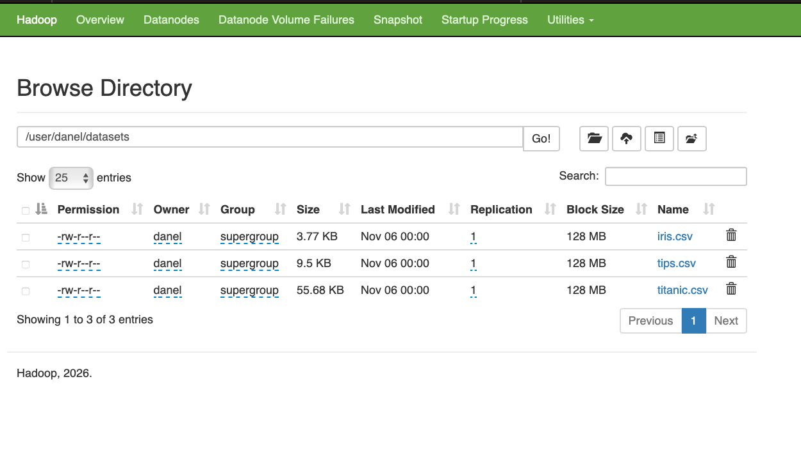

# Modul 6 — Distributed File System (HDFS)

**Praktikum Sistem Terdistribusi dan Terdesentralisasi**  
Program Studi Informatika — Universitas Teknologi Digital Indonesia

| Informasi | Detail |
| :--- | :--- |
| **Nama** | Usat Jalung |
| **Kelas** | IF1 |
| **Topik** | Instalasi Apache Hadoop 3.5.0 (pseudo-distributed) & Operasi Dasar HDFS |
| **Tanggal** | 06 November 2026 |
| **Penulis Modul** | Dr. Bambang Purnomosidi D. P. |
| **Sumber Materi** | Modul 6 - Praktikum Sistem Terdistribusi dan Terdesentralisasi, Prodi Informatika, UTDI |

---

## 📑 Daftar Isi
1. [Persyaratan Software](#-persyaratan-software)
2. [Unduh & Instalasi Apache Hadoop](#-unduh--instalasi-apache-hadoop)
3. [Instalasi pdsh & Konfigurasi SSH](#-instalasi-pdsh--konfigurasi-ssh)
4. [Konfigurasi Apache Hadoop](#-konfigurasi-apache-hadoop)
5. [Format NameNode & JAVA_HOME](#-format-namenode--java_home)
6. [Menjalankan Daemon HDFS](#-menjalankan-daemon-hdfs)
7. [Operasi File HDFS](#-operasi-file-hdfs)
8. [Tugas Praktikum](#-tugas-praktikum)
9. [Kesimpulan](#-kesimpulan)

---

## 📦 Persyaratan Software

Untuk mengerjakan materi pada petunjuk ini, beberapa distribusi software diperlukan:

| Software | Keterangan |
| :--- | :--- |
| **JDK** | Versi 17 dan/atau 21. Jika akan mengkompilasi Apache Hadoop, gunakan versi 17. JDK 17 untuk server, client boleh 17 atau 21. |
| **Apache Hadoop** | Versi 3.5.0 (rilis 2 April 2026). |
| **pdsh** | Parallel Distributed Shell. |
| **ssh / sshd** | Klien dan Server SSH. `sshd` harus telah dijalankan. |

> 💡 **Catatan:** Pada sistem Artix Linux + dinit sebagai init system, jalankan menggunakan `sudo dinitctl start sshd`. Jika menggunakan systemd: `sudo systemctl start ssh`.

---

## 📥 Unduh & Instalasi Apache Hadoop

### 1. Unduh Distribusi
Ambil distribusi Apache Hadoop di [https://hadoop.apache.org/releases.html](https://hadoop.apache.org/releases.html). Pilih **Binary download** untuk paket siap pakai.


### 2. Ekstraksi & Symbolic Link
```bash
cd ~/software/storage/
tar -xvf ~/master/data-engineering/apache-hadoop/hadoop-3.5.0.tar.gz
ln -s hadoop-3.5.0 hadoop
```
> **Catatan:** Lokasi instalasi Apache Hadoop selanjutnya akan disebut dengan `$HADOOP_HOME`. Dalam kasus ini, `$HADOOP_HOME` merujuk pada direktori `$HOME/software/storage/hadoop`.

### 3. Konfigurasi Environment Variable
Setiap akan menggunakan Apache Hadoop di suatu shell/terminal, source file tersebut (cukup sekali saja):
```bash
source ~/env/bash/storage/hadoop.sh
```
*(Pastikan file `hadoop.sh` berisi export PATH ke `$HADOOP_HOME/bin` dan `$HADOOP_HOME/sbin`)*

### 4. Verifikasi Instalasi
```bash
hadoop
```
*Jika terinstall dengan baik, akan muncul daftar usage options dan subcommands.*

---

## 🔑 Instalasi pdsh & Konfigurasi SSH

### 1. Instalasi pdsh
Kebanyakan distro Linux sudah mempunyai paket untuk `pdsh`. Pada Artix Linux, `pdsh` harus dikompilasi dari AUR menggunakan `trizen`:
```bash
trizen -Ss pdsh
trizen -S pdsh
```

### 2. Verifikasi pdsh
Jalankan program menggunakan binary executable `pdsh`:
```bash
pdsh -q -w localhost
```
Jika `Rcmd type` selain `ssh`, atur environment variable (misal di Bash):
```bash
export PDSH_RCMD_TYPE=ssh
```

### 3. SSH ke localhost Tanpa Password
Atur agar SSH ke localhost tidak perlu login (passwordless):
```bash
ssh-keygen -t rsa -P '' -f ~/.ssh/id_rsa
cat ~/.ssh/id_rsa.pub >> ~/.ssh/authorized_keys
chmod 0600 ~/.ssh/authorized_keys
```
Uji coba dengan menjalankan `ssh localhost`. Jika berhasil, Anda akan langsung masuk tanpa diminta password.

---

## ⚙️ Konfigurasi Apache Hadoop

Edit file konfigurasi di dalam `$HADOOP_HOME/etc/hadoop/`:

### 1. `hdfs-site.xml`
```xml
<configuration>
    <property>
        <name>dfs.replication</name>
        <value>1</value>
    </property>
</configuration>
```

### 2. `core-site.xml`
```xml
<configuration>
    <property>
        <name>fs.defaultFS</name>
        <value>hdfs://localhost:9000</value>
    </property>
    <property>
        <name>hadoop.proxyuser.yourusername.groups</name>
        <value>*</value>
    </property>
    <property>
        <name>hadoop.proxyuser.yourusername.hosts</name>
        <value>*</value>
    </property>
</configuration>
```
*(Ganti `yourusername` dengan nama user Linux Anda)*

### 3. `mapred-site.xml`
```xml
<configuration>
    <property>
        <name>mapreduce.framework.name</name>
        <value>yarn</value>
    </property>
    <property>
        <name>mapreduce.application.classpath</name>
        <value>$HADOOP_CLASSPATH:$HADOOP_HOME/share/hadoop/mapreduce/*:$HADOOP_MAPRED_HOME/share/hadoop/mapreduce/lib/*</value>
    </property>
</configuration>
```

### 4. `yarn-site.xml`
```xml
<configuration>
    <property>
        <name>yarn.nodemanager.aux-services</name>
        <value>mapreduce_shuffle</value>
    </property>
    <property>
        <name>yarn.nodemanager.env-whitelist</name>
        <value>JAVA_HOME,HADOOP_COMMON_HOME,HADOOP_HDFS_HOME,HADOOP_CONF_DIR,CLASSPATH_PREPEND_DISTCACHE,HADOOP_YARN_HOME,HADOOP_HOME,PATH,LANG,TZ,HADOOP_MAPRED_HOME</value>
    </property>
    <property>
        <name>yarn.nodemanager.resource.memory-mb</name>
        <value>4096</value>
    </property>
    <property>
        <name>yarn.scheduler.minimum-allocation-mb</name>
        <value>2048</value>
    </property>
    <property>
        <name>yarn.nodemanager.vmem-pmem-ratio</name>
        <value>2.1</value>
    </property>
</configuration>
```

---

## 🗄️ Format NameNode & JAVA_HOME

### 1. Format NameNode
> ⚠️ **PERINGATAN:** Proses ini dilakukan **sekali saja**. Jika dilakukan lagi, akan menghapus berbagai file yang telah diproses di HDFS.
```bash
hdfs namenode -format
```
*Pastikan muncul pesan: `Storage directory ... has been successfully formatted.`*

### 2. Atur Konfigurasi JAVA_HOME
Edit file `$HADOOP_HOME/etc/hadoop/hadoop-env.sh` dengan mengisikan env var untuk `JAVA_HOME` sesuai dengan lokasi di komputer/server/node Anda:
```bash
export JAVA_HOME=/home/<user>/.sdkman/candidates/java/current
```
*(Sesuaikan path di atas dengan lokasi JDK yang sebenarnya di sistem Anda).*

---

## 🚀 Menjalankan Daemon HDFS

Jalankan daemon untuk HDFS:
```bash
start-dfs.sh
```

Pemantauan bisa dilakukan menggunakan Web UI di browser:  
🔗 **[http://localhost:9870](http://localhost:9870)**


---

## 📂 Operasi File HDFS

Jika sudah berhasil sampai pada posisi ini, berarti Hadoop dan HDFS siap digunakan. Berikut adalah contoh operasi file pada HDFS. 

*(Daftar lengkap dari perintah-perintah HDFS bisa dilihat di: [Hadoop FileSystemShell Documentation](https://hadoop.apache.org/docs/current/hadoop-project-dist/hadoop-common/FileSystemShell.html))*

Contoh perintah dasar:
```bash
# Melihat isi direktori root
hdfs dfs -ls /

# Membuat direktori user
hdfs dfs -mkdir -p /user/<nama-user>

# Melihat isi direktori user
hdfs dfs -ls /user
```

**Untuk menghentikan HDFS:**
```bash
stop-dfs.sh
```

---

## 📝 Tugas Praktikum

Sesuai dengan instruksi modul, berikut adalah pengerjaan tugas:

1. Buat direktori `/user/<nama-user>/datasets` di HDFS anda.
2. Cari 3 file `.csv` di Internet dan kemudian copy kan 3 file tersebut ke direktori yang baru saja anda buat pada tugas 1 di atas.

### Langkah Pengerjaan:

**1. Membuat Direktori**
```bash
hdfs dfs -mkdir -p /user/usatjalung/datasets
hdfs dfs -ls /user/usatjalung
```

**2. Mengunduh 3 File CSV (Lokal)**
```bash
mkdir -p ~/datasets
wget -P ~/datasets https://raw.githubusercontent.com/jbrownlee/Datasets/master/iris.csv
wget -P ~/datasets https://raw.githubusercontent.com/jbrownlee/Datasets/master/pima-indians-diabetes.csv
wget -P ~/datasets https://raw.githubusercontent.com/jbrownlee/Datasets/master/sonar.csv
```

**3. Menyalin (Copy) File ke HDFS**
```bash
hdfs dfs -put ~/datasets/*.csv /user/usatjalung/datasets/
```

**4. Verifikasi Hasil (Browsing HDFS)**
```bash
hdfs dfs -ls -h /user/usatjalung/datasets/
```

### 📸 Output Tugas:


> **Analisis Output:** Gambar di atas membuktikan bahwa perintah `mkdir` dan `put` berhasil dieksekusi sesuai instruksi tugas. Terlihat 3 file `.csv` telah tersimpan di dalam direktori `/user/usatjalung/datasets/` di HDFS dengan ukuran yang valid, pemilik `usatjalung`, grup `supergroup`, dan replikasi `1` (sesuai konfigurasi pseudo-distributed).

---

## 🏁 Kesimpulan

1. Apache Hadoop 3.5.0 berhasil diinstal dan dikonfigurasi dalam mode *pseudo-distributed* sesuai panduan modul.
2. Konfigurasi `pdsh` dan *passwordless SSH* merupakan prasyarat mutlak agar skrip manajemen daemon (`start-dfs.sh`) dapat berjalan otomatis.
3. Proses format NameNode berhasil dilakukan satu kali, dan variabel `JAVA_HOME` telah dikonfigurasi dengan benar.
4. Operasi dasar HDFS (`-mkdir`, `-ls`, `-put`) berhasil divalidasi, termasuk penyelesaian tugas praktikum yaitu mengunggah 3 file `.csv` ke direktori `/user/<nama-user>/datasets`.

---

## 📚 Referensi
- Modul 6 - Distributed File System (HDFS), Praktikum Sistem Terdistribusi dan Terdesentralisasi.  
- Penulis: **Dr. Bambang Purnomosidi D. P.**  
- Program Studi Informatika, Universitas Teknologi Digital Indonesia.  
- [Apache Hadoop Official Documentation](https://hadoop.apache.org/docs/stable/)

---
*Dikerjakan oleh **Usat Jalung** | Kelas **IF1** | © 2026*
```

### 💡 Cara Menggunakan:
1. Buka repository GitHub Anda: `prak-dis-dec` → folder `06`.
2. Klik tombol **Add file** → **Create new file** (atau edit file `README.md` yang sudah ada).
3. Beri nama file: `README.md`.
4. **Salin (Copy)** seluruh teks di dalam kotak kode di atas (dari `# Modul 6` sampai baris `© 2026*`).
5. **Tempel (Paste)** ke editor GitHub.
6. Klik **Commit changes...** untuk menyimpan.

Semua gambar akan otomatis muncul karena menggunakan tautan *raw* langsung dari repository Anda, dan kredit penulis modul (Dr. Bambang Purnomosidi D. P.) serta sumber materi sudah dicantumkan secara eksplisit di bagian header dan referensi.
