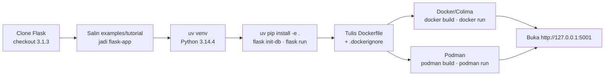
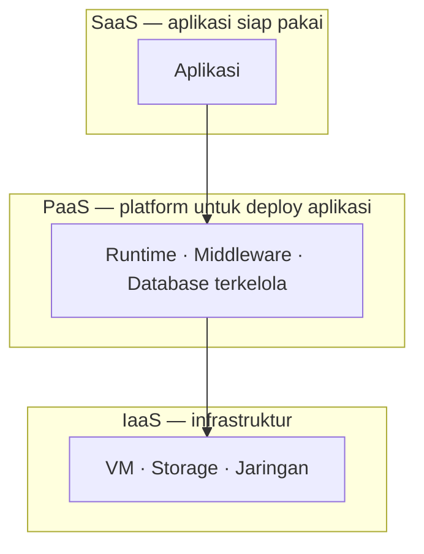

<h1 align="center">Modul 7 — Cloud Computing (Containerized App)</h1>


<h3 align="center">Praktikum Sistem Terdistribusi dan Terdesentralisasi</h3>

<h4 align="center">Containerisasi Aplikasi Flask (<code>flaskr</code>) dengan Docker &amp; Podman di macOS</h4>

<p align="center">
  
  
  
  
  
  
</p>

<div align="center">

| Nama | NIM | Program Studi |
|:---:|:---:|:---:|
| Usat Jalung | 255410017 | Informatika |

</div>

<p align="center"><sub>Universitas Teknologi Digital Indonesia</sub></p>

---

Dokumen ini adalah laporan praktikum Modul 7: mengubah aplikasi blog tutorial Flask (`flaskr`) menjadi **Containerized App (CA)** yang dijalankan memakai **Docker** dan **Podman**. Selain langkah kerja, dokumen ini menjelaskan **mengapa perintah di terminal saya berbeda dengan yang tertulis di modul**, menjelaskan setiap kode yang dipakai beserta outputnya, dan menyediakan **kode untuk mengatasi error** yang umum muncul.

---

## Daftar Isi

1. [Isi direktori ini](#1-isi-direktori-ini)
2. [Gambaran alur kerja](#2-gambaran-alur-kerja)
3. [Langkah 0 — Pengantar & persiapan source code](#3-langkah-0--pengantar--persiapan-source-code)
4. [Langkah 1 — Membuat env Python 3.14.4 (uv)](#4-langkah-1--membuat-env-python-3144-uv)
5. [Langkah 2 — Install paket & jalankan lokal](#5-langkah-2--install-paket--jalankan-lokal)
6. [Penjelasan kode aplikasi `flaskr`](#6-penjelasan-kode-aplikasi-flaskr)
7. [Langkah 3 — Dockerfile & `.dockerignore`](#7-langkah-3--dockerfile--dockerignore)
8. [Langkah 4 — Build & jalankan dengan Docker (Colima)](#8-langkah-4--build--jalankan-dengan-docker-colima)
9. [Langkah 5 — Build & jalankan dengan Podman](#9-langkah-5--build--jalankan-dengan-podman)
10. [Mengapa terminal saya berbeda dengan modul?](#10-mengapa-terminal-saya-berbeda-dengan-modul)
11. [Error yang muncul & kode penanganannya](#11-error-yang-muncul--kode-penanganannya)
12. [Membersihkan resource](#12-membersihkan-resource)
13. [Tugas 0 — XaaS (SaaS, PaaS, IaaS)](#13-tugas-0--xaas-saas-paas-iaas)
14. [Log terminal lengkap](#14-log-terminal-lengkap)

---

## 1. Isi direktori ini

| Berkas / folder | Keterangan |
|---|---|
| [`README.md`](README.md) | Dokumen ini. |
| [`Containerization_Docker_Podman`](Containerization_Docker_Podman) | Log terminal lengkap praktikum (setup → lokal → Docker/Colima → Podman). Isinya ditampilkan juga di [bagian 14](#14-log-terminal-lengkap). |
| [`image/localhost:5002.png`](image/localhost%3A5002.png) | Screenshot aplikasi berjalan **lokal** (`flask run --port 5002`). |
| [`image/localhost:5001.png`](image/localhost%3A5001.png) | Screenshot aplikasi berjalan di **container Docker** (host `5001` → container `5000`). |
| [`image/Podman 127.0.0.1-5001.png`](image/Podman%20127.0.0.1-5001.png) | Screenshot aplikasi berjalan di **container Podman** (host `5001` → container `5000`). |
| [`PDF/ http-::127.0.0.1-5002.pdf`](PDF/%20http-%3A%3A127.0.0.1-5002.pdf) | Cetak halaman browser — lokal, port 5002. |
| [`PDF/ http-::127.0.0.1-5001.pdf`](PDF/%20http-%3A%3A127.0.0.1-5001.pdf) | Cetak halaman browser — Docker, port 5001. |
| [`PDF/Podman http-::127.0.0.1-5001.pdf`](PDF/Podman%20http-%3A%3A127.0.0.1-5001.pdf) | Cetak halaman browser — Podman, port 5001. |

> **Catatan nama berkas:** beberapa nama berkas mengandung tanda titik dua (`:`) dan spasi. Di macOS/Linux ini aman, tetapi di **Windows** karakter `:` tidak diizinkan sehingga `git clone` bisa gagal/ter-rename. Sebaiknya di-rename, misalnya:
> ```bash
> git mv "image/localhost:5002.png"          image/lokal-5002.png
> git mv "image/localhost:5001.png"          image/docker-5001.png
> git mv "image/Podman 127.0.0.1-5001.png"   image/podman-5001.png
> ```
> (lalu perbarui tautan gambar di README ini).

---

## 2. Gambaran alur kerja



Konsep singkat: **image** = "cetakan" berisi OS + Python + aplikasi + dependensi; **container** = proses hasil menjalankan image. Dockerfile yang sama bisa dibaca oleh Docker maupun Podman.

---

## 3. Langkah 0 — Pengantar & persiapan source code

Source code tutorial Flask: <https://github.com/pallets/flask/tree/3.1.3/examples/tutorial>

### 3.1 Membuat direktori kerja dan mengambil source Flask

**Kode**

```bash
deactivate 2>/dev/null
mkdir -p $HOME/src
cd $HOME/src
[ -d flask ] || git clone https://github.com/pallets/flask
cd flask && git checkout 3.1.3 && cd ..
```

**Output**

```text
HEAD sekarang berada di 22d92470 release version 3.1.3
```

**Penjelasan**

| Perintah | Fungsi |
|---|---|
| `deactivate 2>/dev/null` | Keluar dari virtualenv lama jika ada; `2>/dev/null` membuang pesan error bila tidak ada venv aktif. |
| `mkdir -p $HOME/src` | Membuat direktori kerja `~/src` (tidak error bila sudah ada). |
| `[ -d flask ] \|\| git clone …` | "Jika folder `flask` belum ada, baru clone" sehingga aman dijalankan berulang. |
| `git checkout 3.1.3` | Mengunci ke tag rilis 3.1.3, sama dengan versi di modul. Output `HEAD sekarang berada di 22d92470 …` berarti berhasil pindah ke commit rilis itu (pesan berbahasa Indonesia karena locale sistem). |

### 3.2 Menyalin contoh tutorial menjadi `flask-app`

**Kode**

```bash
rm -rf flask-app
cp -R ~/src/flask/examples/tutorial flask-app
cd flask-app
ls -la
```

**Output**

```text
total 32
drwxr-xr-x  8 danel  staff   256 Nov 13 18:14 .
drwxr-xr-x  4 danel  staff   128 Nov 13 18:14 ..
-rw-r--r--  1 danel  staff   119 Nov 13 18:14 .gitignore
-rw-r--r--  1 danel  staff  1475 Nov 13 18:14 LICENSE.txt
-rw-r--r--  1 danel  staff  1273 Nov 13 18:14 README.rst
drwxr-xr-x  9 danel  staff   288 Nov 13 18:14 flaskr
-rw-r--r--  1 danel  staff   771 Nov 13 18:14 pyproject.toml
drwxr-xr-x  8 danel  staff   256 Nov 13 18:14 tests
```

**Penjelasan**

- `rm -rf flask-app` menghapus salinan lama agar tidak bercampur.
- `cp -R` menyalin seluruh isi `examples/tutorial` (rekursif) menjadi folder baru `flask-app`.
- `ls -la` menampilkan isi: `flaskr/` (kode aplikasi), `pyproject.toml` (metadata & dependensi), `tests/` (pengujian), serta `LICENSE.txt`, `README.rst`, `.gitignore`.

---

## 4. Langkah 1 — Membuat env Python 3.14.4 (uv)

**Kode**

```bash
uv python install 3.14.4
uv venv --python 3.14.4
echo "3.14.4" > .python-version
source .venv/bin/activate
python --version
```

**Output**

```text
Python 3.14.4 is already installed
Using CPython 3.14.4
Creating virtual environment at: .venv
Activate with: source .venv/bin/activate
Python 3.14.4
```

**Penjelasan**

| Perintah | Fungsi |
|---|---|
| `uv python install 3.14.4` | Memastikan Python 3.14.4 tersedia. Output "already installed" = sudah terpasang sebelumnya. |
| `uv venv --python 3.14.4` | Membuat virtualenv `.venv` dengan Python tersebut. |
| `echo "3.14.4" > .python-version` | Menyimpan versi Python proyek agar `uv` memakai versi yang sama di lain waktu. |
| `source .venv/bin/activate` | Mengaktifkan venv; prompt berubah menjadi `(flask-app) …`. |
| `python --version` | Verifikasi: `Python 3.14.4`. |

---

## 5. Langkah 2 — Install paket & jalankan lokal

### 5.1 Install paket

**Kode**

```bash
uv pip install -e .
```

**Output**

```text
Resolved 8 packages in 460ms
      Built flaskr @ file:///Users/danel/src/flask-app
Prepared 8 packages in 640ms
Installed 8 packages in 19ms
 + blinker==1.9.0
 + click==8.5.1
 + flask==3.1.3
 + flaskr==1.0.0 (from file:///Users/danel/src/flask-app)
 + itsdangerous==2.2.0
 + jinja2==3.1.6
 + markupsafe==3.0.4
 + werkzeug==3.1.9
```

**Penjelasan:** `-e .` memasang proyek di direktori saat ini dalam mode *editable* (perubahan kode langsung terbaca). `pyproject.toml` hanya meminta `flask`; `uv` otomatis menambah dependensinya (blinker, click, itsdangerous, jinja2, markupsafe, werkzeug) sehingga total 8 paket, termasuk `flaskr` sendiri.

### 5.2 Inisialisasi database

**Kode**

```bash
flask --app flaskr init-db
```

**Output**

```text
Initialized the database.
```

**Penjelasan:** `--app flaskr` memberi tahu Flask paket aplikasinya; `init-db` adalah perintah CLI buatan `db.py` yang menjalankan `schema.sql` untuk membuat tabel `user` dan `post` di `instance/flaskr.sqlite`.

### 5.3 Menjalankan aplikasi

**Kode**

```bash
flask --app flaskr run --port 5002
```

**Output**

```text
 * Serving Flask app 'flaskr'
 * Debug mode: off
WARNING: This is a development server. Do not use it in a production deployment. Use a production WSGI server instead.
 * Running on http://127.0.0.1:5002
Press CTRL+C to quit
127.0.0.1 - - [13/Nov/2026 18:16:03] "GET / HTTP/1.1" 200 -
127.0.0.1 - - [13/Nov/2026 18:16:04] "GET /static/style.css HTTP/1.1" 200 -
127.0.0.1 - - [13/Nov/2026 18:16:05] "GET /auth/login HTTP/1.1" 200 -
127.0.0.1 - - [13/Nov/2026 18:16:10] "POST /auth/login HTTP/1.1" 200 -
127.0.0.1 - - [13/Nov/2026 18:16:13] "GET /auth/register HTTP/1.1" 200 -
127.0.0.1 - - [13/Nov/2026 18:16:20] "GET / HTTP/1.1" 200 -
```

*(baris `304` untuk `style.css` dipersingkat; log lengkap ada di bagian 14.)*

**Tampilan di browser** — <http://127.0.0.1:5002>:


**Penjelasan**

- `run --port 5002` menjalankan server pengembangan Flask di port 5002 (default 5000).
- `WARNING: This is a development server` normal; server ini hanya untuk belajar, bukan produksi.
- Baris log dibaca: `GET /` = membuka beranda; `GET /static/style.css` = memuat CSS; `GET /auth/login` & `GET /auth/register` = membuka halaman Log In / Register; `POST /auth/login` = mengirim form login; kode `200` = sukses, `304` = file dari cache browser.
- Gambar menampilkan halaman **Posts** dengan menu **Register** dan **Log In** — bukti aplikasi berjalan.
- `Ctrl+C` menghentikan server.

---

## 6. Penjelasan kode aplikasi `flaskr`

Struktur paket `flaskr/` (Flask 3.1.3):

| File | Peran |
|---|---|
| `__init__.py` | *Application factory* `create_app()`: membuat objek Flask, mengatur `SECRET_KEY` dan lokasi database (`instance/flaskr.sqlite`), membuat folder `instance`, mendaftarkan perintah CLI dan blueprint `auth` & `blog`. |
| `db.py` | Koneksi SQLite per-request (`get_db`, `close_db`) dan perintah CLI `init-db` yang menjalankan `schema.sql`. |
| `schema.sql` | Definisi tabel `user` (id, username unik, password) dan `post` (id, author_id, created, title, body). `DROP TABLE IF EXISTS` membuat `init-db` selalu mengosongkan data lama. |
| `auth.py` | Blueprint `/auth`: `/auth/register`, `/auth/login`, `/auth/logout`, serta dekorator `login_required`. |
| `blog.py` | Blueprint blog: `/` (daftar post), `/create`, `/<id>/update`, `/<id>/delete`. |
| `templates/` | Template Jinja2: `base.html`, `auth/login.html`, `auth/register.html`, `blog/index.html`, `blog/create.html`, `blog/update.html`. |
| `static/style.css` | Gaya tampilan (di-request sebagai `/static/style.css` di log). |

Potongan kunci `__init__.py`:

```python
def create_app(test_config=None):
    app = Flask(__name__, instance_relative_config=True)
    app.config.from_mapping(
        SECRET_KEY="dev",   # kunci default; ganti untuk produksi
        DATABASE=os.path.join(app.instance_path, "flaskr.sqlite"),
    )
    os.makedirs(app.instance_path, exist_ok=True)   # folder instance/ untuk database
    ...
    app.register_blueprint(auth.bp)
    app.register_blueprint(blog.bp)
    app.add_url_rule("/", endpoint="index")         # "/" → blog.index
    return app
```

Mengapa penting untuk container: database berada di folder **`instance/`**. Saat `flask --app flaskr init-db` dijalankan di Dockerfile, database kosong ikut "terpanggang" ke dalam image.

---

## 7. Langkah 3 — Dockerfile & `.dockerignore`

### 7.1 Membuat Dockerfile

**Kode**

```bash
printf '%s\n' \
'FROM python:3.14' \
'' \
'RUN mkdir /app' \
'WORKDIR /app' \
'ADD . /app/' \
'RUN pip install -e .' \
'RUN flask --app flaskr init-db' \
'' \
'EXPOSE 5000' \
'CMD ["flask", "--app", "flaskr", "run", "--host=0.0.0.0", "--port=5000"]' \
> Dockerfile
cat Dockerfile
```

**Output**

```text
FROM python:3.14

RUN mkdir /app
WORKDIR /app
ADD . /app/
RUN pip install -e .
RUN flask --app flaskr init-db

EXPOSE 5000
CMD ["flask", "--app", "flaskr", "run", "--host=0.0.0.0", "--port=5000"]
```

**Penjelasan**

`printf '%s\n' … > Dockerfile` mencetak tiap argumen sebagai satu baris ke file `Dockerfile` (alternatif mengetik di editor); `cat` membuktikan isinya sama dengan modul.

| Baris Dockerfile | Penjelasan |
|---|---|
| `FROM python:3.14` | Image dasar (Debian + Python 3.14). |
| `RUN mkdir /app` | Membuat direktori `/app` di dalam image. |
| `WORKDIR /app` | Perintah berikutnya dijalankan dari `/app`. |
| `ADD . /app/` | Menyalin isi proyek ke `/app` (dikurangi yang ada di `.dockerignore`). |
| `RUN pip install -e .` | Memasang aplikasi + dependensi di dalam image. |
| `RUN flask --app flaskr init-db` | Membuat database saat **build** (output build: `Initialized the database.`). |
| `EXPOSE 5000` | Dokumentasi bahwa aplikasi memakai port 5000 (belum membuka port ke host). |
| `CMD [...]` | Perintah saat container start. `--host=0.0.0.0` **wajib** agar bisa diakses dari luar container. |

### 7.2 Membuat `.dockerignore` (tambahan di luar modul)

**Kode**

```bash
printf '%s\n' '.venv' '__pycache__' '*.pyc' 'instance' > .dockerignore
```

**Output:** tidak ada (perintah berhasil diam-diam). Isi file:

```text
.venv
__pycache__
*.pyc
instance
```

**Penjelasan:** mencegah `ADD . /app/` menyalin `.venv` macOS (binary tidak kompatibel dengan Linux dan membuat image besar), cache Python, serta `instance/` milik host (agar tidak menimpa database yang dibuat saat build).

---

## 8. Langkah 4 — Build & jalankan dengan Docker (Colima)

Di macOS tidak ada `dockerd` native, jadi Docker berjalan lewat VM **Colima** (padanan `sudo systemctl start docker` di modul).

### 8.1 Menyalakan Docker

**Kode**

```bash
colima start --cpus 2 --memory 4
```

**Output**

```text
INFO[0001] starting colima
INFO[0001] runtime: docker
INFO[0001] starting ...                                  context=vm
INFO[0024] provisioning ...                              context=docker
INFO[0029] starting ...                                  context=docker
INFO[0032] done
```

**Penjelasan:** membuat VM Linux dengan 2 CPU dan 4 GB RAM, lalu menjalankan Docker di dalamnya. `done` = siap dipakai.

### 8.2 Build image

**Kode**

```bash
docker build -f Dockerfile -t flaskr:1.0.0 .
```

**Output**

```text
[+] Building 14.9s (11/11) FINISHED                               docker:colima
 => [1/6] FROM docker.io/library/python:3.14@sha256:a7097ae62ea4cf4fec036  0.1s
 => CACHED [2/6] RUN mkdir /app                                            0.0s
 => CACHED [3/6] WORKDIR /app                                              0.0s
 => [4/6] ADD . /app/                                                      0.1s
 => [5/6] RUN pip install -e .                                            10.7s
 => [6/6] RUN flask --app flaskr init-db                                   0.9s
 => exporting to image                                                     2.5s
 => => naming to docker.io/library/flaskr:1.0.0                            0.0s
```

*(baris `internal`/`exporting manifest` dipersingkat; versi lengkap di bagian 14.)*

**Penjelasan:** `-f Dockerfile` = berkas build; `-t flaskr:1.0.0` = nama:tag image; `.` = *build context* (jangan lupa titik). `11/11 FINISHED` = semua tahap berhasil; `CACHED` = layer dipakai ulang dari build sebelumnya; tahap `pip install` paling lama (10,7 dtk) karena mengunduh paket.

### 8.3 Memeriksa image

**Kode**

```bash
docker image ls
```

**Output** (cuplikan baris `flaskr`)

```text
IMAGE                        ID             DISK USAGE   CONTENT SIZE   EXTRA
flaskr:1.0.0                 75141cf6ade5       1.64GB          423MB
python:3.14                  a7097ae62ea4       1.63GB          434MB
```

**Penjelasan:** image `flaskr:1.0.0` sudah ada (**build berhasil**). Daftar lengkap juga berisi image lain dari praktikum sebelumnya (`nginx`, `postgres`, dll.). Hapus yang tidak terpakai dengan `docker rmi <IMAGE_ID>` (lihat bagian 12).

### 8.4 Menjalankan container

**Kode**

```bash
docker run -p 5001:5000 flaskr:1.0.0
```

**Output**

```text
 * Serving Flask app 'flaskr'
 * Debug mode: off
WARNING: This is a development server. Do not use it in a production deployment. Use a production WSGI server instead.
 * Running on all addresses (0.0.0.0)
 * Running on http://127.0.0.1:5000
 * Running on http://172.17.0.2:5000
Press CTRL+C to quit
172.17.0.1 - - [13/Nov/2026 11:18:56] "GET / HTTP/1.1" 200 -
172.17.0.1 - - [13/Nov/2026 11:18:59] "GET /auth/login HTTP/1.1" 200 -
172.17.0.1 - - [13/Nov/2026 11:19:02] "POST /auth/login HTTP/1.1" 200 -
172.17.0.1 - - [13/Nov/2026 11:19:04] "GET /auth/register HTTP/1.1" 200 -
```

**Tampilan di browser** — <http://127.0.0.1:5001>:


**Penjelasan**

- `-p 5001:5000` memetakan port **5001 di host** ke **5000 di container**, jadi browser membuka `127.0.0.1:5001`.
- `Running on all addresses (0.0.0.0)` membuktikan `--host=0.0.0.0` dari `CMD` bekerja.
- `172.17.0.2` = IP container di jaringan Docker; `172.17.0.1` pada log request = gateway Docker (asal akses dari host).
- Jam log `11:18` = **UTC**, sedangkan laptop WIB (UTC+7) = `18:18`.
- Halaman **Posts** tampil → **CA berhasil dijalankan**.

### 8.5 Membersihkan sebelum pindah ke Podman

**Kode**

```bash
docker rm -f $(docker ps -aq) 2>/dev/null
colima stop
colima delete -f
df -h /System/Volumes/Data
```

**Output**

```text
d6fee853e142
INFO[0000] stopping colima
INFO[0003] done
INFO[0000] deleting colima
INFO[0001] done
Filesystem     Size   Used  Avail Capacity iused    ifree %iused  Mounted on
/dev/disk1s1  113Gi   68Gi  5.7Gi    93%  816166 59351280    1%   /System/Volumes/Data
```

**Penjelasan:** `docker rm -f $(docker ps -aq)` menghapus semua container (ID `d6fee853e142` yang tercetak adalah container yang dihapus); `colima stop` mematikan Docker (padanan `systemctl stop docker` di modul); `colima delete -f` menghapus VM supaya disk lega; `df -h` mengecek sisa disk — tinggal **5.7 GiB (93 % terpakai)**, itulah alasan resource dibersihkan dan VM Podman dibatasi.

---

## 9. Langkah 5 — Build & jalankan dengan Podman

Podman tidak memakai daemon dan membaca Dockerfile yang sama. Di macOS tetap butuh VM (*podman machine*).

### 9.1 Menyiapkan Podman

**Kode**

```bash
export PATH="/opt/podman/bin:$PATH"
podman --version
```

**Output**

```text
podman version 5.8.6
```

**Penjelasan:** menambahkan folder instalasi Podman ke `PATH` agar perintah `podman` ditemukan. (Di log sempat muncul `zsh: command not found: v` — hanya salah ketik, lihat bagian 11.)

### 9.2 Mereset dan membuat mesin Podman

**Kode**

```bash
podman machine stop 2>/dev/null
podman machine rm -f 2>/dev/null
podman system connection rm podman-machine-default 2>/dev/null
podman system connection rm podman-machine-default-root 2>/dev/null
rm -rf ~/.local/share/containers/podman/machine ~/.config/containers/podman/machine
podman machine init --cpus 2 --memory 2048 --disk-size 20
podman machine start
```

**Output**

```text
Machine "podman-machine-default" stopped successfully
Looking up Podman Machine image at quay.io/podman/machine-os:5.8 to create VM
Extracting compressed file: podman-machine-default-amd64.raw: done
Machine init complete
Starting machine "podman-machine-default"
API forwarding listening on: /var/folders/66/.../podman/podman-machine-default-api.sock
Machine "podman-machine-default" started successfully
```

**Penjelasan:** empat perintah pertama menghentikan dan menghapus mesin lama beserta koneksinya; `rm -rf` membersihkan sisa konfigurasi. `machine init` membuat VM baru (2 CPU, 2 GB RAM, disk 20 GB) dan `machine start` menyalakannya. Pesan *rootless mode* berarti container berjalan tanpa hak root (cukup untuk port 5001); pesan `podman-mac-helper` bersifat opsional, hanya untuk memakai socket Docker bawaan.

### 9.3 Mengecek mesin dan menarik image dasar

**Kode**

```bash
podman machine list
podman pull python:3.14
```

**Output**

```text
NAME                     VM TYPE     CREATED        LAST UP            CPUS        MEMORY      DISK SIZE
podman-machine-default*  applehv     5 minutes ago  Currently running  2           2GiB        20GiB

Resolved "python" as an alias (/etc/containers/registries.conf.d/000-shortnames.conf)
Trying to pull docker.io/library/python:3.14...
Writing manifest to image destination
78689ccd8331c65bc36e09037448cf821790ed39b1073b3f7e2affe966471989
```

**Penjelasan:** `machine list` memastikan VM `Currently running` dengan 2 CPU/2 GiB/20 GiB. `podman pull` mengunduh image dasar lebih dulu; nama pendek `python` di-*resolve* menjadi `docker.io/library/python` lewat file alias.

### 9.4 Build image

**Kode**

```bash
podman build -f Dockerfile -t flaskr:1.0.0 .
```

**Output** (diringkas)

```text
STEP 1/8: FROM python:3.14
STEP 2/8: RUN mkdir /app
STEP 3/8: WORKDIR /app
STEP 4/8: ADD . /app/
STEP 5/8: RUN pip install -e .
Successfully installed blinker-1.9.0 click-8.5.1 flask-3.1.3 flaskr-1.0.0 itsdangerous-2.2.0 jinja2-3.1.6 markupsafe-3.0.4 werkzeug-3.1.9
STEP 6/8: RUN flask --app flaskr init-db
Initialized the database.
STEP 7/8: EXPOSE 5000
STEP 8/8: CMD ["flask", "--app", "flaskr", "run", "--host=0.0.0.0", "--port=5000"]
COMMIT flaskr:1.0.0
Successfully tagged localhost/flaskr:1.0.0
```

**Penjelasan:** setiap baris Dockerfile menjadi satu `STEP` (8 langkah). Langkah 5 memasang dependensi (muncul peringatan pip root — tidak berbahaya). Langkah 6 menampilkan `Initialized the database.` (database dibuat di dalam image). `Successfully tagged localhost/flaskr:1.0.0` = **image berhasil dibuat**.

### 9.5 Memeriksa image

**Kode**

```bash
podman image ls
```

**Output**

```text
REPOSITORY                TAG         IMAGE ID      CREATED         SIZE
localhost/flaskr          1.0.0       5d4ea3d2e3e5  12 seconds ago  1.16 GB
docker.io/library/python  3.14        78689ccd8331  8 days ago      1.14 GB
```

**Penjelasan:** Podman memberi awalan `localhost/` untuk image buatan lokal. Daftarnya hanya dua image karena VM baru (tidak membawa image Docker sebelumnya).

### 9.6 Menjalankan container

**Kode**

```bash
podman run -p 5001:5000 flaskr:1.0.0
```

**Output**

```text
 * Serving Flask app 'flaskr'
 * Debug mode: off
 * Running on all addresses (0.0.0.0)
 * Running on http://127.0.0.1:5000
 * Running on http://10.88.0.2:5000
Press CTRL+C to quit
10.88.0.2 - - [13/Nov/2026 11:28:22] "GET / HTTP/1.1" 200 -
10.88.0.2 - - [13/Nov/2026 11:28:38] "GET /auth/login HTTP/1.1" 200 -
10.88.0.2 - - [13/Nov/2026 11:28:46] "POST /auth/login HTTP/1.1" 200 -
10.88.0.2 - - [13/Nov/2026 11:28:50] "GET /auth/register HTTP/1.1" 200 -
```

**Tampilan di browser** — <http://127.0.0.1:5001>:


**Penjelasan:** perintahnya sama dengan Docker. Bedanya hanya IP jaringan: `10.88.0.2` (jaringan bawaan Podman) vs `172.17.0.2` (Docker). Halaman **Posts** tampil → CA berhasil di Podman. Hentikan dengan `Ctrl+C`, lalu `podman machine stop` (output: `Machine "podman-machine-default" stopped successfully`).

> ⚠️ **Catatan:** `Podman 127.0.0.1-5001.png` dan `localhost:5001.png` **byte-identik** (hash sama), artinya screenshot Podman adalah salinan screenshot Docker. Karena aplikasinya sama, tampilannya memang sama, tetapi untuk laporan sebaiknya ambil ulang screenshot saat Podman benar-benar berjalan. PDF cetakan browser tersedia di folder `PDF/`.

---

## 10. Mengapa terminal saya berbeda dengan modul?

Modul ditulis untuk **Linux** (prompt `$`, `sudo`, `systemctl`, `dinitctl`). Praktik saya dikerjakan di **macOS** dan dengan versi paket yang lebih baru. Berikut pemetaan perbedaannya:

| # | Hal | Di modul | Di terminal saya | Alasan |
|---|---|---|---|---|
| 1 | Sistem operasi & shell | Linux, prompt `$` | macOS, zsh (`danel@… %`), prompt `(flask-app)` karena venv aktif | Perangkat berbeda. |
| 2 | Pengaktifan Docker | `sudo systemctl start docker` / `sudo dinitctl start dockerd` | `colima start --cpus 2 --memory 4` | macOS tidak punya `dockerd` native; container Linux berjalan di dalam VM (Colima). |
| 3 | Perintah Docker | `sudo docker build …` | `docker build …` (tanpa `sudo`) | Colima berjalan di level pengguna; `sudo` hanya perlu di Linux jika user tidak masuk grup `docker`. |
| 4 | Mematikan Docker sebelum Podman | `systemctl stop docker` | `docker rm -f …`, `colima stop`, `colima delete -f` | Padanannya di macOS. `colima delete` juga membebaskan disk (disk tinggal **5.7 GiB / 93 % terpakai** saat itu). |
| 5 | Podman | Langsung `podman build` | `podman machine init/start` dulu + `export PATH="/opt/podman/bin:$PATH"` | Di macOS Podman butuh VM; binary berada di `/opt/podman/bin`. |
| 6 | Alokasi VM | tidak ada | `--cpus 2 --memory 2048 --disk-size 20` | Membatasi resource VM karena ruang disk terbatas. |
| 7 | Pull image Podman | Terjadi otomatis di `STEP 1/8` ("Resolved … as an alias", "Trying to pull…") | `podman pull python:3.14` dijalankan **sebelum** build, sehingga `STEP 1/8` langsung jalan | Hanya beda urutan; hasilnya sama. |
| 8 | Nama file alias | `00-shortnames.conf` | `000-shortnames.conf` | Versi Podman/paket berbeda menamai berkas konfigurasi berbeda. |
| 9 | Versi dependensi | click 8.3.3, markupsafe 3.0.3, werkzeug 3.1.8, pip 26.0.1→26.1 | click **8.5.1**, markupsafe **3.0.4**, werkzeug **3.1.9**, pip 26.2.2→26.3 | Pyproject hanya menulis batas minimum (`>=`), jadi pip mengambil rilis **terbaru saat dijalankan**. Modul ditulis lebih awal. Flask tetap 3.1.3. |
| 10 | Hash / ID / ukuran image | `216db408897d`, dll. | `5d4ea3d2e3e5`, 1.16 GB, dll. | ID adalah hash unik tiap build — tidak akan pernah sama. |
| 11 | Port aplikasi lokal | `flask --app flaskr run` (port 5000) | `flask --app flaskr run --port 5002` | Port 5000 di macOS sering sudah dipakai layanan sistem (AirPlay Receiver); memakai 5002 menghindari bentrok. Port container tetap 5000. |
| 12 | Cara membuat Dockerfile | Diketik di editor | `printf '%s\n' … > Dockerfile` | Isi identik; `printf` mempermudah copy-paste dari terminal. |
| 13 | `.dockerignore` | Tidak ada | Ditambahkan | Mencegah `.venv` macOS, cache, dan `instance/` ikut tersalin ke image (lihat bagian 7). |
| 14 | `git checkout 3.1.3` & `rm -rf flask-app` | Hanya `git clone` dan `cp -R` | Ditambah checkout tag & hapus folder lama | Agar versi sama dengan modul dan langkah bisa diulang dari nol. |
| 15 | Bahasa pesan git | `Cloning into…` (Inggris) | `HEAD sekarang berada di …` | Locale sistem saya Bahasa Indonesia. |
| 16 | Jam di log request | – | Lokal `18:16`, container `11:18` | Container memakai **UTC**, laptop memakai **WIB (UTC+7)**; selisih 7 jam adalah normal. |
| 17 | Pesan `pip` sebagai root | Muncul di modul | Muncul juga | Di dalam container pengguna memang `root`; peringatan ini tidak berbahaya (lihat bagian 11). |
| 18 | Daftar image Docker | – | Berisi banyak image lain (`nginx`, `postgres`, `python:*-slim`, dll.) | Sisa praktikum modul lain; modul menyarankan menghapus yang tidak dipakai (lihat bagian 12). |
| 19 | Arsitektur | `x86_64` | Mesin Podman `…-amd64.raw` | Sama-sama amd64 sehingga wheel `manylinux2014_x86_64` yang sama dipakai. |

**Kesimpulan:** perbedaan hanya pada *lingkungan* (macOS vs Linux, versi terbaru dependensi, hash/ID, port lokal). **Dockerfile, urutan langkah, dan hasil akhir (aplikasi Flaskr tampil di `127.0.0.1:5001`) sama dengan modul.**

---

## 11. Error yang muncul & kode penanganannya

### 11.1 Error yang benar-benar muncul di log

**a. `zsh: command not found: v`** — salah ketik (perintah `v` tidak ada). Hanya typo; ketik ulang perintah yang benar. Untuk memastikan sebuah perintah tersedia:

```bash
command -v podman || echo "podman belum ada di PATH"
```

**b. Disk hampir penuh (`93%`, sisa 5.7 GiB)** — image Docker/Podman besar (~1–1,6 GB tiap image). Penanganan yang dipakai di log: hapus VM Colima, lalu batasi VM Podman 20 GB.

```bash
df -h /System/Volumes/Data            # cek sisa disk (macOS)
docker system df                      # lihat pemakaian Docker
docker system prune -a --volumes      # hapus image/container/volume tak terpakai (HATI-HATI)
colima delete -f                      # hapus total VM Colima
podman system prune -a                # hapus resource Podman tak terpakai
```

**c. `podman` tidak ditemukan** (PATH belum berisi `/opt/podman/bin`):

```bash
export PATH="/opt/podman/bin:$PATH"
# agar permanen:
echo 'export PATH="/opt/podman/bin:$PATH"' >> ~/.zshrc
```

**d. Peringatan `Running pip as the 'root' user …`** — tidak fatal. Untuk menyembunyikannya di Dockerfile:

```dockerfile
RUN pip install --root-user-action=ignore -e .
```

### 11.2 Error umum lain & solusinya

| Gejala | Penyebab | Solusi |
|---|---|---|
| `Cannot connect to the Docker daemon` | Docker/Colima belum menyala | macOS: `colima start` · Linux: `sudo systemctl start docker` |
| `permission denied … /var/run/docker.sock` (Linux) | User belum di grup `docker` | `sudo usermod -aG docker $USER` lalu logout/login (atau pakai `sudo docker …`) |
| `Cannot connect to Podman … unable to connect to Podman socket` | `podman machine` belum jalan | `podman machine start` (jika rusak: `podman machine rm -f && podman machine init && podman machine start`) |
| `Bind for 0.0.0.0:5001 failed: port is already allocated` / `address already in use` | Port host sudah dipakai | Cari pemakainya: `lsof -i :5001` lalu `kill <PID>`, atau ganti pemetaan: `-p 5003:5000` |
| Web tidak terbuka padahal container jalan | Aplikasi bind ke `127.0.0.1` di dalam container | Pastikan `CMD` memakai `--host=0.0.0.0` dan `-p host:container` benar |
| `sqlite3.OperationalError: no such table: user` | Database belum diinisialisasi | `flask --app flaskr init-db` (lokal) — di container sudah dilakukan oleh `RUN flask --app flaskr init-db` |
| `ModuleNotFoundError: No module named 'flaskr'` | Paket belum di-install / venv tidak aktif | `source .venv/bin/activate && uv pip install -e .` |
| `short-name "python" did not resolve to an alias` (Podman) | Registry alias tidak dikonfigurasi | Pakai nama lengkap: `FROM docker.io/library/python:3.14` |
| `container name … already in use` | Container lama masih ada | `docker rm -f <nama>` / `podman rm -f <nama>` |
| Data (user/post) hilang saat container dibuat ulang | Database ada di dalam container | Simpan di volume: `docker run -p 5001:5000 -v flaskr-data:/app/instance flaskr:1.0.0` (Podman: perintah sama) |
| Image/ build sangat besar & lambat | `.venv` & cache ikut ter-copy | Pastikan `.dockerignore` ada (bagian 7) |

### 11.3 Skrip diagnosa cepat (`cek-env.sh`)

Simpan sebagai `cek-env.sh`, jalankan `bash cek-env.sh [port_host]` (default 5001) sebelum `build`/`run`:

```bash
#!/usr/bin/env bash
# cek-env.sh — diagnosa cepat sebelum build/run container Flaskr
PORT="${1:-5001}"
ok()   { printf '  [OK]    %s\n' "$1"; }
warn() { printf '  [WARN]  %s\n' "$1"; }
bad()  { printf '  [ERROR] %s\n' "$1"; }

echo "== 1. Berkas proyek =="
[ -f Dockerfile ]     && ok "Dockerfile ada"     || bad "Dockerfile tidak ada (jalankan dari root flask-app)"
[ -f .dockerignore ]  && ok ".dockerignore ada"  || warn ".dockerignore belum ada -> .venv & instance ikut ter-copy"
[ -f pyproject.toml ] && ok "pyproject.toml ada" || bad "pyproject.toml tidak ada"

echo "== 2. Runtime container =="
if command -v docker >/dev/null 2>&1; then
  if docker info >/dev/null 2>&1; then ok "Docker daemon aktif"
  else bad "Docker terpasang tetapi daemon mati -> 'colima start' (macOS) / 'sudo systemctl start docker' (Linux)"; fi
else warn "docker tidak ditemukan"; fi

if command -v podman >/dev/null 2>&1; then
  if podman info >/dev/null 2>&1; then ok "Podman siap"
  else bad "Podman terpasang tetapi belum siap -> 'podman machine start'"; fi
else warn "podman tidak ditemukan -> export PATH=\"/opt/podman/bin:\$PATH\""; fi

echo "== 3. Port host $PORT =="
if command -v lsof >/dev/null 2>&1 && lsof -iTCP:"$PORT" -sTCP:LISTEN >/dev/null 2>&1; then
  bad "Port $PORT sedang dipakai -> 'lsof -i :$PORT' lalu kill, atau pakai port lain (mis. -p 5003:5000)"
else ok "Port $PORT kosong"; fi

echo "== 4. Ruang disk =="
USED=$(df -Pk . | awk 'NR==2 {gsub("%","",$5); print $5}')
if [ "${USED:-0}" -ge 90 ]; then bad "Disk terpakai ${USED}% -> bersihkan: 'docker system prune -a' / 'podman system prune -a'"
else ok "Disk terpakai ${USED}%"; fi
```

---

## 12. Membersihkan resource

Modul menyarankan menghapus image yang tidak dipakai lagi dengan mengacu pada **ID** image:

```bash
docker image ls                 # lihat ID image
docker rmi <IMAGE_ID>           # hapus image tertentu
docker container prune          # hapus container yang sudah berhenti
docker image prune -a           # hapus semua image yang tidak dipakai container

podman image ls
podman rmi <IMAGE_ID>
podman machine stop             # matikan VM Podman bila sudah selesai
```

---

## 13. Tugas 0 — XaaS (SaaS, PaaS, IaaS)

Pendekatan **XaaS (Everything as a Service)**: provider menyediakan sumber daya komputasi dan konsumen memakainya sebagai layanan.



| Model | Contoh vendor | Layanan yang disediakan | Yang dikelola pengguna |
|---|---|---|---|
| **SaaS** | Google Workspace (Gmail, Docs) | Aplikasi email, dokumen, penyimpanan siap pakai lewat browser | Hanya data & akun |
| **PaaS** | Heroku / Google App Engine | Runtime, deploy otomatis, scaling, add-on database | Kode aplikasi & konfigurasi |
| **IaaS** | Amazon Web Services (EC2, S3, VPC) | VM, block/object storage, jaringan virtual | OS, runtime, aplikasi, data |

> Contoh di atas adalah satu contoh per kategori sebagaimana diminta Tugas 0. Aplikasi container pada modul ini biasanya dijalankan di lapisan **PaaS/IaaS** (mis. layanan container terkelola atau VM yang menjalankan Docker/Podman).

---

## 14. Log terminal lengkap

Berikut isi berkas [`Containerization_Docker_Podman`](Containerization_Docker_Podman) apa adanya.

<details>
<summary><b>Klik untuk membuka log lengkap (≈330 baris)</b></summary>

```text
Last login: Fri Nov 13 18:13:55 on ttys001
danel@1111QD-rs ~ % deactivate 2>/dev/null
danel@1111QD-rs ~ % mkdir -p $HOME/src
danel@1111QD-rs ~ % cd $HOME/src
[ -d flask ] || git clone https://github.com/pallets/flask
danel@1111QD-rs src % cd flask && git checkout 3.1.3 && cd ..
HEAD sekarang berada di 22d92470 release version 3.1.3
danel@1111QD-rs src % rm -rf flask-app
danel@1111QD-rs src % cp -R ~/src/flask/examples/tutorial flask-app
danel@1111QD-rs src % cd flask-app
danel@1111QD-rs flask-app % ls -la
total 32
drwxr-xr-x  8 danel  staff   256 Nov 13 18:14 .
drwxr-xr-x  4 danel  staff   128 Nov 13 18:14 ..
-rw-r--r--  1 danel  staff   119 Nov 13 18:14 .gitignore
-rw-r--r--  1 danel  staff  1475 Nov 13 18:14 LICENSE.txt
-rw-r--r--  1 danel  staff  1273 Nov 13 18:14 README.rst
drwxr-xr-x  9 danel  staff   288 Nov 13 18:14 flaskr
-rw-r--r--  1 danel  staff   771 Nov 13 18:14 pyproject.toml
drwxr-xr-x  8 danel  staff   256 Nov 13 18:14 tests
danel@1111QD-rs flask-app % uv python install 3.14.4
Python 3.14.4 is already installed
danel@1111QD-rs flask-app % uv venv --python 3.14.4
Using CPython 3.14.4
Creating virtual environment at: .venv
Activate with: source .venv/bin/activate
danel@1111QD-rs flask-app % echo "3.14.4" > .python-version
danel@1111QD-rs flask-app % source .venv/bin/activate
(flask-app) danel@1111QD-rs flask-app % python --version
Python 3.14.4
(flask-app) danel@1111QD-rs flask-app % uv pip install -e .
Resolved 8 packages in 460ms
      Built flaskr @ file:///Users/danel/src/flask-app                          Prepared 8 packages in 640ms
Installed 8 packages in 19ms
 + blinker==1.9.0
 + click==8.5.1
 + flask==3.1.3
 + flaskr==1.0.0 (from file:///Users/danel/src/flask-app)
 + itsdangerous==2.2.0
 + jinja2==3.1.6
 + markupsafe==3.0.4
 + werkzeug==3.1.9
(flask-app) danel@1111QD-rs flask-app % flask --app flaskr init-db
Initialized the database.
(flask-app) danel@1111QD-rs flask-app % flask --app flaskr run --port 5002
 * Serving Flask app 'flaskr'
 * Debug mode: off
WARNING: This is a development server. Do not use it in a production deployment. Use a production WSGI server instead.
 * Running on http://127.0.0.1:5002
Press CTRL+C to quit
127.0.0.1 - - [13/Nov/2026 18:16:03] "GET / HTTP/1.1" 200 -
127.0.0.1 - - [13/Nov/2026 18:16:04] "GET /static/style.css HTTP/1.1" 200 -
127.0.0.1 - - [13/Nov/2026 18:16:05] "GET /auth/login HTTP/1.1" 200 -
127.0.0.1 - - [13/Nov/2026 18:16:05] "GET /static/style.css HTTP/1.1" 304 -
127.0.0.1 - - [13/Nov/2026 18:16:10] "POST /auth/login HTTP/1.1" 200 -
127.0.0.1 - - [13/Nov/2026 18:16:10] "GET /static/style.css HTTP/1.1" 304 -
127.0.0.1 - - [13/Nov/2026 18:16:13] "GET /auth/register HTTP/1.1" 200 -
127.0.0.1 - - [13/Nov/2026 18:16:13] "GET /static/style.css HTTP/1.1" 304 -
127.0.0.1 - - [13/Nov/2026 18:16:14] "GET /auth/login HTTP/1.1" 200 -
127.0.0.1 - - [13/Nov/2026 18:16:14] "GET /static/style.css HTTP/1.1" 304 -
127.0.0.1 - - [13/Nov/2026 18:16:20] "GET / HTTP/1.1" 200 -
127.0.0.1 - - [13/Nov/2026 18:16:20] "GET /static/style.css HTTP/1.1" 304 -
^C%                                                                             (flask-app) danel@1111QD-rs flask-app % cd $HOME/src/flask-app
(flask-app) danel@1111QD-rs flask-app % source .venv/bin/activate
(flask-app) danel@1111QD-rs flask-app % printf '%s\n' \
'FROM python:3.14' \
'' \
'RUN mkdir /app' \
'WORKDIR /app' \
'ADD . /app/' \
'RUN pip install -e .' \
'RUN flask --app flaskr init-db' \
'' \
'EXPOSE 5000' \
'CMD ["flask", "--app", "flaskr", "run", "--host=0.0.0.0", "--port=5000"]' \
> Dockerfile
(flask-app) danel@1111QD-rs flask-app % printf '%s\n' '.venv' '__pycache__' '*.pyc' 'instance' > .dockerignore
(flask-app) danel@1111QD-rs flask-app % cat Dockerfile
FROM python:3.14

RUN mkdir /app
WORKDIR /app
ADD . /app/
RUN pip install -e .
RUN flask --app flaskr init-db

EXPOSE 5000
CMD ["flask", "--app", "flaskr", "run", "--host=0.0.0.0", "--port=5000"]
(flask-app) danel@1111QD-rs flask-app % colima start --cpus 2 --memory 4
INFO[0001] starting colima                              
INFO[0001] runtime: docker                              
INFO[0001] starting ...                                  context=vm
INFO[0024] provisioning ...                              context=docker
INFO[0029] starting ...                                  context=docker
INFO[0032] done                                         
(flask-app) danel@1111QD-rs flask-app % docker build -f Dockerfile -t flaskr:1.0.0 .
[+] Building 14.9s (11/11) FINISHED                               docker:colima
 => [internal] load build definition from Dockerfile                       0.0s
 => => transferring dockerfile: 235B                                       0.0s
 => [internal] load metadata for docker.io/library/python:3.14             0.0s
 => [internal] load .dockerignore                                          0.0s
 => => transferring context: 73B                                           0.0s
 => [1/6] FROM docker.io/library/python:3.14@sha256:a7097ae62ea4cf4fec036  0.1s
 => => resolve docker.io/library/python:3.14@sha256:a7097ae62ea4cf4fec036  0.1s
 => [internal] load build context                                          0.1s
 => => transferring context: 41.80kB                                       0.0s
 => CACHED [2/6] RUN mkdir /app                                            0.0s
 => CACHED [3/6] WORKDIR /app                                              0.0s
 => [4/6] ADD . /app/                                                      0.1s
 => [5/6] RUN pip install -e .                                            10.7s
 => [6/6] RUN flask --app flaskr init-db                                   0.9s 
 => exporting to image                                                     2.5s 
 => => exporting layers                                                    1.6s 
 => => exporting manifest sha256:e34202c655d88b9043971f758367d6dc8183da47  0.0s 
 => => exporting config sha256:b227a50f1950b5604fc60975ab4e4329351ef2d682  0.0s 
 => => exporting attestation manifest sha256:d0e92ae862ac3fd1a54d1037e3a9  0.0s 
 => => exporting manifest list sha256:75141cf6ade58db20ec4fde3edd59993d98  0.0s
 => => naming to docker.io/library/flaskr:1.0.0                            0.0s
 => => unpacking to docker.io/library/flaskr:1.0.0                         0.7s
(flask-app) danel@1111QD-rs flask-app % docker image ls
                                                            i Info →   U  In Use
IMAGE                        ID             DISK USAGE   CONTENT SIZE   EXTRA
apacheignite/ignite:3.1.0    c0f43bde84be        939MB          389MB        
flaskr:1.0.0                 75141cf6ade5       1.64GB          423MB        
hello-world:latest           11a3eb1597e8       25.9kB         9.49kB        
modul5-bs_app:latest         7a5e2c157103        391MB          105MB        
modul5-nginx:latest          99a541f86cef        240MB         63.9MB        
nginx-bs_app:latest          6850660330bf        501MB          123MB        
nginx:latest                 7be37bf763b4        243MB         66.8MB        
postgres:17-alpine           eee6c6e1b089        424MB          118MB        
python:3.12-slim             aa943ce41142        180MB         45.5MB        
python:3.13.1-slim           031ebf3cde9f        184MB         46.7MB        
python:3.14                  a7097ae62ea4       1.63GB          434MB        
python:3.14-slim             cd89c30eda26        181MB         45.8MB        
python:3.14-slim-bookworm    516b51cb9db2        186MB         47.3MB        
python:3.14.4-slim           2ca02f32b4d9        179MB         45.5MB        
workspace-05-bs_app:latest   998dd5928ebb        501MB          123MB        
workspace-05-nginx:latest    33d4197b46c3        240MB         63.9MB        
(flask-app) danel@1111QD-rs flask-app % docker run -p 5001:5000 flaskr:1.0.0
 * Serving Flask app 'flaskr'
 * Debug mode: off
WARNING: This is a development server. Do not use it in a production deployment. Use a production WSGI server instead.
 * Running on all addresses (0.0.0.0)
 * Running on http://127.0.0.1:5000
 * Running on http://172.17.0.2:5000
Press CTRL+C to quit
172.17.0.1 - - [13/Nov/2026 11:18:56] "GET / HTTP/1.1" 200 -
172.17.0.1 - - [13/Nov/2026 11:18:56] "GET /static/style.css HTTP/1.1" 200 -
172.17.0.1 - - [13/Nov/2026 11:18:59] "GET /auth/login HTTP/1.1" 200 -
172.17.0.1 - - [13/Nov/2026 11:18:59] "GET /static/style.css HTTP/1.1" 304 -
172.17.0.1 - - [13/Nov/2026 11:19:02] "POST /auth/login HTTP/1.1" 200 -
172.17.0.1 - - [13/Nov/2026 11:19:02] "GET /static/style.css HTTP/1.1" 304 -
172.17.0.1 - - [13/Nov/2026 11:19:04] "GET /auth/register HTTP/1.1" 200 -
172.17.0.1 - - [13/Nov/2026 11:19:04] "GET /static/style.css HTTP/1.1" 304 -
172.17.0.1 - - [13/Nov/2026 11:19:09] "GET / HTTP/1.1" 200 -
172.17.0.1 - - [13/Nov/2026 11:19:09] "GET /static/style.css HTTP/1.1" 304 -
^C%                                                                             (flask-app) danel@1111QD-rs flask-app % docker rm -f $(docker ps -aq) 2>/dev/null
d6fee853e142
(flask-app) danel@1111QD-rs flask-app % colima stop
INFO[0000] stopping colima                              
INFO[0000] stopping ...                                  context=docker
INFO[0001] stopping ...                                  context=vm
INFO[0003] done                                         
(flask-app) danel@1111QD-rs flask-app % colima delete -f
INFO[0000] deleting colima                              
INFO[0001] done                                         
(flask-app) danel@1111QD-rs flask-app % df -h /System/Volumes/Data
Filesystem     Size   Used  Avail Capacity iused    ifree %iused  Mounted on
/dev/disk1s1  113Gi   68Gi  5.7Gi    93%  816166 59351280    1%   /System/Volumes/Data
(flask-app) danel@1111QD-rs flask-app % export PATH="/opt/podman/bin:$PATH"
(flask-app) danel@1111QD-rs flask-app % v
zsh: command not found: v
(flask-app) danel@1111QD-rs flask-app % cd $HOME/src/flask-app
(flask-app) danel@1111QD-rs flask-app % source .venv/bin/activate
(flask-app) danel@1111QD-rs flask-app % podman --version
podman version 5.8.6
(flask-app) danel@1111QD-rs flask-app % podman machine stop 2>/dev/null
Machine "podman-machine-default" stopped successfully
(flask-app) danel@1111QD-rs flask-app % podman machine rm -f 2>/dev/null
(flask-app) danel@1111QD-rs flask-app % podman system connection rm podman-machine-default 2>/dev/null
(flask-app) danel@1111QD-rs flask-app % podman system connection rm podman-machine-default-root 2>/dev/null
(flask-app) danel@1111QD-rs flask-app % rm -rf ~/.local/share/containers/podman/machine ~/.config/containers/podman/machine 
(flask-app) danel@1111QD-rs flask-app % podman machine init --cpus 2 --memory 2048 --disk-size 20
Looking up Podman Machine image at quay.io/podman/machine-os:5.8 to create VM
Getting image source signatures
Copying blob 85f6845337e7 done   | 
Copying config 44136fa355 done   | 
Writing manifest to image destination
85f6845337e76b191e02ef259bae03437df72ae4246efd36a7603eb0f1d70a62
Extracting compressed file: podman-machine-default-amd64.raw: done  
Machine init complete
To start your machine run:

	podman machine start

(flask-app) danel@1111QD-rs flask-app % podman machine start
Starting machine "podman-machine-default"

This machine is currently configured in rootless mode. If your containers
require root permissions (e.g. ports < 1024), or if you run into compatibility
issues with non-podman clients, you can switch using the following command:

	podman machine set --rootful

API forwarding listening on: /var/folders/66/fcgr2gjd1l5518ykmycd945r0000gn/T/podman/podman-machine-default-api.sock

The system helper service is not installed; the default Docker API socket
address can't be used by podman. If you would like to install it, run the following commands:

        sudo /opt/podman/bin/podman-mac-helper install
        podman machine stop; podman machine start

You can still connect Docker API clients by setting DOCKER_HOST using the
following command in your terminal session:

        export DOCKER_HOST='unix:///var/folders/66/fcgr2gjd1l5518ykmycd945r0000gn/T/podman/podman-machine-default-api.sock'

Machine "podman-machine-default" started successfully
(flask-app) danel@1111QD-rs flask-app % podman info | head -n 5
Client:
  APIVersion: 5.8.6
  BuildOrigin: pkginstaller
  Built: 1786654954
  BuiltTime: Fri Aug 14 04:02:34 2026
(flask-app) danel@1111QD-rs flask-app % podman pull python:3.14
Resolved "python" as an alias (/etc/containers/registries.conf.d/000-shortnames.conf)
Trying to pull docker.io/library/python:3.14...
Getting image source signatures
Copying blob sha256:30a939f32c3666529658895da478296143998cbf9bbb6ede9e0ea68655ef8804
Copying blob sha256:a6dd1c05fbba4f9028078a11f143cbb625d2408921eb8207bfa1dd1ad301276f
Copying blob sha256:696c1fe91c64662be9b13aa92628d62d6685ab94c0b55d185258a8f762133deb
Copying blob sha256:411d2dc8717dbb4bb0d3cfa27e6e0275fca455c5220029d7a14dc7a75fbe8665
Copying blob sha256:7d9ddf92c2fd754219dc2783bdc40c04c9283f48a48741a7b00590eac48a1ac9
Copying blob sha256:e8a88afca2bd37d4058d4b33d9d4d29b0557f8b811bb8c106942b5b51e1e4aad
Copying blob sha256:bd2decaa66042884c6b07d78fdb33ff346fe35b29f7ec34cc18eca1548a6477d
Copying config sha256:78689ccd8331c65bc36e09037448cf821790ed39b1073b3f7e2affe966471989
Writing manifest to image destination
78689ccd8331c65bc36e09037448cf821790ed39b1073b3f7e2affe966471989
(flask-app) danel@1111QD-rs flask-app % podman machine list
NAME                     VM TYPE     CREATED        LAST UP            CPUS        MEMORY      DISK SIZE
podman-machine-default*  applehv     5 minutes ago  Currently running  2           2GiB        20GiB
(flask-app) danel@1111QD-rs flask-app % podman build -f Dockerfile -t flaskr:1.0.0 .
STEP 1/8: FROM python:3.14
STEP 2/8: RUN mkdir /app
--> fb7081b51bcc
STEP 3/8: WORKDIR /app
--> ef7b2a2b42fe
STEP 4/8: ADD . /app/
--> 4656cd658529
STEP 5/8: RUN pip install -e .
Obtaining file:///app
  Installing build dependencies: started
  Installing build dependencies: finished with status 'done'
  Checking if build backend supports build_editable: started
  Checking if build backend supports build_editable: finished with status 'done'
  Getting requirements to build editable: started
  Getting requirements to build editable: finished with status 'done'
  Preparing editable metadata (pyproject.toml): started
  Preparing editable metadata (pyproject.toml): finished with status 'done'
Collecting flask (from flaskr==1.0.0)
  Downloading flask-3.1.3-py3-none-any.whl.metadata (3.2 kB)
Collecting blinker>=1.9.0 (from flask->flaskr==1.0.0)
  Downloading blinker-1.9.0-py3-none-any.whl.metadata (1.6 kB)
Collecting click>=8.1.3 (from flask->flaskr==1.0.0)
  Downloading click-8.5.1-py3-none-any.whl.metadata (2.6 kB)
Collecting itsdangerous>=2.2.0 (from flask->flaskr==1.0.0)
  Downloading itsdangerous-2.2.0-py3-none-any.whl.metadata (1.9 kB)
Collecting jinja2>=3.1.2 (from flask->flaskr==1.0.0)
  Downloading jinja2-3.1.6-py3-none-any.whl.metadata (2.9 kB)
Collecting markupsafe>=2.1.1 (from flask->flaskr==1.0.0)
  Downloading markupsafe-3.0.4-cp314-cp314-manylinux2014_x86_64.manylinux_2_17_x86_64.manylinux_2_28_x86_64.whl.metadata (2.7 kB)
Collecting werkzeug>=3.1.0 (from flask->flaskr==1.0.0)
  Downloading werkzeug-3.1.9-py3-none-any.whl.metadata (4.1 kB)
Downloading flask-3.1.3-py3-none-any.whl (103 kB)
Downloading blinker-1.9.0-py3-none-any.whl (8.5 kB)
Downloading click-8.5.1-py3-none-any.whl (126 kB)
Downloading itsdangerous-2.2.0-py3-none-any.whl (16 kB)
Downloading jinja2-3.1.6-py3-none-any.whl (134 kB)
Downloading markupsafe-3.0.4-cp314-cp314-manylinux2014_x86_64.manylinux_2_17_x86_64.manylinux_2_28_x86_64.whl (23 kB)
Downloading werkzeug-3.1.9-py3-none-any.whl (228 kB)
Building wheels for collected packages: flaskr
  Building editable for flaskr (pyproject.toml): started
  Building editable for flaskr (pyproject.toml): finished with status 'done'
  Created wheel for flaskr: filename=flaskr-1.0.0-py2.py3-none-any.whl size=2594 sha256=5173702933ff219b8139231280ff871d76ab28d81fa5493154c04746c4706ac5
  Stored in directory: /tmp/pip-ephem-wheel-cache-1v74n8ny/wheels/b8/36/9c/914153c626bda53913fc1c371da41560e7caf866363da7bf04
Successfully built flaskr
Installing collected packages: markupsafe, itsdangerous, click, blinker, werkzeug, jinja2, flask, flaskr

Successfully installed blinker-1.9.0 click-8.5.1 flask-3.1.3 flaskr-1.0.0 itsdangerous-2.2.0 jinja2-3.1.6 markupsafe-3.0.4 werkzeug-3.1.9
WARNING: Running pip as the 'root' user can result in broken permissions and conflicting behaviour with the system package manager, possibly rendering your system unusable. It is recommended to use a virtual environment instead: https://pip.pypa.io/warnings/venv. Use the --root-user-action option if you know what you are doing and want to suppress this warning.

[notice] A new release of pip is available: 26.2.2 -> 26.3
[notice] To update, run: pip install --upgrade pip
--> 58fb9d99b468
STEP 6/8: RUN flask --app flaskr init-db
Initialized the database.
--> 49ee0b5cf8a7
STEP 7/8: EXPOSE 5000
--> 474e7ba06b2b
STEP 8/8: CMD ["flask", "--app", "flaskr", "run", "--host=0.0.0.0", "--port=5000"]
COMMIT flaskr:1.0.0
--> 5d4ea3d2e3e5
Successfully tagged localhost/flaskr:1.0.0
5d4ea3d2e3e5ff6e96b598386c57340db78a1ae0d2e2786a6f05dfbbc3ff23b1
(flask-app) danel@1111QD-rs flask-app % podman image ls
REPOSITORY                TAG         IMAGE ID      CREATED         SIZE
localhost/flaskr          1.0.0       5d4ea3d2e3e5  12 seconds ago  1.16 GB
docker.io/library/python  3.14        78689ccd8331  8 days ago      1.14 GB
(flask-app) danel@1111QD-rs flask-app % podman run -p 5001:5000 flaskr:1.0.0
 * Serving Flask app 'flaskr'
 * Debug mode: off
WARNING: This is a development server. Do not use it in a production deployment. Use a production WSGI server instead.
 * Running on all addresses (0.0.0.0)
 * Running on http://127.0.0.1:5000
 * Running on http://10.88.0.2:5000
Press CTRL+C to quit
10.88.0.2 - - [13/Nov/2026 11:28:22] "GET / HTTP/1.1" 200 -
10.88.0.2 - - [13/Nov/2026 11:28:22] "GET /static/style.css HTTP/1.1" 200 -
10.88.0.2 - - [13/Nov/2026 11:28:38] "GET /auth/login HTTP/1.1" 200 -
10.88.0.2 - - [13/Nov/2026 11:28:38] "GET /static/style.css HTTP/1.1" 304 -
10.88.0.2 - - [13/Nov/2026 11:28:46] "POST /auth/login HTTP/1.1" 200 -
10.88.0.2 - - [13/Nov/2026 11:28:46] "GET /static/style.css HTTP/1.1" 304 -
10.88.0.2 - - [13/Nov/2026 11:28:50] "GET /auth/register HTTP/1.1" 200 -
10.88.0.2 - - [13/Nov/2026 11:28:50] "GET /static/style.css HTTP/1.1" 304 -
10.88.0.2 - - [13/Nov/2026 11:28:55] "GET / HTTP/1.1" 200 -
10.88.0.2 - - [13/Nov/2026 11:28:55] "GET /static/style.css HTTP/1.1" 304 -
^C%                                                                                (flask-app) danel@1111QD-rs flask-app % podman machine stop
Machine "podman-machine-default" stopped successfully
(flask-app) danel@1111QD-rs flask-app % 

```

</details>

---

*Dibuat untuk Modul 7 — Praktikum Sistem Terdistribusi dan Terdesentralisasi.*
