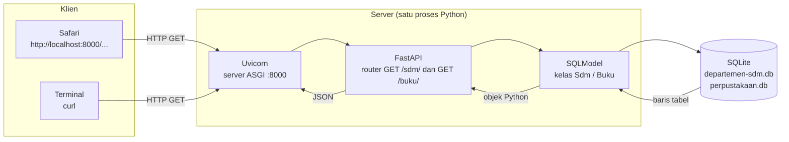
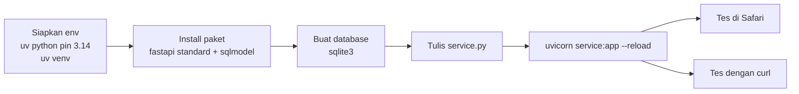
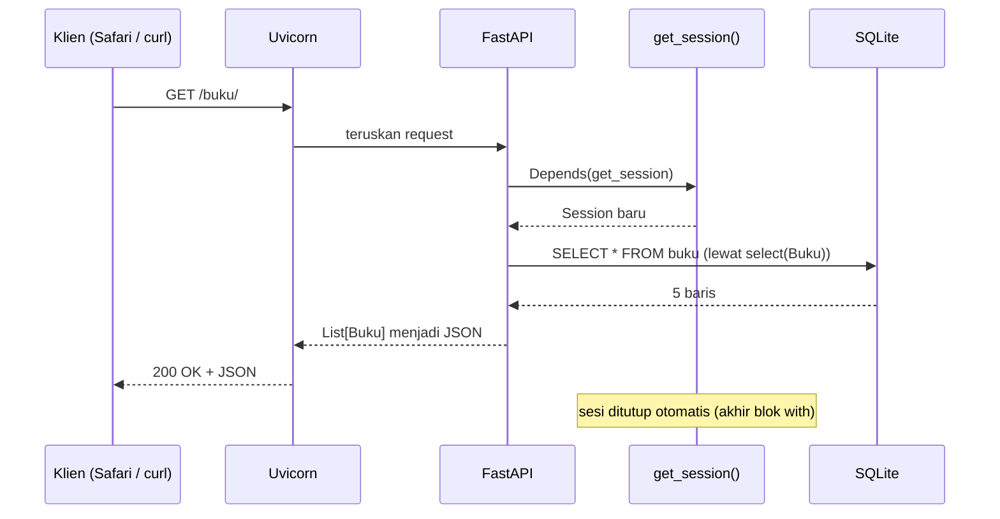

<h1 align="center">Modul 8 — Arsitektur Microservices untuk Sistem Terdistribusi</h1>


<h3 align="center">Praktikum Sistem Terdistribusi dan Terdesentralisasi</h3>

<h4 align="center">REST API dengan FastAPI, SQLModel, SQLite, dan Uvicorn di macOS</h4>

<p align="center">
  
  
  
  
  
  
  
</p>

<div align="center">

| Nama | NIM | Program Studi |
|:---:|:---:|:---:|
| Usat Jalung | 255410017 | Informatika |

</div>

<p align="center"><sub>Universitas Teknologi Digital Indonesia</sub></p>

---

Dokumen ini adalah laporan praktikum Modul 8. Isinya **dua bagian yang dipisah dan tidak digabung**:

| Bagian | Isi | Folder kerja di Mac | Database | Endpoint |
|---|---|---|---|---|
| **I. Praktik** | Mengikuti contoh modul persis: tabel `sdm` | `~/modul8/contoh` | `departemen-sdm.db` | `GET /sdm/` |
| **II. Tugas** | Tabel baru `buku` (tema perpustakaan), isi 5 data, endpoint, curl | `~/modul8/tugas-buku` | `perpustakaan.db` | `GET /buku/` |

Setiap bagian memuat **seluruh kode**, **penjelasan kode**, **output terminal**, **screenshot Safari dan Terminal**, serta **pembahasan**. Pada akhir dokumen ada penjelasan **mengapa terminal saya berbeda dengan modul**, daftar **error beserta kode penanganannya**, dan **log terminal lengkap**.

---

## Daftar Isi

1. [Isi direktori ini](#1-isi-direktori-ini)
2. [Tentang modul, pembuat modul, dan pola yang dipakai](#2-tentang-modul-pembuat-modul-dan-pola-yang-dipakai)
3. [Representasi arsitektur dan alur kerja](#3-representasi-arsitektur-dan-alur-kerja)

**BAGIAN I — PRAKTIK (tabel `sdm`)**

4. [Langkah 1 — Prasyarat dan persiapan lingkungan](#4-langkah-1--prasyarat-dan-persiapan-lingkungan)
5. [Langkah 2 — Membuat database `departemen-sdm.db`](#5-langkah-2--membuat-database-departemen-sdmdb)
6. [Langkah 3 — Source code `service.py` dan penjelasannya](#6-langkah-3--source-code-servicepy-dan-penjelasannya)
7. [Langkah 4 — Menjalankan service dengan Uvicorn](#7-langkah-4--menjalankan-service-dengan-uvicorn)
8. [Langkah 5 — Hasil di Safari dan Terminal (curl)](#8-langkah-5--hasil-di-safari-dan-terminal-curl)

**BAGIAN II — TUGAS (tabel `buku`)**

9. [Daftar tugas pada modul](#9-daftar-tugas-pada-modul)
10. [Tugas 1 — Tabel baru `buku` (`schema.sql`)](#10-tugas-1--tabel-baru-buku-schemasql)
11. [Tugas 2 — Isi 5 data dengan script Python (`seed.py`)](#11-tugas-2--isi-5-data-dengan-script-python-seedpy)
12. [Verifikasi isi database dengan sqlite3](#12-verifikasi-isi-database-dengan-sqlite3)
13. [Tugas 3 — RESTful API endpoint (`service.py`)](#13-tugas-3--restful-api-endpoint-servicepy)
14. [Tugas 4 — Hasil di Safari dan Terminal (curl)](#14-tugas-4--hasil-di-safari-dan-terminal-curl)
15. [Pembahasan: pemetaan tipe data dan perbandingan `sdm` vs `buku`](#15-pembahasan-pemetaan-tipe-data-dan-perbandingan-sdm-vs-buku)

**LAMPIRAN**

16. [Mengapa terminal saya berbeda dengan modul?](#16-mengapa-terminal-saya-berbeda-dengan-modul)
17. [Error yang muncul dan kode penanganannya](#17-error-yang-muncul-dan-kode-penanganannya)
18. [Membersihkan resource](#18-membersihkan-resource)
19. [Kesimpulan](#19-kesimpulan)
20. [Log terminal lengkap](#20-log-terminal-lengkap)
21. [Referensi](#21-referensi)

---

## 1. Isi direktori ini

| Berkas / folder | Keterangan |
|---|---|
| [`README.md`](README.md) | Dokumen ini. |
| [`setup-fastapi-sqlmodel-uvicorn.log`](setup-fastapi-sqlmodel-uvicorn.log) | Log terminal **Bagian I (Praktik)**: setup, install paket, database `sdm`, menjalankan Uvicorn. Isinya ditampilkan juga di [bagian 20](#20-log-terminal-lengkap). |
| [`tugas-buku-sqlite-fastapi-log.txt`](tugas-buku-sqlite-fastapi-log.txt) | Log terminal **Bagian II (Tugas)**: `schema.sql`, `seed.py`, sqlite3, `service.py`, Uvicorn. |
| [`image/Hasil curl dari tes Safari.png`](image/Hasil%20curl%20dari%20tes%20Safari.png) | Praktik: Safari membuka `localhost:8000/sdm/`. |
| [`image/Hasil curl dari tes Terminal.png`](image/Hasil%20curl%20dari%20tes%20Terminal.png) | Praktik: `curl http://localhost:8000/sdm/` di Terminal. |
| [`image/TUGAS-Hasil curl dari tes Safari.png`](image/TUGAS-Hasil%20curl%20dari%20tes%20Safari.png) | Tugas: Safari membuka `localhost:8000/buku/`. |
| [`image/TUGAS-Hasil curl dari tes Terminal.png`](image/TUGAS-Hasil%20curl%20dari%20tes%20Terminal.png) | Tugas: `curl` dan `curl ... \| python3 -m json.tool` di Terminal. |
| [`image/PDF/localhost:8000:sdm.pdf`](image/PDF/%E2%80%8Elocalhost%3A8000%3Asdm.pdf) | Cetak halaman Safari `localhost:8000/sdm/` (Praktik). |
| [`image/PDF/localhost:8000:buku.pdf`](image/PDF/%E2%80%8Elocalhost%3A8000%3Abuku.pdf) | Cetak halaman Safari `localhost:8000/buku/` (Tugas). |

> **Catatan nama berkas:** nama PDF mengandung tanda titik dua (`:`) dan karakter tak terlihat di awal nama. Di macOS/Linux aman, tetapi di **Windows** `:` tidak diizinkan sehingga `git clone` bisa gagal. Sebaiknya di-rename, misalnya `git mv "image/PDF/‎localhost:8000:sdm.pdf" image/PDF/sdm.pdf`, lalu perbarui tautan di README ini.

---

## 2. Tentang modul, pembuat modul, dan pola yang dipakai

### 2.1 Pembuat modul dan isi modul

| Keterangan | Isi |
|---|---|
| Judul | Modul 8 — Arsitektur Microservices untuk Sistem Terdistribusi |
| Mata kuliah | Praktikum Sistem Terdistribusi dan Terdesentralisasi |
| Penulis modul | **Dr. Bambang Purnomosidi D. P.** |
| Institusi | Prodi Informatika, Universitas Teknologi Digital Indonesia |
| Tebal modul | 8 halaman |

Isi modul: *microservices* adalah arsitektur yang banyak dipakai pada sistem terdistribusi. Perangkat lunak dibagi menjadi **frontend** (UI/UX, titik interaksi pengguna) yang meminta layanan dari **backend** berupa *service*. Service bisa dibuat dengan REST API, GraphQL, atau gRPC. Praktik ini memakai **REST API** dengan pustaka **FastAPI** dan **SQLModel** (ORM Python).

### 2.2 Pola dan konsep yang dipakai pada kode

| Pola / konsep | Penerapan pada kode |
|---|---|
| **Microservices** | Satu service berdiri sendiri dengan satu database: service SDM (`departemen-sdm.db`) dan service perpustakaan (`perpustakaan.db`) terpisah. |
| **Client–Server** | Safari dan `curl` adalah klien, FastAPI di balik Uvicorn adalah server. |
| **REST API** | Sumber daya diakses lewat URL (`/sdm/`, `/buku/`) dengan metode HTTP `GET`, hasil berupa JSON. |
| **ORM (Object–Relational Mapping)** | Kelas Python `Sdm` dan `Buku` dipetakan ke tabel SQLite oleh SQLModel, query ditulis dengan `select(...)`, bukan SQL mentah. |
| **Dependency Injection** | `Depends(get_session)` membuat FastAPI menyuplai sesi database ke setiap endpoint. |
| **Session-per-request** | `get_session` memakai `with ... yield`, sehingga sesi dibuka saat request masuk dan ditutup otomatis setelah response. |
| **Response model** | `response_model=List[...]` membuat FastAPI memvalidasi dan membentuk keluaran sebagai daftar objek. |
| **Pemisahan tanggung jawab (Tugas)** | Skema SQL (`schema.sql`), pengisian data (`seed.py`), dan layanan API (`service.py`) dipisah ke berkas masing-masing. |
| **Query berparameter** | `INSERT ... VALUES (?, ?, ?, ?, ?)` di `seed.py` memakai placeholder agar aman dari SQL injection. |

### 2.3 Teknologi dan versi (dari log praktik saya)

| Komponen | Versi di modul | Versi di Mac saya | Fungsi |
|---|---|---|---|
| Python | 3.14.4 | **3.14.10** | Bahasa pemrograman (dipasang dengan `uv`) |
| uv | — | terbaru | Pengelola Python, virtualenv, dan paket |
| FastAPI | 0.136.1 | **0.165.0** | Framework REST API |
| SQLModel | 0.0.38 | **0.0.50** | ORM (gabungan SQLAlchemy + Pydantic) |
| SQLAlchemy | 2.0.49 | **2.1.9** | Mesin ORM di bawah SQLModel |
| Pydantic | 2.13.4 | **2.14.4** | Validasi dan serialisasi data |
| Starlette | 1.0.0 | **1.10.0** | Toolkit ASGI di bawah FastAPI |
| Uvicorn | 0.46.0 | **0.54.0** | Server ASGI untuk menjalankan FastAPI |
| SQLite | 3.53.x | **3.54.1** | Database |
| Jumlah paket terpasang | 45 | **61** | Hasil `uv pip install "fastapi[standard]" sqlmodel` |
| Browser | Browser di Linux | **Safari** | Menampilkan hasil endpoint |

Pada modul hanya ada batas versi minimum, sehingga `uv` mengambil rilis **terbaru saat dijalankan**. Itulah sebab versi saya lebih baru. Fungsinya sama.

---

## 3. Representasi arsitektur dan alur kerja

### 3.1 Arsitektur sistem



### 3.2 Alur kerja praktikum



### 3.3 Alur satu request `GET /buku/`



---

# BAGIAN I — PRAKTIK (tabel `sdm`)

Bagian ini mengikuti contoh pada modul dan berdiri sendiri, terpisah dari tugas. Log aslinya: [`setup-fastapi-sqlmodel-uvicorn.log`](setup-fastapi-sqlmodel-uvicorn.log).

---

## 4. Langkah 1 — Prasyarat dan persiapan lingkungan

Prasyarat dari modul: (1) `uv` sudah terpasang, (2) Python 3.14 lewat `uv`, (3) paket FastAPI dan SQLModel, (4) SQLite. Di macOS, SQLite sudah bawaan sistem.

### 4.1 Cek SQLite

**Kode**

```bash
sqlite3 --version
```

**Output**

```text
3.54.1 2026-10-16 14:45:20 555e07ef33f69a0957d24d8e555b702464a131d6f1607f4c3c1e4551e8e6ca76 (64-bit)
```

**Penjelasan:** menampilkan versi SQLite yang terpasang. Output ini membuktikan prasyarat nomor 4 sudah terpenuhi, tidak perlu mengunduh dari sqlite.org seperti contoh Linux di modul.

### 4.2 Membuat folder kerja

**Kode**

```bash
mkdir -p ~/modul8 && cd ~/modul8
```

**Output:** tidak ada (berhasil diam-diam).

**Penjelasan:** `mkdir -p` membuat folder `~/modul8` dan tidak error bila sudah ada. `&&` menjalankan `cd` hanya jika `mkdir` berhasil.

### 4.3 Memasang dan mengunci versi Python

**Kode**

```bash
uv python install 3.14
uv python pin 3.14
```

**Output**

```text
Python 3.14 is already installed
Pinned `.python-version` to `3.14`
```

**Penjelasan**

| Perintah | Fungsi |
|---|---|
| `uv python install 3.14` | Memastikan Python 3.14 tersedia. "already installed" artinya sudah terpasang sebelumnya. |
| `uv python pin 3.14` | Menulis berkas `.python-version` berisi `3.14` agar proyek selalu memakai versi itu. |

### 4.4 Membuat dan mengaktifkan virtual environment

**Kode**

```bash
uv venv
source .venv/bin/activate
```

**Output**

```text
Using CPython 3.14.10
Creating virtual environment at: .venv
? A virtual environment already exists at `.venv`. Do you want to replace it? [y/N]
✔ A virtual environment already exists at `.venv`. Do you want to replace it? · yes
Activate with: source .venv/bin/activate
```

**Penjelasan:** `uv venv` membuat folder `.venv` berisi Python terisolasi (CPython **3.14.10**). Karena `.venv` sudah ada dari percobaan sebelumnya, `uv` bertanya apakah ingin menggantinya dan saya menjawab `y` (yes). `source .venv/bin/activate` mengaktifkannya, ditandai prompt berubah menjadi `(modul8) danel@... %`.

### 4.5 Memasang FastAPI dan SQLModel

**Kode**

```bash
uv pip install "fastapi[standard]" sqlmodel
```

**Output**

```text
Resolved 61 packages in 71ms
Installed 61 packages in 193ms
 + fastapi==0.165.0
 + fastapi-cli==0.0.34
 + sqlmodel==0.0.50
 + sqlalchemy==2.1.9
 + pydantic==2.14.4
 + starlette==1.10.0
 + uvicorn==0.54.0
 + httpx==0.28.1
 + jinja2==3.1.6
 ... (total 61 paket, daftar lengkap ada di bagian 20)
```

**Penjelasan**

- `"fastapi[standard]"` memasang FastAPI **beserta paket tambahan** `standard`: `uvicorn` (server), `httpx`, `jinja2`, `fastapi-cli`, `python-multipart`, dan lainnya.
- `sqlmodel` ikut membawa `sqlalchemy` dan `pydantic`.
- **Tanda kutip wajib di zsh.** Tanpa kutip, zsh menganggap `[standard]` sebagai pola glob dan muncul error `zsh: no matches found`.
- Jumlah paket pada modul 45, pada saya **61** karena versi paket yang lebih baru punya dependensi tambahan (misalnya `opentelemetry-*`, `protobuf`, `requests`, `truststore`).

---

## 5. Langkah 2 — Membuat database `departemen-sdm.db`

### 5.1 Membuat folder `contoh` dan menjalankan SQL

**Kode**

```bash
mkdir -p ~/modul8/contoh && cd ~/modul8/contoh
sqlite3 departemen-sdm.db <<'EOF'
CREATE TABLE sdm (id INTEGER PRIMARY KEY, npp CHAR(6), nama VARCHAR(50));
INSERT INTO sdm (npp, nama) VALUES ('112233', 'Karyawan 1');
INSERT INTO sdm (npp, nama) VALUES ('223344', 'Karyawan 2');
INSERT INTO sdm (npp, nama) VALUES ('334455', 'Karyawan 3');
SELECT * FROM sdm;
EOF
```

**Output pada percobaan pertama (ada error, karena database lama sudah berisi tabel `sdm`)**

```text
Parse error near line 1: table sdm already exists
  CREATE TABLE sdm (id INTEGER PRIMARY KEY, npp CHAR(6), nama VARCHAR(50));
               ^--- error here
╭────┬──────────┬────────────╮
│ id │   npp    │    nama    │
╞════╪══════════╪════════════╡
│  1 │ '112233' │ Karyawan 1 │
│  2 │ '223344' │ Karyawan 2 │
│  3 │ '334455' │ Karyawan 3 │
│  4 │ '112233' │ Karyawan 1 │
│  5 │ '223344' │ Karyawan 2 │
│  6 │ '334455' │ Karyawan 3 │
╰────┴──────────┴────────────╯
```

**Pembahasan error:** berkas `departemen-sdm.db` sudah ada dari percobaan sebelumnya. `CREATE TABLE` gagal (`table sdm already exists`), tetapi tiga `INSERT` tetap berjalan, sehingga data **terduplikasi menjadi 6 baris**. Solusinya menghapus berkas database lalu mengulang (lihat 5.2). Pencegah ke depan: `CREATE TABLE IF NOT EXISTS` atau `DROP TABLE IF EXISTS`, lihat [bagian 17](#17-error-yang-muncul-dan-kode-penanganannya).

### 5.2 Mengulang dari database kosong

**Kode**

```bash
rm departemen-sdm.db && sqlite3 departemen-sdm.db <<'EOF'
CREATE TABLE sdm (id INTEGER PRIMARY KEY, npp CHAR(6), nama VARCHAR(50));
INSERT INTO sdm (npp, nama) VALUES ('112233', 'Karyawan 1');
INSERT INTO sdm (npp, nama) VALUES ('223344', 'Karyawan 2');
INSERT INTO sdm (npp, nama) VALUES ('334455', 'Karyawan 3');
SELECT * FROM sdm;
EOF
```

**Output**

```text
╭────┬──────────┬────────────╮
│ id │   npp    │    nama    │
╞════╪══════════╪════════════╡
│  1 │ '112233' │ Karyawan 1 │
│  2 │ '223344' │ Karyawan 2 │
│  3 │ '334455' │ Karyawan 3 │
╰────┴──────────┴────────────╯
```

**Penjelasan SQL**

| Bagian | Arti |
|---|---|
| `sqlite3 departemen-sdm.db <<'EOF' ... EOF` | Membuka (atau membuat) database `departemen-sdm.db`, lalu mengirim semua baris di antara `EOF` sebagai perintah SQL. Tanda kutip pada `'EOF'` mencegah shell mengubah isinya. |
| `CREATE TABLE sdm (...)` | Membuat tabel `sdm`. |
| `id INTEGER PRIMARY KEY` | Kolom `id` bilangan bulat sebagai **primary key**. Di SQLite nilainya terisi otomatis (1, 2, 3, ...). |
| `npp CHAR(6)` | Nomor pokok pegawai, teks 6 karakter. |
| `nama VARCHAR(50)` | Nama pegawai, teks sampai 50 karakter. |
| `INSERT INTO sdm (npp, nama) VALUES (...)` | Menambah satu baris. `id` tidak diisi karena otomatis. |
| `SELECT * FROM sdm;` | Menampilkan semua baris. |

**Pembahasan output:** tampilan kotak (`╭──┬──╮`) adalah mode keluaran bawaan `sqlite3` versi terbaru (3.54.1). Nilai `npp` tampil dengan tanda petik (`'112233'`), tanda bahwa nilainya **teks**, bukan angka. Terdapat **3 baris**, `id` 1 sampai 3.

---

## 6. Langkah 3 — Source code `service.py` dan penjelasannya

### 6.1 Kode lengkap

Dibuat di `~/modul8/contoh/service.py` (kode persis seperti halaman 5–6 modul):

```python
from typing import List, Optional
from fastapi import Depends, FastAPI, HTTPException
from sqlmodel import Field, Session, SQLModel, create_engine, select


class Sdm(SQLModel, table=True):
    id: int | None = Field(default=None, primary_key=True)
    npp: str
    nama: str


engine = create_engine("sqlite:///departemen-sdm.db")


def get_session():
    with Session(engine) as session:
        yield session


app = FastAPI()


@app.get("/sdm/", response_model=List[Sdm])
def read_sdm(session: Session = Depends(get_session)):
    # SQLModel select statement
    statement = select(Sdm)
    results = session.exec(statement).all()
    return results
```

> Pada log, baris awal heredoc `cat > service.py <<'EOF'` tidak terlihat karena terminal menimpa tampilannya saat menempel (`>....`). Bagian yang terlihat (dari `id: int | None ...` sampai `return results`) identik dengan kode di atas, dan service berjalan normal (`200 OK`).

### 6.2 Penjelasan kode baris demi baris

**Bagian import**

| Kode | Penjelasan |
|---|---|
| `from typing import List, Optional` | `List` dipakai untuk menyatakan tipe keluaran berupa daftar. `Optional` ikut diimpor sesuai modul tetapi **tidak terpakai**. |
| `from fastapi import Depends, FastAPI, HTTPException` | `FastAPI` membuat aplikasi, `Depends` untuk dependency injection. `HTTPException` untuk membuat error HTTP, diimpor sesuai modul tetapi **tidak terpakai** pada contoh ini. |
| `from sqlmodel import Field, Session, SQLModel, create_engine, select` | `Field` mengatur properti kolom, `Session` untuk sesi database, `SQLModel` kelas dasar model, `create_engine` membuat koneksi, `select` membuat query. |

**Bagian model**

| Kode | Penjelasan |
|---|---|
| `class Sdm(SQLModel, table=True):` | Mendefinisikan model sekaligus tabel. `table=True` berarti kelas ini dipetakan ke tabel database. Nama tabel otomatis dari nama kelas dalam huruf kecil: `sdm`. |
| `id: int \| None = Field(default=None, primary_key=True)` | Kolom primary key. Boleh `None` saat objek baru dibuat karena nilainya diberikan database. |
| `npp: str` | Kolom teks `npp`. |
| `nama: str` | Kolom teks `nama`. |

**Bagian koneksi dan sesi**

| Kode | Penjelasan |
|---|---|
| `engine = create_engine("sqlite:///departemen-sdm.db")` | Membuat koneksi ke berkas SQLite `departemen-sdm.db`. Tiga garis miring (`///`) berarti **path relatif** terhadap folder tempat Uvicorn dijalankan. Karena itu service harus dijalankan dari folder yang berisi database. |
| `def get_session():` | Fungsi penyedia sesi (dipakai sebagai *dependency*). |
| `with Session(engine) as session:` | Membuka sesi database dan menutupnya otomatis setelah blok selesai. |
| `yield session` | Menyerahkan sesi ke endpoint. Karena memakai `yield`, kode setelahnya (penutupan sesi) berjalan setelah response terkirim. |

**Bagian aplikasi dan endpoint**

| Kode | Penjelasan |
|---|---|
| `app = FastAPI()` | Membuat objek aplikasi. Nama `app` dirujuk oleh `uvicorn service:app`. |
| `@app.get("/sdm/", response_model=List[Sdm])` | Dekorator yang mendaftarkan fungsi di bawahnya sebagai endpoint **`GET /sdm/`**. `response_model=List[Sdm]` memastikan keluaran divalidasi sebagai daftar objek `Sdm`. |
| `def read_sdm(session: Session = Depends(get_session)):` | Fungsi endpoint. FastAPI memanggil `get_session` dan memasukkan hasilnya sebagai `session`. |
| `# SQLModel select statement` | Komentar. |
| `statement = select(Sdm)` | Membuat query setara `SELECT * FROM sdm`. |
| `results = session.exec(statement).all()` | Menjalankan query dan mengambil **semua** baris sebagai daftar objek `Sdm`. |
| `return results` | FastAPI mengubah daftar objek itu menjadi JSON. |

---

## 7. Langkah 4 — Menjalankan service dengan Uvicorn

**Kode**

```bash
uvicorn service:app --reload
```

**Output**

```text
INFO:     Will watch for changes in these directories: ['/Users/danel/modul8/contoh']
INFO:     Uvicorn running on http://127.0.0.1:8000 (Press CTRL+C to quit)
INFO:     Started reloader process [41208] using WatchFiles
INFO:     Started server process [41210]
INFO:     Waiting for application startup.
INFO:     Application startup complete.
INFO:     127.0.0.1:51755 - "GET /sdm/ HTTP/1.1" 200 OK
INFO:     127.0.0.1:51764 - "GET /sdm/ HTTP/1.1" 200 OK
^CINFO:     Shutting down
INFO:     Waiting for application shutdown.
INFO:     Application shutdown complete.
INFO:     Finished server process [41210]
INFO:     Stopping reloader process [41208]
```

**Penjelasan perintah**

| Bagian | Arti |
|---|---|
| `uvicorn` | Server ASGI yang menjalankan aplikasi FastAPI. |
| `service:app` | `service` = berkas `service.py`, `app` = objek `FastAPI()` di dalamnya. |
| `--reload` | Server dimuat ulang otomatis bila berkas kode berubah (untuk pengembangan, jangan dipakai di produksi). |

**Penjelasan baris log**

| Baris log | Arti |
|---|---|
| `Will watch for changes in these directories: [...]` | Mode `--reload` memantau folder `contoh`. |
| `Uvicorn running on http://127.0.0.1:8000` | Alamat service. `127.0.0.1` adalah komputer sendiri (`localhost`), port bawaan `8000`. |
| `Started reloader process [41208] using WatchFiles` | Proses pemantau perubahan berkas (induk). |
| `Started server process [41210]` | Proses server (anak) yang melayani request. |
| `Application startup complete.` | Aplikasi siap menerima request. |
| `127.0.0.1:51755 - "GET /sdm/ HTTP/1.1" 200 OK` | Ada request `GET /sdm/` dari port klien 51755 dan dijawab **200 OK** (sukses). Dua baris `GET /sdm/` pada sesi pertama adalah dua kali akses dari klien (pengujian di Safari dan curl). |
| `^C ... Shutting down` | Saya menekan `Ctrl+C`, server dimatikan dengan rapi. |

Pada log ada **sesi kedua** (proses `[45014]` dan `[45016]`) yang mencatat `GET /sdm/ ... 200 OK` lalu `GET /favicon.ico ... 404 Not Found`. Baris 404 itu **bukan error aplikasi**: Safari otomatis meminta ikon tab `/favicon.ico` dan service memang tidak punya endpoint tersebut.

---

## 8. Langkah 5 — Hasil di Safari dan Terminal (curl)

Selama Uvicorn berjalan di satu tab Terminal, pengujian dilakukan dari browser Safari dan dari tab Terminal lain.

### 8.1 Tes di Safari

Alamat: `http://localhost:8000/sdm/`


**Pembahasan:** tab Safari yang aktif berjudul `localhost:8000/sdm/`. Isinya JSON mentah berisi **3 objek**, masing-masing punya `npp`, `nama`, dan `id`. Safari tidak memformat JSON secara otomatis sehingga tampil sebagai teks bersambung yang terpotong baris mengikuti lebar jendela.

### 8.2 Tes di Terminal dengan curl

**Kode**

```bash
curl http://localhost:8000/sdm/
```

**Output**

```text
[{"id":1,"npp":"112233","nama":"Karyawan 1"},{"id":2,"npp":"223344","nama":"Karyawan 2"},{"id":3,"npp":"334455","nama":"Karyawan 3"}]%
```


**Pembahasan**

- `curl http://localhost:8000/sdm/` mengirim request `GET` dan mencetak badan response JSON. Ini memenuhi petunjuk modul: *"akses dari browser atau dari headless tool (curl atau wget)"*.
- Hasil berisi **3 objek** sesuai 3 baris tabel `sdm`.
- Tanda `%` di ujung output adalah penanda zsh: response JSON **tidak diakhiri baris baru**, sehingga zsh memberi tanda lalu memindahkan prompt ke baris berikutnya. Itu bukan bagian dari data.
- **Urutan field berbeda** antara Safari (`npp, nama, id`) dan curl (`id, npp, nama`). Itu wajar: JSON adalah kumpulan pasangan kunci-nilai tanpa urutan yang dijamin, dan isi datanya sama persis. Kedua screenshot diambil pada waktu yang berbeda (log bagian 7 mencatat dua sesi Uvicorn).
- Kedua klien yang berbeda (browser dan curl) mendapat data yang sama dari satu service. Inilah inti arsitektur microservices: backend diakses lewat HTTP oleh klien apa pun.

### 8.3 PDF hasil cetak Safari

Cetakan halaman `localhost:8000/sdm/` dari Safari (*File > Export as PDF*):

- [`image/PDF/localhost:8000:sdm.pdf`](image/PDF/%E2%80%8Elocalhost%3A8000%3Asdm.pdf)

---

# BAGIAN II — TUGAS (tabel `buku`)

Bagian ini **terpisah** dari Bagian I. Tema: **perpustakaan**, tabel **`buku`**, yang berbeda dari tabel `sdm` pada contoh. Log aslinya: [`tugas-buku-sqlite-fastapi-log.txt`](tugas-buku-sqlite-fastapi-log.txt).

---

## 9. Daftar tugas pada modul

Bagian "4. Tugas" pada modul meminta:

1. Buat satu tabel baru menggunakan SQLite, berbeda dari contoh. Tabel mempunyai **1 primary key** dan setidaknya berisi data dengan tipe **INT, CHAR, VARCHAR, BOOLEAN, dan FLOAT**.
2. Isikan **5 data** menggunakan **script Python**.
3. Buat **RESTful API endpoint** untuk menampilkan semua data yang telah diisikan.
4. Tampilkan hasil RESTful API endpoint tersebut menggunakan **curl**.

Pemenuhan tugas:

| Tugas | Dipenuhi oleh | Bagian |
|---|---|---|
| 1. Tabel baru, 1 PK, INT, CHAR, VARCHAR, BOOLEAN, FLOAT | `schema.sql` (tabel `buku`) | [10](#10-tugas-1--tabel-baru-buku-schemasql) |
| 2. Isi 5 data dengan script Python | `seed.py` | [11](#11-tugas-2--isi-5-data-dengan-script-python-seedpy) |
| 3. RESTful API endpoint tampilkan semua data | `service.py` (`GET /buku/`) | [13](#13-tugas-3--restful-api-endpoint-servicepy) |
| 4. Tampilkan dengan curl | `curl http://localhost:8000/buku/` | [14](#14-tugas-4--hasil-di-safari-dan-terminal-curl) |

---

## 10. Tugas 1 — Tabel baru `buku` (`schema.sql`)

### 10.1 Kode

**Kode**

```bash
cd ~/modul8
source .venv/bin/activate
mkdir -p tugas-buku && cd tugas-buku

cat > schema.sql <<'EOF'
-- Skema database perpustakaan
DROP TABLE IF EXISTS buku;

CREATE TABLE buku (
    id            INTEGER       PRIMARY KEY,
    kode          CHAR(6)       NOT NULL UNIQUE,
    judul         VARCHAR(100)  NOT NULL,
    tahun_terbit  INT           NOT NULL,
    harga_sewa    FLOAT         NOT NULL,
    tersedia      BOOLEAN       NOT NULL DEFAULT 1
);
EOF
```

**Output:** tidak ada (berkas dibuat diam-diam).

### 10.2 Penjelasan

| Kolom | Tipe | Keterangan |
|---|---|---|
| `id` | `INTEGER` | **Primary key** (memenuhi syarat 1 PK). Terisi otomatis. |
| `kode` | `CHAR(6)` | Tipe **CHAR**: kode buku tepat 6 karakter (contoh `BK0001`). `UNIQUE` melarang kode ganda. |
| `judul` | `VARCHAR(100)` | Tipe **VARCHAR**: judul sampai 100 karakter. |
| `tahun_terbit` | `INT` | Tipe **INT**: tahun terbit. |
| `harga_sewa` | `FLOAT` | Tipe **FLOAT**: biaya sewa desimal. |
| `tersedia` | `BOOLEAN` | Tipe **BOOLEAN**: status ketersediaan. SQLite menyimpannya sebagai `1` (ya) atau `0` (tidak). |

| Bagian SQL | Arti |
|---|---|
| `-- Skema database perpustakaan` | Komentar SQL. |
| `DROP TABLE IF EXISTS buku;` | Menghapus tabel lama bila ada, sehingga skrip aman dijalankan berulang dan **tidak menimbulkan error `table already exists`** seperti pada Bagian I. |
| `NOT NULL` | Kolom wajib diisi. |
| `UNIQUE` | Nilai tidak boleh kembar antar baris. |
| `DEFAULT 1` | Bila `tersedia` tidak diisi, nilainya `1` (tersedia). |

Skema dipisah ke berkas `schema.sql` supaya SQL-nya **rapi, terformat, dan terpisah** dari kode Python.

---

## 11. Tugas 2 — Isi 5 data dengan script Python (`seed.py`)

### 11.1 Kode

**Kode**

```bash
cat > seed.py <<'EOF'
import sqlite3

DB_FILE = "perpustakaan.db"
SCHEMA_FILE = "schema.sql"

INSERT_SQL = """
    INSERT INTO buku (
        kode,
        judul,
        tahun_terbit,
        harga_sewa,
        tersedia
    )
    VALUES (?, ?, ?, ?, ?)
"""

DATA = [
    ("BK0001", "Pemrograman Python Dasar", 2021, 5000.00, True),
    ("BK0002", "Sistem Terdistribusi",     2019, 7500.50, True),
    ("BK0003", "Basis Data Lanjut",        2020, 6000.00, False),
    ("BK0004", "Jaringan Komputer",        2018, 5500.75, True),
    ("BK0005", "Kecerdasan Buatan",        2023, 8000.25, False),
]

conn = sqlite3.connect(DB_FILE)

with open(SCHEMA_FILE, encoding="utf-8") as f:
    conn.executescript(f.read())

conn.executemany(INSERT_SQL, DATA)
conn.commit()

print(f"{'id':<3} {'kode':<7} {'judul':<26} {'tahun':<6} {'harga':>9}  tersedia")
print("-" * 62)
for id_, kode, judul, tahun, harga, ada in conn.execute("SELECT * FROM buku"):
    print(f"{id_:<3} {kode:<7} {judul:<26} {tahun:<6} {harga:>9.2f}  {bool(ada)}")

conn.close()
print(f"\n{len(DATA)} data berhasil dimasukkan ke {DB_FILE}")
EOF
```

> Pada log, beberapa baris awal heredoc tidak tampak karena terminal menimpa tampilan saat menempel. Baris yang terlihat sama dengan kode di atas, dan hasil eksekusinya (bagian 11.3) membuktikan script berjalan benar.

### 11.2 Penjelasan kode

| Kode | Penjelasan |
|---|---|
| `import sqlite3` | Modul SQLite **bawaan Python**, tidak perlu di-install. |
| `DB_FILE`, `SCHEMA_FILE` | Konstanta nama berkas database dan berkas skema. |
| `INSERT_SQL = """ ... """` | Query `INSERT` ditulis berbaris-baris (rapi). Lima tanda `?` adalah **placeholder**: nilai dikirim terpisah sehingga aman dari SQL injection dan tipe data ditangani otomatis. `id` tidak disebut karena otomatis. |
| `DATA = [ ... ]` | Daftar **5 tuple**, satu tuple per buku, dengan urutan sesuai kolom di `INSERT_SQL`: `kode, judul, tahun_terbit, harga_sewa, tersedia`. Nilai `True/False` Python disimpan SQLite sebagai `1/0`. |
| `conn = sqlite3.connect(DB_FILE)` | Membuka (atau membuat) berkas `perpustakaan.db`. |
| `with open(SCHEMA_FILE, encoding="utf-8") as f:` | Membuka `schema.sql` untuk dibaca. |
| `conn.executescript(f.read())` | Menjalankan **seluruh isi** `schema.sql` (hapus tabel lama, buat tabel baru). |
| `conn.executemany(INSERT_SQL, DATA)` | Menjalankan `INSERT` satu kali untuk tiap tuple, jadi **5 baris masuk sekaligus**. |
| `conn.commit()` | Menyimpan perubahan permanen. Tanpa ini data tidak tersimpan ke berkas. |
| `for id_, kode, judul, tahun, harga, ada in conn.execute("SELECT * FROM buku"):` | Membaca ulang isi tabel untuk verifikasi, membongkar tiap baris menjadi 6 variabel. |
| `print(f"{'id':<3} ...")` | Mencetak judul kolom. `:<3` rata kiri lebar 3, `:>9` rata kanan lebar 9. |
| `print("-" * 62)` | Garis pemisah 62 karakter. |
| `{harga:>9.2f}` | Harga rata kanan, lebar 9, **2 angka desimal**. |
| `{bool(ada)}` | Mengubah `1/0` dari SQLite menjadi `True/False`. |
| `conn.close()` | Menutup koneksi. |
| `print(f"\n{len(DATA)} data berhasil ...")` | Mencetak jumlah data yang masuk (5). |

### 11.3 Menjalankan dan output

**Kode**

```bash
python seed.py
```

**Output**

```text
id  kode    judul                      tahun      harga  tersedia
--------------------------------------------------------------
1   BK0001  Pemrograman Python Dasar   2021     5000.00  True
2   BK0002  Sistem Terdistribusi       2019     7500.50  True
3   BK0003  Basis Data Lanjut          2020     6000.00  False
4   BK0004  Jaringan Komputer          2018     5500.75  True
5   BK0005  Kecerdasan Buatan          2023     8000.25  False

5 data berhasil dimasukkan ke perpustakaan.db
```

**Pembahasan:** lima baris masuk dengan `id` 1 sampai 5 (otomatis). Tiga buku **tersedia** (`BK0001`, `BK0002`, `BK0004`) dan dua buku **tidak tersedia** (`BK0003`, `BK0005`). Harga dicetak dengan dua desimal (`7500.50`) oleh format `.2f`. Pesan terakhir mengonfirmasi **5 data** tersimpan di `perpustakaan.db`, memenuhi **Tugas 2**.

---

## 12. Verifikasi isi database dengan sqlite3

### 12.1 Melihat skema tabel

**Kode**

```bash
sqlite3 perpustakaan.db ".schema buku"
```

**Output**

```text
CREATE TABLE buku (
    id            INTEGER       PRIMARY KEY,
    kode          CHAR(6)       NOT NULL UNIQUE,
    judul         VARCHAR(100)  NOT NULL,
    tahun_terbit  INT           NOT NULL,
    harga_sewa    FLOAT         NOT NULL,
    tersedia      BOOLEAN       NOT NULL DEFAULT 1
);
```

**Penjelasan:** `.schema buku` adalah perintah khusus sqlite3 (diawali titik) yang menampilkan pernyataan `CREATE TABLE` tersimpan. Hasilnya **sama persis** dengan `schema.sql`, jadi tabel terbentuk sesuai rancangan, lengkap dengan tipe INT, CHAR, VARCHAR, BOOLEAN, FLOAT dan satu primary key.

### 12.2 Melihat isi tabel

**Kode**

```bash
sqlite3 -header -column perpustakaan.db "SELECT * FROM buku;"
```

**Output**

```text
id   kode            judul            tahun_terbit  harga_sewa  tersedia
--  ------  ------------------------  ------------  ----------  --------
 1  BK0001  Pemrograman Python Dasar          2021      5000.0         1
 2  BK0002  Sistem Terdistribusi              2019      7500.5         1
 3  BK0003  Basis Data Lanjut                 2020      6000.0         0
 4  BK0004  Jaringan Komputer                 2018     5500.75         1
 5  BK0005  Kecerdasan Buatan                 2023      8000.25         0
```

**Penjelasan opsi:** `-header` menampilkan nama kolom, `-column` menampilkan dalam bentuk kolom rata.

**Pembahasan:** kolom `tersedia` tampil sebagai `1`/`0` karena begitulah SQLite menyimpan BOOLEAN. Nilai `harga_sewa` tampil `7500.5`, bukan `7500.50`, karena SQLite tidak menyimpan nol di belakang. Nilainya tetap sama.

---

## 13. Tugas 3 — RESTful API endpoint (`service.py`)

### 13.1 Kode

**Kode**

```bash
cat > service.py <<'EOF'
from typing import List

from fastapi import Depends, FastAPI
from sqlmodel import Field, Session, SQLModel, create_engine, select


class Buku(SQLModel, table=True):
    id: int | None = Field(default=None, primary_key=True)
    kode: str
    judul: str
    tahun_terbit: int
    harga_sewa: float
    tersedia: bool


engine = create_engine("sqlite:///perpustakaan.db")


def get_session():
    with Session(engine) as session:
        yield session


app = FastAPI()


@app.get("/buku/", response_model=List[Buku])
def read_buku(session: Session = Depends(get_session)):
    statement = select(Buku)
    results = session.exec(statement).all()
    return results
EOF
```

> Seperti pada Bagian I, baris awal heredoc tidak terlihat di log (`>....`). Bagian yang terlihat (dari `tahun_terbit: int` sampai `return results`) sama dengan kode di atas.

### 13.2 Penjelasan kode

| Kode | Penjelasan |
|---|---|
| `from typing import List` | Untuk menyatakan keluaran berupa daftar. Import `Optional` dan `HTTPException` dari contoh modul **dihapus** karena tidak terpakai. |
| `from fastapi import Depends, FastAPI` | `FastAPI` untuk aplikasi, `Depends` untuk dependency injection. |
| `from sqlmodel import ...` | Sama seperti contoh: `Field, Session, SQLModel, create_engine, select`. |
| `class Buku(SQLModel, table=True):` | Model sekaligus tabel. Nama kelas `Buku` otomatis menjadi nama tabel **`buku`**, sesuai tabel di `schema.sql`. |
| `id: int \| None = Field(default=None, primary_key=True)` | Primary key, pola sama dengan contoh modul. |
| `kode: str` | Dipetakan ke kolom `CHAR(6)`. |
| `judul: str` | Dipetakan ke kolom `VARCHAR(100)`. |
| `tahun_terbit: int` | Dipetakan ke kolom `INT`. |
| `harga_sewa: float` | Dipetakan ke kolom `FLOAT`. |
| `tersedia: bool` | Dipetakan ke kolom `BOOLEAN`, diubah dari `1/0` menjadi `true/false` di JSON. |
| `engine = create_engine("sqlite:///perpustakaan.db")` | Koneksi ke database hasil `seed.py` (path relatif, jalankan Uvicorn dari folder `tugas-buku`). |
| `get_session()` | Penyedia sesi database per request, dibuka dan ditutup otomatis. |
| `app = FastAPI()` | Objek aplikasi. |
| `@app.get("/buku/", response_model=List[Buku])` | Mendaftarkan endpoint **`GET /buku/`** yang mengembalikan daftar `Buku`. |
| `statement = select(Buku)` | Query setara `SELECT * FROM buku`. |
| `session.exec(statement).all()` | Menjalankan query, mengambil **semua** baris. |
| `return results` | Dikonversi FastAPI menjadi JSON. |

Ini memenuhi **Tugas 3**: *RESTful API endpoint untuk menampilkan semua data yang telah diisikan*.

---

## 14. Tugas 4 — Hasil di Safari dan Terminal (curl)

### 14.1 Menjalankan service

**Kode**

```bash
uvicorn service:app --reload
```

**Output**

```text
INFO:     Will watch for changes in these directories: ['/Users/danel/modul8/tugas-buku']
INFO:     Uvicorn running on http://127.0.0.1:8000 (Press CTRL+C to quit)
INFO:     Started reloader process [48409] using WatchFiles
INFO:     Started server process [48411]
INFO:     Waiting for application startup.
INFO:     Application startup complete.
INFO:     127.0.0.1:51967 - "GET /buku/ HTTP/1.1" 200 OK
INFO:     127.0.0.1:51969 - "GET /buku/ HTTP/1.1" 200 OK
INFO:     127.0.0.1:51973 - "GET /buku/ HTTP/1.1" 200 OK
INFO:     Waiting for application shutdown.
INFO:     Application shutdown complete.
INFO:     Finished server process [48411]
INFO:     Stopping reloader process [48409]
```

**Pembahasan log**

- Folder yang dipantau `/Users/danel/modul8/tugas-buku`, sehingga `perpustakaan.db` dibaca dengan benar lewat path relatif.
- Ada **3 request** `GET /buku/`, semuanya **200 OK**, sesuai tiga tes yang dilakukan: Safari, `curl http://localhost:8000/buku/`, dan `curl -s ... | python3 -m json.tool`. Tidak ada `404` untuk `favicon.ico` pada sesi ini.
- `Shutting down / Application shutdown complete` menunjukkan service dimatikan dengan rapi.

### 14.2 Tes di Safari

Alamat: `http://localhost:8000/buku/`


**Pembahasan:** tab aktif `localhost:8000/buku/` (tab `localhost:8000/sdm/` dari Bagian I masih terbuka di sebelahnya). Terlihat **5 objek JSON** dengan 6 field: `id`, `tahun_terbit`, `harga_sewa`, `kode`, `judul`, `tersedia`. Nilai `tersedia` tampil sebagai `true`/`false` (boolean JSON).

### 14.3 Tes di Terminal dengan curl (syarat Tugas 4)

**Kode**

```bash
curl http://localhost:8000/buku/
curl -s http://localhost:8000/buku/ | python3 -m json.tool
```

**Output perintah pertama**

```text
[{"id":1,"tahun_terbit":2021,"harga_sewa":5000.0,"kode":"BK0001","judul":"Pemrograman Python Dasar","tersedia":true},{"id":2,"tahun_terbit":2019,"harga_sewa":7500.5,"kode":"BK0002","judul":"Sistem Terdistribusi","tersedia":true},{"id":3,"tahun_terbit":2020,"harga_sewa":6000.0,"kode":"BK0003","judul":"Basis Data Lanjut","tersedia":false},{"id":4,"tahun_terbit":2018,"harga_sewa":5500.75,"kode":"BK0004","judul":"Jaringan Komputer","tersedia":true},{"id":5,"tahun_terbit":2023,"harga_sewa":8000.25,"kode":"BK0005","judul":"Kecerdasan Buatan","tersedia":false}]
```

**Output perintah kedua**

```json
[
    {
        "id": 1,
        "tahun_terbit": 2021,
        "harga_sewa": 5000.0,
        "kode": "BK0001",
        "judul": "Pemrograman Python Dasar",
        "tersedia": true
    },
    {
        "id": 2,
        "tahun_terbit": 2019,
        "harga_sewa": 7500.5,
        "kode": "BK0002",
        "judul": "Sistem Terdistribusi",
        "tersedia": true
    },
    {
        "id": 3,
        "tahun_terbit": 2020,
        "harga_sewa": 6000.0,
        "kode": "BK0003",
        "judul": "Basis Data Lanjut",
        "tersedia": false
    },
    {
        "id": 4,
        "tahun_terbit": 2018,
        "harga_sewa": 5500.75,
        "kode": "BK0004",
        "judul": "Jaringan Komputer",
        "tersedia": true
    },
    {
        "id": 5,
        "tahun_terbit": 2023,
        "harga_sewa": 8000.25,
        "kode": "BK0005",
        "judul": "Kecerdasan Buatan",
        "tersedia": false
    }
]
```


**Penjelasan perintah**

| Bagian | Arti |
|---|---|
| `curl http://localhost:8000/buku/` | Mengirim `GET` ke endpoint dan mencetak JSON apa adanya (satu baris panjang). |
| `curl -s ...` | `-s` (*silent*) menyembunyikan tabel progres curl. |
| `\| python3 -m json.tool` | Mengalirkan (*pipe*) keluaran ke modul `json.tool` Python yang memformat JSON dengan indentasi 4 spasi, agar mudah dibaca. |

**Pembahasan**

- Endpoint mengembalikan **5 objek JSON**, sama dengan jumlah baris yang diisi `seed.py`. Ini membuktikan **Tugas 3 dan 4** terpenuhi.
- Setiap objek memuat 6 field sesuai kolom tabel.
- Pada keluaran pertama, kurung penutup `]` langsung diikuti prompt (`...]danel@1111QD-rs ~ %`) karena response JSON tidak diakhiri baris baru. Output kedua dimulai dari baris baru karena `json.tool` menambahkannya.
- Karakter `=` dan `[` yang tampak di dekat prompt pada screenshot hanyalah sisa tampilan terminal, bukan bagian data.
- Nilai `tersedia` berupa `true`/`false` (JSON), berbeda dengan `1`/`0` di sqlite3, karena model `Buku` mendeklarasikan `tersedia: bool`.
- `harga_sewa` `5000.0`, `7500.5`, `5500.75` cocok dengan data di tabel.
- Hasil di Safari, curl, dan `json.tool` **identik**. Hanya cara menampilkannya yang berbeda.

### 14.4 PDF hasil cetak Safari

- [`image/PDF/localhost:8000:buku.pdf`](image/PDF/%E2%80%8Elocalhost%3A8000%3Abuku.pdf)

---

## 15. Pembahasan: pemetaan tipe data dan perbandingan `sdm` vs `buku`

### 15.1 Tabel `sdm` (Praktik) dan tabel `buku` (Tugas)

| Aspek | Praktik: `sdm` | Tugas: `buku` |
|---|---|---|
| Database | `departemen-sdm.db` | `perpustakaan.db` |
| Jumlah kolom | 3 | 6 |
| Primary key | `id INTEGER` | `id INTEGER` |
| Tipe yang dipakai | INTEGER, CHAR, VARCHAR | INTEGER, **CHAR, VARCHAR, INT, FLOAT, BOOLEAN** |
| Cara membuat tabel | SQL langsung di `sqlite3` | Berkas `schema.sql` dijalankan oleh `seed.py` |
| Cara mengisi data | `INSERT` manual di `sqlite3` (3 baris) | Script Python `executemany` (5 baris) |
| Idempotensi | Tidak (error bila tabel sudah ada) | Ya (`DROP TABLE IF EXISTS`) |
| Model SQLModel | `Sdm` (3 atribut) | `Buku` (6 atribut) |
| Endpoint | `GET /sdm/` | `GET /buku/` |
| Jumlah objek di JSON | 3 | 5 |

### 15.2 Pemetaan tipe data SQLite, SQLModel, dan JSON

| Kolom `buku` | Tipe SQLite | Atribut SQLModel | Tipe di JSON | Contoh |
|---|---|---|---|---|
| `id` | `INTEGER` | `int \| None` | number | `1` |
| `kode` | `CHAR(6)` | `str` | string | `"BK0001"` |
| `judul` | `VARCHAR(100)` | `str` | string | `"Sistem Terdistribusi"` |
| `tahun_terbit` | `INT` | `int` | number | `2019` |
| `harga_sewa` | `FLOAT` | `float` | number | `7500.5` |
| `tersedia` | `BOOLEAN` | `bool` | boolean | `true` |

SQLite memakai *type affinity* sehingga `CHAR(6)` dan `VARCHAR(100)` pada praktiknya diperlakukan sebagai teks dan panjangnya tidak dipaksa. Panjang tetap dijaga oleh data yang kita isi.

---

# LAMPIRAN

## 16. Mengapa terminal saya berbeda dengan modul?

Modul dikerjakan di **Linux** (prompt `$`, folder `/home/bpdp/...`). Praktik saya di **macOS** dengan versi paket lebih baru.

| # | Hal | Di modul | Di terminal saya | Alasan |
|---|---|---|---|---|
| 1 | Sistem operasi dan shell | Linux, prompt `$`, tema `(src) bpdp@NEO-X` | macOS, zsh, prompt `(modul8) danel@1111QD-rs ... %` | Perangkat berbeda. Nama di kurung adalah nama folder venv (`src` di modul, `modul8` di saya). |
| 2 | Versi Python | CPython **3.14.4** | CPython **3.14.10** | Saya memakai `uv python install 3.14` (rilis 3.14 terbaru), bukan `3.14.4`. |
| 3 | `uv python pin` | `uv python pin /home/bpdp/.local/bin/python3.14` (path interpreter) | `uv python pin 3.14` | Pada Mac cukup menyebut versi. Hasilnya sama: `.python-version` terbentuk. |
| 4 | `uv venv` | Langsung membuat | Ada pertanyaan "replace existing `.venv`?" dan dijawab yes | `.venv` sudah ada dari percobaan sebelumnya. |
| 5 | Jumlah dan versi paket | 45 paket, fastapi 0.136.1, sqlmodel 0.0.38, uvicorn 0.46.0 | 61 paket, fastapi 0.165.0, sqlmodel 0.0.50, uvicorn 0.54.0 | Rilis terbaru saat dijalankan, dependensinya bertambah. |
| 6 | Instalasi SQLite | Unduh dari sqlite.org (halaman download) | Sudah bawaan macOS, cukup `sqlite3 --version` (3.54.1) | macOS menyertakan SQLite. |
| 7 | Tampilan hasil `SELECT` | Tidak ditampilkan pada modul | Tabel kotak `╭──┬──╮` dengan nilai teks bertanda petik | Tampilan bawaan sqlite3 versi yang saya pakai (3.54.1). |
| 8 | Struktur folder | `.../08/src` | `~/modul8/contoh` dan `~/modul8/tugas-buku` | Folder praktik dan tugas dipisah. |
| 9 | Browser | Browser di Linux (lihat tangkapan layar modul) | **Safari** di macOS | Browser bawaan Mac. Safari menampilkan JSON mentah. |
| 10 | Pengujian | Browser atau curl/wget | Safari dan `curl`, plus PDF cetak | Sesuai petunjuk modul, ditambah dokumentasi. |
| 11 | Baris `favicon.ico 404` | Tidak ada | Muncul pada satu sesi | Safari meminta ikon situs otomatis. Tidak berbahaya. |
| 12 | Tanda `%` setelah output curl | Tidak ada (prompt `$`) | `...}]%` | Penanda zsh bahwa output tidak diakhiri baris baru. |
| 13 | Cara membuat berkas | Editor teks (tampak pada tangkapan layar modul) | `cat > berkas <<'EOF' ... EOF` | Isi sama, lebih mudah disalin dari terminal. |

**Kesimpulan:** perbedaan hanya pada *lingkungan* (macOS vs Linux), *versi terbaru paket*, dan *browser*. **Kode `service.py`, urutan langkah, dan hasil akhir** (JSON berisi seluruh baris tabel, status `200 OK`) **sama dengan modul**.

---

## 17. Error yang muncul dan kode penanganannya

### 17.1 Error yang benar-benar muncul di log

**a. `table sdm already exists` (database lama masih ada)**

Terjadi pada percobaan pertama Bagian I. `CREATE TABLE` gagal, tetapi `INSERT` tetap jalan sehingga data **terduplikasi** (6 baris). Penanganan yang dipakai di log:

```bash
rm departemen-sdm.db && sqlite3 departemen-sdm.db <<'EOF'
CREATE TABLE sdm (id INTEGER PRIMARY KEY, npp CHAR(6), nama VARCHAR(50));
...
EOF
```

Pencegahan agar bisa diulang tanpa error (dipakai pada tugas lewat `schema.sql`):

```sql
DROP TABLE IF EXISTS buku;
CREATE TABLE buku (...);
```

atau, bila data lama tidak boleh hilang: `CREATE TABLE IF NOT EXISTS sdm (...);`

**b. Pertanyaan "virtual environment already exists"** — bukan error. Jawab `y` untuk menggantinya, atau lewati `uv venv` bila `.venv` sudah benar dan langsung `source .venv/bin/activate`.

**c. `GET /favicon.ico ... 404 Not Found`** — bukan error aplikasi, hanya permintaan ikon dari Safari. Bila ingin menghilangkannya:

```python
from fastapi.responses import Response

@app.get("/favicon.ico", include_in_schema=False)
def favicon():
    return Response(status_code=204)
```

### 17.2 Error umum lain dan solusinya

| Gejala | Penyebab | Solusi |
|---|---|---|
| `zsh: no matches found: fastapi[standard]` | zsh menganggap `[standard]` pola glob | Pakai tanda kutip: `"fastapi[standard]"` |
| `command not found: uvicorn` | Virtualenv belum aktif | `source .venv/bin/activate` |
| `ModuleNotFoundError: No module named 'sqlmodel'` | Paket belum terpasang di venv | `uv pip install "fastapi[standard]" sqlmodel` |
| `Error loading ASGI app. Could not import module "service"` | Dijalankan dari folder yang salah | `cd` ke folder yang berisi `service.py`, lalu `uvicorn service:app --reload` |
| `sqlalchemy.exc.OperationalError: no such table: buku` | `seed.py` belum dijalankan, atau Uvicorn dijalankan dari folder lain (path database relatif) | Jalankan `python seed.py` di folder `tugas-buku`, lalu jalankan Uvicorn dari folder yang sama |
| `[Errno 48] Address already in use` | Port 8000 dipakai proses lain (misalnya service Praktik masih jalan) | `Ctrl+C` pada tab server lama, atau `uvicorn service:app --reload --port 8001` |
| `curl: (7) Failed to connect to localhost port 8000` | Uvicorn belum jalan atau sudah dimatikan | Jalankan Uvicorn di tab lain dan biarkan terbuka |
| Safari "tidak dapat terhubung ke server" | Sama seperti di atas | Pastikan Uvicorn berjalan, cek alamat `http://localhost:8000/buku/` |
| `sqlite3.IntegrityError: UNIQUE constraint failed: buku.kode` | `seed.py` dijalankan lagi tanpa menghapus tabel lama | Aman: `schema.sql` punya `DROP TABLE IF EXISTS`. Pastikan `executescript` jalan sebelum `executemany` |
| JSON tampil satu baris panjang | Safari/curl tidak memformat JSON | `curl -s URL \| python3 -m json.tool` |

### 17.3 Skrip diagnosa cepat (`cek-env.sh`)

Simpan sebagai `cek-env.sh`, jalankan `bash cek-env.sh` dari folder `tugas-buku`:

```bash
#!/usr/bin/env bash
# cek-env.sh — diagnosa cepat sebelum menjalankan service FastAPI
PORT="${1:-8000}"
ok()   { printf '  [OK]    %s\n' "$1"; }
bad()  { printf '  [ERROR] %s\n' "$1"; }

echo "== 1. Berkas proyek =="
for f in schema.sql seed.py service.py; do
  [ -f "$f" ] && ok "$f ada" || bad "$f tidak ada (jalankan dari folder tugas-buku)"
done
[ -f perpustakaan.db ] && ok "perpustakaan.db ada" || bad "perpustakaan.db belum ada -> python seed.py"

echo "== 2. Lingkungan Python =="
[ -n "$VIRTUAL_ENV" ] && ok "venv aktif: $VIRTUAL_ENV" || bad "venv belum aktif -> source ../.venv/bin/activate"
python -c "import fastapi, sqlmodel" 2>/dev/null && ok "fastapi dan sqlmodel terpasang" || bad "paket belum terpasang -> uv pip install \"fastapi[standard]\" sqlmodel"

echo "== 3. Database =="
if command -v sqlite3 >/dev/null 2>&1 && [ -f perpustakaan.db ]; then
  N=$(sqlite3 perpustakaan.db "SELECT COUNT(*) FROM buku;" 2>/dev/null)
  [ "${N:-0}" -ge 5 ] && ok "tabel buku berisi $N baris" || bad "tabel buku kosong/tidak ada -> python seed.py"
fi

echo "== 4. Port $PORT =="
if command -v lsof >/dev/null 2>&1 && lsof -iTCP:"$PORT" -sTCP:LISTEN >/dev/null 2>&1; then
  ok "ada proses mendengarkan di port $PORT (service jalan)"
else
  bad "port $PORT kosong -> jalankan: uvicorn service:app --reload"
fi
```

---

## 18. Membersihkan resource

```bash
# hentikan service        : Ctrl+C di tab Uvicorn
# keluar dari venv        : deactivate

# hapus database agar bisa diulang dari nol
rm ~/modul8/contoh/departemen-sdm.db
rm ~/modul8/tugas-buku/perpustakaan.db

# buat ulang database tugas
cd ~/modul8/tugas-buku && python seed.py

# hapus seluruh lingkungan praktik (hati-hati)
rm -rf ~/modul8/.venv
```

---

## 19. Kesimpulan

1. Arsitektur microservices memisahkan *frontend* dari *backend* berupa service yang diakses lewat HTTP. Klien yang berbeda (Safari dan `curl`) menerima data yang sama dari satu service.
2. FastAPI dan SQLModel memungkinkan REST API dengan kode ringkas: satu kelas model, satu fungsi `get_session`, dan satu fungsi endpoint.
3. **Bagian I (Praktik)** berhasil: tabel `sdm` dan endpoint `GET /sdm/` mengembalikan 3 objek JSON dengan status `200 OK`.
4. **Bagian II (Tugas)** berhasil: tabel `buku` memenuhi syarat (1 primary key serta kolom INT, CHAR, VARCHAR, BOOLEAN, FLOAT), 5 data diisi dengan script Python, endpoint `GET /buku/` menampilkan seluruh data, dan hasilnya ditampilkan dengan `curl` serta Safari.
5. Memisahkan `schema.sql`, `seed.py`, dan `service.py` membuat tugas lebih rapi dan bisa diulang tanpa error.
6. Error `table already exists` pada Bagian I memberi pelajaran bahwa skrip pembuat database sebaiknya idempoten (`DROP TABLE IF EXISTS`).

---

## 20. Log terminal lengkap

Isi berkas log apa adanya.

<details>
<summary><b>Log Bagian I — <code>setup-fastapi-sqlmodel-uvicorn.log</code></b></summary>

```text
Last login: Fri Nov 20 00:23:01 on ttys000
danel@1111QD-rs ~ % sqlite3 --version
3.54.1 2026-10-16 14:45:20 555e07ef33f69a0957d24d8e555b702464a131d6f1607f4c3c1e4551e8e6ca76 (64-bit)
danel@1111QD-rs ~ % mkdir -p ~/modul8 && cd ~/modul8
danel@1111QD-rs modul8 % uv python install 3.14
Python 3.14 is already installed
danel@1111QD-rs modul8 % uv python pin 3.14
Pinned `.python-version` to `3.14`
danel@1111QD-rs modul8 % uv venv
Using CPython 3.14.10
Creating virtual environment at: .venv
? A virtual environment already exists at `.venv`. Do you want to replace it? [y✔ A virtual environment already exists at `.venv`. Do you want to replace it? · yes
Activate with: source .venv/bin/activate
danel@1111QD-rs modul8 % source .venv/bin/activate
(modul8) danel@1111QD-rs modul8 % uv pip install "fastapi[standard]" sqlmodel
Resolved 61 packages in 71ms
Installed 61 packages in 193ms
 + agent-detector==2.0.0
 + annotated-doc==0.0.7
 + annotated-types==0.8.0
 + anyio==4.16.0
 + certifi==2026.10.23
 + charset-normalizer==3.5.2
 + click==8.5.1
 + detect-installer==0.2.1
 + dnspython==2.9.2
 + email-validator==2.4.0
 + fastapi==0.165.0
 + fastapi-cli==0.0.34
 + fastapi-cloud-cli==0.28.0
 + fastar==0.12.0
 + googleapis-common-protos==1.76.0
 + h11==0.16.0
 + httpcore==1.0.9
 + httpcore2==2.16.2
 + httptools==0.9.0
 + httpx==0.28.1
 + httpx2==2.16.2
 + idna==3.20
 + jinja2==3.1.6
 + markdown-it-py==4.3.0
 + markupsafe==3.0.4
 + mdurl==0.1.2
 + opentelemetry-api==1.45.2
 + opentelemetry-exporter-http-transport==0.66b2
 + opentelemetry-exporter-otlp-common==0.66b2
 + opentelemetry-exporter-otlp-proto-common==1.45.2
 + opentelemetry-exporter-otlp-proto-http==1.45.2
 + opentelemetry-proto==1.45.2
 + opentelemetry-sdk==1.45.2
 + opentelemetry-semantic-conventions==0.66b2
 + protobuf==7.36.2
 + pydantic==2.14.4
 + pydantic-core==2.50.5
 + pydantic-extra-types==2.11.1
 + pydantic-settings==2.16.3
 + pygments==2.21.0
 + python-dotenv==1.2.4
 + python-multipart==0.0.34
 + pyyaml==6.0.3
 + requests==2.34.2
 + rich==15.0.0
 + rich-toolkit==0.20.6
 + rignore==0.8.1
 + sentry-sdk==2.75.0
 + shellingham==1.5.4
 + sqlalchemy==2.1.9
 + sqlmodel==0.0.50
 + starlette==1.10.0
 + truststore==0.10.5
 + typer==0.29.2
 + typing-extensions==4.16.0
 + typing-inspection==0.4.5
 + urllib3==2.8.0
 + uvicorn==0.54.0
 + uvloop==0.23.0
 + watchfiles==1.3.0
 + websockets==17.4
(modul8) danel@1111QD-rs modul8 % mkdir -p ~/modul8/contoh && cd ~/modul8/contoh 
(modul8) danel@1111QD-rs contoh % sqlite3 departemen-sdm.db <<'EOF'
CREATE TABLE sdm (id INTEGER PRIMARY KEY, npp CHAR(6), nama VARCHAR(50));
INSERT INTO sdm (npp, nama) VALUES ('112233', 'Karyawan 1');
INSERT INTO sdm (npp, nama) VALUES ('223344', 'Karyawan 2');
INSERT INTO sdm (npp, nama) VALUES ('334455', 'Karyawan 3');
SELECT * FROM sdm;
EOF
Parse error near line 1: table sdm already exists
  CREATE TABLE sdm (id INTEGER PRIMARY KEY, npp CHAR(6), nama VARCHAR(50));
               ^--- error here
╭────┬──────────┬────────────╮
│ id │   npp    │    nama    │
╞════╪══════════╪════════════╡
│  1 │ '112233' │ Karyawan 1 │
│  2 │ '223344' │ Karyawan 2 │
│  3 │ '334455' │ Karyawan 3 │
│  4 │ '112233' │ Karyawan 1 │
│  5 │ '223344' │ Karyawan 2 │
│  6 │ '334455' │ Karyawan 3 │
╰────┴──────────┴────────────╯
(modul8) danel@1111QD-rs contoh % rm departemen-sdm.db && sqlite3 departemen-sdm.db <<'EOF'
CREATE TABLE sdm (id INTEGER PRIMARY KEY, npp CHAR(6), nama VARCHAR(50));
INSERT INTO sdm (npp, nama) VALUES ('112233', 'Karyawan 1');
INSERT INTO sdm (npp, nama) VALUES ('223344', 'Karyawan 2');
INSERT INTO sdm (npp, nama) VALUES ('334455', 'Karyawan 3');
SELECT * FROM sdm;
EOF

╭────┬──────────┬────────────╮
│ id │   npp    │    nama    │
╞════╪══════════╪════════════╡
│  1 │ '112233' │ Karyawan 1 │
│  2 │ '223344' │ Karyawan 2 │
│  3 │ '334455' │ Karyawan 3 │
╰────┴──────────┴────────────╯
(modul8) danel@1111QD-rs contoh % >....                                         
    id: int | None = Field(default=None, primary_key=True)
    npp: str
    nama: str


engine = create_engine("sqlite:///departemen-sdm.db")


def get_session():
    with Session(engine) as session:
        yield session


app = FastAPI()


@app.get("/sdm/", response_model=List[Sdm])
def read_sdm(session: Session = Depends(get_session)):
    # SQLModel select statement
    statement = select(Sdm)
    results = session.exec(statement).all()
    return results
EOF
(modul8) danel@1111QD-rs contoh % uvicorn service:app --reload
INFO:     Will watch for changes in these directories: ['/Users/danel/modul8/contoh']
INFO:     Uvicorn running on http://127.0.0.1:8000 (Press CTRL+C to quit)
INFO:     Started reloader process [41208] using WatchFiles
INFO:     Started server process [41210]
INFO:     Waiting for application startup.
INFO:     Application startup complete.
INFO:     127.0.0.1:51755 - "GET /sdm/ HTTP/1.1" 200 OK
INFO:     127.0.0.1:51764 - "GET /sdm/ HTTP/1.1" 200 OK
^CINFO:     Shutting down
INFO:     Waiting for application shutdown.
INFO:     Application shutdown complete.
INFO:     Finished server process [41210]
INFO:     Stopping reloader process [41208]
(modul8) danel@1111QD-rs contoh % 
(modul8) danel@1111QD-rs contoh % uvicorn service:app --reload
INFO:     Will watch for changes in these directories: ['/Users/danel/modul8/contoh']
INFO:     Uvicorn running on http://127.0.0.1:8000 (Press CTRL+C to quit)
INFO:     Started reloader process [45014] using WatchFiles
INFO:     Started server process [45016]
INFO:     Waiting for application startup.
INFO:     Application startup complete.
INFO:     127.0.0.1:51887 - "GET /sdm/ HTTP/1.1" 200 OK
INFO:     127.0.0.1:51887 - "GET /favicon.ico HTTP/1.1" 404 Not Found
^CINFO:     Shutting down
INFO:     Waiting for application shutdown.
INFO:     Application shutdown complete.
INFO:     Finished server process [45016]
INFO:     Stopping reloader process [45014]
(modul8) danel@1111QD-rs contoh %
```

</details>

<details>
<summary><b>Log Bagian II — <code>tugas-buku-sqlite-fastapi-log.txt</code></b></summary>

```text
Last login: Fri Nov 20 01:01:27 on ttys000
danel@1111QD-rs ~ % cd ~/modul8
danel@1111QD-rs modul8 % source .venv/bin/activate
(modul8) danel@1111QD-rs modul8 % mkdir -p tugas-buku && cd tugas-buku
(modul8) danel@1111QD-rs tugas-buku % cat > schema.sql <<'EOF'
-- Skema database perpustakaan
DROP TABLE IF EXISTS buku;

CREATE TABLE buku (
    id            INTEGER       PRIMARY KEY,
    kode          CHAR(6)       NOT NULL UNIQUE,
    judul         VARCHAR(100)  NOT NULL,
    tahun_terbit  INT           NOT NULL,
    harga_sewa    FLOAT         NOT NULL,
    tersedia      BOOLEAN       NOT NULL DEFAULT 1
);
EOF
(modul8) danel@1111QD-rs tugas-buku % >....                                     
    ("BK0004", "Jaringan Komputer",        2018, 5500.75, True), 
    ("BK0005", "Kecerdasan Buatan",        2023, 8000.25, False),
]

conn = sqlite3.connect(DB_FILE)

with open(SCHEMA_FILE, encoding="utf-8") as f:
    conn.executescript(f.read())

conn.executemany(INSERT_SQL, DATA)
conn.commit()

print(f"{'id':<3} {'kode':<7} {'judul':<26} {'tahun':<6} {'harga':>9}  tersedia")
print("-" * 62)
for id_, kode, judul, tahun, harga, ada in conn.execute("SELECT * FROM buku"):
    print(f"{id_:<3} {kode:<7} {judul:<26} {tahun:<6} {harga:>9.2f}  {bool(ada)}")

conn.close()
print(f"\n{len(DATA)} data berhasil dimasukkan ke {DB_FILE}")
EOF

(modul8) danel@1111QD-rs tugas-buku % python seed.py
id  kode    judul                      tahun      harga  tersedia
--------------------------------------------------------------
1   BK0001  Pemrograman Python Dasar   2021     5000.00  True
2   BK0002  Sistem Terdistribusi       2019     7500.50  True
3   BK0003  Basis Data Lanjut          2020     6000.00  False
4   BK0004  Jaringan Komputer          2018     5500.75  True
5   BK0005  Kecerdasan Buatan          2023     8000.25  False

5 data berhasil dimasukkan ke perpustakaan.db
(modul8) danel@1111QD-rs tugas-buku % sqlite3 perpustakaan.db ".schema buku"
CREATE TABLE buku (
    id            INTEGER       PRIMARY KEY,
    kode          CHAR(6)       NOT NULL UNIQUE,
    judul         VARCHAR(100)  NOT NULL,
    tahun_terbit  INT           NOT NULL,
    harga_sewa    FLOAT         NOT NULL,
    tersedia      BOOLEAN       NOT NULL DEFAULT 1
);
(modul8) danel@1111QD-rs tugas-buku % sqlite3 -header -column perpustakaan.db "SELECT * FROM buku;"
id   kode            judul            tahun_terbit  harga_sewa  tersedia
--  ------  ------------------------  ------------  ----------  --------
 1  BK0001  Pemrograman Python Dasar          2021      5000.0         1
 2  BK0002  Sistem Terdistribusi              2019      7500.5         1
 3  BK0003  Basis Data Lanjut                 2020      6000.0         0
 4  BK0004  Jaringan Komputer                 2018     5500.75         1
 5  BK0005  Kecerdasan Buatan                 2023     8000.25         0
(modul8) danel@1111QD-rs tugas-buku % >....                                     
    tahun_terbit: int
    harga_sewa: float
    tersedia: bool


engine = create_engine("sqlite:///perpustakaan.db")


def get_session():
    with Session(engine) as session:
        yield session


app = FastAPI()


@app.get("/buku/", response_model=List[Buku])
def read_buku(session: Session = Depends(get_session)):
    statement = select(Buku)
    results = session.exec(statement).all()
    return results
EOF

(modul8) danel@1111QD-rs tugas-buku % uvicorn service:app --reload
INFO:     Will watch for changes in these directories: ['/Users/danel/modul8/tugas-buku']
INFO:     Uvicorn running on http://127.0.0.1:8000 (Press CTRL+C to quit)
INFO:     Started reloader process [48409] using WatchFiles
INFO:     Started server process [48411]
INFO:     Waiting for application startup.
INFO:     Application startup complete.
INFO:     127.0.0.1:51967 - "GET /buku/ HTTP/1.1" 200 OK
INFO:     127.0.0.1:51969 - "GET /buku/ HTTP/1.1" 200 OK
INFO:     127.0.0.1:51973 - "GET /buku/ HTTP/1.1" 200 OK
INFO:     Waiting for application shutdown.
INFO:     Application shutdown complete.
INFO:     Finished server process [48411]
INFO:     Stopping reloader process [48409]
(modul8) danel@1111QD-rs tugas-buku %
```

</details>

---

## 21. Referensi

- Modul 8 — *Arsitektur Microservices untuk Sistem Terdistribusi*, Praktikum Sistem Terdistribusi dan Terdesentralisasi, Dr. Bambang Purnomosidi D. P., Universitas Teknologi Digital Indonesia.
- Panduan praktis `uv`: <https://github.com/NEO-X-School/notes/blob/main/uv/00.md>
- FastAPI: <https://fastapi.tiangolo.com>
- SQLModel: <https://sqlmodel.tiangolo.com>
- Uvicorn: <https://www.uvicorn.org>
- SQLite: <https://sqlite.org>
