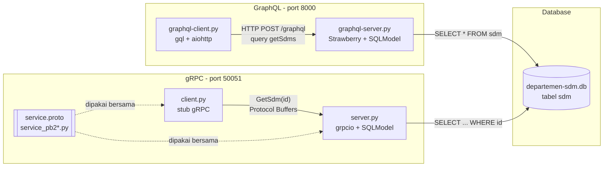
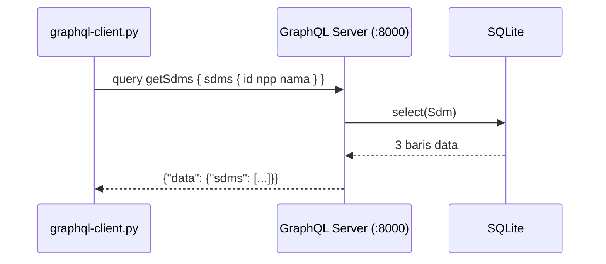
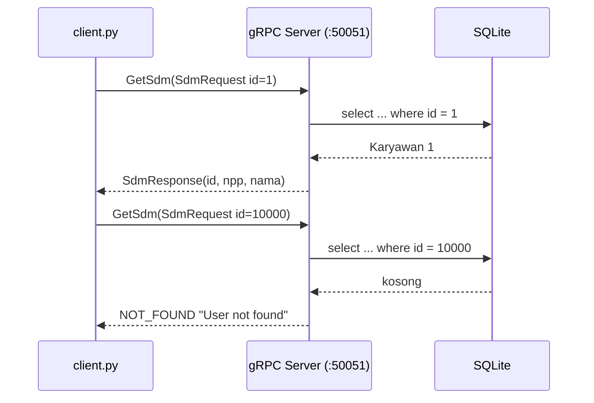
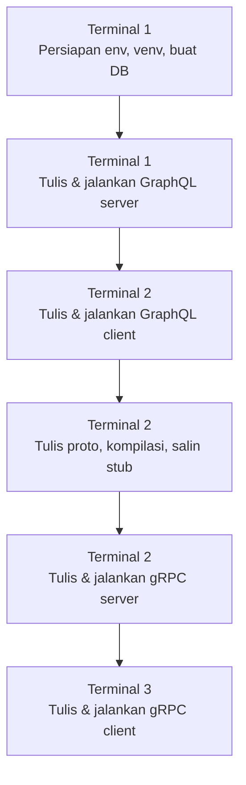
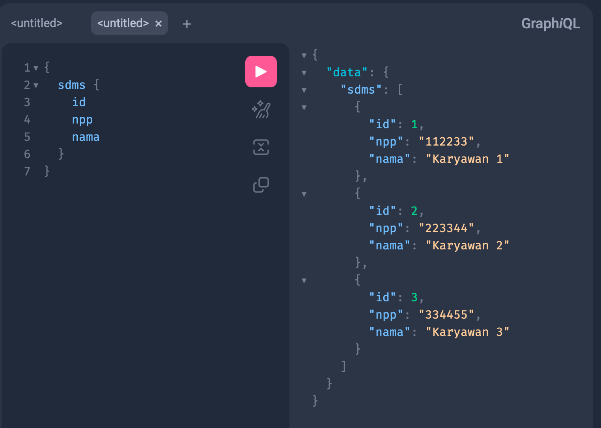
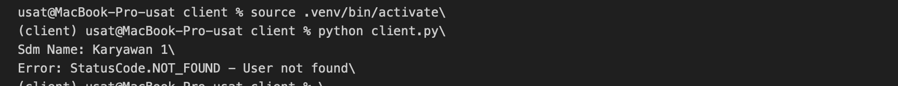

# Praktik Modul 9 — Arsitektur Microservices: GraphQL & gRPC

> **Mata kuliah:** Sistem Terdistribusi dan Terdesentralisasi
> **Nama / NIM / Kelas:** Usat Jalung / 255410017 / IF-1
> **Prodi:** Informatika, Fakultas Teknologi Informasi, Universitas Teknologi Digital Indonesia
> **Lokasi:** `09/terminal-peratik/`

---

## Daftar Isi

1. [Tujuan](#1-tujuan)
2. [Gambaran Arsitektur (Representasi)](#2-gambaran-arsitektur-representasi)
3. [Struktur Folder](#3-struktur-folder)
4. [Isi Folder `terminal-peratik`](#4-isi-folder-terminal-peratik)
5. [Terminal 1 — Persiapan Environment & GraphQL Server](#5-terminal-1--persiapan-environment--graphql-server)
6. [Terminal 2 — GraphQL Client & gRPC Server](#6-terminal-2--graphql-client--grpc-server)
7. [Terminal 3 — gRPC Client](#7-terminal-3--grpc-client)
8. [Bukti Output (Gambar)](#8-bukti-output-gambar)
9. [Perbandingan GraphQL vs gRPC](#9-perbandingan-graphql-vs-grpc)
10. [Perbedaan dengan Modul & Catatan](#10-perbedaan-dengan-modul--catatan)
11. [Cara Menjalankan Ulang (Ringkas)](#11-cara-menjalankan-ulang-ringkas)
12. [Kesimpulan](#12-kesimpulan)

---

## 1. Tujuan

- Memahami arsitektur **microservices**: frontend/client meminta layanan ke backend berupa service.
- Membuat **GraphQL server** (Strawberry) dan mengaksesnya dengan **GraphQL client** (`gql`).
- Membuat **gRPC server** dan **gRPC client** dengan serialisasi **Protocol Buffers**.
- Mengelola environment Python dengan **uv** (`uv venv`, `uv pip install`).
- Memakai database SQLite `departemen-sdm.db` (tabel `sdm`: `id`, `npp`, `nama`).

---

## 2. Gambaran Arsitektur (Representasi)

### 2.1 Alur besar sistem



### 2.2 Urutan pemanggilan GraphQL



### 2.3 Urutan pemanggilan gRPC



### 2.4 Tahapan kerja pada tiga terminal



---

## 3. Struktur Folder

Struktur yang dibangun di terminal (sama dengan yang diminta modul):

```text
~/src/
├── graphql/
│   ├── client/
│   │   ├── graphql-client.py
│   │   ├── .python-version
│   │   ├── requirements.txt      # gql[aiohttp]
│   │   └── .venv/
│   └── server/
│       ├── departemen-sdm.db
│       ├── graphql-server.py
│       ├── .python-version
│       ├── requirements.txt      # strawberry-graphql, uvicorn, sqlmodel
│       └── .venv/
└── grpc/
    ├── client/
    │   ├── client.py
    │   ├── service.proto
    │   ├── service_pb2.py
    │   ├── service_pb2_grpc.py
    │   ├── requirements.txt      # grpcio, grpcio-tools
    │   └── .venv/
    └── server/
        ├── departemen-sdm.db
        ├── server.py
        ├── service.proto
        ├── service_pb2.py
        ├── service_pb2_grpc.py
        ├── requirements.txt      # grpcio, grpcio-tools, sqlmodel
        └── .venv/
```

---

## 4. Isi Folder `terminal-peratik`

| Berkas | Isi | Dibahas di |
|---|---|---|
| `TERMINAL1.rtf` | Persiapan environment, instalasi paket, pembuatan database, GraphQL server | [Bagian 5](#5-terminal-1--persiapan-environment--graphql-server) |
| `TERMINAL2.rtf` | GraphQL client, `service.proto`, kompilasi, gRPC server | [Bagian 6](#6-terminal-2--graphql-client--grpc-server) |
| `TERMINAL3.rtf` | gRPC client | [Bagian 7](#7-terminal-3--grpc-client) |
| `image/peratik0.1.png` | Hasil query di GraphiQL (browser) | [Bagian 8](#8-bukti-output-gambar) |
| `image/peratik0.2.png` | Hasil `python client.py` (gRPC) | [Bagian 8](#8-bukti-output-gambar) |

---

## 5. Terminal 1 — Persiapan Environment & GraphQL Server

### Tahap 5.1 — Membersihkan sisa environment lama

```bash
deactivate 2>/dev/null
cd ~
rm -rf ~/src
rm -f ~/.python-version
```

| Perintah | Penjelasan |
|---|---|
| `deactivate 2>/dev/null` | Menonaktifkan venv yang masih aktif. `2>/dev/null` menyembunyikan pesan error bila tidak ada venv aktif. |
| `rm -rf ~/src` | Menghapus folder `src` lama agar praktik mulai dari kondisi bersih. |
| `rm -f ~/.python-version` | Menghapus pin versi Python global yang tersisa. |

> Sesuai modul: venv yang aktif harus dinonaktifkan (`deactivate`) sebelum berpindah direktori lain.

### Tahap 5.2 — Memeriksa `uv` dan Python

```bash
uv --version
source $HOME/.local/bin/env
uv python install 3.13
uv python list --only-installed
```

**Output (ringkas):**

```text
uv 0.13.10 (e3e7c1eac 2026-11-24 x86_64-apple-darwin)
Python 3.13 is already installed
cpython-3.13.18-macos-x86_64-none   ...
cpython-3.12.16-macos-x86_64-none   ...
cpython-3.9.6-macos-x86_64-none     /usr/bin/python3
```

**Penjelasan:**

- `uv --version` memastikan `uv` terpasang (versi **0.13.10**).
- `source $HOME/.local/bin/env` memuat PATH agar perintah `uv` dikenali di sesi terminal ini.
- `uv python install 3.13` memastikan Python 3.13 tersedia. Hasilnya *already installed*, jadi tidak perlu mengunduh.
- `uv python list --only-installed` menampilkan Python yang terpasang: 3.13.18, 3.12.16, dan 3.9.6 (bawaan macOS).

### Tahap 5.3 — Membuat struktur direktori

```bash
mkdir -p src/graphql/client src/graphql/server src/grpc/client src/grpc/server
```

`-p` membuat seluruh jalur folder sekaligus, termasuk folder induknya. Hasilnya adalah empat direktori kerja seperti pada [Bagian 3](#3-struktur-folder).

> Pada log ada baris `cd \`` yang memunculkan prompt `bquote>`. Itu hanya salah ketik tanda *backtick*, lalu dibatalkan dan diulang dengan `cd ~`. Tidak berpengaruh ke hasil.

### Tahap 5.4 — Membuat `requirements.txt` untuk empat direktori

```bash
cat > src/graphql/server/requirements.txt <<'EOF'
strawberry-graphql[cli]
sqlmodel
EOF

cat > src/graphql/client/requirements.txt <<'EOF'
gql[aiohttp]
EOF

cat > src/grpc/server/requirements.txt <<'EOF'
grpcio
grpcio-tools
sqlmodel
EOF

cat > src/grpc/client/requirements.txt <<'EOF'
grpcio
grpcio-tools
EOF
```

| Direktori | Paket | Fungsi |
|---|---|---|
| `graphql/server` | `strawberry-graphql[cli]` | Membuat server GraphQL dan perintah `strawberry dev`. |
| `graphql/server` | `sqlmodel` | ORM untuk membaca SQLite. |
| `graphql/client` | `gql[aiohttp]` | Library client GraphQL dengan transport HTTP async. |
| `grpc/server` | `grpcio` | Runtime gRPC. |
| `grpc/server` | `grpcio-tools` | Menyediakan `protoc` untuk mengompilasi `.proto`. |
| `grpc/server` | `sqlmodel` | Membaca SQLite. |
| `grpc/client` | `grpcio`, `grpcio-tools` | Runtime gRPC dan kompilator proto. |

### Tahap 5.5 — Membuat venv dan memasang paket (diulang untuk 4 direktori)

Pola yang sama dilakukan di `graphql/server`, `graphql/client`, `grpc/server`, dan `grpc/client`:

```bash
cd ~/src/graphql/server
uv python pin 3.13 --managed-python
uv venv
source .venv/bin/activate
uv pip install --only-binary :all: -r requirements.txt
deactivate
```

| Perintah | Penjelasan |
|---|---|
| `uv python pin 3.13 --managed-python` | Membuat `.python-version` berisi `3.13` dan memakai Python yang dikelola `uv`. |
| `uv venv` | Membuat virtual environment `.venv` di direktori tersebut. |
| `source .venv/bin/activate` | Mengaktifkan venv. Prompt berubah menjadi `(server)` atau `(client)`. |
| `uv pip install --only-binary :all: -r requirements.txt` | Memasang paket dari `requirements.txt`, hanya yang berbentuk *binary wheel* agar tidak perlu kompilasi. |
| `deactivate` | Menonaktifkan venv sebelum pindah ke direktori lain. |

**Hasil instalasi:**

| Direktori | Jumlah paket | Paket utama |
|---|---|---|
| `graphql/server` | 30 | `strawberry-graphql 0.324.0`, `sqlmodel 0.0.50`, `sqlalchemy 2.1.9`, `uvicorn 0.54.0` |
| `graphql/client` | 14 | `gql 4.4.0`, `aiohttp 3.14.5`, `graphql-core 3.3.2` |
| `grpc/server` | 11 | `grpcio 1.85.4`, `grpcio-tools 1.85.4`, `protobuf 7.36.2`, `sqlmodel 0.0.50` |
| `grpc/client` | 5 | `grpcio 1.85.4`, `grpcio-tools 1.85.4`, `protobuf 7.36.2` |

### Tahap 5.6 — Memperbarui `requirements.txt` GraphQL server

```bash
cd ~/src/graphql/server
cat > requirements.txt <<'EOF'
strawberry-graphql
uvicorn
sqlmodel
EOF
source .venv/bin/activate
uv pip install --only-binary :all: -r requirements.txt
deactivate
```

**Output:** `Checked 3 packages in 35ms`

Semua paket sudah terpasang, jadi `uv` hanya memeriksa dan tidak memasang ulang.

### Tahap 5.7 — Menyiapkan database `departemen-sdm.db`

Percobaan menyalin database dari lokasi lain gagal karena `/LOKASI/FILE/` hanyalah contoh path:

```bash
cp /LOKASI/FILE/departemen-sdm.db ~/src/graphql/server/
# cp: /LOKASI/FILE/departemen-sdm.db: No such file or directory
```

Sebagai gantinya, database dibuat ulang dengan Python:

```bash
cd ~/src/graphql/server
source .venv/bin/activate
python - <<'EOF'
import sqlite3
con = sqlite3.connect("departemen-sdm.db")
con.execute("DROP TABLE IF EXISTS sdm")
con.execute("CREATE TABLE sdm (id INTEGER PRIMARY KEY, npp VARCHAR NOT NULL, nama VARCHAR NOT NULL)")
con.executemany("INSERT INTO sdm (npp, nama) VALUES (?, ?)",
    [("112233", "Karyawan 1"), ("223344", "Karyawan 2"), ("334455", "Karyawan 3")])
con.commit()
print(con.execute("SELECT * FROM sdm").fetchall())
EOF
deactivate
cp ~/src/graphql/server/departemen-sdm.db ~/src/grpc/server/
```

**Output:**

```text
[(1, '112233', 'Karyawan 1'), (2, '223344', 'Karyawan 2'), (3, '334455', 'Karyawan 3')]
```

**Penjelasan:**

| Bagian kode | Fungsi |
|---|---|
| `sqlite3.connect("departemen-sdm.db")` | Membuat atau membuka file database SQLite. |
| `DROP TABLE IF EXISTS sdm` | Menghapus tabel lama agar tidak ada data ganda. |
| `CREATE TABLE sdm (...)` | Membuat tabel dengan `id` (primary key, auto-increment), `npp`, dan `nama`. |
| `executemany(INSERT ...)` | Mengisi tiga baris data sekaligus. `id` terisi otomatis 1, 2, 3. |
| `commit()` | Menyimpan perubahan ke file. |
| `SELECT * FROM sdm` | Memverifikasi isi tabel. |
| `cp ... ~/src/grpc/server/` | Database yang sama dipakai oleh gRPC server. |

**Representasi tabel `sdm`:**

| id (PK) | npp | nama |
|---|---|---|
| 1 | 112233 | Karyawan 1 |
| 2 | 223344 | Karyawan 2 |
| 3 | 334455 | Karyawan 3 |

### Tahap 5.8 — Membuat dan menjalankan GraphQL Server

**File `graphql-server.py`:**

```python
import typing
import strawberry
from sqlmodel import Field, Session, SQLModel, create_engine, select


@strawberry.type
class Sdm(SQLModel, table=True):
    id: int | None = Field(default=None, primary_key=True)
    npp: str
    nama: str


engine = create_engine("sqlite:///departemen-sdm.db")

def get_sdms():
    # SQLModel select statement
    with Session(engine) as session:
        statement = select(Sdm)
        results = session.exec(statement).all()
    return results


@strawberry.type
class Query:
    sdms: typing.List[Sdm] = strawberry.field(resolver=get_sdms)


schema = strawberry.Schema(query=Query)
```

**Penjelasan kode:**

| Baris | Penjelasan |
|---|---|
| `@strawberry.type` + `class Sdm(SQLModel, table=True)` | Satu kelas dipakai sebagai **tipe GraphQL** sekaligus **model tabel database**. |
| `id: int \| None = Field(default=None, primary_key=True)` | Kolom `id` sebagai primary key. `None` berarti diisi otomatis oleh database. |
| `npp: str`, `nama: str` | Kolom teks. |
| `create_engine("sqlite:///departemen-sdm.db")` | Koneksi ke file SQLite. Tiga garis miring berarti path relatif. |
| `get_sdms()` | *Resolver*: fungsi yang dipanggil saat client meminta `sdms`. Mengambil seluruh baris tabel. |
| `with Session(engine) as session` | Membuka sesi database dan menutupnya otomatis. |
| `class Query` | Menentukan data apa yang boleh di-*query* client. Di sini hanya field `sdms`. |
| `strawberry.Schema(query=Query)` | Menyusun skema GraphQL yang akan dilayani server. |

**Menjalankan server:**

```bash
source .venv/bin/activate
strawberry dev graphql-server
```

**Output:**

```text
Running strawberry on http://0.0.0.0:8000/graphql
^C
```

`strawberry dev` menjalankan server dengan *auto-reload* di port **8000**. `^C` (Ctrl+C) menandakan server dihentikan setelah pengujian. Selama server aktif, GraphiQL bisa dibuka di `http://localhost:8000/graphql`.

---

## 6. Terminal 2 — GraphQL Client & gRPC Server

### Tahap 6.1 — Membuat dan menjalankan GraphQL Client

```bash
cd ~/src/graphql/client
cat > graphql-client.py <<'EOF'
...
EOF
source .venv/bin/activate
python graphql-client.py
```

**File `graphql-client.py`:**

```python
import asyncio

from gql import Client, gql
from gql.transport.aiohttp import AIOHTTPTransport


async def main():
    # Pilih transport dengan URL endpoint yang ditentukan
    transport = AIOHTTPTransport(url="http://localhost:8000/graphql")

    # Buat GraphQL client memakai transport tersebut
    client = Client(transport=transport)

    # Tulis query GraphQL
    query = gql(
        """
        query getSdms {
          sdms {
            id
            npp
            nama
          }
        }
        """
    )

    # async with membuka koneksi dan menyediakan variabel session
    async with client as session:
        result = await session.execute(query)
        print(result)


asyncio.run(main())
```

**Penjelasan kode:**

| Bagian | Fungsi |
|---|---|
| `AIOHTTPTransport(url=...)` | Menentukan cara client berkomunikasi: HTTP async ke endpoint `/graphql`. |
| `Client(transport=transport)` | Objek client yang memakai transport tadi. |
| `gql("""...""")` | Membungkus teks query agar divalidasi oleh library `gql`. |
| `query getSdms { sdms { id npp nama } }` | Meminta field `id`, `npp`, `nama` dari seluruh data `sdms`. Client **memilih sendiri** field yang diperlukan. |
| `async with client as session` | Membuka koneksi lalu menutupnya otomatis. |
| `await session.execute(query)` | Mengirim query ke server dan menunggu hasil. |
| `asyncio.run(main())` | Menjalankan fungsi async `main`. |

**Output:**

```text
{'sdms': [{'id': 1, 'npp': '112233', 'nama': 'Karyawan 1'},
          {'id': 2, 'npp': '223344', 'nama': 'Karyawan 2'},
          {'id': 3, 'npp': '334455', 'nama': 'Karyawan 3'}]}
```

**Pembahasan:** Client berhasil mengambil tiga baris data. Hasil berupa dictionary Python dengan kunci `sdms` yang sama dengan nama field di query. Jumlah dan isinya sama persis dengan tabel di database, jadi alur *client → server → SQLite → client* berjalan benar. Server GraphQL harus sedang berjalan (Terminal 1), kalau tidak client akan gagal terhubung.

### Tahap 6.2 — Membuat `service.proto`

```bash
cd ~/src/grpc/server
cat > service.proto <<'EOF'
...
EOF
```

**File `service.proto`:**

```protobuf
syntax = "proto3";

package mydb;

message SdmRequest {
  int32 id = 1;
}

message SdmResponse {
  int32 id = 1;
  string npp = 2;
  string nama = 3;
}

service SdmService {
  rpc GetSdm (SdmRequest) returns (SdmResponse);
}
```

| Baris | Penjelasan |
|---|---|
| `syntax = "proto3"` | Memakai Protocol Buffers versi 3. |
| `package mydb` | Namespace agar nama tidak bentrok. |
| `message SdmRequest { int32 id = 1; }` | Format permintaan: hanya berisi `id`. Angka `1` adalah **nomor field** untuk serialisasi biner, bukan nilai data. |
| `message SdmResponse {...}` | Format balasan: `id`, `npp`, `nama`. |
| `service SdmService` | Kumpulan layanan yang disediakan server. |
| `rpc GetSdm (SdmRequest) returns (SdmResponse)` | Satu prosedur jarak jauh: kirim `SdmRequest`, terima `SdmResponse`. |

### Tahap 6.3 — Mengompilasi proto dan menyalinnya ke client

```bash
source .venv/bin/activate
python -m grpc_tools.protoc -I. --python_out=. --grpc_python_out=. service.proto
ls -la service_pb2*
cp service.proto service_pb2.py service_pb2_grpc.py ../client/
```

**Output:**

```text
-rw-r--r--  1 usat  staff  1644 Nov 27 00:41 service_pb2.py
-rw-r--r--  1 usat  staff  3315 Nov 27 00:41 service_pb2_grpc.py
```

| Opsi | Arti |
|---|---|
| `-I.` | Cari file proto di direktori saat ini. |
| `--python_out=.` | Hasilkan `service_pb2.py` (kelas pesan `SdmRequest`, `SdmResponse`). |
| `--grpc_python_out=.` | Hasilkan `service_pb2_grpc.py` (kelas `SdmServiceStub` untuk client dan `SdmServiceServicer` untuk server). |
| `cp ... ../client/` | Menyalin hasil kompilasi ke client, karena menurut modul **proto dan hasil kompilasi server dan client harus sama**. |

> `service_pb2.py` dan `service_pb2_grpc.py` dihasilkan otomatis dan tidak boleh diedit langsung. Kalau ingin mengubah, edit `service.proto` lalu kompilasi ulang.

### Tahap 6.4 — Membuat dan menjalankan gRPC Server

**File `server.py`:**

```python
import grpc
from concurrent import futures
from sqlmodel import Field, Session, SQLModel, create_engine, select

# Stub hasil kompilasi
import service_pb2
import service_pb2_grpc


class Sdm(SQLModel, table=True):
    id: int | None = Field(default=None, primary_key=True)
    npp: str
    nama: str


engine = create_engine("sqlite:///departemen-sdm.db")


class SdmServiceServicer(service_pb2_grpc.SdmServiceServicer):
    def GetSdm(self, request, context):
        with Session(engine) as session:
            statement = select(Sdm).where(Sdm.id == request.id)
            results = session.exec(statement)
            sdm_result = results.first()
            if sdm_result is None:
                context.set_code(grpc.StatusCode.NOT_FOUND)
                context.set_details("User not found")
                return service_pb2.SdmResponse()

            return service_pb2.SdmResponse(
                id = sdm_result.id,
                npp = sdm_result.npp,
                nama = sdm_result.nama,
            )


def serve():
    # Inisialisasi server
    server = grpc.server(futures.ThreadPoolExecutor(max_workers=10))
    service_pb2_grpc.add_SdmServiceServicer_to_server(SdmServiceServicer(), server)

    # Dengarkan di port 50051
    server.add_insecure_port('[::]:50051')
    print("Server started. Listening on port 50051...")

    server.start()
    server.wait_for_termination()


if __name__ == '__main__':
    serve()
```

**Penjelasan kode:**

| Bagian | Fungsi |
|---|---|
| `class Sdm(SQLModel, table=True)` | Model tabel `sdm` (tanpa `@strawberry.type` karena ini bukan GraphQL). |
| `class SdmServiceServicer(...)` | Implementasi layanan. Nama method `GetSdm` harus sama dengan `rpc` di proto. |
| `select(Sdm).where(Sdm.id == request.id)` | Mencari satu baris berdasarkan `id` dari permintaan client. |
| `results.first()` | Mengambil hasil pertama, atau `None` bila tidak ada. |
| `context.set_code(NOT_FOUND)` + `set_details(...)` | Bila data tidak ada, server mengirim kode error gRPC `NOT_FOUND` beserta pesannya. |
| `service_pb2.SdmResponse(id=..., npp=..., nama=...)` | Membungkus data ke format Protocol Buffers untuk dikirim. |
| `grpc.server(ThreadPoolExecutor(max_workers=10))` | Server dengan 10 *thread* pekerja untuk melayani permintaan paralel. |
| `add_SdmServiceServicer_to_server(...)` | Mendaftarkan layanan ke server. |
| `add_insecure_port('[::]:50051')` | Mendengarkan di port 50051 tanpa TLS (cukup untuk praktik). |
| `wait_for_termination()` | Server tetap hidup sampai dihentikan. |

**Menjalankan:**

```bash
source .venv/bin/activate
python server.py
```

**Output:**

```text
Server started. Listening on port 50051...
^C
```

Server sudah aktif dan menunggu permintaan dari client (Terminal 3). `^C` menghasilkan *traceback* karena proses diputus paksa dengan Ctrl+C. Ini normal saat server dihentikan dan **bukan error program**.

---

## 7. Terminal 3 — gRPC Client

```bash
cd ~/src/grpc/client
cat > client.py <<'EOF'
...
EOF
source .venv/bin/activate
python client.py
```

**File `client.py`:**

```python
import grpc
import service_pb2
import service_pb2_grpc


def run_client():
    # Buat koneksi (channel) ke server
    with grpc.insecure_channel('localhost:50051') as channel:
        # Buat stub (client)
        stub = service_pb2_grpc.SdmServiceStub(channel)

        # Request dengan id yang ada
        request = service_pb2.SdmRequest(id=1)

        try:
            response = stub.GetSdm(request)
            print(f"Sdm Name: {response.nama}")
        except grpc.RpcError as e:
            print(f"Error: {e.code()} - {e.details()}")

        # Request dengan id yang tidak ada
        request_not_found = service_pb2.SdmRequest(id=10000)

        try:
            response = stub.GetSdm(request_not_found)
            print(f"Sdm Name: {response.nama}")
        except grpc.RpcError as e:
            print(f"Error: {e.code()} - {e.details()}")


if __name__ == '__main__':
    run_client()
```

**Penjelasan kode:**

| Bagian | Fungsi |
|---|---|
| `grpc.insecure_channel('localhost:50051')` | Membuka saluran ke server gRPC. Port harus sama dengan server. |
| `SdmServiceStub(channel)` | *Stub*: objek perantara. Memanggil `stub.GetSdm()` terasa seperti memanggil fungsi lokal padahal dikirim lewat jaringan. |
| `SdmRequest(id=1)` | Permintaan dengan id yang **ada**. |
| `SdmRequest(id=10000)` | Permintaan dengan id yang **tidak ada**, untuk menguji penanganan error. |
| `except grpc.RpcError as e` | Menangkap error dari server dan menampilkan `e.code()` serta `e.details()`. |

**Output:**

```text
Sdm Name: Karyawan 1
Error: StatusCode.NOT_FOUND - User not found
```

**Pembahasan:**

| Permintaan | Hasil | Arti |
|---|---|---|
| `id=1` | `Sdm Name: Karyawan 1` | Data ditemukan, server mengembalikan `SdmResponse`, client mencetak field `nama`. |
| `id=10000` | `Error: StatusCode.NOT_FOUND - User not found` | Data tidak ada, server mengirim status `NOT_FOUND`, dan client menangkapnya lewat `RpcError`. |

Keduanya sesuai dengan hasil yang dicontohkan di modul. Ini membuktikan server menangani dua kondisi: **sukses** dan **gagal terkendali**.

---

## 8. Bukti Output (Gambar)

### 8.1 GraphiQL — hasil query `sdms`



**Penjelasan:** Panel kiri berisi query:

```graphql
{
  sdms {
    id
    npp
    nama
  }
}
```

Panel kanan menampilkan hasil JSON: objek `data` berisi array `sdms` dengan tiga data (`Karyawan 1` sampai `Karyawan 3`). Tombol merah muda (▶) menjalankan query, bisa juga dengan `Ctrl+Enter`. Hasil ini sama dengan output `graphql-client.py`, hanya dilihat lewat browser.

### 8.2 Terminal — hasil gRPC client



**Penjelasan:** Tangkapan layar menunjukkan perintah `source .venv/bin/activate` lalu `python client.py` di direktori `client` (prompt `(client)`), dengan dua baris hasil: data ditemukan (`Karyawan 1`) dan data tidak ditemukan (`NOT_FOUND`).

---

## 9. Perbandingan GraphQL vs gRPC

| Aspek | GraphQL (praktik ini) | gRPC (praktik ini) |
|---|---|---|
| Library server | Strawberry | grpcio |
| Library client | gql | grpcio (stub) |
| Port | 8000 | 50051 |
| Protokol | HTTP, endpoint `/graphql` | HTTP/2 |
| Format data | JSON | Protocol Buffers (biner) |
| Skema / kontrak | Kelas Python (`@strawberry.type`) | File `service.proto` |
| Langkah kompilasi | Tidak ada | Wajib (`grpc_tools.protoc`) |
| Cara meminta data | Client memilih field sendiri | Memanggil method yang sudah didefinisikan |
| Data yang diambil di praktik | **Semua** baris (`sdms`) | **Satu** baris berdasarkan `id` (`GetSdm`) |
| Penanganan data tidak ada | Mengembalikan list kosong | Status `NOT_FOUND` |
| Cara uji | GraphiQL di browser | Harus lewat client |

---

## 10. Perbedaan dengan Modul & Catatan

| Hal | Di modul | Di praktik terminal | Dampak |
|---|---|---|---|
| Versi Python | 3.14.5 (Linux) | 3.13 (macOS) | Tidak berpengaruh ke hasil. |
| Cara pin Python | `uv python pin cpython-3.14.5-...` | `uv python pin 3.13 --managed-python` | Tujuannya sama, yaitu mengunci versi Python per direktori. |
| Nama file GraphQL server | `graphql-server.py` | `graphql-server.py` | Dijalankan dengan `strawberry dev graphql-server`. |
| Ukuran `service_pb2_grpc.py` | 3339 byte | 3315 byte | Selisih karena versi `grpcio-tools` berbeda. Isi fungsional sama. |
| Database | Dari pertemuan sebelumnya | Dibuat ulang dengan Python | Data identik (3 karyawan). |
| Perintah aktivasi venv | `source .venv/bin/activate` | Sama | Pada modul tertulis typo `.venv/bin/ac/tivate`. |

**Catatan penting:**

- **Urutan menjalankan:** server harus aktif lebih dulu, baru client dijalankan. Karena itu dipakai tiga terminal terpisah.
- **Satu venv per direktori:** `deactivate` dulu sebelum mengaktifkan venv direktori lain.
- **Stub harus sama:** setiap `service.proto` diubah, kompilasi ulang lalu salin lagi ke client.
- **Jika `NOT_FOUND` tidak muncul** pada server sendiri, periksa apakah pada cabang `if sdm_result is None` yang dipakai adalah `service_pb2.SdmResponse()`. Di modul tertulis `user_pb2`, yang tidak ada di proyek ini.

---

## 11. Cara Menjalankan Ulang (Ringkas)

```bash
# --- Terminal A: GraphQL server ---
cd ~/src/graphql/server
source .venv/bin/activate
strawberry dev graphql-server        # buka http://localhost:8000/graphql

# --- Terminal B: GraphQL client ---
cd ~/src/graphql/client
source .venv/bin/activate
python graphql-client.py

# --- Terminal C: gRPC server ---
cd ~/src/grpc/server
source .venv/bin/activate
python server.py

# --- Terminal D: gRPC client ---
cd ~/src/grpc/client
source .venv/bin/activate
python client.py
```

---

## 12. Kesimpulan

1. Environment untuk empat direktori (GraphQL server/client dan gRPC server/client) berhasil dibuat dengan `uv`, masing-masing dengan venv sendiri.
2. **GraphQL** berhasil menyajikan seluruh data tabel `sdm`, diuji lewat GraphiQL dan `graphql-client.py`. Client menentukan sendiri field yang diambil.
3. **gRPC** berhasil menyajikan satu data berdasarkan `id` memakai Protocol Buffers, termasuk penanganan error `NOT_FOUND`.
4. Kedua pendekatan membaca database SQLite yang sama, tetapi berbeda dalam protokol, format data, dan alur kerja (gRPC wajib kompilasi proto, GraphQL tidak).
5. Hasil praktik sesuai dengan output contoh pada modul.
